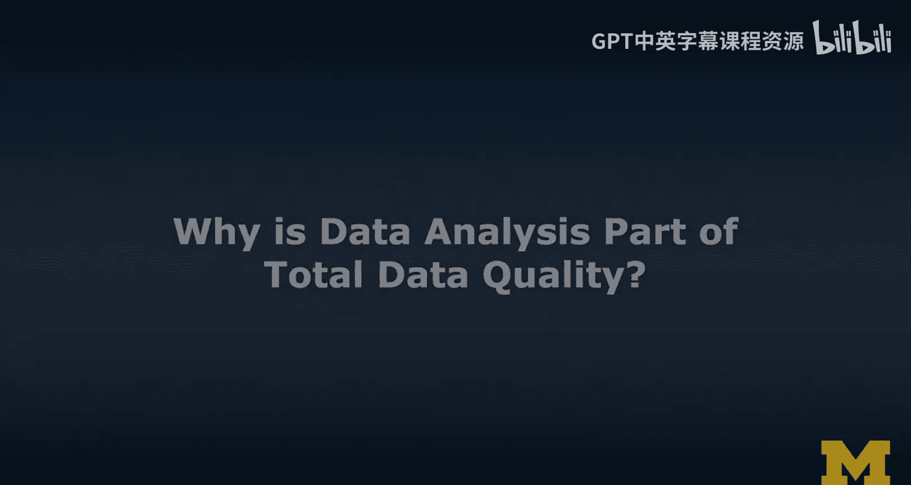
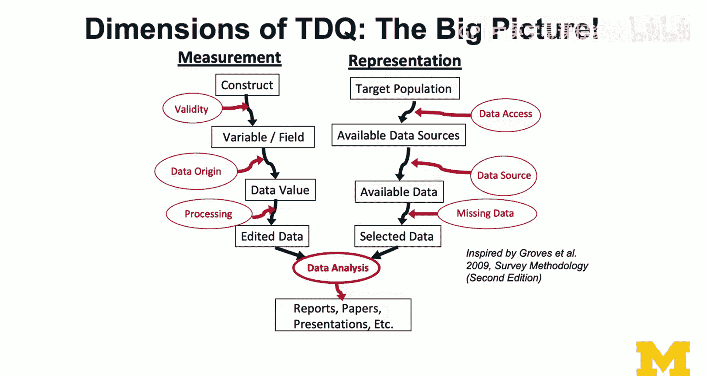
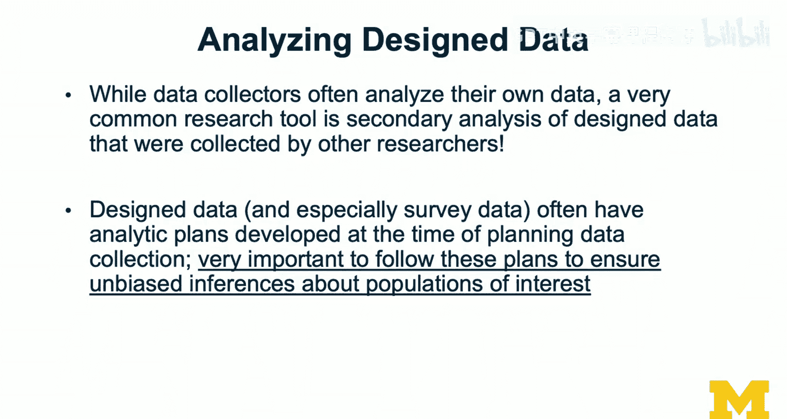
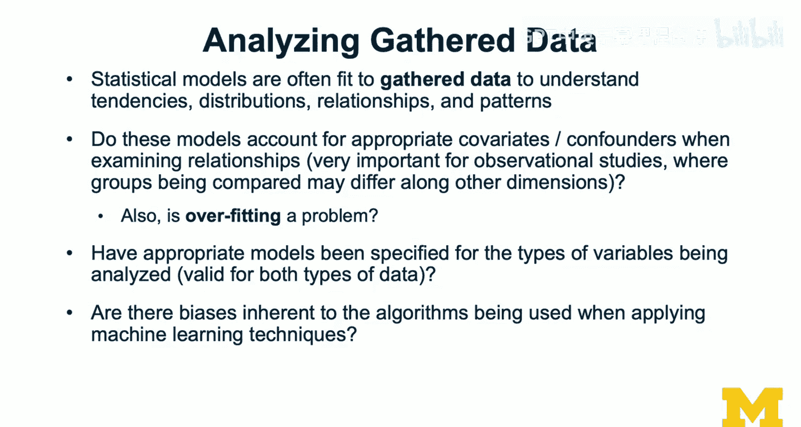
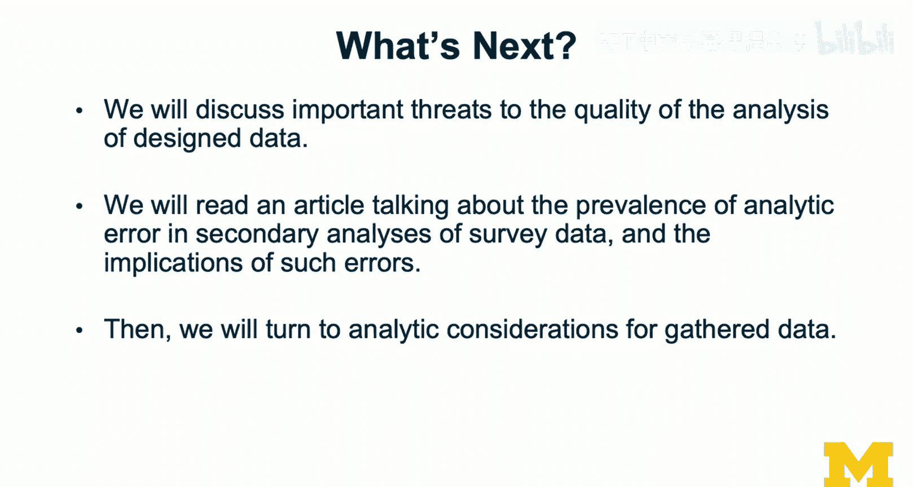

# 密歇根大学《总体数据质量（框架、度量、设计策略）total data quality》 p39 38_为何数据分析属于全面数据质量范畴.zh_en -BV1Jn4y1X7uS_p39-

Okay， hello everyone， now we're shifting our attention to data analysis in terms of the overall total data quality framework。

And with this lecture， we're going to answer the question。

 why do we include data analysis as part of the overall total data quality framework？

So let's revisit that framework thus far in terms of the different measurement dimensions we've been talking about validity。

 data origin， and then data processing， and now we're to the point where we've produced some edited and clean data and we're ready to actually analyze the data for the purpose of generating reports and papers and presentations and so forth。

The data analysis component of the total data quality framework is when we get to the stage。

 we've taken care with all the different representation dimensions， data access， data source。

 missing data， we've been very careful about all the measurement dimensions。

 and ultimately we've produced a data set that's ready for analysis。

What we have to be very careful about is that we're not negating all those prior efforts to optimize total data quality on both the measurement and the representation sides by making mistakes at the data analysis stage。

 that's absolutely critical because ultimately this is what the public and the people reading about our research are going to consume are the estimates and the findings that we produce from analyzing the data。

 So the total data quality framework says we have to be very careful about all the different measurement representation dimensions that lead to the final data set that we're analyzing。

 but we don't want to make mistakes at the data analysis stage that again。

 would mean that all of those prior efforts on these different dimensions were for n because we're producing incorrect estimates that don't correctly describe the key themes in the data。

 So we're including data analysis as a key part of this total data quality framework。

 making sure that we perform high quality analysis of the data so that were respect。

All those prior steps in terms of measurement and representation dimensions。

 and we're maintaining a high quality process to create the reports， the papers。

 the presentations that we're ultimately interested in。

So what do we mean by high quality data analysis So we're going to be focusing now on the quality of the data analysis data analysis does appear last in the overall total data quality framework。

 and it's usually that last step before the research results are released to the public。

 the stakeholders， the individuals who are going to be reading and interpreting the results of our data analysis So a failure to analyze the data using appropriate methods can again negate all the prior work that we did to maximize quality across these different dimensions of the total data quality framework。

 the measurement dimensions and the representation dimensions we've tried to maximize quality along all those different dimensions we've produced a clean data set Now the person analyzing the data also has to be careful to make sure that they do a high quality analysis and we maintain that high level of quality leading to the ultimate reports that we're producing。

So let's think about design data first when we analyze design data maybe coming from a survey。

 data collectors often analyze their own data and this is a very common research tool。

 it's called secondary analysis of design data that were collected by other researchers so while data collectors will often analyze their own data oftentimes researchers who don't have the resources to collect their own data will perform secondary analysis of publicly available data sets or data sets that have been shared with the research community。

 This is called secondary analysis because the people analyzing the data were not the primary researchers who collected the data in the first place and because of the secondary analysis。

 the people who are actually analyzing the data might not be as familiar with the intricacies of the data again。

 all the measurement dimensions， all the representation dimensions as the people who ultimately collected the data so secondary analysts have to be very careful。

When they do the analysis that they're doing a correct analysis that respects all those prior steps that were taken in terms of the total data quality framework。

So design data and especially survey data often have analytic plans that are developed at the time of planning the data collection。

 So the primary individuals who are collecting the data will say， okay。

 for somebody who wants to analyze these data， here are the steps that need to be followed。

 given the steps that we took for representation， given the steps that we took for measurement。

 here's how the data should actually be analyzed to maintain that high level of quality。

 so it's very important to follow these plans， especially if you're a secondary analyst to ensure that you're generating unbiased inferences about the populations of interest via your analysis。

So for example， survey data， as we've mentioned a couple times。

 often include these weights and these weights enable one to map a sample back to a population。

 especially if there was oversampling of certain subgroups and the survey data also include other codes that describe features of the sample design going back to our representation dimensions in terms of data source and data access what were the features of the sample design that was used to actually select the individuals who responded to our survey So if one is doing secondary analyses of the cleaned and the process survey data set that secondary analyst has to make sure that the analyses that they're performing account for these relevant design features that describe that overall representation process and these include the population weights and the sample design codes。

 so we're going to see many examples of how exactly to do this。

 but it's very important that the secondary analysts be careful about these steps and account for these design features。

In their analysis， again， respecting that representation dimension and the steps that were taken there。

Furthermore， have appropriate statistical models been specified for the types of variables that the secondary analyst is analyzing。

 we're also going to see examples of how to pay attention to this later on in the courses。

Now what about gathered data if we're analyzing gathered data where the statistical models that are often fit to gather data are used to understand tendencies。

 distributions， relationships and patterns so when we're thinking about the models that we're ultimately using to analyze gathered data。

 the question is do these models account for appropriate covariates or confounders when when we're using these models to examine relationships this can be very important for observational studies where the groups that we might be comparing in an observational study may differ along other dimensions also is overfitting of statistical models of problems。

 so we're trying to find the perfect model for a given set of gathered data and the model that we ultimately decide on to describe the relationships between variables in that given set of gathered data may be perfect for that particular data set。

But when we try to generalize that model to other data sets。

 it doesn't work well because we've spent too much time focusing on fitting the perfect model to that one data set rather than a general model that will apply to other data sources。

Have appropriate models been specified for the types of variables that were being analyzed。

 this is really an issue that's important for both types of data sets that we're talking about in the course。

 gather data and design data， but have the models that we've selected been carefully examined and are they appropriate for the types of variables that we're working with？

And then finally， specifically when we think about machine learning。

 are there biases inherent to the algorithms that we're using when applying different machine learning techniques and we're going to see several examples of this issue as well。

 which is very important when it comes to analyzing gathered data using machine learning tools。

Okay， so we've talked about why analysis is an important part of the total data quality framework so where are we going from here we're going to discuss important threats to the quality of the analysis of design data。

 we're then going to look at an article that talks about the prevalence of analytic error in the secondary analyses of survey data and that article will talk about the implications of such errors then we're going to turn to analytic considerations for gathered data Okay thank you。

