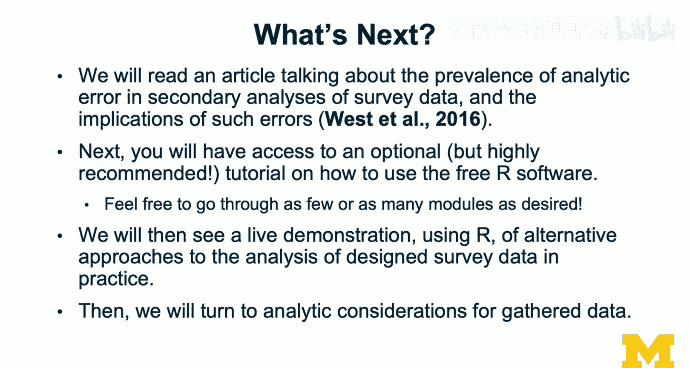

# 密歇根大学《总体数据质量（框架、度量、设计策略）total data quality》 p40 39_设计型数据分析质量威胁因素.zh_en -BV1Jn4y1X7uS_p40-

Okay， hellello everyone， now that we've talked about the role of data analysis in the total data quality framework。

 we're going to talk about some threats to the quality of data analysis for design data specifically。

 so we've talked about why data analysis is thought of as an important dimension of the overall total data quality framework and in this particular lecture。

 we're going to think about how data analysis procedures can go wrong and how that can impact the quality of the overall analysis performed and like we talked about when defining the role of data analysis in our overall total data quality framework。

 poorly perform data analysis can negate all the prior efforts to improve quality along the earlier dimensions that we've been discussing so it's critical to think about threats to the quality of data analysis and what we can do to make sure that we're minimizing those threats when we analyze design data。

So back to our big picture， we've talked about these measurement and representation dimensions of the total data quality framework and at the end of coming up with our survey measures。

 collecting the survey measures making sure that we have our target population in mind。

 we've selected a good sample from that target population， we've dealt with missing data。

 we've process the data， remember everything combines them and at the stage where we have a clean data set where we've minimized all these other potential threats to total data quality。

 we still have to analyze the data to produce our reports， our papers， our presentations。

 so we want to make sure that we've maintained the same level of quality in terms of the overall analysis that we perform again so that we can make sure that we're not negating the efforts to maximize quality at all of these earlier dimensions like validity access。

 data origin data source， processing missing data。Oftentimes we take significant steps to make sure that we maximize the quality of the data collected along all those other dimensions。

 and we want to make sure to do the same thing when we get to the data analysis phase。

So let's talk about threats that concern data analysis for design data， a major threat。

 especially when working with analyses of survey data。

 is a failure to use survey weights and sampling error codes in your data analysis。

And these survey weights and corresponding sampling error codes that are available in survey datas。

 especially large national samples， from widespread populations。

 are designed to correct for selection bias and that could be due to data missingness or it could arise from sampling when there's a selected sample for survey measurement。

 these also correct for non-response。 So survey weights play a very important role to make sure that when somebody analyzes the survey data。

 those weights are used to offset potential biases due to sampling and nonresponse。

 So we select a sample from a population and those weights typically represent probabilities of selection into that sample and if certain populations are oversampled or certain subgroups are less likely to respond to the survey。

 there could be bias in our survey estimates。 and the weights are a tool that's designed to correct for that type of selection bias that can come from sampling and nonresponse。

 So it's very important that we use those survey weights which。

arere attached to our survey respondents to make sure that our weighted survey estimates correct for those sources of selection bias。

We also want to make sure that the standard errors of the survey estimates that we compute。

 which give us a sense of the variability in our estimates actually reflect the expected sampling variability under a given sample design that was used to select the sample from which we're collecting the survey data and in terms of making sure that our standard errors of the estimates are correctly computed we want to make sure to account for those survey weights and also for the sampling error codes that are available in survey datas。

 So a failure to use these survey weights and sampling error codes in our data analysis can severely affect the inferences that we make about populations of interest based on our survey data So we're going to see a reading of a study that I did with some colleagues in 2016 that looks at the prevalence of analytic error in analyses of national surveys and shows what the implications of these analytic errors can be for the estimates that we make and the inferences that we generate based on analysis。

survey dataSo that'll be an important part of the reading for this particular week。

Additional threats concerning data analysis for design data include poor specification of statistical models for the data that have been collected and there's a couple articles here。

 one by Danny Ffferman in 2011 and then this hearing at all book in 2017 talks about appropriate approaches to the analysis of survey data so whenever we're fitting models to survey data in our statistical analysis。

 we want to make sure that we do a very good job of specifying those models。

 including appropriate predictors of the dependent variables that we might be interested in。

 making sure that we're capturing relationships correctly when we fit models to the data。

 very important to make sure that our statistical models are well specified when analyzing the data。

In addition， a failure to use appropriate survey weights when fitting multilevel models to the survey data can also cause problems。

 so this was an important paper by Danny Feffferman and his colleagues in 1998 that shows how survey weights are needed for both the units of analysis at level1 of a multi-level survey data and level1 typically refers to the survey respondents in a data and we also need survey weights for the larger clusters that are often sampled in survey data sets at level 2 and above for example。

 sampled neighborhoods analysts fitting multilevel models to survey data are often interested in the variability across different neighborhoods or different geographic areas or different schools in terms of the survey responses that are reported by the different survey respondents and so they fit multilevel models to try to estimate that variability and when we fit these multilevel models to survey data。

 we need to make sure that we're using weights that are available for both the survey respondents and then these larger。

Clus that are often randomly sampled to identify potential responsesents to sample。

 which are of research interest again， neighborhoods when researchers are interested in between neighborhood variants。

 those are often of research interest， and we need to make sure that the multilevel models are correctly accounting for weights at both of these levels。

 So the Frement article talks a little bit more about that that issue。

So here' are some examples of what can happen in terms of data analysis threats for designed data collections again。

 the article and the research that I conducted in 2016 with my colleagues shows that apparent analytic errors in secondary analyses of survey data are seemingly widespread so by secondary analyses we're talking about survey data sets that have already been collected and researchers are downloading these data sets from public repositories usually online and then doing their own analyses kind of secondhand of those survey data so there's a gap between the individuals who collected the data and then the researchers who are actually analyzing the data that's what we mean by secondary analyses and it's very important in those secondary analyses that all these features of survey data like the survey weights。

 these sampling error codes are correctly accounted for when those analyses are conducted and what we found is in secondary analyses of survey data these types of analytic errors are failing to account for these features seems to be。

Pretty widespread， unfortunately。So here's an extreme example from that research that came up from the 2010 National Survey of college graduates。

 so a designed national data collection。So if you look at estimating the percentage of individuals whose primary job is in science and engineering。

 and this is a key indicator in the United States and elsewhere。

 what fraction of the workforce is working on in technical fields， such as science and engineering。

 if you analyze the data from the 2010 National Sury of College graduates。

 and you fully account for those final survey weights for each of the respondents， which， again。

 correct for sample selection bias and non-response bias。

 and you also account for the stratified sampling that might have been done。

 cluster sampling that was selected within this particular survey。

 If you fully account for all those design features in estimation。

 The estimated percentage of the population who has a primary job in science and engineering is about 30。

4%。 and then you see a standard error of that estimate of about 03。Okay。

 so that's the correct approach to the analysis。 If an analyst was to account for the final survey weights only and not account for the sample design features that include stratification and cluster sampling。

 they would arrive at the exact same weighted point estimate。

 So they'd still make the same conclusion， in terms of the estimated fraction of the population with a primary job in science and engineering。

 However， the standard error that they that they incorrectly compute。

 failing to account for the other sample design features would be too large because they're not getting any gains in terms of the efficiency of this estimate or the precision of this estimate from the stratified sampling that was actually conducted。

 So in sample design， if we stratify， we expect our estimate to be more precise。

 And if we fail to account for that design feature， we see that the standard error here gets larger。

 and we want to have the most efficient estimate possible。Now。

 here's unfortunately what happens a lot of the time in these secondary analyses。

 the data analyst will completely ignore all the sample design features and then includes the final survey weights and these other design codes with the national survey of college graduate data or college graduates data。

 if one were to completely ignore the sample design features。

 the estimated percentage of the population with a primary job in science and engineering would be 55%。

And look how different that estimate would be from the correct estimate that fully adjusts for the survey weights and all the design features Now。

 why is that happening in this particular case for the national survey of college graduates of graduates。

 the sample is selected from a data source which allows the researchers to identify whether people are working in science and engineering。

 and specifically there's oversampling of people from this other data source of individuals who are working in those particular areas So that oversampling is offset by these survey weights that are used to compute correct estimates of the overall population and if we fail to account for the weights that correct for that oversampling of individuals working in this kind of area you can see the expected result。

 the estimated fraction of the population that works in this area is much higher than the true fraction that we estimate from using the weights So the weights again。

 correct for that kind of oversampling。We oversample in that case。 Well。

 researchers are interested in studying the characteristics of people who work in science and engineering。

 so the people who designed this survey wanted that sample to have a disproportionate number of people whose jobs are in science and engineering and if we fail to correct for that oversampling of that particular subgroup that leads to the kinds of differences in estimates that you see here So using the weights and analysis critically important in this little example and unfortunately。

 this type of analytic error happens a lot more than we would like to see in analyses because people aren't familiar with the need to account for these survey design features in estimation。

Some additional examples of threats， my colleague Joe Saaxaw and I found that analytic errors like we've been talking about also seem to be quite prevalent in analyses of establishment survey data。

 so not where we're surveying people but rather we're collecting information about establishments like hospitals or businesses or clinics where if you don't do the analysis correctly again and account for the sample design features you arrive at similar types of incorrect inferences based on the incorrect analyses Furthermoremore。

 this additional article here by care at all， they found that analytic errors also seem to be very common in medical fields。

 so when people are analyzing health survey data and as surveys of hospital inpatients of failure to account for the design features again。

 can lead to incorrect estimates and incorrect estimates of standard errors。

Cor and Gerbarard in their 1999 bookAlysis of Health Surveys。

 they illustrate the importance of correct model specification and careful consideration of design features when using real design survey data。

 so this is a very common issue and it's very important the data analysis stage when you're working with survey data to read the documentation for the survey data and see if there are design features that need to be accounted for。

So what's next in our discussion of the importance of data analysis in the total data quality framework。

 we're going to take a look at that article to which I was referring in this lecture that talks about the prevalence of analytic error in secondary analyses of survey data and again discusses the implications of such errors so you'll see that article among the materials for this week。

Next we're going to have access to an optional but highly recommended tutorial on how to use the free R software for data analysis and data management and you're welcome to go through as few or as many modules of this R tutorial as you would like the purpose of this tutorial is just to give you exposure to how to download open up and then use the R software for reading and data。

 analyzing data and other related activities so you're welcome to go through as many of these modules as you would like this is an optional tutorial but it will help you for the later examples that we go through of how to analyze data using the R software。

We're then going to see a live demonstration using the R software in our studio specifically of alternative approaches that one could take to the analysis of design survey data and practice。

And then we'll turn to analytic considerations for gathered data and important things to keep in mind to maximize the quality of the analysis of gathered data。

 Okay， so thank you。

