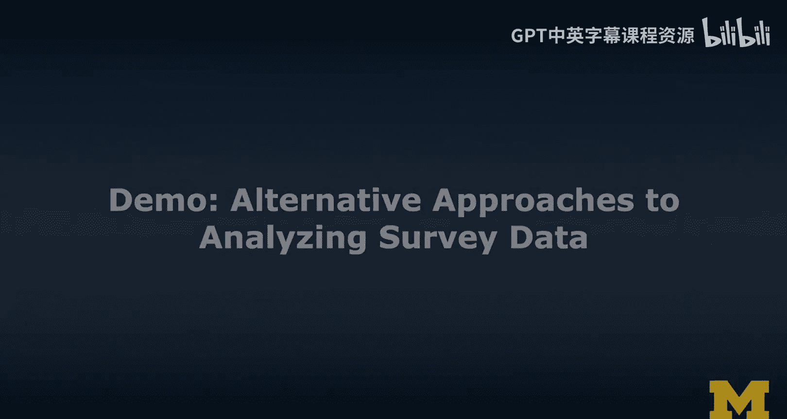
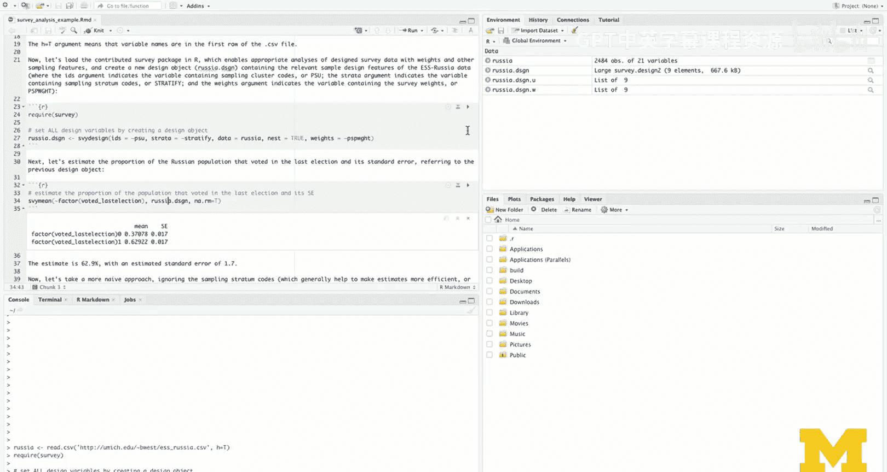
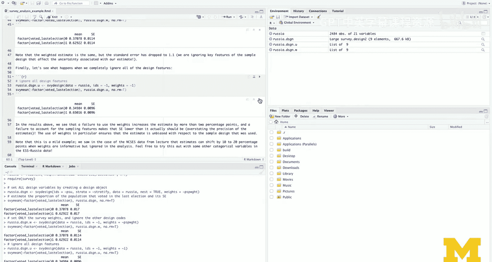

# 密歇根大学《总体数据质量（框架、度量、设计策略）total data quality》 p41 40_演示：调查数据分析的替代方法.zh_en -BV1Jn4y1X7uS_p41-

Okay， hellello everyone， In this demonstration， what we're going to do is present a live example of analyzing design survey data using the our studio software and in this example。

 what we're going illustrate is different approaches that one could take to conducting analysis of publicly available survey data selected from a national population and in this case we're going to be looking at data from the European social survey and we're going to look at some simple hypothetical descriptive analyses just to see what can happen when conducting these kinds of analyses of survey data So the key messages here remembering what we talked about in the lectures is when you download existing survey data to conduct secondary analyses。

 make sure that you're wary of essential design features of that data collection including the sample design and waiting features and so forth when you're preparing for the analysis and then in statistical software like ourt you can。

Look at procedures that allow you to take those design features into account。

 execute those procedures， and make sure that you're generating correct inferences based on the design survey data。

Okay， so we're going to turn to the Rt software here and within the R studio software。

 we have opened the R Markdown file that was available in your materials for this week。

 so the name of this R markdown file is Sur analysis example RMD。And within the R studio software。

 I opened that R markdown file。 So you see that here open in the program editor window within ourt。

 So this R markdown file includes our code and also some description of what's happening in terms of the R code that we're using。

 So that's a nice thing about the R markeddown environment within ourt is you can mix regular text that can be helpful for colleagues who are working on a research project to provide more descriptive information with actual R code that can be executed to conduct analyses。

 conduct data management， whatever the case may be。 So you see this mix of regular text。

 and then these chunks of R code that are indicated in these gray boxes here where you see what look like apostropphhees within R and curly brackets that indicates a set of R code nested within the larger set of texts that describes this R markdown file。

So what we're going to do is we're going to use the Russia data set from a recent round of the European Social Survey。

 again， perform some hypothetical analyses， and look at these alternative approaches that one could take when analyzing design data。

Okay so the first thing that we're going do the first set of working our code。

 we're going to read this European Social Survey Russia data set into R and create an object that contains that particular data Now the data are stored online in a CSV file we're going to read that CSv file into an R object and then work with that R object further So that's what this chunk of our code is doing here we're using this function called read do CSv we're reading in this data file from my website H equals T means that the first row of that CSv file has variable names available for all the variables in that data file and we're saving that result in this data frame object called Russia So within an R markdown file I can click on this little green play button to run that current chunk of our code so I'm going to go ahead and do that right now and then in the console that you see below the code I see that I executed that command and there were no errors or no problem。

bleWith creating that design object。 So now I have this Russia data frame object that exists。

 and I can proceed within the R markdown file。 The next thing that we're going to do is load the contributed survey package in R and in the R environment。

 there are a variety of packages that people can write that you can install and then load within the R studio environment that enable different kinds of analyses。

And in particular， the survey package in R lets you perform appropriate analyses of survey data sets that recognize complex sample design features。

 again， like the weights and the stratum codes and the cluster codes that describe the sample design that was used in the case of the ESS。

Okay， so what we're going to do is load that contributed survey package in R so that all the functions in that package are available。

 and then we're going to create a new design object that contains the relevant sample design features of the ESS Russia data so in this particular design specification。

 the IDs argument that you see here， this indicates the variable that contains sampling cluster codes based on the sample design and the name of that variable in the ESS Russia data set is PSU。

The Strrata argument to the SBY design function indicates the name of the variable in the ESS data that contains the stratification codes that were used for the sample design。

 and as we talked about in lecture， stratification of a sample can help to improve the efficiency of your survey estimates So we indicate the variable contains the stratum codes as well。

 name of that variable again is stratify then we have a weights argument that indicates the name of the variable in the ESS data that contains the final survey weights for the survey of respondents。

 And remember these weights account for different probabilities of being selected in the sample differential non-response across different subgroups and they're designed to make sure that your weighted survey estimates are unbiased with respect to the overall sample design。

 So the name of that variable in the ESS data is called PSP WGHT and more generally when you download a survey data online。

 you can read the documentation for that survey data to identify the name。

Of these different variables in the data set that you need to account for in these kinds of analyses。

 the data argument is the data frame object that I want to use for the analysis。

And then the argument Nest equals true in CAs here says that the sampling clusters are nested within the sampling strata in terms of our overall sample design。

 and that's usually the case in these kinds of national survey data sets。

OkaySo I'm going to run them this chunk of our code to load the survey package and then run that survey design function to create my design object called Russia do design that contains all of this important design information So I'll go ahead and execute this code Now I have that Russia do design object available for further analysis so the next thing we're going to do is estimate the proportion of the Russian population that voted in the last election along with its standard error and in this analysis we're going to refer to that previous design object that we just createdrus。

dsgm and again， this is important because that design object communicates the sample design features that are important to account for in our weighted estimation and our variance estimation so that the sample design features are reflected in the estimates that we're ultimately computing in our analysis So let's look at how we would do that we're going to use the survey mean function which。

A function for computing estimates of means and proportions。 And in that survey mean function。

 the first argument， we're using a tillde and then specifying that this variable called voted last election。

 which is a variable in the ESS Russia data set is a factor variable。

 That just means it's a categorical variable。 So that factor function declares a variable to be categorical。

 And again， we start that with a tillde here。So that's the variable that we're analyzing Here's that design object that we just created rus。

dsGM。 This is the design object that again communicates the essential design information of the ESS sample design for this particular analysis。

 the weights， the stratum codes and the cluster codes to make sure that we're doing this analysis correctly and reflecting those sample design features。

The third argument says NA。rm equals capital T， that just means remove missing values okay so if there are missing values on that particular variable that came from the CSV file。

 we're just going to ignore those for now for this initial analysis。Okay。

 so let's go ahead and execute this analysis function fully accounting for the sample design features。

So when I run that current chunk down in my console also you see within the our markdown file。

 you see the weighted estimates of these population quantities。

 so our weighted estimate of the proportion of the Russian population that voted in the last election is about 62。

9% or 0。692 I'm sorry 0。629 if we interpret this as a proportion so we see the weighted estimate of that meme。

 and then a standard error that reflects the variability of that estimate due to the stratified sampling。

 the cluster sampling and the use of weights and estimation。So that standard error of 0。

017 gives us a sense of the uncertainty or the variability in that estimate due to the sample design features。

 so we have our fully weighted estimate of 62。9% our fully designed adjusted standard error。

 and now we can make good population inference about the fraction of the Russian population that voted in the last election and we can attach a standard error to that estimate to communicate the uncertainty in the estimate。

Okay now so that's the fully design adjusted approach。

 Now let's take a more naive approach where we ignore those sampling stratum codes， which again。

 generally help to make our estimates more efficient or reduce our standard errors and the cluster sampling codes which reflect cluster sampling and tend to increase standard errors because there's more variability when we conduct cluster sampling in terms of our estimates。

 and we're only going to specify the weights in the design object before we estimate the proportion。

 So in this approach we're leaving out the stratum codes and the cluster codes and we're only specifying the weights for estimation purposes when we create our design object。

 So notice that in the Is argument we're now saying one that just means that each individual in the data set really is their own cluster and that the individual aren't clustered in any way by the sampling clusters that were selected。

 which of course is not the case but we're just doing this for illustration we indicate the weights variable and again。

 we indicate the same data set So we create。New version of the design object。

 And then once we have that new design object， we use the same survey mean command。

 but we're just referring to the new design object that has a different set of design variables indicated。

 So let's go ahead and run this analysis。We create that design object， redo the analysis。

 And now we see again that the weighted estimate is the same like we saw in lecture because we're still using the weights to compute the estimate of that proportion。

 but the standard error has now dropped to 1。1。 And the reason for that is we're ignoring key features of the sample design that affect the uncertainty associated with our estimate。

 So instead of the standard error being 0017， it's now 0。

011 or if we interpret this on a percentage scale， it's 1。1。

 So we are understating the variability in our estimate because we're failing to account for those other features of the sample design。

 So when we fully account for those features as we saw above。

 there's more variability in our estimate。 there's more uncertainty。

 but we're doing a good job of communicating that。 We're communicating the correct uncertainty。

Finally， let's see what happens when we completely ignore all the design features。 So again。

 a completely naive analysis where we're ignoring the weights that are used to correct again for sample selection and potential non-response by us。

 we're ignoring the stratum codes and the cluster sampling codes which reflect the sample design features。

 So in our survey design function， we're using the data set we're saying that there is no clustering and we're saying that everybody has a weight of one。

 So people don't have differential weights。 it's a so-called self weighting sample where weights are essentially ignored。

 So we'll create that new design object。 and then we're going to run that same survey mean command。

 but now referring to this unweighted design object。😊，All right。

 so let's go ahead and run this chunk of our code。And now in the results that you see after running this code。

 look what happens。 We see that a failure to use the weights to compute our weighted population estimate of the proportion that voted in the last election increases the estimate by more than two percentage points and a failure to account for the sampling features makes that standard error even lower than it actually should have been。

 So again， we're overstating how precise our estimate is And remember。

 the use of the weights in particular ensures that our estimate is onbiased with respect to the sample design that was used and any non-response that occurred in terms of our survey。

 So this is a relatively mild example of what can happen depending on the approach that you take to the analysis。

 We saw about a two percentage point shift in our estimate when ignoring the weights In other cases。

 like we saw in lecture with the NSess data estimates can really shift substantially if you fail to account for those weights and the weights are informative about that estimate of interest So you can feel free to try out other example analysis。

Of this， the dataset available online。 you can see how to load it in our studio with the command that we used above so you can try out these commands with other categorical variables。

 try different design specifications。And just gain some familiarity with how we account for these sample design features when you analyze these kinds of data sets。

 And again， the best way to prevent these kinds of errors from happening in the future is to carefully read the documentation for these types of survey data sets before you embark on these kinds of analyses。

 And again， this will maximize the quality of the analyses that you perform of these design survey data。

 Okay， so thank you。

