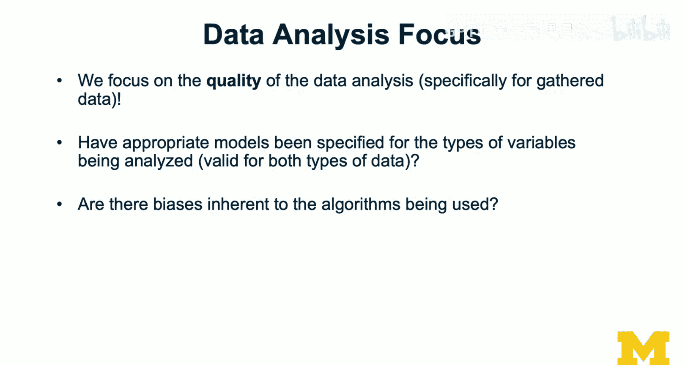
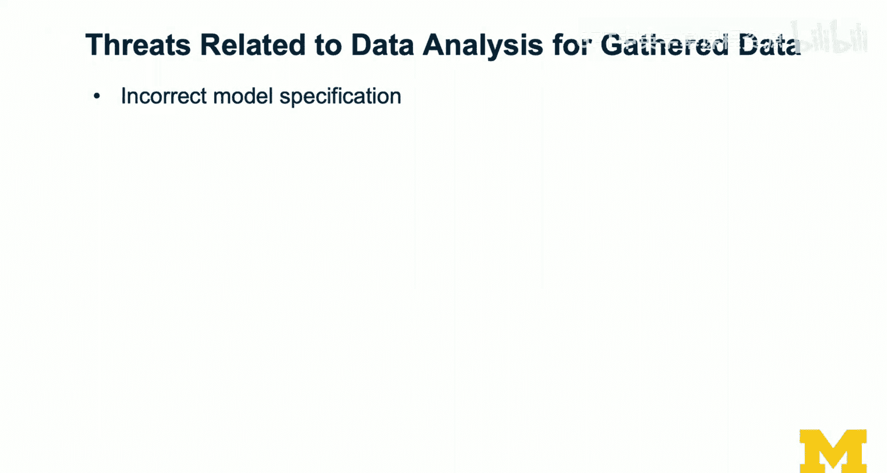
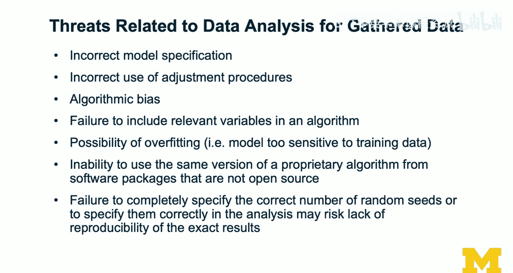
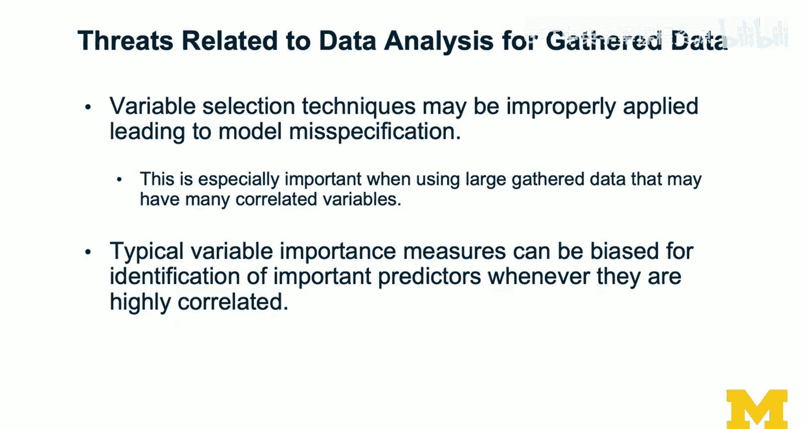
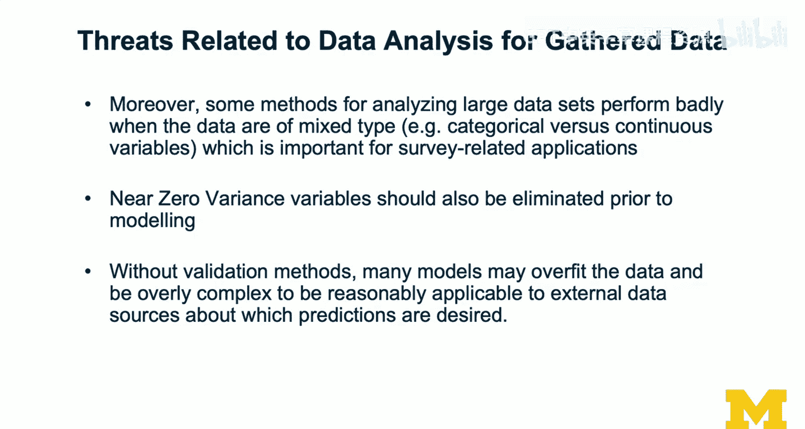
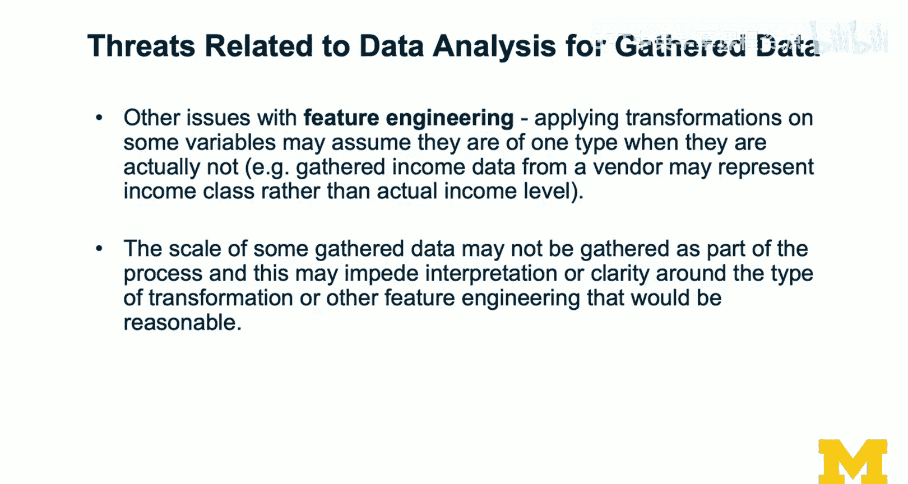
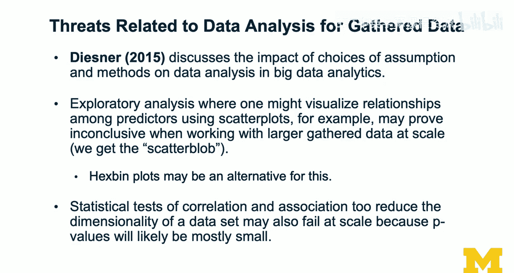
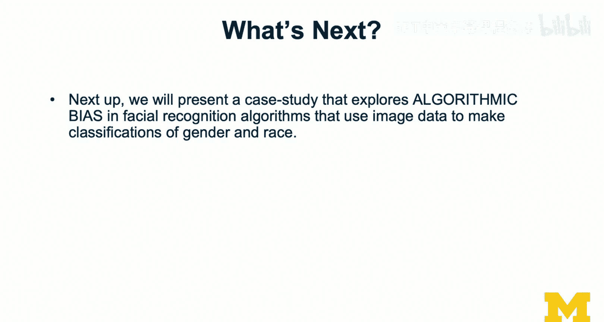

# 密歇根大学《总体数据质量（框架、度量、设计策略）total data quality》 p42 41_采集型数据分析相关威胁因素.zh_en -BV1Jn4y1X7uS_p42-

Hello， welcome back。 We're going to talk about threats concerning data analysis for gather data in this segment。

 I'm Trenm Buskirk。 I'm glad you're here。😊。

To put this into proper context in our diagram for the dimensions of total data quality。

 you'll see that we're working with data analysis， which occurs at toward the bottom of the diagram。

 almost at the end of the process。 so let's get started。Here we're going to focus on data analysis。

 we're going to look at specifically the quality of the data analysis specifically for gathered data。

We might ask questions like， have appropriate models been specified for the types of variables being analyzed。

 So， for example， if we have a categorical outcome， we might be thinking about classification tasks。

 or if we have a continuous outcome， we might be thinking about regression tasks。

 We'd also be asking about whether or not there are biases an errant in the algorithms being used。

Alrithmic bias， perhaps with respect to the data， but also are we trying to tune the algorithms appropriately to balance the bias in variance trade off？

There are many threats related to data analysis for gathered data。

 and we'll go over some of them here。

One of those has to do with incorrect model specification。

 Do we have the right variables included in the model。

 Do we have a model that's going to be flexible enough to specify the actual form of the model many machine learning algorithms or nonparmetric。

 and they allow us to be flexible in not have to specify the model a priori。

 This is really important in the gathered data context。

 Because if you've never seen variables before when asking a research question in the same data set。

 you may not have an a priori hypothesis about the shape of the model or the relationship that those variables might have related to the outcome that you care about。

 So allowing an algorithm that is flexible in terms of not requiring a prior specification of the form of the model could be important。

There are also incorrect use of adjustment procedures for how you've adjusted the data。

 There's possible algorithmic bias that exists。 and the algorithmic bias here really refers not necessarily to the algorithm or the model that we're using to analyze the data。

 But more about the composition of the training data。

 Does the training data represent reasonably well。 The population for which you want to make inference or conclusions or predictions for the models you're using。

Are you including relevant variables in the algorithm。

 Gaer data is great in the sense that we have volumes of data。

 but we may not have the correct combination of variables。There is also a possibility of overfitting。

 This is， in general， how many machine learning algorithms suffer from the curse of overfitting。

 and it might。 it means that the model is too sensitive to the training data。

 There are ways to tune models to prevent that or to minimize it。 Are we taking those steps。

There is also an inability to use the same version of a proprietary algorithm from software packages that are not open source。

 It is possible that those algorithms could change over time。

 and we may not know what those changes are and what impact those changes have on our analysis。

There is also a failure to completely specify the correct number of random seeds or to specify them correctly in the analysis may risk the lack of reproducibility of the results。

 So， for example， if you specify one random seed only。

 but the algorithm has many random components to it。

 you by not specifying subsequent random seeds risks the reproducibility。

 So your results may be different from mine。

Even if we're using the same data source。Some other threats related to data analysis surround the idea of the incorrect use of a variable。

 Some vendor variables may come as a range that could be mistaken as a continuous version of the variable。

 rather than a nominal or ordinal version。There is also the possibility for incorrect interpretation of the results of a model。

 especially for machine learning models。For example。

 variable importance is not the same as statistical significance。There are many。

 many machine learning models have no beta coefficients。

 So making sure that you understand the output of these machine learning models before interpretation is really important。

Some variable selection techniques may be improperly applied， leading to model misspecation。

 One of the advantages of gathered data is that you can typically amass large data sets that are both long and potentially wide by combining multiple data sources together in those situations。

 many times you want to select from a larger set of variables。

 Those variables that have stronger signals for your prediction or analytic tasks。

But typical variable importance measures that are often used for variable selection can be biased for identification of important predictors when either they are highly correlated or you have variables that are of mixed type。

 In other words， you have a combination of categorical and continuous variables。

 This can lead to bias in your variable importance measures that can impact variable selection。😊。

Some methods for analyzing large data sets can perform badly when the data are of mixed type。

 In other words， you have a combination of categorical and continuous variables。

 which is often what we have in surveys。We should also take care that near  zero variance variables are eliminated prior to modeling。

 And by near zero variance， what we mean is those variables that have the same values for most of the cases in the dataset set。

 Typically， these variables don't provide a lot of signals in the models and so should be eliminated。

Without validation methods， many models may overfit the data。

 as we already mentioned and can be overly complex to be reasonably applicable to external data sources that we want to apply them to。

 And so in that situation， we need methods to。

Reduce the complexity of these models and to cross validate their use。

There can be issues with feature engineering for gathered data at the data analysis phase。

 especially when we apply transformations on some variables that assume one type of variable is present when it actually isn't。

 So， for example， we might pick a transformation method for gathered income data that we assume is continuous。

 But in fact， the variable itself is actually stored as a nominal representation of the actual income level。

 So we think that we are transforming a continuous variable that's actually stored as categorical。

The scale of some gathered data may also not be captured as part of the process。

 and this may impede our interpretation， or it may give us a lack of clarity around the type of transformations that we can actually confidently apply to that variable。

 For example， think about the variable where we are thinking that we're collecting square footage of a households lot size。

 So how big is the lot that the house is on。 We think that we're gathering that in square feet。

 But in fact， some small values might be present in the data。

 And they don't actually represent square footage at all。 They actually represent acres。

If we don't transform those acres to square footage prior to applying a feature engineering transformation to this variable。

 we might find ourselves in。Trouble when we go to interpret the results of the analysis。

 we might get beta coefficients that are really large or off kilter。

 simply because our data represents a range that is way broader than what we thought going into the analysis。

Madigan and colleagues in 2014 explored the impact of choices made in the data analysis process on observational studies based on medical records。

 They found that the current ad hoc investigator based decisions LED to inflated P values an incorrect conclusions。

 either type 1 or type 2 errors。 They suggested a data driven procedure as an alternative。

Desner in 2015 discussed the impact of choices of assumptions on the methods for data analysis in big data analytics。

 Are observations normally distributed。 Are they independent。

 These assumptions can impact the validity of results in in the analysis phase， and for gather data。

 We sometimes cannot vet these assumptions。Exploratory analysis where one might visualize relationships among predictors using scatter plots。

 for example， may prove really inconclusive when you have large Ga data sets at scale。

 We end up getting what I call the scatter blob， where the scatter plot is simply nothing more than a big spot of ink。

Because there's just too many data points to plot in two dimensions。

I like to use hexpin plots as an alternative in order for me to be able to see what the relationship between two variables are when I have a million records。

 for example。Statistical tests of correlation and association to reduce the dimensionality of a data set may also fail at scale because P values will likely be very small。

So a lot of the statistical procedures that we currently use for mid size data sets won't scale very well。

 and every variable will be significant or every variable will be important。

 and that may or may not be helpful for our particular analysis。

Just to give you a clue of what's coming in the next segment。

 we're going to present a case study that explores algorithmic bias in facial recognition algorithms that use image data to make classifications about gender and race。

 Now， this case study explores algorithmic bias。 And remember。

 algorithmic bias may not be associated with a particular algorithm but may speak more to the training data that is actually used in your analysis。

 So we're going to explore some of those issues next time。 I'm looking forward to seeing you then。😊。

