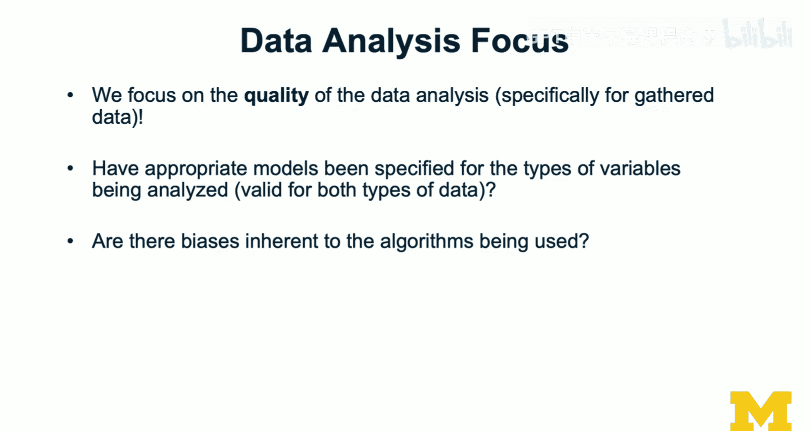
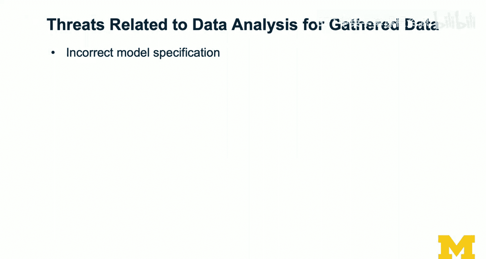
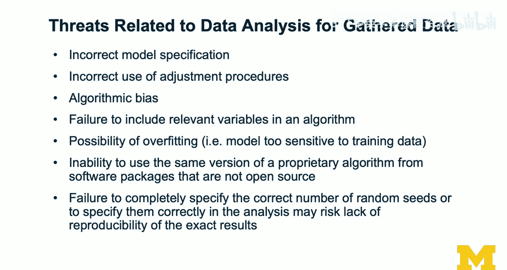
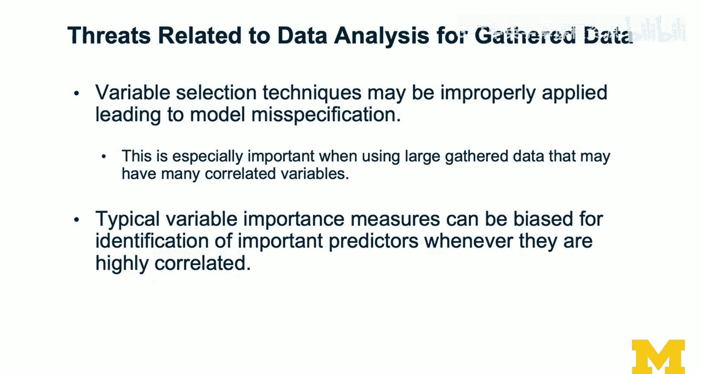
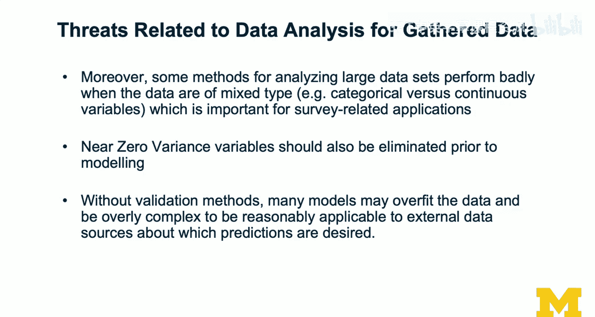
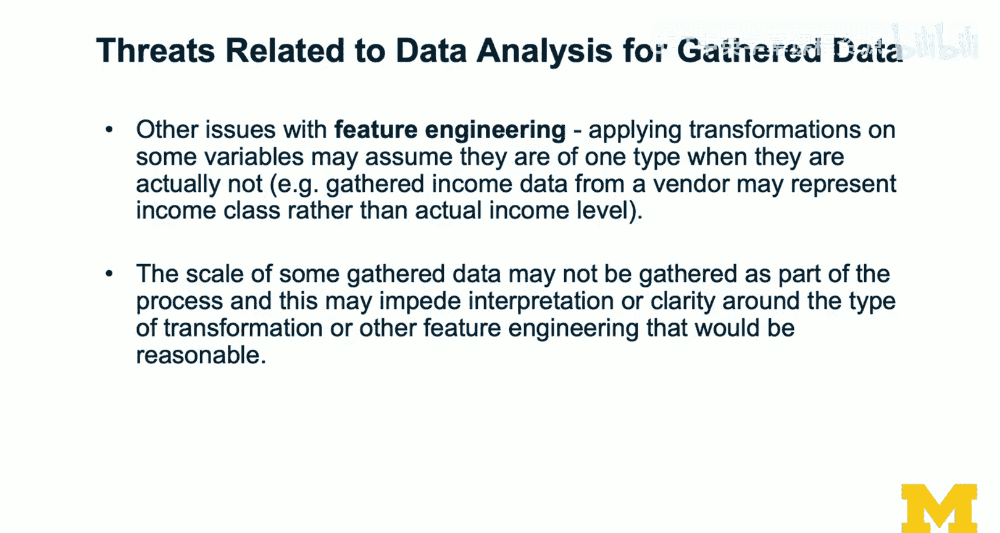
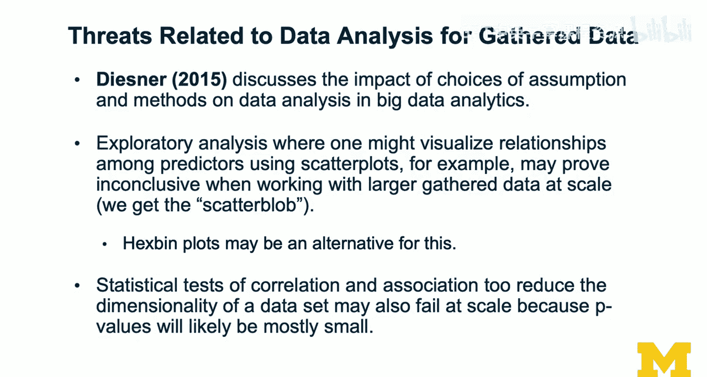
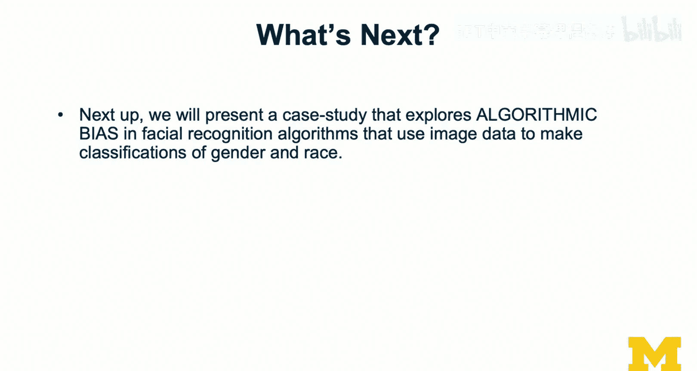

# 总体数据质量：41：采集型数据分析相关威胁因素 🔍

在本节课中，我们将学习在分析采集型数据时可能遇到的各种威胁因素。我们将探讨模型设定、算法偏差、数据解释以及大规模数据分析特有的挑战。

---

上一节我们介绍了总体数据质量的维度框架，本节中我们来看看数据分析阶段，特别是针对采集型数据的分析，可能面临哪些质量威胁。数据分析位于整个数据处理流程的末端，其质量直接影响最终结论的可靠性。

我们可能会提出以下问题：是否为被分析的变量类型设定了恰当的模型？例如，对于分类结果，我们应考虑分类任务；对于连续结果，则应考虑回归任务。此外，我们还需关注所使用的算法是否存在偏差或错误。算法偏差可能源于数据本身，也可能源于我们是否恰当地调整算法以平衡偏差-方差权衡。

以下是数据分析阶段可能遇到的一些主要威胁：

*   **模型设定错误**：模型中是否包含了正确的变量？模型是否足够灵活以捕捉真实的关系？许多机器学习算法是非参数的，允许我们无需事先严格设定模型形式，这在采集型数据背景下尤为重要，因为我们可能对变量间关系没有先验假设。
*   **调整程序使用不当**：对数据的调整方法可能不正确。
*   **算法偏差**：这里的偏差主要指训练数据的构成是否能够合理代表你希望进行推断或预测的目标群体。采集型数据虽然量大，但变量的组合未必正确。
*   **过拟合**：这是许多机器学习算法的通病，意味着模型对训练数据过于敏感。我们需要通过调整模型来防止或最小化过拟合。
*   **专有算法版本不一致**：使用非开源软件包中的专有算法时，算法可能随时间变化，而我们可能不了解这些变化及其对分析的影响。
*   **随机种子指定不完整**：在分析中未能完全或正确地指定随机种子数量，会危及结果的可复现性。例如，如果算法有多个随机成分，仅指定一个随机种子可能导致你我的结果不同。

---

除了上述威胁，数据分析还面临其他挑战，主要围绕变量的不正确使用和结果解释。

*   **变量使用错误**：某些供应商提供的变量可能是范围值，容易被误认为是连续变量，而非名义或有序变量。
*   **结果解释错误**：尤其是对于机器学习模型。例如，**变量重要性** 并不等同于 **统计显著性**。许多机器学习模型没有传统的回归系数（β系数），因此在解释前确保理解模型输出至关重要。
*   **变量选择技术应用不当**：采集型数据的优势在于可以通过整合多个数据源形成大规模数据集。此时常需从大量变量中选择对预测或分析任务信号更强的变量。然而，常用的变量重要性度量方法在变量高度相关或类型混合（即同时包含分类变量和连续变量）时，可能产生偏差，从而影响变量选择。
*   **方法对混合类型数据表现不佳**：一些分析大规模数据集的方法在处理混合类型数据时可能表现很差，而调查数据中常包含此类数据。
*   **未剔除近零方差变量**：近零方差变量指数据集中绝大多数案例取值相同的变量。这些变量通常无法为模型提供有效信号，应在建模前剔除。
*   **缺乏验证方法**：如前所述，缺乏验证方法可能导致模型过拟合或过于复杂，难以合理应用于外部数据源。因此，我们需要方法来降低模型复杂度并进行交叉验证。

---

在数据分析阶段，对采集型数据进行特征工程时也可能出现问题。

*   **特征工程错误**：例如，对变量应用某种转换时，错误地假定了变量类型。我们可能对自认为是连续型的收入数据选择转换方法，但实际上该变量是以名义尺度存储的收入等级。
*   **数据尺度未被捕获**：采集过程中可能未捕获数据的尺度，这会妨碍我们的解释，或使我们不清楚可以对该变量应用何种转换。例如，收集房屋占地面积时，我们认为单位是平方英尺，但数据中的一些小数值实际上代表的是英亩。如果在进行特征工程转换前未将这些英亩值转换为平方英尺，在解释分析结果时可能会遇到麻烦，得到的系数可能异常大或失真。

---

Madigan及其同事在2014年研究了基于医疗记录进行观察性研究时，数据分析过程中的选择对结果的影响。他们发现，当前基于研究者的临时决策导致了P值膨胀和错误结论（I类或II类错误），并建议采用数据驱动的程序作为替代。

Desner在2015年讨论了大数据分析中，假设选择对数据分析方法的影响。例如，观测值是否服从正态分布？是否独立？这些假设会影响分析阶段结果的有效性。对于采集型数据，我们有时无法验证这些假设。

在大规模采集型数据集上，传统的探索性分析方法可能失效。例如，使用散点图可视化预测变量间关系时，由于数据点过多，可能只会得到一团墨迹，我称之为“散点团”。我倾向于使用六边形分箱图作为替代，以便在拥有百万条记录时仍能观察两个变量间的关系。此外，用于降低数据集维度的相关性及关联性统计检验在大规模数据上也可能失效，因为P值很可能都非常小。因此，许多适用于中等规模数据集的统计程序无法很好地扩展，可能导致每个变量都显得“显著”或“重要”，这对我们的特定分析未必有帮助。

---

本节课中我们一起学习了分析采集型数据时面临的多重威胁，包括模型设定、算法偏差、数据解释、特征工程以及大规模数据分析带来的特殊挑战。理解这些威胁是确保数据分析质量、得出可靠结论的关键。

在下一节中，我们将通过一个案例研究，探讨使用图像数据进行性别和种族分类的面部识别算法中的算法偏差。该案例将深入揭示算法偏差问题，请记住，算法偏差可能并非源于特定算法本身，而更多地与训练数据的构成有关。期待下次与你共同探讨。