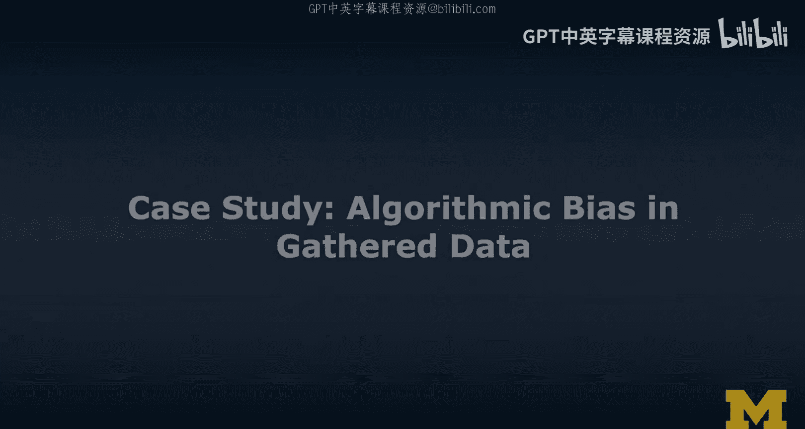
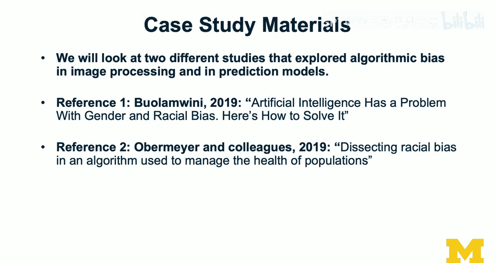
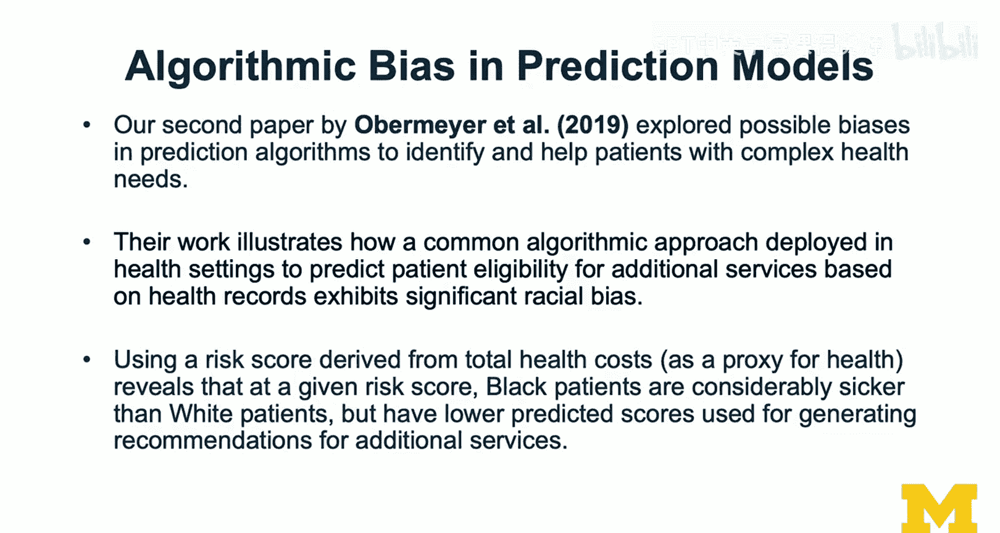
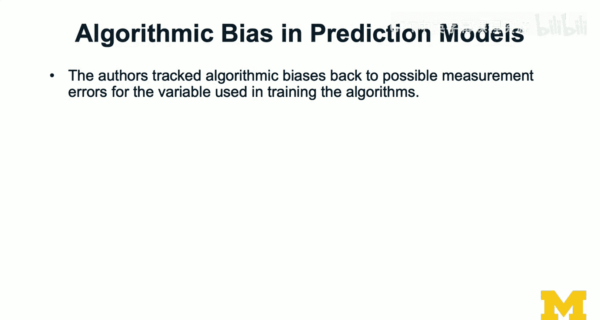
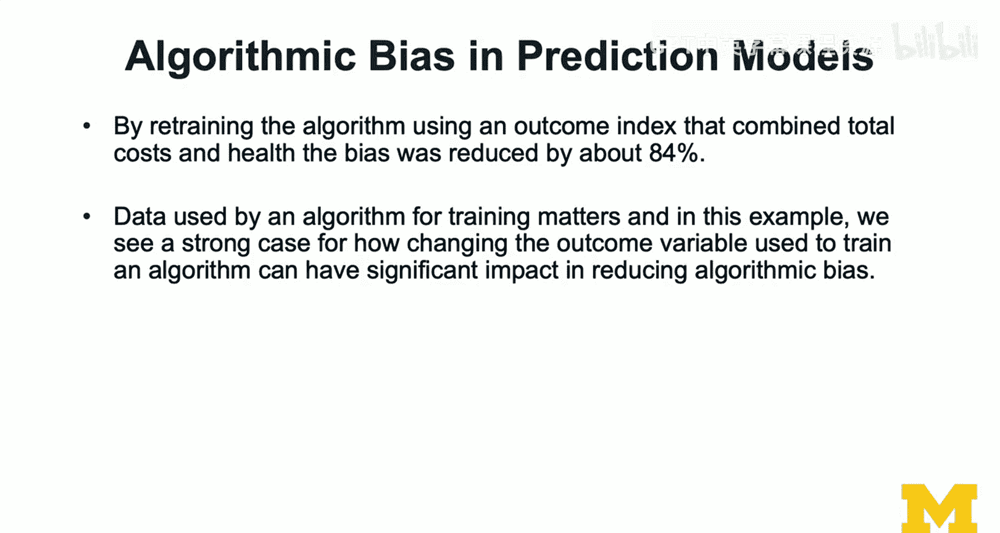

# 密歇根大学《总体数据质量（框架、度量、设计策略）total data quality》 p43 42_案例研究：采集数据中的算法偏见问题.zh_en -BV1Jn4y1X7uS_p43-

Welcome to the case study on algorithmthic bias in Ga data。 I'm Trim Uskirk。

 We're really happy to have you。

In this case study， we're going to be looking at two different studies that explored algorithmic bias in image processing and in prediction models。

Just as a recap， algorithmic bias is often not related necessarily to the algorithms that are being deployed。

 whether it be for prediction or classification， but more to do with the data upon which those algorithms are based。

It is not completely possible in some cases， to remove algorithmic bias by simply changing the algorithm。

 So in other words， if we went from a regression model to a decision tree model， for example。

 we may still have algorithmic bias， even though we have changed the algorithm。

In these particular case studies， we're going to talk a little bit about how the data themselves that that are fed into these algorithms really can drive biases beyond the algorithms themselves。

 And so I'm looking forward to exploring these with you。

 The first reference that we're going to be looking at is this article from the Time magazine called Artificial intelligencetelligence has a problem with Gender and racialciial bias。

 Here's how to solve it。 And the second reference is from Overmeer and Colgues in 2019。

 where the title entitled Dissecting Racial biases and an Alrithm Use to Man the Health of Populations。

 So let's get started。😊，In her recent time article。

 artificialific intelligence is a problem with gender and racial bias。 Here's how to solve it。Joy。

 Bull and Weeny report how facial recognition software used by Amazon。

 Microsoft and other large tech firms have little misclassification of gender for white users。

 but this error can soar to above 35% for darker skin women。 For example。

 Let's look at a table for what this looks like。😊，So in an image of Oprah Winfrey and trying to classify an image of Oprah Winfrey。

 Amazon's facial recognition software predicted that Oprah Winfrey appeared to be male with 76。

5 per cent accuracy。Microsoft's visual detection software predicted that Michelle Obama appeared to be a young man wearing a black shirt with almost 80% accuracy and wearing a hairpiece with almost with over 93% cent accuracy。

And face plus plus facial recognition software predicted that an image of Serena Williams appeared to be male。

Clearly， we know who these women are， but some of the software tools predicting their facial recognition do not。

In the article， Buomwei also reports that the likely issues and the misclassification of images from minority women have less to do with the algorithms themselves。

 As you saw in the last table， there were three different facial recognition software algorithms from three pretty reputable companies。

It had little to do with the algorithms themselves， but rather。

 the training data used to build the analytic models in her research。

 she reported finding that one government data set of faces collected for testing contained 75 per cent men and 80 per cent lighter skinned individuals and less than 5 per cent women of color。

So in that situation， it is not surprising that with few women of color in the actual training dataset sets themselves。

 the algorithms may not be able to learn to distinguish between males and females。

 especially if they are darker in color， just because there aren't enough images to make that distinction。

 So in other words， you might say that the data set was underpowered for that kind of detection。

 That has little to do with the algorithm and more to do with the data composition itself。

Our second paper by Obbermeyer and colleagues in 2019 explored possible biases in prediction algorithms used to identify and help patients with complex health needs。

The whole point of this particular exercise or these algorithms was to help find patients that were at higher risk for worse health outcomes and identify them early so they could participate in ancillary health programs that were aimed at prevention and wellness。

This particular study illustrates how a common algorithmic approach deployed in a health setting to predict patient eligibility for additional services based on their health records。

 exhibit significant racial bias。 Even though the goal of the study or the goal of these models was to help patients。

 It ended up having some algorithmic bias built in and will talk about exactly how that came to be。

Using a risk score derived from total health costs， and they use this as a proxy for health。

 and the idea behind this was that people who have worse health conditions will engender higher health care costs。

Reveals that at a given risk score， black patients are considerably sicker than white patients。

But have lower predicted scores used for generating recommendations for additional services。

This means that in order to qualify for the cutoff for eligibility for these programs based on a predicted score。

 black patients had to be much sicker than their corresponding white patients。

In fact， the authors found that for high values of predicted risk score。

 black patients had about 26% more chronic illnesses than whites。

Less healthy black patients scored at similar risk scores to more healthy white patients。

Indicating substantial disparities in program screening based on this algorithm。

The authors then demonstrated that black patients were substantially less healthy than white patients at any level of the algorithm's predictions。

 and in order to qualify for the respective program。

 black patients had to be much sicker than white patients， given the score。

 given the cutoff score for eligibility。This situation actually makes this preventative program not as useful and is appealing to black patients who were already sicker than white patients。

 This is an example of algorithmic bias that is sort of showing up or manifesting itself in racial differences here in terms of eligibility and underlying condition。

And what's really interesting is the goal of this algorithm itself was to help sick patients。

Remain well and not get sicker。 But black patients wouldn't be able to take advantage of this system if in order to qualify。

 they were already so much sicker。The author tracked algorithmic biases back to possible measurement errors for the variables used in training the algorithms。

 And in fact， in the labels themselves， we're going to explore this。

 This is such an interesting point here。 And it's one that really。

 really brings to mind what we've talked about in this MOOC so far about data quality about understanding the variables themselves and understanding what they represent。

😊。

While the algorithm used to generate the risk score did not include race as a predictor。

 it did include information on other demographic variables like age， sex， insurance。

 type and claim related information。The algorithm also used total medical expenditures as its outcome。

 and this is a variable that is very common in healthcare related studies。

The actual and predicted costs based on these same covariates showed balance across the race groups。

 which is another aspect of fairness that we look at in algorithms like this。However。

 further investigation revealed that at a given level of health， I。e。

 the number of chronic illnesses you might have。 Black patients generated lower costs than white patients。

In fact， this could be related to access to care， it could be related to cultural elements about seeking care or about just general history of patients not trusting doctors in the first place。

As a result， being accurate on cost metrics necessarily implies possible racial biases on health measures by virtue of this association。

So using traditional metrics of overall prediction quality。

 Obbermeyer and colleagues showed that the cost as the outcome measure for the prediction algorithm seemed to be an effective proxy for health。

 there was balance E cetera。 other things that we would check for to see that this made sense as an outcome。

 However， relationships between health costs and race revealed biases that placed greater burden on the overall health of black patients。

 in order to be recommended to further services based on the predicted risk score。

 Black patients had to be far sicker than white patients in order to meet the threshold for recommendation for this program that was supposed to be preventative of greater health risks。

😊，By retraining the algorithm using an outcome index that combined both total costs and health。

 the bias was reduced by 84%。In this case， the data used by an algorithm for training matters。

 and in this example， we see a strong case for how changing the outcome variable used to train the algorithm can have a significant impact in reducing the algorithmic bias。

In this example， we thought that total costs would be a reasonable measure or proxy for overall health。

 But because there were underlying relationships between total cost， health and race。

 we actually generated algorithmic bias in the form of racial disparities in order to solve that problem。

 changing the training data wouldn't necessarily do it。

 But being able to come up with a better outcome measure that was actually the target of the algorithms for prediction。

Actually generated improvements in algorithmic bias。In the first example that we went over。

 changing the actual composition of the training data to ensure that there's more heterogeneity in the images between women and men。

 light skin and dark skin could actually show vast improvements and resolve some of the algorithmic bias issues that were present there。

In the third Moc in this sequence， we're going to talk a lot more about how techniques that we can use for resolving algorithmic bias and improving some of this quality in the actual results of these algorithms。

 Until then， Thanks for coming， and we'll see you next time。😊。

