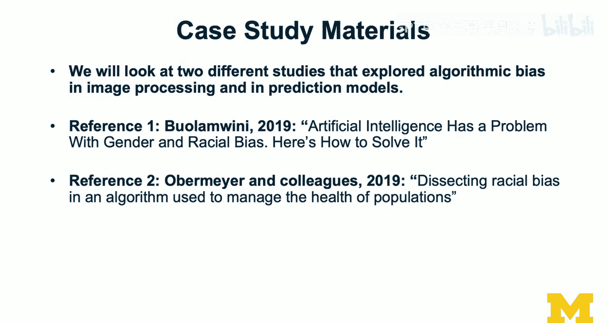
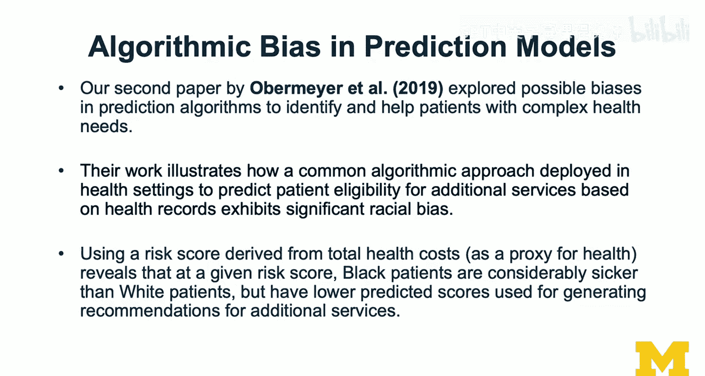
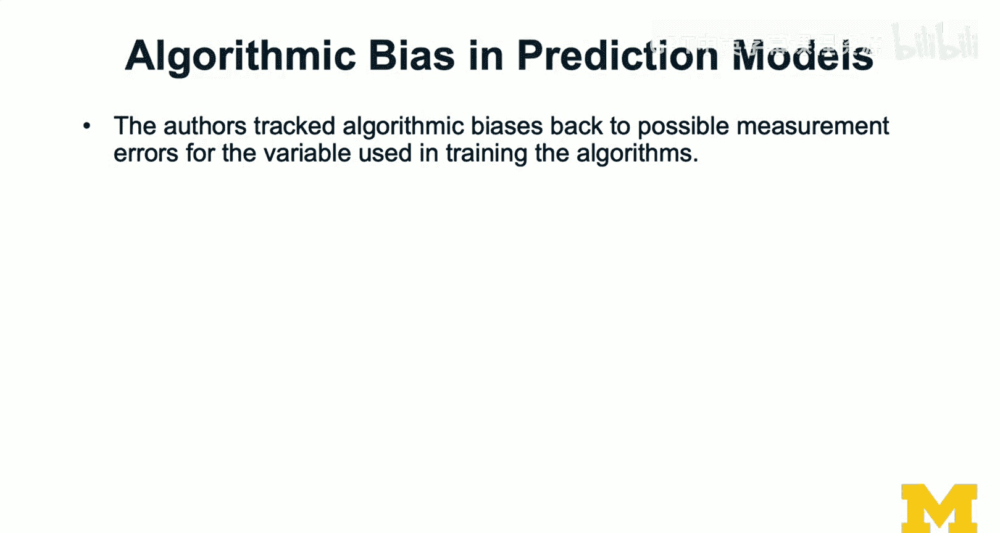
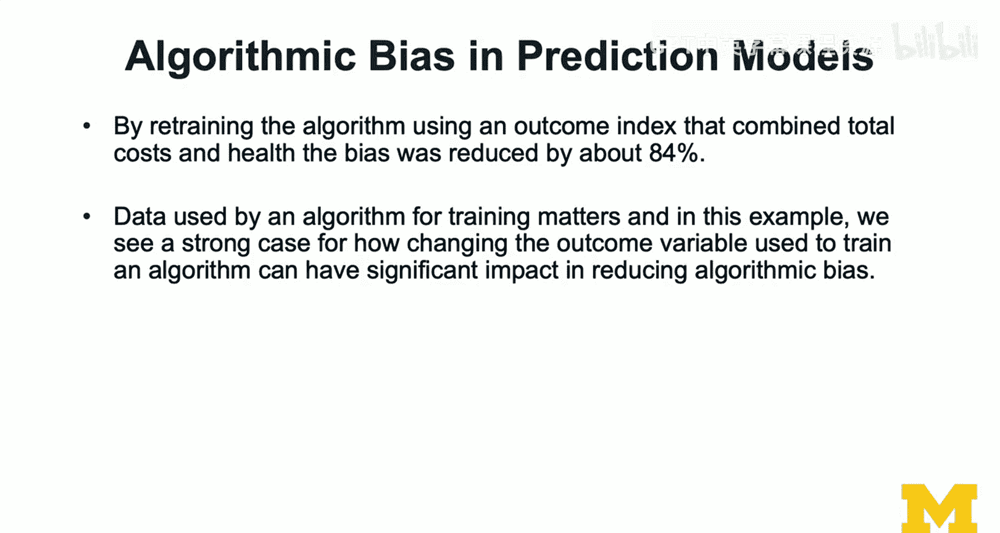

# 总体数据质量：案例研究：采集数据中的算法偏见问题

在本案例研究中，我们将探讨两个不同的研究，它们分别探究了图像处理和预测模型中的算法偏见问题。我们将看到，算法偏见往往并非源于算法本身，而是与用于训练算法的数据密切相关。

## 算法偏见概述

上一节我们介绍了案例研究的主题。本节中，我们来看看算法偏见的本质。

算法偏见通常与用于预测或分类的算法本身关系不大，而更多地与这些算法所基于的数据有关。

在某些情况下，仅仅通过更换算法（例如，从回归模型换成决策树模型）来完全消除算法偏见是不可能的。即使改变了算法，偏见可能依然存在。

在这些具体的案例中，我们将讨论输入算法的数据本身如何能够驱动超越算法本身的偏见。

## 案例一：图像识别中的性别与种族偏见

以下是第一个案例，关于图像识别软件中的偏见问题。

*   **研究来源**：时代杂志文章《人工智能存在性别与种族偏见问题。以下是解决方法》。
*   **核心发现**：亚马逊、微软等大型科技公司使用的面部识别软件，对白人用户的性别分类错误率很低，但对深色皮肤女性的错误率可飙升至35%以上。

让我们看一个具体的表格示例：

*   在识别奥普拉·温弗瑞的图像时，亚马逊的面部识别软件以76.5%的准确率预测其为男性。
*   微软的视觉检测软件以近80%的准确率预测米歇尔·奥巴马是一位穿着黑色衬衫的年轻男性，并以超过93%的准确率预测其戴着假发。
*   Face++面部识别软件预测塞雷娜·威廉姆斯的图像为男性。

显然，我们知道这些女性的身份，但一些软件工具在面部识别预测上却出现了错误。

文章指出，对少数族裔女性图像分类错误的问题，很可能与算法本身关系不大（如上表所示，涉及三家知名公司的三种不同算法），而更多地与用于构建分析模型的训练数据有关。

研究发现，一个用于测试的政府人脸数据集中，包含75%的男性和80%的浅肤色个体，而有色人种女性占比不到5%。

在这种情况下，由于实际训练数据集中有色人种女性的图像过少，算法可能无法学会区分男性和女性，尤其是肤色较深的情况，仅仅是因为没有足够的图像来做出这种区分。换句话说，可以认为该数据集对于此类检测而言**统计效力不足**。这与算法关系不大，而更多是数据构成本身的问题。

## 案例二：医疗预测模型中的种族偏见

在了解了图像识别的案例后，我们转向医疗健康领域，看看预测模型中的偏见。

以下是第二个案例，关于用于管理人群健康的算法中存在的种族偏见。

*   **研究来源**：Obermeyer等人于2019年发表的论文《剖析用于管理人群健康的算法中的种族偏见》。
*   **研究背景**：该算法旨在帮助识别健康状况较差、风险较高的患者，以便他们能及早参与旨在预防和促进健康的辅助医疗项目。

这项研究说明，在医疗环境中部署的一种常见算法方法（基于患者健康记录预测其是否有资格获得额外服务），表现出显著的种族偏见。尽管这些模型的目标是帮助患者，但其内部却存在算法偏见。

**算法机制**：
该算法使用**总医疗费用**推导出的风险评分作为健康的**代理变量**。其背后的理念是，健康状况较差的人会产生更高的医疗费用。

**核心发现**：
在给定的风险评分下，黑人患者比白人患者病情要严重得多，但用于生成额外服务推荐**的预测评分却更低**。

这意味着，基于预测评分来获得这些项目资格时，黑人患者必须比相应的白人患者病情严重得多才能达到资格分数线。

事实上，作者发现，在高预测风险评分下，黑人患者比白人患者多患约26%的慢性病。健康状况较差的黑人患者与健康状况较好的白人患者获得了相似的风险评分，这表明基于该算法的项目筛查存在巨大差异。

作者进一步证明，在算法预测的任何水平上，黑人患者的健康状况都明显差于白人患者。为了获得相应项目的资格，给定资格分数线，黑人患者必须比白人患者病情严重得多。

这种情况实际上使得这项预防性项目对黑人患者不那么有用，因为他们本已比白人患者病情更重，却难以获得资格。这是算法偏见的一个例子，在这里以资格和潜在健康状况方面的种族差异形式显现出来。

有趣的是，该算法本身的目标是帮助患病患者保持健康、防止病情恶化。但如果黑人患者为了获得资格，病情已经严重得多，他们将无法从该系统中受益。

## 偏见根源探究

上一节我们看到了偏见的表现，本节我们来探究其根源。

作者将算法偏见追溯到用于训练算法的变量可能存在的测量误差，甚至标签本身的问题。这一点非常有趣，它让我们回想起本课程中一直强调的：理解数据质量，理解变量本身及其所代表的含义。

虽然用于生成风险评分的算法并未将种族作为预测变量，但它包含了其他人口统计学变量信息，如**年龄、性别、保险类型和理赔相关信息**。该算法还使用**总医疗支出**作为其结果变量，这在医疗保健相关研究中非常常见。

基于这些相同协变量的实际成本和预测成本在种族群体间显示出平衡，这是我们在此类算法中考察的公平性另一个方面。

然而，进一步调查发现，在给定的健康水平下（例如，患有慢性病的数量），黑人患者产生的费用低于白人患者。这可能与获得医疗服务的途径、关于寻求医疗的文化因素，或者患者最初就不信任医生的普遍历史有关。

因此，在成本指标上的准确性，必然意味着由于这种关联，在健康指标上可能存在种族偏见。

## 解决方案与改进

在分析了问题根源后，我们来看看如何解决。

通过使用一个结合了**总成本和健康指标**的结果指数重新训练算法，偏见减少了84%。

在这个案例中，算法用于训练的数据至关重要。这个例子有力地说明了，改变用于训练算法的结果变量，可以对减少算法偏见产生显著影响。

在这个例子中，我们认为总成本是整体健康状况的合理衡量标准或代理变量。但由于总成本、健康和种族之间存在潜在关系，我们实际上产生了以种族差异形式存在的算法偏见。为了解决这个问题，仅仅改变训练数据可能不够，但能够提出一个更好的、真正作为算法预测目标的结果指标，实际上改善了算法偏见。

在我们讨论的第一个例子中，改变训练数据的实际构成，确保男女之间、浅肤色与深肤色之间的图像具有更多的异质性，实际上可以显示出巨大的改进，并解决那里存在的一些算法偏见问题。

## 总结

在本节课中，我们一起学习了两个关于算法偏见的案例研究。

我们首先看到，面部识别软件因训练数据中缺乏多样性（特别是深肤色女性图像不足），导致了对特定群体的高错误率。接着，我们探讨了一个医疗预测模型，它因使用医疗费用作为健康的代理变量，而忽略了费用与种族、健康水平之间的复杂关系，导致黑人患者需要病情更严重才能获得预防性服务资格，造成了种族偏见。

这两个案例共同强调了：**算法偏见往往根植于数据，而非算法本身**。数据的构成、代表性以及所选变量（特别是代理变量）能否准确反映预测目标，是产生或消除偏见的关键。解决偏见需要审视和改善数据质量，包括确保数据集的多样性和代表性，以及谨慎选择和使用真正反映问题本质的变量。