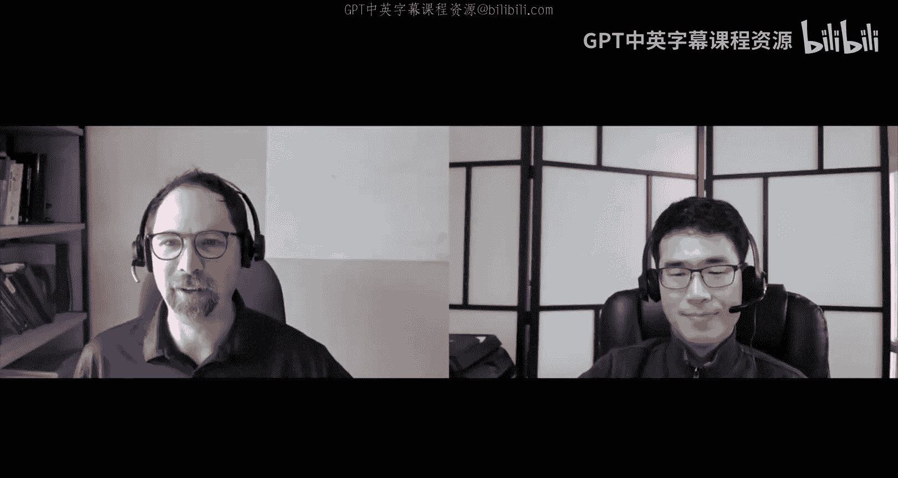
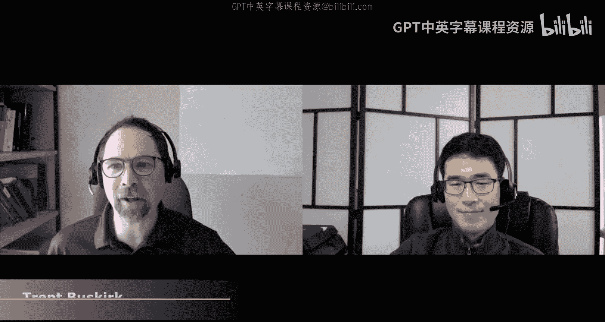
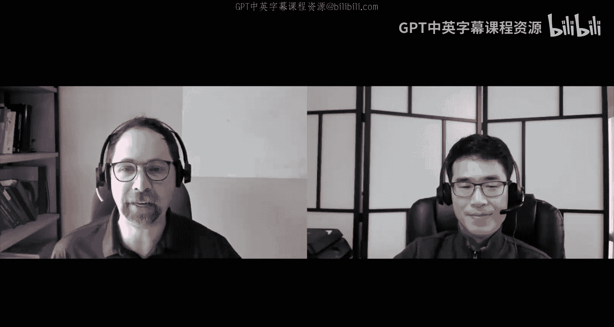
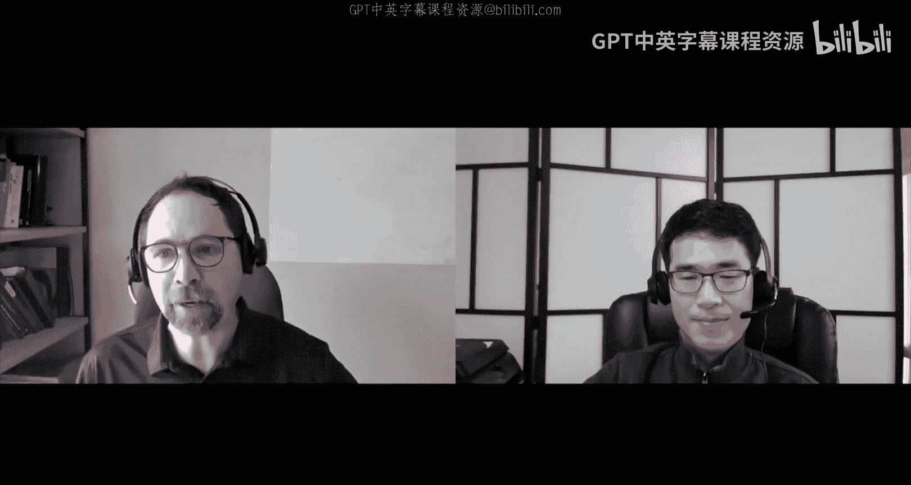
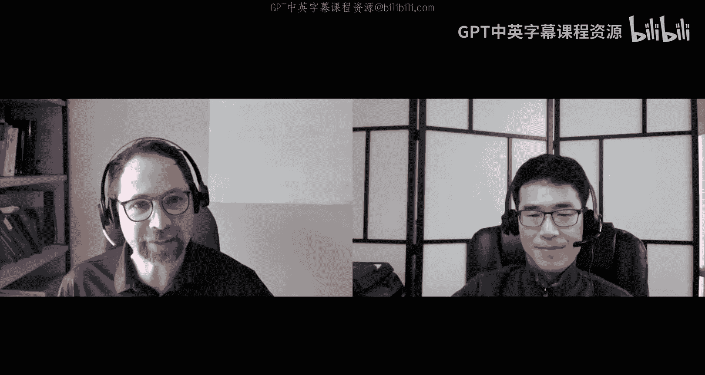

# 密歇根大学《总体数据质量（框架、度量、设计策略）total data quality》 p44 0_欢迎来到第二门课程.zh_en -BV1Jn4y1X7uS_p44-

Hi everyone welcomecome to this second course in the total data quality specialization measuringasuring To data qualityual My name is Tm Buskirk and I'm joined here by my colleague Genseot Ki we're two of the four instructors in this specialization and we want to tell you a little bit about what to expect in the second course。

As the title of the course suggests， our focus will be on measurement。

🎼Thanks Tt in this second course we will introduce a variety of practical techniques that can be used to measure the various dimensions of pro data quality for different types of data sets and illustrate the use of available software for computing these different measures of data quality using real world data sets we will walk through several example case studies and provide hands zone illustrations of the use of software to compute various measures of data quality then you can apply in real studies we will also have access to tutorials introducing the different software。

We feel that this second course will not only deepen your understanding of a systematic approach for understanding data quality across the different types of data that we introduced you to in the first course。

 but it will also empower you to use techniques that will quantify the quality of a given data set across all of the dimensions of the total data quality framework。

We hope that you will enjoy the various case studies。

 and we encourage you to follow along while practicing with the use of the software。

 This will help you to apply these techniques for your own data sets。

Here's to measuring data quality and thanks again for joining us。

