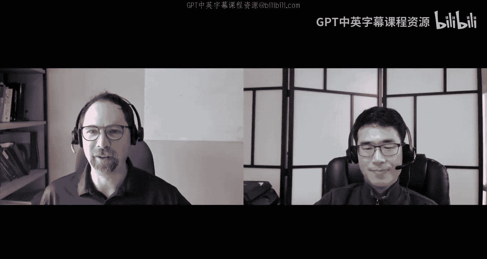
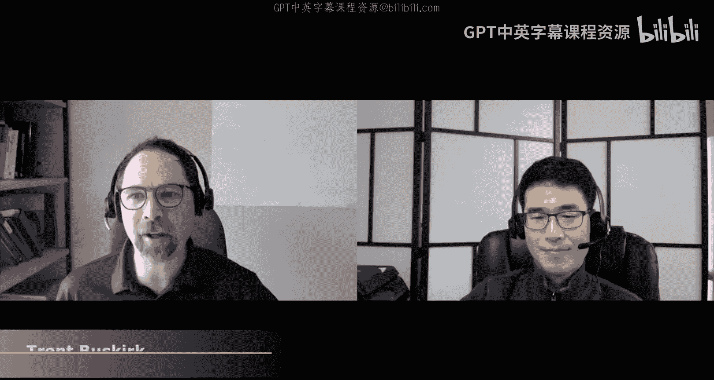
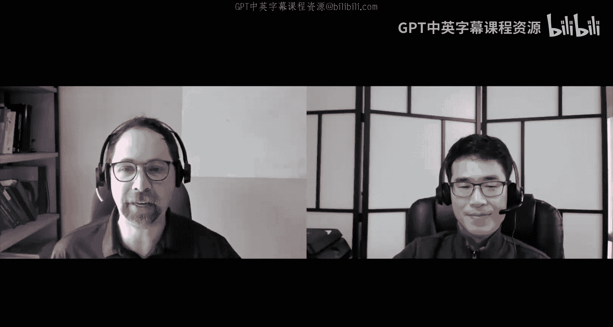
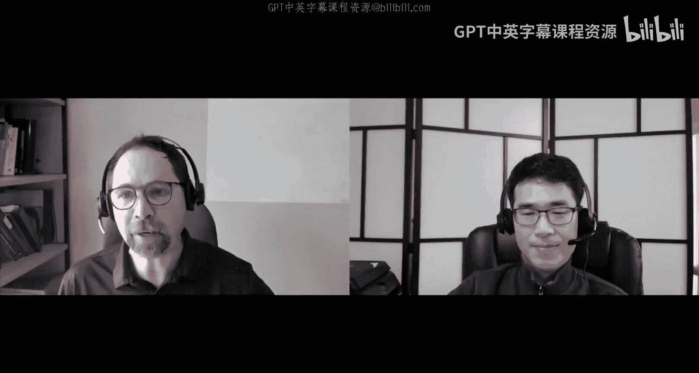
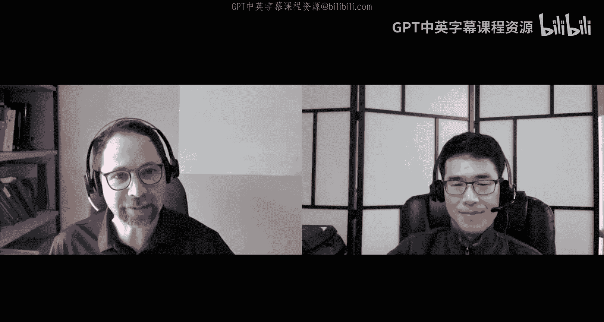

# 总体数据质量（框架、度量、设计策略）：课程二：欢迎与课程概述

在本课程中，我们将学习如何测量数据质量。我们将介绍一系列实用的技术，用于衡量不同类型数据集在总体数据质量框架下各个维度的表现，并通过真实案例和软件操作进行演示。

大家好，欢迎来到总体数据质量专项课程的第二门课程。我是汤姆·巴斯克，我的同事金世基也在这里。我们是本专项课程的四位讲师中的两位。我们将简要介绍第二门课程的内容。

正如课程标题所示，我们的重点将放在**测量**上。

感谢汤姆。在第二门课程中，我们将介绍多种实用技术，用于测量不同类型数据集在各项数据质量维度上的表现。我们将使用真实世界的数据集，演示如何利用现有软件计算这些不同的数据质量度量指标。

我们将逐步讲解几个案例研究，并提供软件使用的实际操作演示，以便您能在实际研究中应用这些技术。我们还将提供介绍不同软件的教程。

我们认为，第二门课程不仅能加深您对系统性理解数据质量方法的认识（我们在第一门课程中已向您介绍了不同类型的数据），还将使您有能力运用技术来量化给定数据集在总体数据质量框架所有维度上的质量。

我们希望您会喜欢这些案例研究。我们鼓励您在学习的同时，跟随练习使用相关软件。这将帮助您将这些技术应用到自己的数据集中。

让我们开始测量数据质量吧，再次感谢您的加入。

---

**本节课总结：**
在本节课中，我们一起学习了第二门课程的总体目标，即聚焦于数据质量的**测量**。课程将通过案例研究和软件实操，介绍量化数据集在各个质量维度表现的具体技术与方法，旨在深化对系统性质量评估的理解并提升实际应用能力。