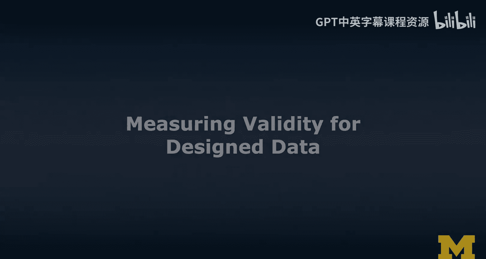
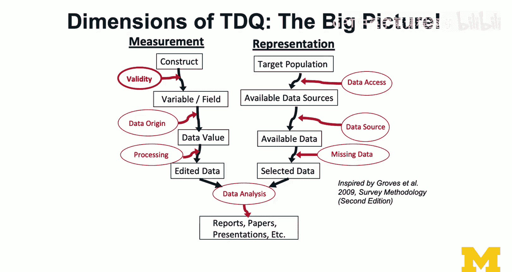
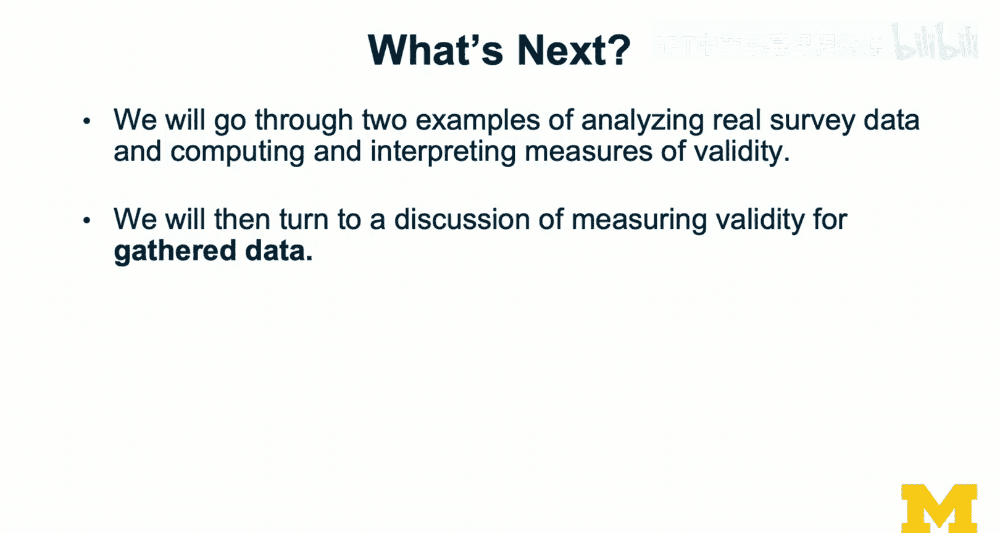

# 密歇根大学《总体数据质量（框架、度量、设计策略）total data quality》 p45 1_设计型数据效度测量.zh_en -BV1Jn4y1X7uS_p45-

Okay， hello everyone。In this lecture， we're going to talk about techniques to measure validity specifically for design data。

So let's revisit our big picture for the total data quality framework we're going to start in this course talking about techniques for measuring validity。

 so this is on the measurement side of the overall total data quality framework where recall that in the case of validity we're talking about the variable that we're actually using to measure a theoretical construct and whether or not that variable provides a valid measure of that particular construct so in the first course in the specialization we talked about validity as a concept now we're going to talk about techniques for how to measure validity and make sense of whether the variables that we're actually using are in fact valid indicators of the theoretical constructs that we're interested in so we're starting here with validity on the measurement side of the total data quality framework。

So some of the tools for measuring validity that are available。

 there's a variety of statistical tools that exist for measuring validity when you're working with design or in the case that we'll focus on here survey data。

 we're going to be focusing on two tools in particular one is called structural equation modeling or SEM and SEM enables assessment of the validity and the reliability of several observed survey variables that supposedly measure the same constructs so we'll talk about the distinction between validity and reliability。

 Another technique that we're going to talk about is testing。

 measurement and variance and what this does is it allows analysts to determine whether survey measures are equally reliable across different subgroups of the target population and we're going to introduce several other tools for measuring validity in addition to these two main tools that we're going to focus on but will focus most of our time on these tools in particular。

Now there are different types of validity， so our focus is going to be on face validity。 That is。

 what are we trying to measure and how exactly are we measuring it。

 so is the variable that we're actually measuring providing a valid indicator of the theoretical construct that we're trying to measure。

Other types of validity include temporal validity。 And there the question is。

 do the measures that we're using remain valid over time so is a measure continuously valid as a measure of some theoretical construct as time moves on different decades。

 different years， even different points within a small time period。

 Are we consistently getting valid measures of the same construct？

 Another types of validity is external validity， And the question here is。

 would we arrive at the same findings in another data set or another context。

 So are our measures equally valid whatever context that we're working in or in a different data set aside from the one that we're using at the moment for a given study。

 These other types of validity are more common for longitudinal design data or longitudinal survey data。

 and they're often assessed by looking at the correlations of variables either across time or across different data sets to see if they're equally valid。

So here's one example of structural equation modeling and specifically this is known as confirmatory factor analysis。

 Suppose that you have three observed variables that you're measuring by design， for example。

 they could be liquor type survey items strongly disagree all the way up to strongly agree。

And your theory suggests that these items indicate one latent or unobserved construct and we're calling that Lv1。

 So you can see that Lv1 is indicated in a circle here as a latent variable and then x1 x2 and x3 are the three different variables that we actually observe in squared boxes as indicators of this theoretical construct so that latent variable Lv1 predicts the values that are observed on each of those three variables and the question is whether these are reliable and valid indicators of that latent construct that we're trying to measure So you see the latent variable predicts each of the three observed variables and then there's some error in those predictions。

 those are those additional epsilon 1， epsilon 2 and also epsilon 1 error circles here in this particular diagram So those paths leading from the latent variable to the observed variables。

 those are called loadings。 you can think of these like weights that express the strength of the relationship between our latent construct and each of the variables that we're actually observing。

We can estimate these in an analysis。We also note again that the latent construct predicts the scores in each observed variable with some error。

 And again， these are those epsilon circles。 So the question here that we're wondering about is are the loadings consistently high and similar for different subgroups in your study。

 or does the latent construct not predict some observed variables for certain subgroups meaning that a particular observed variable may not be a valid indicator of that particular construct。

 So that's what we tend to focus on with confirmatory factor analysis。

More generally we think about measurement models as a way to measure validity associated with particular items。

 so one can fit these structural equation models or SEMs or perform confirmatory factor analysis like we had just discussed for the items that define a scale in a design data collection and again these are the items that claim to measure a particular latent or unobserved construct and with this type of analysis one can also formally test for measurement invaris across different subgroups of cases and we've included a link here to a nice tutorial that walks you through the process of checking for measurement invariances we'll see this in an example as well。

So if the hopefully high correlations of these items in fact vary across different subgroups in the data set。

 this is going to show up in this kind of analysis and different approaches to writing our design questions may be necessary for different subgroups in our target population。

 for example， males and females。Other applications of structural equation modeling to measure validity include multi trait multi method or MTMM models in this structural equation modeling framework to quantify validity in questionnaire evaluation studies。

 and again， this is an important part of pretesting of design data collections。

These MTMM models can be used to estimate what are called validity coefficients。

 which capture the relationships between true values and the measures of interest that we're collecting。

 So Sarah and Gohoeffer in the 2007 article in the references that we'll see provide details about the MTMM approach。

 given the necessary data， these MTMM models can be fitted in using standard SEM software。

 and we're actually going to see an example later in this week。

Another technique for measuring validity is to analyze benchmark data。

 so if you're given benchmark data for measures of interest or what might be called gold standards。

 you can analyze the correlations of your survey responses with these benchmark values。

 And the question here is， are these correlations sufficiently high High correlations between what you're actually measuring and these gold standard benchmarks would suggest that you're collecting more valid measurements。

The difficult part about benchmark data is it's generally difficult to do this with attitude and opinion data that are collected in many kinds of surveys because we don't have a gold standard for those kinds of measures。

 so it's more difficult to assess validity with attitudes and opinions。

Now another important point about measuring validity is that combining design and gathered data can really help with measuring validity so as one example DA and colleagues in a 2018 study linked data from the 2012 national survey of early care and education with commercially available proprietary real estate and property text information from Zillow。

com and they considered the zillow。com data to be benchmark data for the full sample that was selected for the survey they linked these data files together using the addresses and then the research team used each of these two data sources to evaluate the quality in the other data source Furthermore they leveraged property data that was available for all of the sampled units and not just the survey respondents in Zillow to assess potential non-response bias in the survey。

And this this group of authors offered a generalizable approach for investigating the quality of other data sources。

 and they illustrated how such investigations can inform and improve analyses using linked data。

 So linking data from other sources is a very useful technique for measuring the validity of a particular set of measures。

 and here， they could measure the validity of measures collected in the survey using data that were available in Zillow。

 co。 again， considering the Zillow data to be like a benchmark。

Some additional techniques that you might come across in practice for measuring validity include measuring translation errors or translation induced errors and there's an example in the references here by Harkness and colleagues in 2004 this is more of a qualitative type of evaluation of the validity of particular survey items Another popular technique is to measure differential item functioning this paper by Melenburg at all in 1989 talks about that kind of approach where people with equal capabilities might arrive at different scores on a particular survey scale due to the wording of particular items。

Additional techniques include question evaluation methods in Maitland Ipressor in a 2016 paper provide a nice overview of these different possible methods。

 these can be used to identify potential problems with survey questions and assign quality scores to the questions and so recall of those of you who have taken course number one in this specialization we looked at a survey quality predictor and we looked at quality scores for different types of questions。

 That's one of the methods that was evaluated in this Maitland impresspressor paper。

Another technique is computing Chrobox alpha， and this is specifically a technique for examining the reliability of the items that define a survey scale。

 and we note again， that reliability is not validity。

 but rather an indication of whether multiple items are effectively measuring the same construct。

 are multiple items all having a high correlation with each other。

 Chromeboxox alpha provides a nice summary of that。Okay。

 so now we've introduced these different techniques for measuring validity of design data next we're going to go through two examples of analyzing real survey data and computing and interpreting measures of validity and then we'll turn to a discussion of measuring validity specifically for gathered data Thank you。

