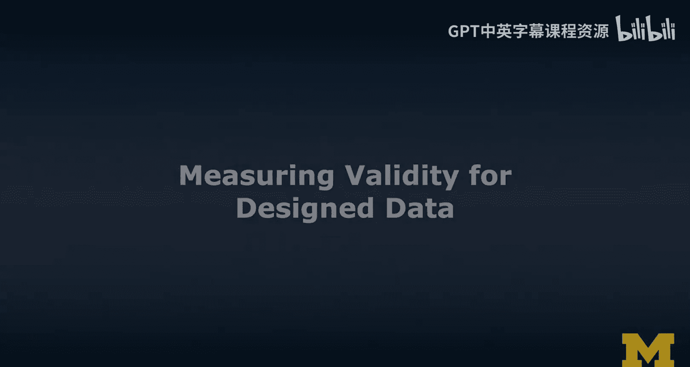
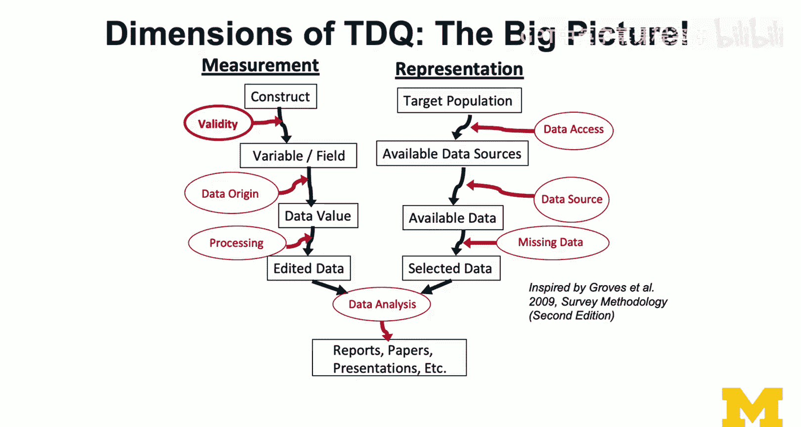
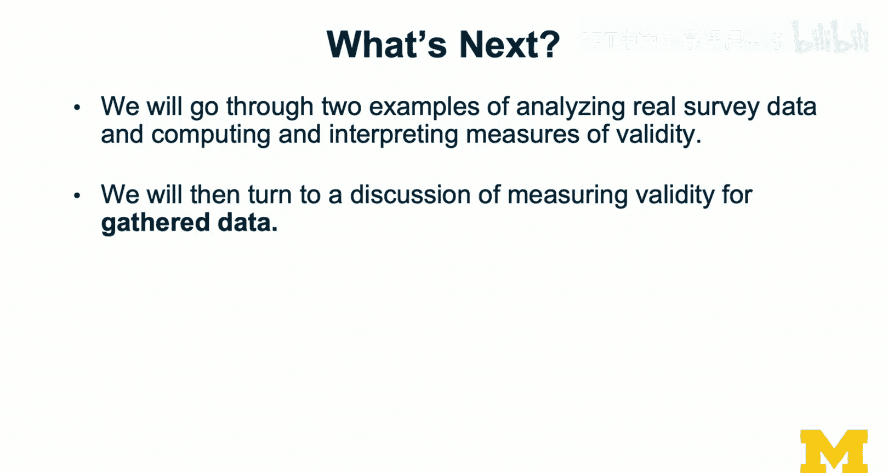

# 总体数据质量：1：设计型数据效度测量 📊

在本节课中，我们将学习如何测量设计型数据（特别是调查数据）的效度。我们将介绍多种统计工具和方法，帮助你理解并评估你所使用的变量是否能有效衡量你感兴趣的理论构念。

---

在总体数据质量框架的测量侧，我们关注效度。效度指的是我们实际使用的变量，是否能够有效衡量某个理论构念。在本系列的第一门课程中，我们讨论了效度这一概念。现在，我们将深入探讨如何测量效度，并判断我们使用的变量是否确实是有效指标。

---

## 效度测量工具概览

有多种统计工具可用于测量设计型或调查数据的效度。我们将重点介绍两种主要工具，并简要提及其他方法。

以下是可用的效度测量工具：

1.  **结构方程模型**：特别是验证性因子分析，用于评估多个观测变量对同一构念的效度和信度。
2.  **测量不变性检验**：用于分析调查测量在不同目标群体子组中是否具有同等信度。
3.  **基准数据分析**：将调查数据与“黄金标准”基准数据关联，通过相关性分析评估效度。
4.  **数据链接**：将设计数据与其他来源的收集数据结合，相互验证以评估效度。
5.  **其他定性或定量方法**：如翻译误差评估、差异项目功能分析、问题评估方法以及计算克朗巴哈系数等。

---

## 效度的不同类型

效度有多种类型，我们的重点将放在**表面效度**上，即我们测量的变量是否有效指示了我们试图衡量的理论构念。

其他类型的效度包括：
*   **时间效度**：测量工具是否随时间推移保持有效。
*   **外部效度**：测量结果在其他数据集或背景下是否同样有效。

这些效度类型在纵向设计数据中更常见，通常通过观察变量在不同时间点或不同数据集间的相关性来评估。

---

## 核心测量工具详解

上一节我们介绍了效度的类型和可用工具，本节中我们来看看两种核心工具的具体应用。

### 结构方程模型与验证性因子分析

假设你有三个通过设计（如李克特量表题项）观测到的变量：`x1`, `x2`, `x3`。你的理论表明，这三个变量共同指示一个潜在的、无法直接观测的构念 `Lv1`。

在验证性因子分析模型中，潜在变量 `Lv1` 被设定为预测三个观测变量的值。其关系可以用以下公式表示：
`x_i = λ_i * Lv1 + ε_i` （其中 `i = 1, 2, 3`）

*   `λ_i` 称为**因子载荷**，表示潜在构念 `Lv1` 与观测变量 `x_i` 之间关系的强度。
*   `ε_i` 表示**测量误差**。

分析时，我们会估计这些因子载荷。我们关注的核心问题是：对于研究中的不同子组（例如男性和女性），这些因子载荷是否 consistently 保持较高且相似？如果潜在构念无法有效预测某些子组的特定观测变量，则意味着该观测变量对该子组而言，可能不是该构念的有效指标。

更广泛地说，测量模型是评估与特定题项相关的效度的一种方式。我们可以为设计数据收集中定义量表的题项拟合结构方程模型或进行验证性因子分析。此类分析还可以正式检验不同案例子组之间的**测量不变性**。

结构方程模型的其他应用包括**多特质-多方法矩阵模型**。该模型可用于估计**效度系数**，以捕捉真实值与我们收集的测量值之间的关系。

### 基准数据分析

如果你拥有感兴趣测量的基准数据或“黄金标准”，你可以分析调查响应与这些基准值之间的相关性。

核心问题是：这些相关性是否足够高？高相关性表明你收集的测量值效度更高。

然而，基准数据分析的难点在于，对于许多调查中收集的态度和意见数据，我们通常没有“黄金标准”，因此评估这类测量的效度更为困难。

---

## 通过数据链接提升效度评估

结合设计数据和收集数据可以极大地帮助测量效度。

例如，在一项2018年的研究中，研究人员将《2012年全国早期护理与教育调查》的数据与来自Zillow.com的商业房地产信息相链接。他们将Zillow数据视为整个调查样本的基准数据。

通过地址链接这两个数据文件后，研究团队利用这两个数据源相互评估对方的数据质量。此外，他们还利用Zillow中所有抽样单元（而不仅仅是调查受访者）的房产数据，来评估调查中潜在的无应答偏差。

这种方法提供了一种可推广的途径来调查其他数据源的质量，并说明了此类调查如何能为使用链接数据的分析提供信息并加以改进。

---

## 其他效度测量技术

除了上述核心方法，实践中你可能会遇到其他一些效度测量技术：

*   **测量翻译误差**：对调查题项进行定性的效度评估。
*   **测量差异项目功能**：分析具有相同能力的人是否因题项表述而在特定调查量表上得到不同分数。
*   **问题评估方法**：用于识别调查问题的潜在问题并为问题分配质量分数。
*   **计算克朗巴哈α系数**：这是一种专门用于检验定义调查量表的多个题项**信度**的技术。需要再次强调，**信度不等同于效度**。克朗巴哈α系数衡量的是多个题项是否在有效地测量同一构念，即它们彼此之间是否具有高度相关性。

---

## 总结

本节课中，我们一起学习了测量设计型数据效度的多种方法。我们从总体数据质量框架下的效度概念出发，介绍了包括结构方程模型、验证性因子分析、基准数据分析、数据链接在内的核心工具，并简要概述了其他辅助技术。理解并应用这些方法，对于确保你所收集的数据能够真实、有效地反映研究目标至关重要。接下来，我们将通过两个真实调查数据的分析示例，具体演示如何计算和解释效度测量值。