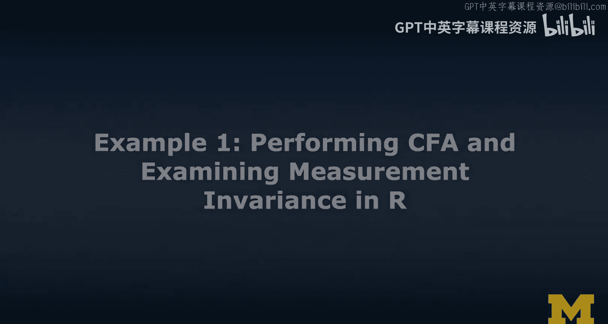
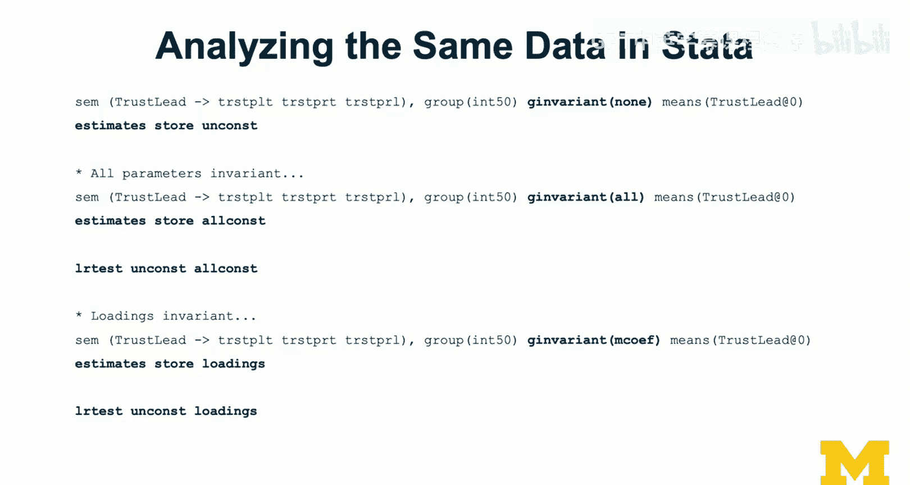
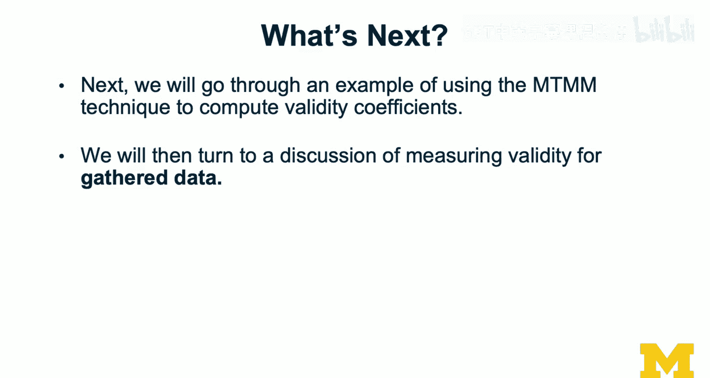

# 密歇根大学《总体数据质量（框架、度量、设计策略）total data quality》 p46 2_示例1：R语言中的验证性因子分析与测量等值检验.zh_en -BV1Jn4y1X7uS_p46-

Okay， hellello everyone， now that we've talked about some different techniques for measuring validity and design data。

 we're going to look at an example using the R software of performing confirmatory factor analysis and examining measurement invariance。

 using tools that are available within the R software。

Okay， so just again， keeping that big picture for the total data quality framework in mind， again。

 our focus right now is on measuring validity and making sure that we have good valid measures in terms of the variables that we're using of a theoretical construct of interest。

 so we're talking about techniques for measuring validity on the measurement side of the total data quality framework always important to keep this in mind。

So we're going to look at a real example using the R software so we're assuming here that you have the R studio software loaded on your own machine and ready to go and we're going to walk through the syntax and see how to do these different analyses and then interpret the results Our focus is going to be on fitting confirmatory factor analysis models and then testing for measurement andvari across subgroups and we're going to use the Levan package in the R software in order to do this and we'll see how to load this package and make sure that we can use it We're going to be using example data from the European social Sur and you'll see this data set available in the materials for this week's lectures。

Now we've included a web link here that you can visit for additional details and a tutorial about using different functions within the Levan package。

 and you can visit this at your leisure to read a little bit more about the types of functions that we're using in this example today。

Okay， so again， the data that we're using is from the European Social Survey or ESS。

 and specifically we're working with survey data from Belgium。

 so the European Social Survey collects survey data。

 design survey data in many different European countries。

 Belgium being one of them and we're using data from Belgium in this example。

 the problem that we're looking at is whether there is measurement invari in the way that a latent construct that we'll call trust in leadership。

Is measured across groups of respondents and those groups of respondents are defined by whether or not the response rates of their interviewers are either above or below 50%。

 So in other words， we want to see， are the interviewers who are consistently achieving higher response rates in this design data collection。

 Are they getting more reliable measures。 in terms of trust and leadership than the interviewers who are achieving lower response rates。

 this is more of a methodological question to see if there' is this link between the non-response that interviewers are introducing in the data collection and whether or not the measures collected are of high quality。

Now the observed survey variables in the European Social Surve that we are believing to be indicators of this latent construct called trust in leadership are trust in politicians。

 trust in political parties and trust in Parliament。

 and the survey respondents asked about each of these different types of trust on a scale between zero to 10。

 where 10 indicates that they have the most trust and0 indicates that they have the least trust。

So first we'll do some data management and I'll flip over to the our studio software here to show you how this is working we're going to start by loading the ESS Belgium data again that are available in the materials associated with this particular example。

Then we're going to define our two subgroups of interest in the population。

 again based on the response rate of the interviewer for that particular case。

 These two subgroups could be anything。 We're just using the response rates in this case to define the two subgroups。

 We'll look at a summary of that new in 50 variable to see how many respondents had low performing interviewers。

 less than or equal to 50% response rates。 and then we'll get rid of missing values。

 We want to make sure that when we at when we're analyzing the actual data。

 We're not analyzing missing values。 and those are coded with an 88 on these three different variables。

 We want to make sure that those values of 88 are not considered in the actual analysis。

 Then we'll just look at the dimensions of the resulting data set in terms of how many cases there are and how many variables there are。

 Okay， so I'm going to switch over to our studio。Here we are within the Rt environment。

 First thing I'm going to do is load that our data file that you see available in the materials containing that ES Belgium data so you can download that R data file anywhere on your machine once you have our studio involved installed and then I'm going to click open on that particular data file you'll get a question that says do you want to load the R data file into your environment you can go ahead and click yes。

 and that will load the ESS Belgium data so I see now that's showing up in my environment as an actual data file and I see that there are 17003 observations on 26 different variables as part of this design data collection。

Once I have the ESS Belgium data loaded， again， I'm going to execute these two lines here to define those two subgroups。

 I'm defining a new variable called INt50 in the EsS Belgium data frame object and that variable is being defined by whether the int are our field in the ES Belgium data frame is either less than or equal to 50 or greater than 50 so less than or equal to 50 cases are going to get a1 on this new variable greater than 50 cases are going to be get a 0 and those are going to be my two subgroups for the purposes of this analysis so I'll highlight those two lines of code here click on the run button in order to run those two lines now I have that additional variable you can see I have 27 variables now in the ES Belgium data frame。

Now， I can look at a simple summary of that new variable that I just created， again。

 indicated with a dollar sign here and then the name of the variable。

 and I see like we saw in the slides that 47。56% of my cases were with a lower than or equal to 50% response rate interviewer。

Next， importantly， we want to remove all those cases where there are missing values so we want to remove cases where there are missing values on trust in Parliament trust in politics and then trust in political parties and again。

 those are all indicated with in 88 on each of those variables where again we don't want to analyze those。

 So I'm creating a new version of the data frame object that is dropping those rows where those variables are equal to 88。

 That's what this syntax is doing here。 and I'm keeping all of the columns in the data set。

 That's why there's nothing after a comma here。 So I'll run this particular line And after doing that。

 I see that that Ess do red data frame object is now down to 1674 observations because I've taken out the missing data and I can look at the dimensions of that data frame object in terms of rows in columns just by running this dim function here。

 I see 1674 rows，27 columns for variables。Now， to do the confirmatory factor analysis within R。

 one way of doing that is to load the Levan contributed package。

 and that's what this library lavan statement is doing here。 In order to do that。

 you first need to install the lavan package， and you can do that by going into this packages window down here in the lower right。

 click on the packages tab and then click the install button。Okay， and to do that。

 you just type the name of the package that you want to install the contributed package。

 I just type Levan here and then click install， and our will take care of the installation of that contributed package for you。

 excuse me， our studio will take care of that for you。 I've already installed the lavan package。

 I'm not going to do this again。 But this is the way that you would install one of these contributed packages。

 Then to actually load the package so that the functions within that package are available for analysis。

 We're going execute this command that says library and then Levan in parentheses。

 that loads all the functions from the Levan package。 Okay， so I'm going to go ahead and run this。

so now all those functions are available for analysis within the ourt software。

 So we've loaded that Levan library， and now we're going to fit the unconstrained model in this particular example using the CFA function。

 Now what we mean by the unconstrained model is that each of the two groups depending on the interviewer response rate are allowed to have different factor loadings so different parameters defining that confirmatory factor analysis。

 So we're allowing for heterogeneity between these two different groups in terms of those loadings。

 which remember where the relationships of that latent variable with the observed indicators that we have in our survey data set so the way that we fit this unconstrained model。

 allowing for unique loadings for each of the two subgroups is we first of all define this model object called trust model here and in single quotes。

 we indicate the name of our latent variable， again， this is not a variable in data。

 this is a name that we make up。And then we say that that latent variable is defined by with this equal sign in a tillde。

 these three observed variables， so these are the three observed variables that we believe provide indications of this latent variable here。

Once we have that trust model specification， then we use the CFA function where the first argument that we enter that function is the trust model object that we just defined up here。

 defining the latent variable and the observed variables。

 Then we indicate the name of our data frame object。

 this is that reduced data frame that we just created， and then in the third argument。

 we indicate the group variable， the variable that defines different groups in this overall analysis of measurement and variance。

Now， this actually performs the analysis and saves the results in an object called fit to look at those results。

 we can then apply the summary function to that fit object。Okay， so let's go back to our studio。

 I'm just going to highlight those three lines of code that we just went over in the slides。

 provided that we have the Levand package installed and loaded I'll go ahead and run those and after a couple seconds。

 you see that R generates estimates of each of those loadings。

 the variances of the errors for each of the observed variables and also the intercepts or the means for each of those observed variables。

 And if you look at the output down here in the window。

 you can see that there are different estimates of those loadings for each of the groups。

 So you see group one up here and group  two down here and each of those groups is allowed to have a different loading and we want to see whether those two groups do have the same loadings or whether those loadings are different between the groups and that's what we're gonna to be checking here。

 you also see the variances of the prediction errors based on that latent variable for each of those observed variables down here at the bottom of the output again for each of those groups So each group is allowed to have a。

Completely unique set of parameters defining that structural equation model。

 You also see some other summary values for this overall analysis。

 the number of observations per group， and then a test statistic。

 which we'll come back to in a second。 but that fits the initial unconstrained model where the two groups are allowed to have completely unique parameters and we want to see if we can force those loadings to be equal to each other and meaning that each group would have equally reliable measures of that latent variable。

Okay， so I'm going to go back to the slides here。So， again， in the summary。

 you see the estimated loadings， the estimated variances and covariances of those latent variables。

 including those errors in prediction。 And this unconstrained model assumes that each group is unique。

 Now， you'll also notice that by default， one loading for each of the factors is fixed to be one。

 This is to make sure that that latent variable is scaled。

 so one of those loadings has to be fixed to one as a way of providing a scale for that latent measure again。

 because it's not in the actual data set。 So these results， again。

 allows us to take an initial look at the amount of invariance between the groups。

 Does it seem like those loadings are similar to each other or not。

So what we're going to do next is then constrain those factor loadings to be equal to each other and test the difference in the fit of that model between the constrained and the unconstrained models。

 So in other words， does forcing those loadings to be equal across the subgroups make sense or is trust and leadership being measured in the same way across each of these different subgroups or is that kind of constraint significantly reducing the fit of this model to the observed data。

 meaning that each subgroup does， in fact， have its own unique set of factor loadings。

Okay so the way we're going to do that is again， use the CFA function， same model， same data set。

 but now we're adding this argument that says group do equal and we're setting a particular aspect of this confirmatory factor analysis to be equal across the two subgroups we're indicating that with in double quotes here the term loading。

 So we're saying the loadings again， those relationships of the latent variable with each of the observed variables are fixed to be equal across these two different groups and the group variable remains the same as well。

 once we fit this model and look at this fit loads object。

 we can then look at the summary function of fit loads to look at the results。

 in addition to seeing a test of whether constraining the loadings to be equal improve the fit of the model or caused a poorit of the model to the observed data Now along with the materials for this week。

 we've created a word document that contains the R output that we're generating here in this example。

 So you can review that output in that。That wordord document as well。Okay。

 so let's go back to our studio， here's the same syntax that we saw on the slides。

 we're going to fit that model that forces the loadings in each of the two subgroups to be equal as opposed to letting them be variable across the subgroups and then look at a summary of those results。

Okay， so I'm going to go ahead and run that highlighted code here。 Now， if you look at the output。

 and again， you can see this in the word document that goes along with this example。

 Now you'll notice that the loadings here。Are set to be equal。

 So here here are the loadings for group 1。 Here are the loadings for group 2。

 And you can see that they're forced to be exactly equal。 So the question is。

 is that a good fit to the observed data or should the two subgroups continue to have different loadings representing the relationships of the latent variable with each of those observed variables。

 Now， in this， in this kind of setup， we actually get a test of the null hypothesis that each group has the exact same factor loadings。

 That's what you see in this part of the output called model test user model。

 This is a test statistic comparing the fit of this model to a model where all of those loadings are allowed to differ between the two groups。

And this test statistic is pretty large， which means that the fit has been significantly reduced compared to that model where the loadings were allowed to vary between the different subgroups。

 So the significant P value here suggests that we would reject a null hypothesis that each group has the exact same factor loadings and conclude that those loading should be allowed to vary between the two groups。

 So， in fact， the loadings for that latent variable leading to the observed variables were different between these two groups If that P value was not significant that would provide support for the constrained model where both groups had the exact same types had the exact same loadings Me that trust and leadership was being measured the same way in the two groups。

So this tells us that there's evidence that trust in leadership is being measured in a different way between those two groups and if we look back up in the output at that unconstrained model。

 it seems like trust in Parliament has a weaker relationship with trust in leadership than in the second group here which is the higher response rate interviewers。

 so it seems like there was more reliable measurement of trust in leadership among that higher response rate group that group that was coded 0。

 as you can see the loadings 。959 and 。837 are about equal to the first loading for trust in parties and then a little bit lower in the case of trust in Parliament came down to about 0。

707 so it seems like there's a little bit better measurement of this latent variable in the higher response rate group of interviewers overall。

Okay， so just to review that significant likelihood ratio test suggests that the fit of the constrained model with the equal loadings is significantly worse than that of the saturated or the unconstrained model where all the parameters are allowed to vary。

 So at this point in assessing measurement andvari。

 we'd stop and conclude that we don't even have evidence of what would be called weak measurement and variance。

 where those loadings are fixed for the two different subgroups of interest。

 So these two groups of interviewers appear to be measuring different constructs based on the observed values on these three variables。

 And in fact， the correlation seems a little bit weaker in that high response rate group。

So some additional points on this example， the same approach can be used when using the SEM function in LeV for MGA and again for multigroup analysis。

And you can take a look at that aforementioned webage for examples of additional constraints that can be tested following the steps that we discussed earlier。

 just remember to stop if the likelihood ratio test is significant at any given step in testing for measurement andvariance。

 because that means that the constraints that you're introducing are resulting in a significantly worse fit of this model to the observed data and adding those constraints didn't make a lot of sense。

Specific standardized tests of measurement invari in this confirmatory effect analysis context are also possible using the measurement invariance function in the R package SEM tool。

 so that's another R package that you could use to test for measurement andvari。

We've included this slide here just to show that the same kind of analysis can be done using other software。

 so this is in the status software， which is another general environment for a statistical analysis。

 and this is just showing SEM commands that can be used to perform the same kind of test of measurement andvari where you can compare the unconstrained model which would be this G invariant nu model at the top to this constrained model where the loadings were the same indicated here by G andvari M coF。

 and then we can do a likelihood ratio test comparing the fits of those two models like we did with an R to see if the constraints are reducing the fit of the model。

Okay， so this has been an example of using confirmatory factor analysis to test for measurement invari across different subgroups。

 Next up， we're going to go through an example of using the multi trait multi method technique to compute validity coefficients。

 So we're going to look at an onlineline example of how to fit these kinds of models using our and then interpret those results。

 and we'll then turn to a discussion of measuring validity for gathered data。 Okay， Thank you。

