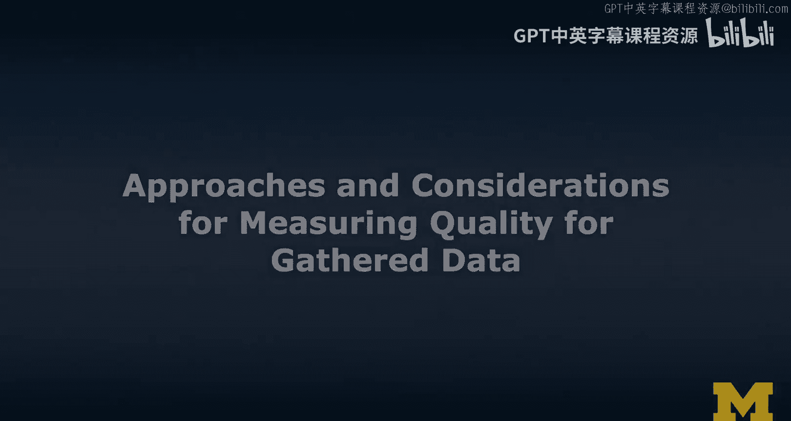
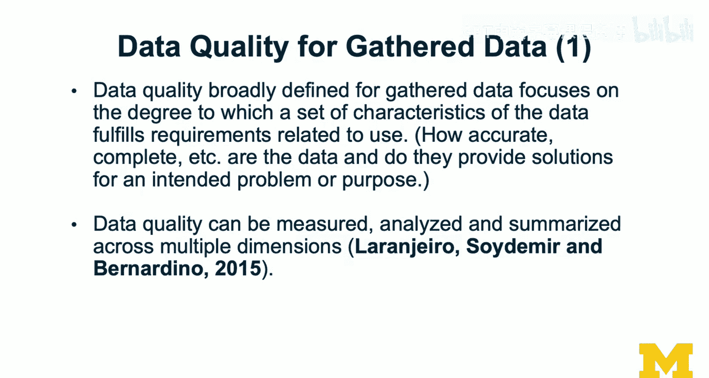
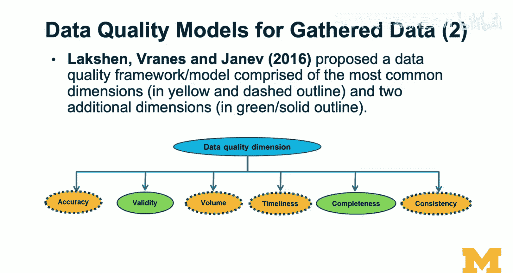
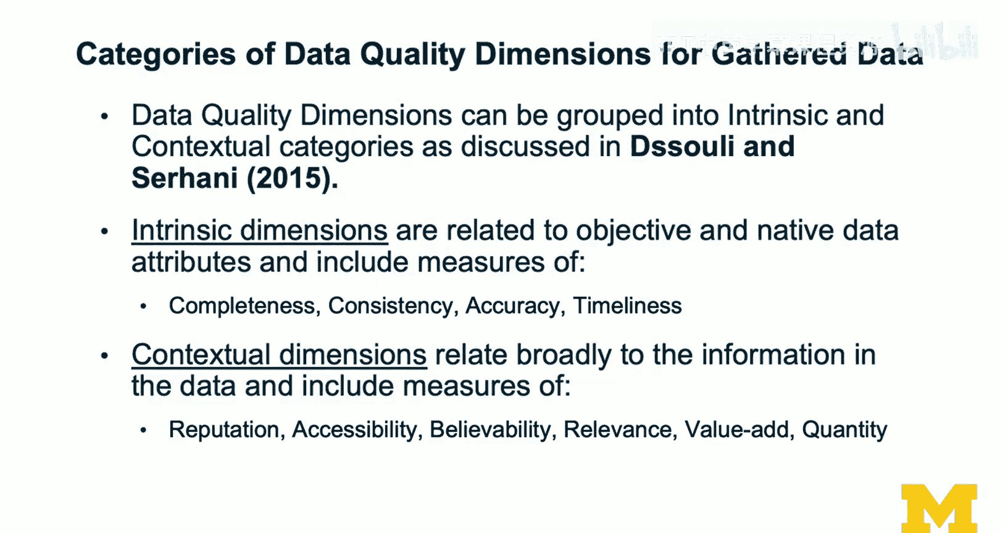
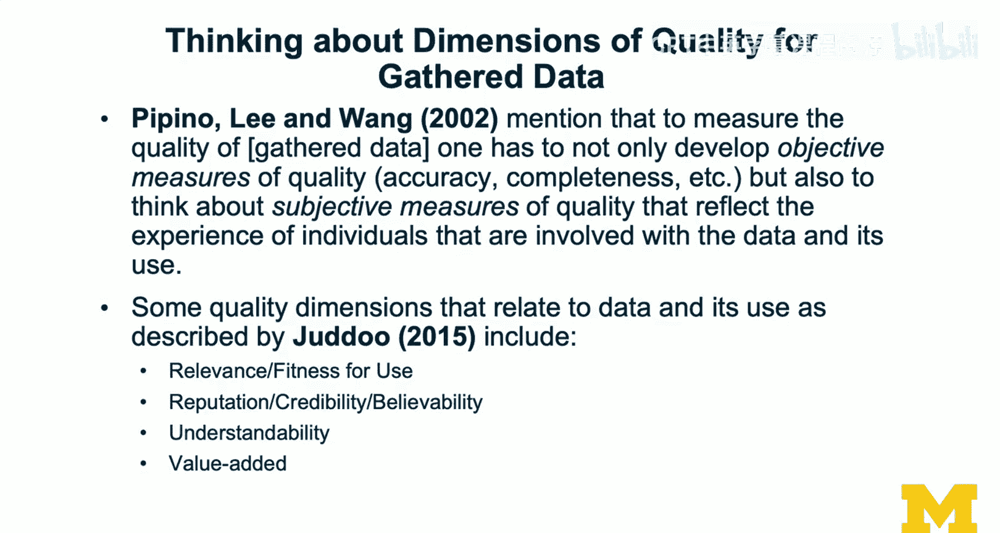
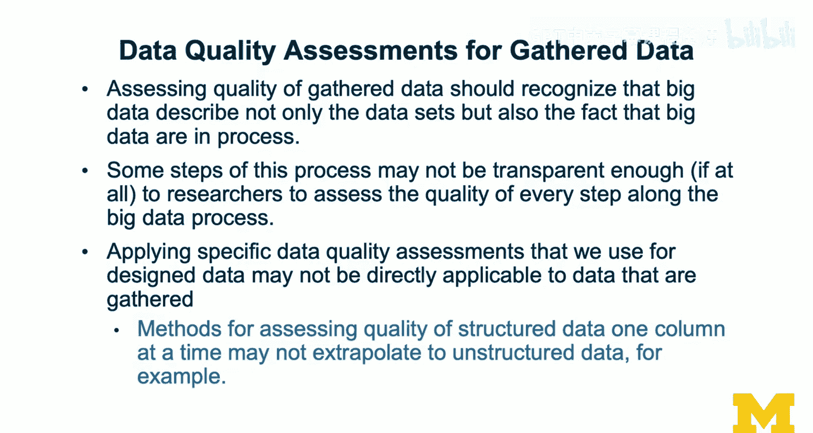
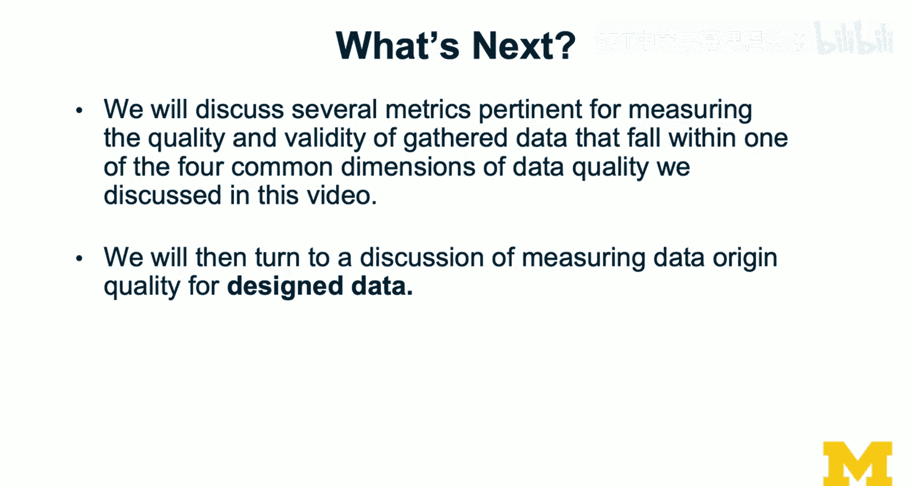
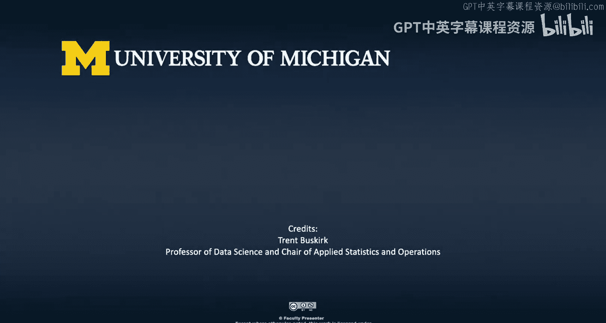

# 密歇根大学《总体数据质量（框架、度量、设计策略）total data quality》 p47 3_采集型数据质量测量的方法与考量.zh_en -BV1Jn4y1X7uS_p47-

Hi， I'm Drrent Buskirk。 Today， we're going to be talking about approaches and considerations for measuring quality for gathered data。

 Thanks for joining us。 Just to give you an overview of where we are in our framework。

 we're going to park a little bit on validity and the concepts around measuring that for gathered data。

 There are a few aspects of gathered data that are a little bit unique。

 And so we're going to really talk a few moments about how those unique properties of gathered data might affect the way we think about measurement of these properties。

 Data quality broadly define for gathered data focuses on the degree to which a set of characteristics of that data fulfills requirements related to its use。

 We collect， and we gather data for many different uses。

 And so understanding the context of the use is really important here for making an assessment of quality。

😊。

So for example we might ask how accurate or complete the data are。

 do they provide solutions for an intended problem or purpose。

 these are all questions that sort of provide context to help us evaluate the quality of gathered data。

 very similar to what we would do for design data。

Data quality can be measured， analyzed and summarized across multiple dimensions。

 And so we're going to talk a little bit about those dimensions and what those definitions are。

 A data quality dimension refers to a measurable data quality property that represents some aspect of the data。

So these dimensions are used broadly to understand and manage data quality through the pipeline。

 Remember that much gathered data are data in motion。 There is a pipeline aspect to it。

 And so when we think about using these quality dimensions。

 it helps us to figure out how much quality there is in the data as it progresses through the pipeline。

Data quality metrics are developed specifically for each dimension of data quality。

 When you see a number that represents quality， a quality measure for gather data。

 it's going to be the realization of a metric。 This is how we are going to operationalize the measurement of quality。

Several metrics can be used within a given dimension。

And a metric is an equation or a formula developed to compute an actual number。

 score or ratio that quantifies the quality dimension that we're talking about。

 The assessments of quality of gathered data can come from focusing on a single dimension。

 but usually in practice， data quality models or frameworks are proposed that incorporate multiple dimensions and include specific metrics for each dimension。

 We need those metrics to come up with the numbers that are going to allow us to make the final assessment of quality。

There is obviously some variation in the dimensions that are used within these frameworks。

 There isn't a one size fits all framework， and there isn't a one size fits all metric for each dimension。

But there does seem to be a common set of dimensions that are included in many of these data quality models。

 as reported by Laction and colleagues in 2016。 and we're going to talk a little bit about what some of those common elements are。

 This literature proposed Laction and colleagues proposed to data quality framework that comprised the most common dimensions。

 and these are in yellow， accuracy， volume， timeliness， consistency。

 These are the most common used dimensions。 and two additional dimensions in solid validity and completeness。

 we're going to talk through a little bit about how we would measure each of these dimensions and provide specific metrics that are actually going to be used to operationalize those measures。

Data quality dimensions can be grouped into what we call intrinsic and contextual categories。

 The intrinsic dimensions are related to objective and native data attributes。

 including completeness， consistency， accuracy， timeliness。

 contextual dimensions relate broadly to the information of the data and include measures of reputation。

 accessibility， believability， relevance， value add and quantity。

 So a contextual dimension might be something like we've used this data before。

 and we were very successful in using Twitter data to estimate some outcome of interest。

 So the Twitter data itself for that particular purpose has a positive reputation based on your prior experience。

 This is a contextual dimension that one might operationalize。

 An intrinsic dimension might be that out of 100 cases that you were able to gather。

 you only have complete data for 50 of those。😊。

Case this is an intrinsic dimension that is an objective or native attribute of the data set itself。

Pppino and colleagues mentioned that to measure the quality of gathered data。

 one has to not only develop objective measures of quality， like we've already discussed。

 but also to think about subjective measures of quality that reflect the experience of individuals that are involved with the data and its use。

 These are those contextual factors that we talked about earlier。

Some quality dimensions that relate to data and its use， as described by judo。

 include the relevance or fitness for use。 So is this data useful for its intended purpose。

 What reputation or credibility or believability does this data have。Is the data understandable。

 and it does it add value for your particular case？

 So an example of credibility or believability might be that you're going to give censors to each of the individuals in your study and you're going to gather a lot of information about their movement。

But if during the consult with these individuals， you find that people are not able to wear these cs on their waist。

 but instead， they're putting them on their shoe。The measures may not actually be generating accurate assessments of what you're trying to measure。

 So in that case， the results that you're getting from that data aren't going to be believable as measures of physical activity。

 because the signals are not very consistent simply because people didn't wear the sensors correctly。

 So there is this element of context and believability that could impact your decision to as to whether or not that data are of sufficient quality for the intended use。

Throughout this some of these lectures in this course in course too。

 we're going to be talking about some of these factors in more detail。

 so please stay tuned for more of these more details。

 more examples of these kinds of things and we'll sort those out as we continue to discuss this in the course。

 assessing the quality of gathered data should recognize that， of course。

 big data describe not only the data sets， but also the fact that big data are in process。

 as I mentioned earlier。

Some steps of this process may not be transparent enough to the researchers to assess the quality of every step along the way。

 So， for example， you may not be able to go back to where the data are recorded because you don't have access to the recording mechanism or at the you're not available the the time at which that data were recorded。

 is not open for the researcher。 This is way back into the sort of beginning phases of where that data generated According to a data generating process that you don't have control over。

So applying specific data quality assessments that we use for design data may not be directly applicable to the data that are gathered。

 so for example methods for the quality of structured data one column at a time may not extrapolate to unstructured data where we don't even have columns so we don't necessarily have direct analogs for what we do in the design data space for the gather data space necessarily。

 but what is consistent is our ability to measure many of these things。

 but our ability to apply the exact metric or the exact method of measurement may be different。

 and this is where we have to adapt these different frameworks that are developed for gathered data。

Throughout this specialization， we are deploying an overarching framework for identifying。

 measuring and maximizing data quality for both design and gathered data。

 So what is common to both types of data are the dimensions of measurement and the representation quality that were concerned about like validity。

 data access and so on， which is similar to the diagram I showed you。

 just as we started this lecture。But what can vary throughout this process or across these data types are how these quality dimensions can be measured and in some ways operationalized。

For example， for design data， we spend a lot of effort on developing valid measures and questionnaire items of constructs that we want to measure in our questionnaires。

For gathered data， we may place greater emphasis on how the data are processed once they are obtained throughout this pipeline process。

 Shu and colleagues in 2020 note that compared with design data。

 researchers have far less control or influence over how data are generated for gathered data。😊。

The data generating process for gather data is often more opaque。 We often do not understand。

 or we cannot go back all the way to the point of where the data are captured for gathered data because we don't own or control that process。

 or these data were never intended for research purposes in the first place。

 And so they're captured or they're gathered in very different ways that are not necessarily available to the researcher。

The opaqueness may impact the ability to vet or measure construct and internal validity， for example。

And gather data rely more on automated tools to process the data。

And then that convert the input data into data that are useful for research purposes。

 If you imagine sensors， for example， as you're measuring physical activity。

 sensors are converting that those movements into measures that are useful for researchers。

 So with gathered data， the concept of scales or items from a questionnaire may be replaced with multiple measures from keywords。

 for example， and other metadata that are combined to indirectly measure the construct。

 So for gather data， we may not necessarily have control over how we ask a question or how we capture data。

 but we might have a say in what data captured through the specification of keywords or the identification of specific metadata that we know that we need to collect。

😊，Some outcome of interest may be measured as traits， so for example， religiosity。

 but with gathered data they are operationalized by measuring a series of behaviors that are aimed at getting as best of an estimate as we can for this particular trait。

The behaviors may be influenced not only by religiosity。

 but also by the social norms or perceptions of a particular social media platform or the culture of that platform。

 So these are things that we have to consider when we think about measuring quality。

The volume and velocity of gathered data may also make holistic quality assessments using the entire corpus of data very difficult。

 We may not have the capacity to capture the full day's worth of all the tweets available in your region。

 for example。 So quality assessment approaches that can navigate the larger data sets that are evolvingvo in real time are needed in order to make assessments of quality。

Taliban colleagues developed a framework called the Big data quality profiling model that leverages multiple modules to automate the estimation of quality metrics。

 quality reporting， metadata collection and parsing of these large data sets in real time。

 in order to be able to make these assessments possible in the gathered data space。 Com up。

 we will discuss several metrics pertinent for measuring the quality and validity of gathered data that will fall within one of our four common dimensions that we described already in this video。

😊，We will then turn to a discussion of measuring data， origin， quality for design data。

 Thanks for being with us and stay tuned for our next lecture。

