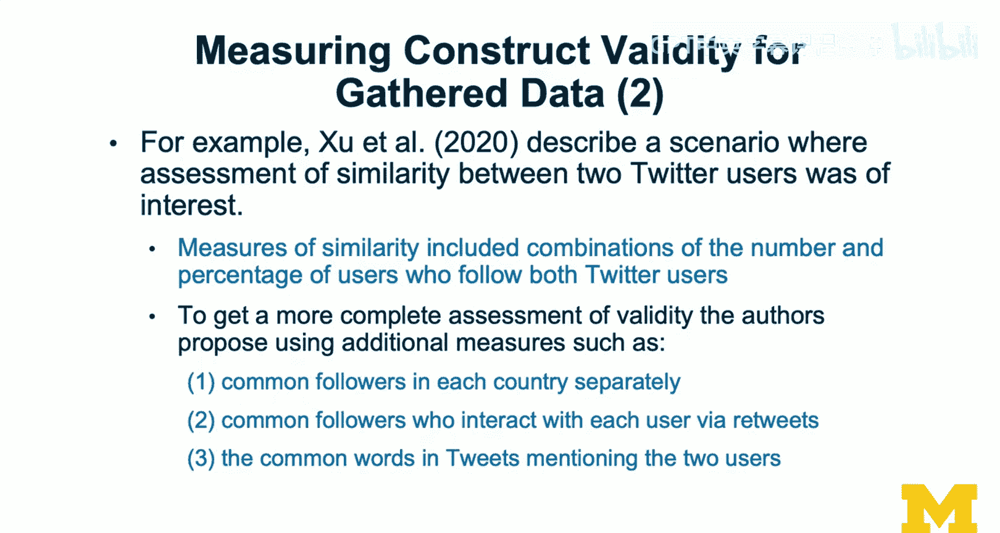
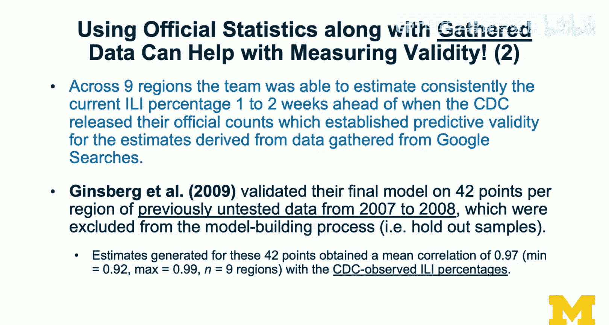
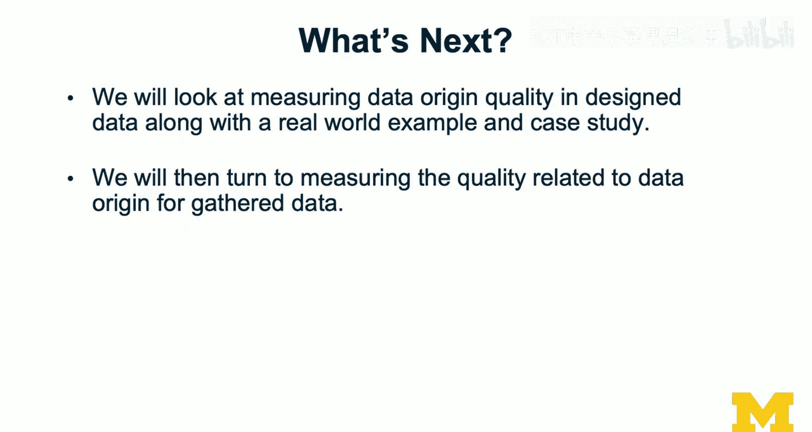

# 密歇根大学《总体数据质量（框架、度量、设计策略）total data quality》 p48 4_采集型数据效度测量.zh_en -BV1Jn4y1X7uS_p48-

Hello， I'm Tm Busker。 welcomecom back In this lecture。

 we're going to be talking about measuring validity for gathered data。

So just as we do at the beginning of all of our lectures。

 we just want to make sure that we're aware of where we are within our framework。

 and so in this particular lecture， we're going to talk about measuring validity。

 which is on the measurement side of our framework。

 and we're going to be focused again on gathered data。

 we will focus on two types of validity for gathered data in this lecture。

 including construct validity， which we define as is what we're measuring actually measuring what we want to measure。

 In other words， an underlying construct that we care about。

And the other measure of validity is face validity。

 And that really is operationalized by thinking about。

 does what we say we are measuring appear to be what we are measuring。

There are other types of validity that might be of interest， such as external and temporal validity。

 but we'll address these later on in this series in another lecture video。

Multi trait multi method approaches or models are popular with design data for assessing construct validity。

Their application to gather data， though is more challenging because the researcher often has less control over the data generating process and may not be able to obtain similar measures across multiple data sources。

So validating a measure with gathered data is still possible。

 but you need to keep in mind some of these very real limitations of control and access that persist for gathered data。

For example， established scales don't often work for gather data because you're not directly interacting with a respondent to capture the item directly。

 but you may be able to collect the information passively。

To measure construct validity for gathered data， we're going to use conceptual replications that use slightly varied operationalizations for the same constructs。

 Greater agreement among multiple similar measures would indicate higher levels of construct validity。

 For example， shoe and colleagues describe a scenario where assessment of similarity between two Twitter users was of interest。

The measures of similarity included combinations of the number and percentage of users who follow both Twitter users。

To get a more complete assessment of validity， the authors proposed using additional measures such as the common followers in each country separately。

The common followers who interact with each user via retweets。

 the common words in tweets mentioning the two users。

So the idea here is to use multiple measures to triangulate on the validity。

 since we can't control or we don't have the ability to design a particular measure to capture this Twitter similarity。

 we have to rely on things that we can measure passively or observe passively or gather through the overall data framework that is available to us。

Alternatively， given benchmark data for outcomes of interest or what we call gold standards。

 we could analyze the correlations of these operationalized measures from the gathered data with the benchmark values themselves。

 Are the correlation sufficiently high， higher correlations which suggest more valid measurements。

 But keep in mind， correlation does not imply causation。 We're not looking for causation here。

 what we're looking for is whether or not we're getting consistency across the way that we're measuring this with gathered data in comparison to a benchmark that we can trust。

This is generally difficult to do， though， with attitude and opinion data or user based behaviors that are captured from social media platforms and other forms of gathered data。

 It's also quite expensive to get gold standard benchmark data using a very large probability sample。

 although one could do that to provide a benchmark to compare the quality of the gathered data to something that is captured in a more rigorous and potentially gold standard way。

 Ginsburg and colleagues in 2009 estimated weekly influenza like illness based on Google searches about various keywords。

 And this is a particularly interesting example， because it shows you how we can use these gold standard benchmarks。

 i。e。 official statistics to help measure the validity of gathered data。 In particular。

 these authors use this information and historical influenza like illness case counts。

From the CDC's US influenza Sentinel panel， the team was able to create a model that had high accuracy for a period of four years between 2003 and 2007。

Throughout the 2007 and 2008 influenza season in particular。

 the team used preliminary versions of their predictive model to generate influenza like illness estimates and share their results weekly with the CDC to evaluate timeliness and accuracy。

Across nine regions， the team was able to estimate consistently the current I L I percentage。

 one to two weeks ahead of when the CDC released their official counts。

 which established some predictive validity for the estimates derived using their gathered data from Google searches。

 Ginsburg and colleagues validated their final model on 42 points per region of previously untested data from 2007 to 2008。

😊，These were excluded from the model building process。 So this was the holdout sample。

They estimated the estimates that they came up with generated for these 42 points obtained a mean correlation of 0。

97 with CDC observed I L I percentages。 I don't know about in your work， but a correlation of 。

97 is something to write home about。 This graph shows you sort of the coincidence between the estimates that Ginsburg and colleagues came up with in black compared to the CDC official statistics that were released in the 20072008 year。

 And you can see how the correlations were so high based on how these curves track with each other over time。

The Google F trendsrens used a collection of Google search terms from 45 different keywords found in early pilot testing to be in aggregate。

 High correlated with these I L I percentages over the same pilot period。

So the target construct here was I L I illness， flu like illnesses。

 but the search terms themselves did not necessarily measure whether or not you had the flu。

So they may have had low construct validity。But they were identified as indirect signals of the outcome。

For example， some of the keywords were related to antibiotics。Not necessarily related to Iil I。

 However， the estimates of the influenza like illnesses were based on simple linear models that used the combined measures of Google search activity across these 45 terms。

 And thus， the gathered data were operationalized as a single aggregate predictor of Iil I based on combinations of these search terms of these keywords and the searches that were gathered from those keywords。

However， the estimates of I L I were based on simple linear models that used the combined measures of the Google search activity across these 45 terms。

 And so the gathered data were operationalized as a single aggregate predictor of influenza like illness。

 The research team also did not pre filter any of these search terms。

 And this allowed them to avoid the so called ad hoc data pre filtering issues that are also discussed in the literature。

 The idea here is that if you were to pre filter， you might miss some of the signals that otherwise could be useful in creating prediction accuracy。

For many gathered data sets， measuring face validity is more possible than construct validity。

 since researchers have less control over the actual data generating process。

So in the big data literature， face validity is simply referred to as so called validity characteristic of big data。

 Bardwaj and Ormand Geva in 2021 proposed a framework for measuring the validity of big data that include dimensions of accuracy。

 credibility and compliance。The final quality assessment is represented by a vector that captures metrics for each of these dimensions。

 So rather than providing a single number， I'm providing a vector of three different numbers that relate to accuracy。

 credibility and compliance， because these three elements are important for understanding validity overall for big data。

 Com up in the next lecture， we're going to look at measuring data origin quality in design data。

 Along with the real world example in case study。 Well then turn our attention to measuring the quality related to data origin for gather data。

 Thanks for being with us and stay tuned for our next lecture。😊。

