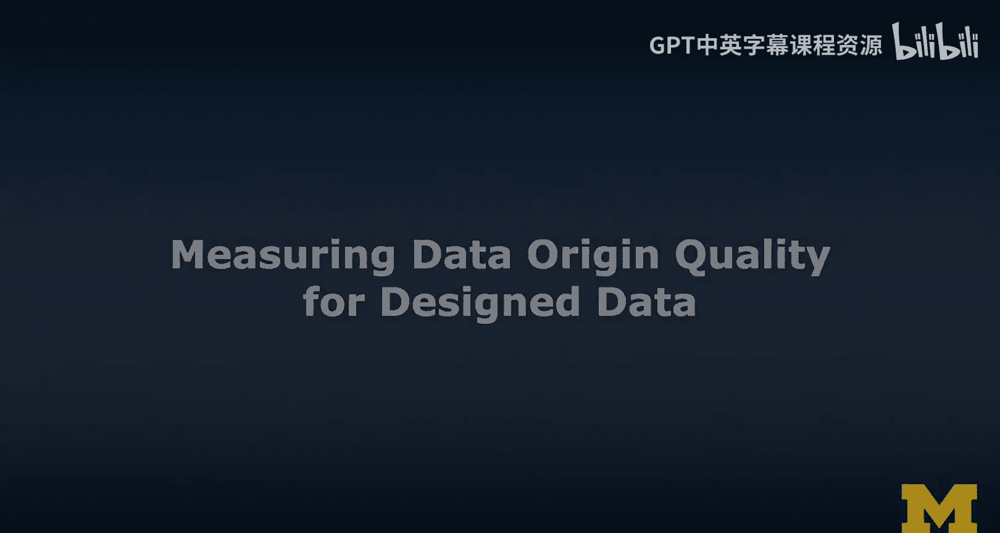
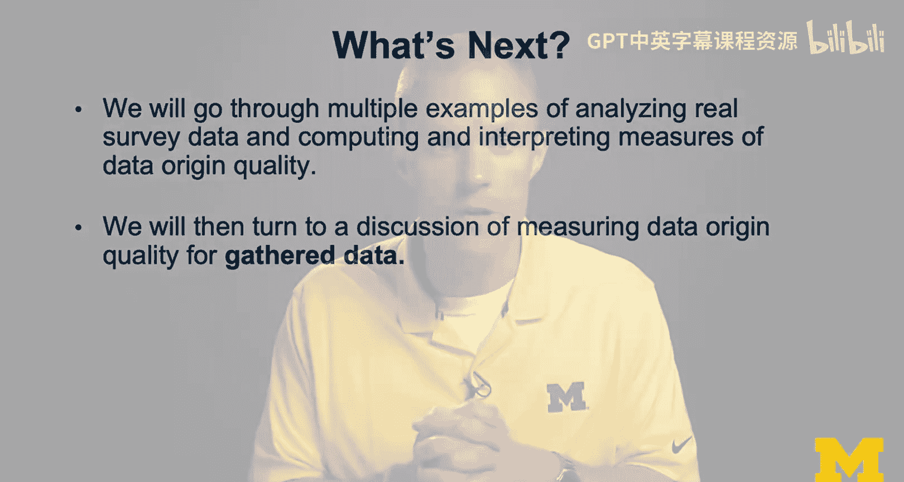
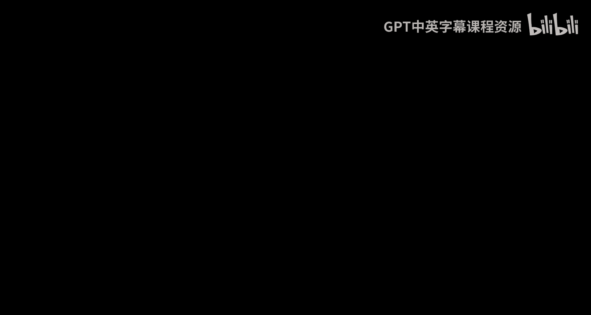

# 密歇根大学《总体数据质量（框架、度量、设计策略）total data quality》 p49 5_设计型数据溯源质量测量.zh_en -BV1Jn4y1X7uS_p49-

Okay， hello everyone， now we're going to shift gears a bit and talk about techniques for measuring data origin quality for design data。

So back to our big picture of the total data quality framework。

 we've thus far talked about techniques and tools for measuring the validity on the measurement side of the overall total data quality framework。

 Now we're going to shift gears and talk about techniques and tools for measuring data origin quality。

 So remember this is the part of the measurement side of the total data quality framework where we go from a variable that we have available in a design data collection to the actual data values that we collect on that variable as part of the design data collection and we want to talk now about tools and techniques for measuring the quality of the data in terms of where the data came from or the data origin。

 So now we're shifting from the validity of a variable of interest to the actual measures that are recorded on that variable of interest and looking at the quality of those measures。

So one type of quality issue in terms of data origin for design data is in design data collections where interviewers are actually collecting the data from survey respondents and an important problem with data origin quality in interviewer administered design data collections is what are known as interviewer effects。

So when working with design survey data that are collected by interviewers。

 an important question for this type of measurement is whether or not interviewer ID codes are available in the data in addition to the survey responses。

 So does every survey respondent have a corresponding interviewer ID code that information is necessary in order to try to quantify interviewer effects on the measures collected。

If those interviewer ID codes are available， then we can fit what are known as multilevel models to the survey measures of interest。

 so the measures collected from the respondents are generally thought of as occurring at level1 in terms of this multilevel framework。

And then the interviewers that collected the survey measures are treated as higher level clusters of survey respondents or level 2 in the multi level framework。

 so we have respondents at level1 nested within the interviewers who collected the data at level 2。

AndWhat we want to do by fitting these models to the collected survey data is test the variability of random interviewer effects for significance。

 So these random interviewer effects are effects that are associated with those interviewer ID codes and we want to see if theres significant variability in those effects that the individual interviewers are having on the survey measures。

 Now this type of analysis approach assumes that the respondents have been randomly assigned to the different interviewers。

 So an important question is whether or not that assumption is realistic。

 but that's the assumption that we're making when we do this kind of analysis and there are different ways to deal with that assumption and practice which we'll talk about in an example。

 ideally， we would wish to see negligible interviewer variants。

 So this is a type of measurement error where different interviewers introduce different types of systematic bias in the measures collected and ideally。

 we wouldn't want to see a lot of variability across interviewers in terms of the measures that they're collected basically。

We would just want to see random noise between the interviewers rather than significant variability。

Another type of technique for measuring data origin quality with design data is MTM modeling and mode effects。

So we can design studies that enable multitrate multi method analyses of survey response quality and remember in the validity context we talked about using multitrate multimet models for assessing validity of different survey items so we had that tutorial earlier in this week that everybody hopefully had a chance to go through General the MTMM technique is used in pretesting of survey items for quality where we talked about its utility in establishing validity of survey items。

 this technique does require at least three items each of which are measured using three different methods。

 so we're trying to measure the same idea using three different measurement techniques。

 the article by Sirna Obbersky in 2019 provides a nice overview of this particular idea and Obbersky is actually the one who wrote the multitrate multi method tutorial that everybody hopefully had a chance to look at。

Another technique for examining data origin quality is to look at differences in response distributions and or correlations between variables of interest。

 depending on the mode of data collection used。 So what do we mean by the mode of data collection that's the technique used to actually collect the survey responses in a design data collection so it could be by mail it could be over the web it could be by telephone with an interviewer it could be face to face with an interviewer。

 that's what we mean by the mode of data collection and an important area of research in design data collection is whether or not the mode used causes significant differences in the types of survey responses collected and there are a couple of example articles here in the references that talk about the analysis of mode effects。

 So this idea of the data collection mode having an impact on the type of responses collected is known more generally as mode effects and there's a vast。

 vast literature on this topic and the effects the different modes have on the quality of the data collected and so mode effects are very important。

In terms of analyzing data origin quality。Other measurement techniques include computing response deviations in the presence of benchmark or gold standard data。

 So we had talked about this as a technique as well for looking at a validity。

 but these are also known as record check approaches。 And in these settings。

 good validation data tend to be rare。 So given a benchmark value for an individual survey respondent。

 We want to see if there's a significant deviation in terms of their reported value from that true benchmark value which might come from administrative records or something like that。

 we want to see if there's a significant deviation in terms of what survey of respondents say compared to what known benchmark values are。

 and that'll give us a sense of the quality of the data origin。

We could also use what's called latent class analysis or LC to estimate the probability of erroneous reporting on items that measure different latent traits。

 similar to the idea of structural equation modeling that we talked about for examining validity。

 So given membership in a particular latent class that we don't actually observe what's the probability of seeing each response on different categorical variables of interest。

 So Croiter and colleagues in 2008 had a very nice demonstration of the use of latent class analysis to examine data origin quality。

 We've also included a web link here where you can look at examples in the R software of performing latent class analysis and then getting a sense of overall data origin quality based on the results of that kind of analysis。

 So latent class analysis is a popular technique to try to estimate the probability of poor reporting on individual categorical items。

Other techniques include comparing different items in the design survey data set in terms of item nonres rates。

 so rates of missing data on individual variables。 that provides a very simple idea of whether particular variables are causing problems at the data origin in terms of responseents not being able to provide a useful response。

 so examining item nonres rates is very helpful。You can also fit Sems with latent variables that represent true scores indicated by observed survey items and then estimate reliability coefficients for the items。

 And again， we would refer you to that Ser and Gahooffffer article in 2007。

 And we looked at that previous factor analysis example to see whether there was similar reliability of survey items across different subgroups of survey respondents。

 We can also look at test retest correlations or reliability of survey items that are measured repeatedly over a short period of time。

 So a longitudinal study or brief measurements of different items collected over a short period of time。

 we can look at the correlations of those items to see whether they're consistently high。

Another useful technique in thinking about data origin quality is paraadata We can collect paraadata or data that describe the data collection process and these paraadata may correlate with response quality。

 Fracka Krader has written a book in 2013 on the use of paraadata for quality investigation and these paraadata can take many different forms these could be interviewer observations collected after a survey has been completed that tell you whether the respondent was engaged and whether the respondent understood and comprehended all different survey questions。

 this could be the stated confidence of responseents and the response that they've provided。

 These could be response latency measures or measures of response times on individual items and that book by Fracca provides many other examples of the use of paraadata to examine quality。

 This is a rapidly developing area of the literature on total data quality and paraadata have a lot of untapped potential since their process data they're not the actual survey data but their process data that can provide us with a sense of data origin。

Quality in these design data collections。So now that we've had an overview of some of these techniques for measuring data origin quality。

 we're going to go through multiple examples of analyzing real survey data and computing and interpreting measures of data origin quality。

 then we'll turn to a discussion of measuring data origin quality specifically for the case of gathered data。

Thank you。

