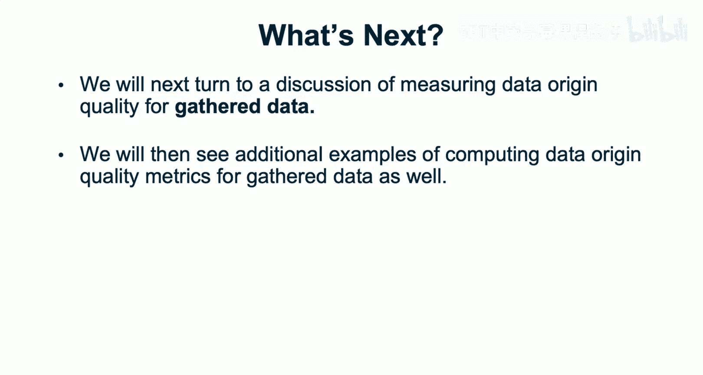

# 密歇根大学《总体数据质量（框架、度量、设计策略）total data quality》 p50 6_示例：R语言中设计型数据溯源质量指标计算.zh_en -BV1Jn4y1X7uS_p50-

Okay， hello and welcome。Now that we've learned about some conceptual measures of data origin quality。

 we're going to look at some examples of actually computing those measures of data origin quality。

 specifically for design data using the R software。Okay， so back to our big picture， again。

 we're focusing now on the data origin aspect of the measurement dimensions of total data quality where we have a variable or a field and we're talking about the process of generating values that are actually recorded for that variable or for that field and what could potentially go wrong and how to actually measure what could go wrong when looking at the data origin。

So one of the first issues that we need to think about specifically for design data is interviewer effects and the idea that different interviewers who are collecting data。

 whether it be face to face or by telephone may be having effects on the measures that are actually recorded on the variables of interest。

 so we're going to look at an example using the European Social Survey specifically from Belgium。

 and we're going to look at respondent answers to a question about how helpful people are in general that was asked in the European Social Survey。

So the variable name in the ESS Belgium data is PL HLP， or people help。

 and then we also have a variable in the ESS data which identifies different interviewers and so in a multilevel modeling framework the interviewer ID would really define level 2 of the multilevel data structure where survey respondents are nested within interviewers。

 but this is critical to have this interviewer ID variable in the data set in order to estimate actual interviewer effects。

 So in the ES data that variable is called inum and it contains codes for each of the interviewers who collected the data。

The actual survey item is on a10 point scale， and it measures the attitude of the respondent with regard to people in general。

 being helpful， where a 10 means that they're most helpful or a 0 means that people generally look out for themselves exclusively。

 Now， it's important also to keep in mind that values of 88 on this variable represent missing data。

 So when we're analyzing interviewer effects or anything related to this variable in general。

 We need to make sure that we handle those values of 88 correctly。

 and we don't include them in actual substantive analyses because that could really cause some issues。

Now， first of all， when doing these analyses， we need to install and load the LME4 and LMER test contributed packages in RR。

 and we're going to see how to do that using our studio here in a second。

Okay so the first thing that's usually good to do when thinking about interviewer effects and the idea that different interviewers might collect different distributions on a variable of interest when that would not be expected。

 if they're working different random subamples is to look at some box plots which show the distributions of the variable of interest for the different interviewers and I've included some simple R code here and we'll look at using this R code in a second that plots the distributions on the people help variable within the ESS Belgium data set as a function of that interviewer ID variable which is indicated as a categorical factor after the Tilday sign in this particular code so this R code will generate this kind of side by side box plot which shows for each of the different interviewers。

 the distributions on the variable of interest people help and you'll note in this graph that the distributions of the responses to people help clearly vary among different interviewers and that's what we're worried about with this idea of interviewer effects is that different interviewers are collecting different distributions。

On the variable of interest， where we would expect these to be more equal。 If each interviewer was。

 in fact， interviewing a random sample， we would expect these distributions to be more similar。

 So let's take a look at the our studio code here that we can use to load the E S S Belgium data and then look at these initial descriptive analyses。

 So， first of all， we're going to load the E S S Belgium data with this load statement here。

 and you can just open that our data file in general， within our studio。

 But I'm going to run this particular command by highlighting that line and then clicking on this run button here at the top。

Then again， we need to be very careful with missing data。 So for these particular variables。

 we want to make sure that we're not analyzing any cases that are equal to 88。

 So what this code is doing is it's taking that EsS Belgium data frame and it's only keeping those rows in the data frame where these three variables of interest are not equal to 88 so we want to make sure that that's that's carefully looked at here and note the comma indicates that we're only looking at the rows in the data frame。

 We're keeping all the columns after those particular rows so I'm going to look at this reduced format data set here。

 EsS red。And then I'm going to look at the dimensions of that ESs red data set after after we keep only those rows without missing values。

 Okay so now you see in your our console here at the bottom。

 we have 1674 survey respondents and 26 different variables after taking out cases with missing values on these three variables now just for the purpose of the graph。

 we're going to only keep those cases that have interviewer Is less than 2000。

 So we're not going to plot every single interviewer。

 we're just going to look at a random subsample to get a sense of that variability So what this code is doing is it's creating a new data frame object again called ESs red2。

 which is only keeping those rows， again， you see this condition before the comma。

 only keeping those rows where interviewer ID is less than 2000。

 So this is making a new data frame called ES red2 that we're ultimately going to work with for this graph。

Now， here's that plot command that you saw on the slides where we're plotting the values on this people help variable as a function of a categorical version of that interviewer ID variable。

 and this this plot command again will create a side by side box plot。

 So I'm going to run this command。And then in the lower right of your R studio window。

 you'll see the graph that gets generated down here at the bottom。

 And this is the same graph that you saw on the slide where again， for each interviewer I。

 you see a box plot showing the distribution of responses on that people help variable。 So again。

 we can look at these kinds of graphs to get a sense of the variability in in the people help response across the different interviewers。

 Now， the next two lines here that you see in the R code again。

 we're loading the L4 library and we're loading the LMr test library to do this actual analysis of the interviewer variant。

 So we need to make sure that those packages are installed。

 and you can install them down here in the lower right pane where you see the packages window you can click on the install button to actually install those different packages。

 I'm not going to load them right now because they've already been installed。

 So I'll cancel out it here。 once they're installed them you have to load the packages to make sure that the functions in those libraries are available for your use for analysis。

 So I'm loading。The LME4 package， which lets us fit models and then the LMER test package。

 which lets us test whether the interviewer variance is， in fact significant。 Okay。

 so I'll run both of these lines to load all the functions within those two contributed packages within our。

 and then we're ready to move forward with the analysis。Okay， so back to the slides。

Here's how we actually fit the model within R。 so in the R code， what we're doing。

 we're using the LMR function， which fits multilevel models to continuous dependent variables within the R software。

 So we're treating people help like a continuous variable in this case。

 And here's how the model set up。 People help is the dependent variable。

 That's the variable that we're interested in analyzing And then after a till day。

 we indicate what the predictors of that dependent variable are。

 A one just means that we're modeling that dependent variable with an intercept。

 or we're modeling the mean of that dependent variable。 And then after a plus sign。

 we're also adding the random effects of those different interviewers with that interviewer I code in the data set。

 So what this one means here followed by the interviewer I。

 is that each interviewer is allowed to have a unique intercept or mean in the overall model。

 So that's what as the random effect。 The one here。

 which is the mean is allowed to very depending on the interviewer。

 and these include the random effects。Then we're including Remel equals true as an argument which invokes Reel estimation of the parameters in this model that ensures that the estimates of the interviewer variance component are unbiased。

 and then the name of the data set that we wish to use ES Belgium。Okay。

 and we're saving the results of that of that modeling that model fit。

 the modeling procedure in this new object called mod1。 After we have that Mo 1 object created。

 then we can use the summary function to produce the estimates from fitting this particular model and look at the interviewer variance around the overall mean。

 Okay so back to our studio。 Let's go ahead and run those commands。 First of all。

 I submit the model fitting command to generate the estimates of the interviewer variance and the overall mean。

 So I'll go ahead and run this initial line。 And you see， I don't see any output initially。

 I'm just creating an object called mod 1 that contains the results of that analysis to actually look at the estimates。

 I can run the summary function on that new object called mod 1。 I'll go ahead and run this。😊。

And that generates the estimates of the parameters in this model， the overall mean， which is 4。76。

 and then the estimate of the interviewer variance， which is 0。21 up here。

 And then the estimate of the residual variance within interviewers。

 the unexplained variability within interviewers， which is 3。76。

 And you see that the LMR function also reports the square root of each of those variance components or the standard deviation here。

 So we see 125 interviewers，1674 observations。 and then the estimates that we're interested in。Okay。

 so back to our slides again， you can see an output file with today's lecture that shows the same outputs。

 you can go through that with some notes and comments。

 But the estimated mean of that people help variable or the intercept in this model is 4。76。

 the estimated variance of the random interviewer effects again is 0。

21 and the estimated residual variance that within interviewer variance in the peoplehel responses is about 3。

76 Now， the question is， how big is the interviewer variance relative to that within interviewer variance。

 is there a lot of variability between interviewers relative to the variability in people help within interviewers So we can look at something called the estimated intrainer correlation or Iic。

 which is the correlation of any two observations within the same interviewer。

 So if there's more between interviewer variance that Iic is going to tend to be larger and we calculate that Iic by taking the between interviewer variance component and dividing by the sum of those two variance components or the total variance。

In the people help responses， the within interviewer variance and the between interviewer variance。

 that IicC is 0。053。 and that's relatively high for normal variables in a face to face survey。

 Usually intrainer correlations are going to be like 。005。01 on the smaller side。

 This one is relatively high。 Okay， We're about you know。

5% of the total variance in the data is due to the interviewers。

 We can also perform a formal test of the null hypothesis that that interviewer variance component is equal to 0 using the LMR test package。

 And we can do that using the ran function within the LMR test package。

 So I'll go back to our studio。😊，Now that we've loaded the LMER test package。

 this RA function is available so we can go ahead and run that RA function。

 And in the table that's produced， we see a test of the null hypothesis that the variance of those random effects。

 which again， you see here indicated by one given it is0。

 and the resulting P value for that particular likelihood ratio test is very， very small。

 You see three stars here in the output， which indicates that we have pretty strong evidence against that null hypothesis that the variance component for interviewers is0。

 So we would reject that null hypothesis and conclude that there is evidence of significant between interviewer variance here that may or may not be explained with other interviewer level covariance or variables。

 So there is some concern for these measures on people help of interviewer variability and the response is collected。

 And the next question is， why is that happening， Can we effectively try to explain that。

OkaySo in conclusion， the interviewer variance in this case is greater than0。

 and it seems like the ESS interviewers are varying in terms of their response distribution。

 So the interviewer is a factor affecting the quality of the data at the data origin。

 The interviewers are collecting different distributions of responses on the variable of interest。

 So again， we're bringing this back to data origin quality。

 This is a possible source of measurement error at this point。

 we could either add other interviewer level predictors to the model that might explain that variability between interviewers or we could study interviewers with unusually high or low deviations from the overall meme to see if they're having issues with actually asking this question or bringing in the responses on this question。

 and we'll get back to this in the third course on optimizing data quality。😊，Okay。

 so interview effects an important part of design data。

 especially when you're using face to face and telephone surveys。

 Another important data origin quality metric is test retest reliability。

 So let's suppose in the Ess data that TST PLT and TST PRt are both measures of trust in the political system。

 and these are measured in the same survey， So they're just different measures of a respondent's trust in the political system。

 And we want to use these measures to estimate test retest reliability。

 So if you ask an individual survey respondent， the same question repeatedly。

 do you tend to get the same answers or do those answers tend to balance all over the place。

 That's what we're really focused on with test retest reliability。

 So to estimate this reliability we simply compute the piercing correlation of these two repeated measures。

 And remember at the beginning of our our code， we remove missing values on each of these different variables so we don't have to worry about the 88s on each of the variables。

 And so we can simply use the core function。In our studio with these two variables specified to compute this correlation。

 we'll go ahead and do that to get a sense of the test retest reliability in the E in the Ess red data frame object。

 And when we run this particular analysis， you see that the estimated correlation of those two repeated measures is about 0。

843 in the R console。 so given that correlation。 a correlation of one would indicate perfect reliability of the two measures。

 You ask the same person the same question multiple times。 you get the exact same response。

 A correlation of0 would indicate no reliability。 So the answers are completely all over the map and they're not correlated in any way。

 correlations closer to 1 suggests more reliable measures。

And we could also compute a P value to test the nu hypothesis that the correlation is0 if we wanted to。

Another important data origin quality metric is item missing data rates。

 so we can also examine the missing data rates for these two variables based on the full set of 1703 respondents where higher rates are suggestive of lower data quality or more difficulty in producing valid answers to a particular question to do this before we do any data reduction。

 we can just lose the summary function for each of these two different variables within the R software and you'll see the NAs or the 88s in other cases specifically indicated here So for the trust PLt variable。

 we see seven missing values for the trust PRt variable。

 we see 10 missing values And if we calculate those item missing data rates out of 1703。

 you see that those item missing data rates are very， very small so you see 0。

004 for the first variable 0。006 for the second variable So it doesn't seem like item missing data is a particular issue on these two variables but always important to get a sense of that the missing data rates。

And each of the variables that you're thinking about working with because higher missing data rates could indicate more issues with data origin quality。

Another very important conceptual measurement of data origin quality that we talked about previously was mode effects。

 The idea that different modes of data collection would ultimately generate different sets of responses on the same variable of interest。

 So in this little example here were comparing response distributions on a survey item for different modes of response。

 And that survey item represents a level of agreement with some statement。

 And you can see the possible values are disagree， neutral and agree。 Now。

 the two modes of data collection that we're comparing here。

 supposeose that this was a randomized experiment where some people responded by web and some people responded by a mail questionnaire。

 And we assume that people were randomly assigned to each of these two modes and that there was no differential nonres between the modes。

 where more people responded by web， for example， and those people might be different on the survey variable of interest。

 We're assuming randomized assignment and randomized response distributions for each of these two modes So what this table is showing is for。

Each of the different modes， the distribution on this agreement variables。 you can see， for example。

 in the Web mode，51。8% of people agree， but in the mail mode， only 26。67% of people agree。

 So it seems like there are， in fact， different response distributions。

 and we can look at a chi square test to compare the two randomized modes in terms of the distribution on the survey variable of interest。

 So we're comparing the two modes here， and you see that this chi square test is significant。

 which means we would reject an all hypothesis that these two variables are independent of each other。

 and we would conclude that these these two variables are， in fact， associated。

 which means that the different modes， in fact， are collecting different distributions on the variable of interest where you see people in the mail mode are much more likely to disagree on that particular variable。

 So we would have to account for these mode effects when we analyze the data。

On this particular level of agreement variable， it seems like there's evidence of a mode effect here because the modes are。

 in fact， generating different response distributions， again， an issue with theta origin quality。

Okay， so now we've gone over some examples up next。

 we're going to turn to a discussion of measuring data origin quality for gathered data。

 and we'll then see additional examples of computing data origin quality metrics for gathered data as well。

 so thank you。

