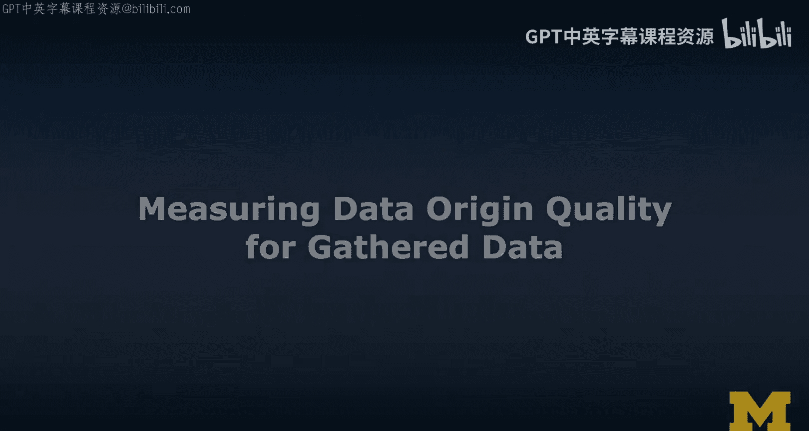
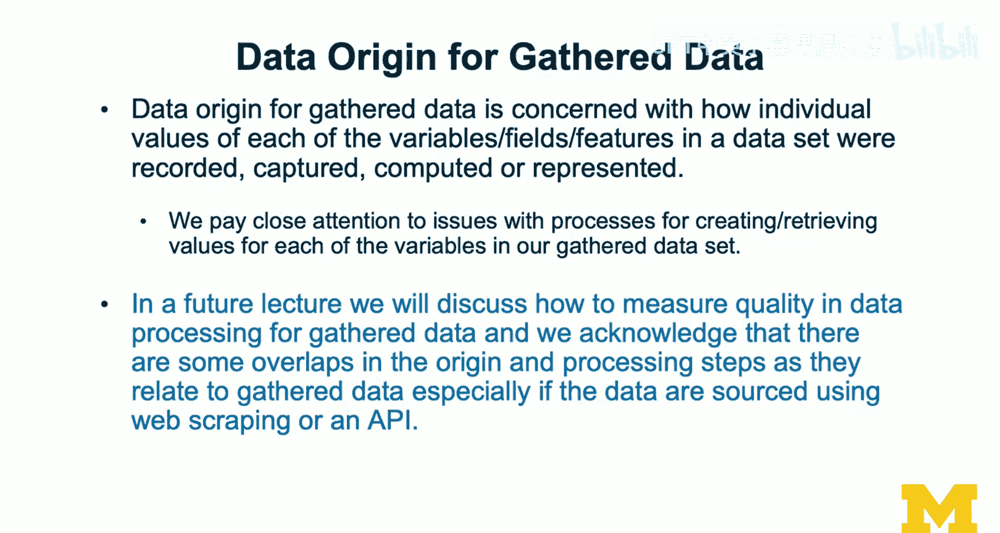
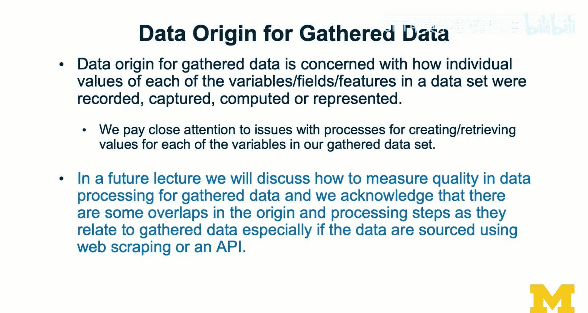
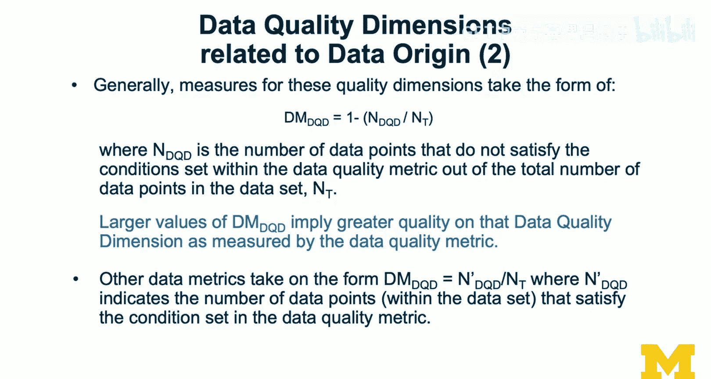
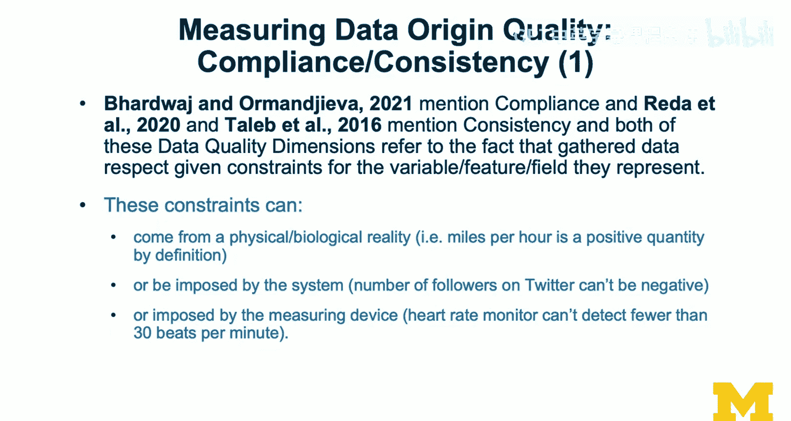
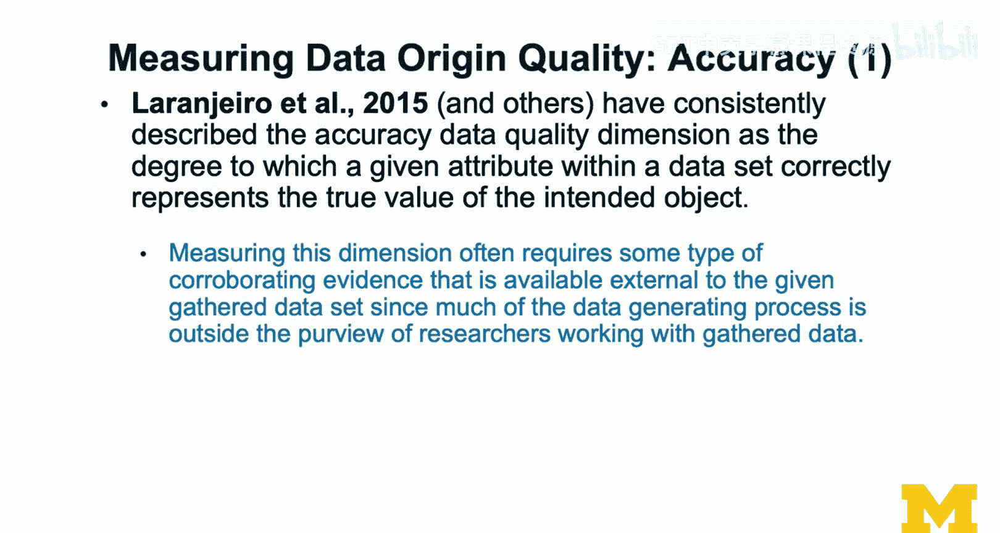
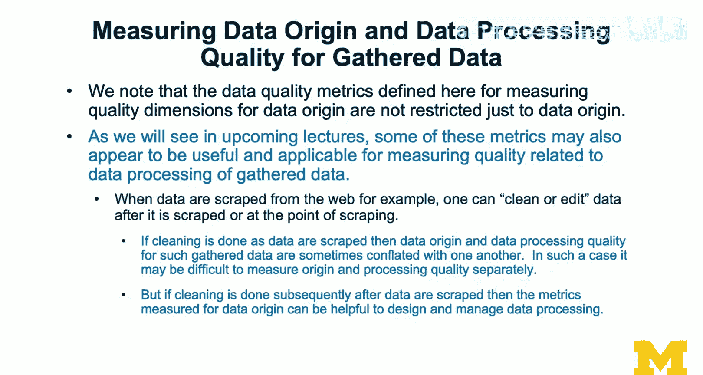
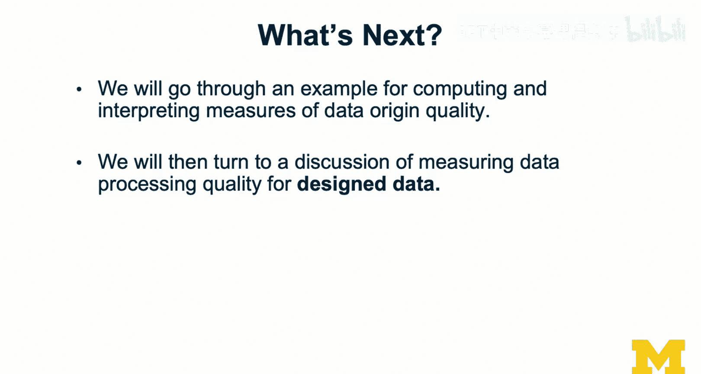

# 密歇根大学《总体数据质量（框架、度量、设计策略）total data quality》 p51 7_采集型数据溯源质量测量.zh_en -BV1Jn4y1X7uS_p51-

Hello， I'm Trim Buskirk。 Welcome back to our lecture on measuringasuring data originig qualityity for gathered data。

 As we do with every lecture， we'd like to make sure that you're aware of where we are in our overall framework。

 And so today we're going to talk about we're on the measurement side of the framework。

 and we're going to be focusing on data origin quality for gathered data specifically。😊。

As we recall from course one， data origin for gathered data is concerned with how individual values for each of the variables。

 fields or features。 Those are all synonyms for one another。 in a data set werere recorded， captured。

 computed or represented。 Now， a quick note here on our overall framework。

 we have a measurement side and we have a representation side。

 The word represented here does not refer to the representation side。

 It really refers to the format of the individual data itself。 So， for example。

 if I am recording a date I might have a long format， which is the month。

 the date and a four digit year。 or I might have an abbreviated or short format。

 which is a two digit month， a two digit day and a two digit year。

 and that's how I'm formatting the variable。 It's this format formatting of a variable that we're referring to when we say how is how is a。

Information represented。

We're going to pay close attention to processes for creating and retrieving values for each of the variables in our gathered data set。

In a future lecture， we're going to discuss how to measure quality and data processing for gathered data。

 and we want to acknowledge that there are some overlaps in the origin and processing steps as they relate to gather data。

 especially if that data are sourced using web scraping or in API。

We recognize that when you gather data using web scraping， for example。

 it is very possible that origin quality and processing quality can be affected at the same time。

 because data are being retrieved and processed almost simultaneously while we still see origin and processing error sources as separate。

 we recognize that during certain kinds of gathering， like with web scraping。

 they can be happening almost simultaneously。 So we're going to talk through some of these issues a little bit later in this lecture。

 but we wanted to acknowledge the fact that this might be a little bit confusing。

 but we're going to try our best to sort it out as we talk through these concepts。

Before we can establish how to measure data origin quality， though。

 we need to discuss the data quality dimensions that are related broadly to issues of data origin。

So there's a lot of literature in this particular topic on data origin quality。

 and we find that if we synthesized a lot of this information。

The data origin quality is related to several quality dimensions。

 including compliance and consistency， accuracy， consistent and concise representation。

 And that's that formatting piece that I was talking about earlier， timeliness and currency。

 accessibility and redundancy。 We're going to talk through these quality dimensions here。

 because these are the ways that people are operationalizing measures of data origin quality for gathered data。

Generally， measures for these data quality dimensions take on the form that you see here。

 The metric is defined as one minus a ratio。The ratio is n sub DqD。

 which is the number of data points that do not satisfy a particular condition for a quality metric that we care about。

 and n sub T is the total number of data points in the data set。

 We're going to fill in very specific values of these things as we go through the list of quality dimensions。

 but generally speaking This is the format or the formula that is going to give us the metric that we want to measure for that particular data quality dimension。

 La values of these metrics imply greater quality on that particular data quality dimension。

 An other metrics may take on a similar form but don't have the one minus structure。

 they just simply measure a ratio where the numerator of that ratio N prime sub DqD indicates the number of data points that satisfy a condition。

 and n sub T again is the number of data points in the data。 I bring this。

Because we mentioned in the earlier lecture that quality metrics are formulas that generate numbers that we can use to represent quality measure for a particular dimension。

 so these are the formats we're going to go through some very specific quality dimension metrics now。

 but you will see generally one of two different formats。

 the one minus a ratio or just the ratio itself。

Bardwaj and Ormajieva in 2021 mentioned compliance， and other colleagues mentioned consistency。

 and both of these data quality mentions refer to the fact that gathered data， respect。

 given constraints for the variable feature or field they represent。

These constraints can come from physical or biological reality。 For example。

 the miles per hour is a positive quantity by definition。Or they can be imposed by a system。

 The number of followers on Twitter can be 0， but it can't be negative。

Or they're imposed by a measuring device。 A heart rate monitor can't detect fewer than 30 beats per minute。

 for example。 So these are these are constraints that we would expect to see in the data set if they are compliant。

 So in other words， if we're measuring number of Twitter followers。

 We would expect that the data set would would have compliance in that all of those measures or all the recorded data would be at least zero in number。

 So they have to comply with a given constraint that is either driven biologically imposed by a system or impose by the measuring device。

 for example。 So for a given field feature or variable in a data set。

 we can measure its consistency using the following quality metric。

Nth con refers to the number of instances， rows or cases that have values that satisfy or respect the constraints that we are expecting for that variable。

An N sub T is the total number of instances or rows or cases in the data set。

This is a consistency and compliance defined sort of as the same quality dimension。

Is a variable specific dimension that we are measuring。

 So we're measuring this per variable in the data set。

You can remember that it's a per variable because if I'm measuring Twitter followers and the number of tweets in separate variables。

 those have different constraints or different expected values or ranges of values from the system itself。

People can have0 followers。 They can have many followers。 They can have zero tweets。

 They can have many tweets， but those are separate variables that have potentially different constraints or different ranges。

 So， again， this particular metric is variable specific。So now we're going to talk about accuracy。

 Laren Gerro and colleagues have consistently described the accuracy data quality dimension as the degree to which a given attribute within a data set correctly represents the true value of the intended object。

Measuring this dimension often requires some type of corroborating evidence that is available external to the given gathered data set。

 since much of the data generating process is outside of the purview of the researchers working with the gathered data。

 So in other words。

I would not be able to know whether or not the accuracy of， say。

 a gather data field of the square footage of your home or apartment。

 So I capture the square footage of your home or apartment。 and apart from compliance。

 which means that you're going to be living in a place that is at least 0 square feet。

 and maybe at most 3 million square feet， there might be a natural range。

But if I record 100 square feet for your apartment。

 I have no idea if that recording is accurate or not without having some external value to corroborate that。

 So accuracy is not an easy dimension to measure without some ability to get a corroborating evidence。

 So for this particular quality dimension。 We're going to， we have the metric of this form。

1 minus n sub air divided by n sub T。 N sub air refers to the number of instances。

 rows or cases that have errors in their recorded values。 These are truly errors。 In other words。

 your apartment is a hundred and 30 square feet。 and Ive recorded it as 100 square feet。

The hundred score itself is compliant because it falls within the range of expected square footages。

 but it's not accurate because I'm missing it by 30 square feet。 So that's what N error refers to。

 It's the number of instances， rows or cases that have errors in their recorded values。

 And as before， N sub T is the total number of instances， rows or cases in the data set。Now。

 it is possible for a given data value to be inaccurate but consistent。

 which is exactly what we talked about with a square footage example。

 One more thing I want to note about this particular dimension is that measures of accuracy are also variable specific。

Now we're going to talk about consistent representation， and again。

 the word representation here really refers to the way data are formatted。

So Tlib and others describe the consistent representation data quality dimension as the extent to which data for a given variable feature or field are presented in the same format or have consistent representation。

For a given variable or field or feature。 So this is a variable specific measure。

 we measure the consistent representation using this quality metric。

1 minus n sub C R divided by n sub T。N sub N CRR refers to the number of instances that have values that are not represented consistently with the other values recorded for that variable。

And N sub T， again， is the number of instances， rows or cases in the data set for that variable。

 Papanino and colleagues， as well as others， have consistently described accessibility as the extent to which data can be accessed or is available for a given task。

 and that these data are sufficiently up to date or or are of the right age for a task at hand。

Accessibility can be measured at various levels for a given variable or feature to the overall platform or system for which the data are gathered。

 So this measure could be variable specific。 It could also be data source specific。

 or platform specific。Accessibility can refer to encoding issues so that data are from one country cannot be obtained from another because of encoding reasons。

 so you have ASI data from one country that can't be converted into readable format in another country。

 so I'm not able to access that information and use it。

 cookies and cookie violations may be another way that a given platform may have low values of accessibility if a webscraper can't get past the cookie terms and conditions。

 for example， your webcraper may not be able to access large portions of the data you want to gather and so your accessibility metrics would be low in those situations。

Rta and colleagues note that redundancy data quality dimension refers to the extent that records within a gathered data set are unique。

 So redundancy metric is really a data set specific metric。

 and it is operationalized using the quotient endduup divided by N sub T。

 where Nduup refers to the number of rows in a data set that are duplicate within the data file。

 and N sub T is the total number of cases in that data set。We note here that， as I mentioned。

 redundancy is a data set specific measure。It is completely possible for all of the values of a particular variable。

 let's say， state， for example， would be the same for a given study of California Twitter users。

 and yet each individual record within that data file is completely unique。

 So redundancy does not refer to duplication in values of a particular variable。

 What it really refers to is are there individual records in the data file that are exactly the same for all the variables that we're measuring。

Therefore， creating redundancy or duplicate records。

 so high values of redundancy indicate that we have more duplicate records。

This particular metric of data origin quality can help inform the data processing steps that might occur subsequent to data capture。

 For example， if the redundancy metric is0， then there wouldn't necessarily be a need in the processing step to have a removal of duplicates。

 because the metric is informing you that there aren't any duplicates to remove。 However。

 if the redundancy metric is high， then you cannot you cannot skip the processing step that would remove duplicates。

 So we think of this metric as a way to inform what is going to need to happen in the processing step。

We note that data quality metrics defined here for measuring data quality dimensions for data origin are not necessarily restricted just to data origin。

As we will see in upcoming lectures， some of these metrics may also appear to be useful and applicable for measuring quality related to data processing of gathered data。

When data are scraped from the web， for example， one can clean or edit data after it's scraped as a separate processing step。

 or at at the point of origin where the data are scraped， using regular expressions， for example。

 as we have seen or as we will see in a future lecture。If cleaning is done as data are scraped。

 then data origin and data processing quality for gathered data are sometimes conflated with one another because it's literally happening simultaneously。

 In such a case， it may be difficult to measure origin and processing quality separately。

 So we might use similar metrics to describe the overall process of capturing and cleaning the data at the same time。

 But if cleaning is done subsequently。 So after I have scrape my data。

 I send it to processing totally separate from the scraping process。

 then the metrics measured for data origin can be helpful to design and manage the data processing steps as we mentioned with the redundancy metric。

 for example， in this lecture， we've introduced many dimensions for measuring data origin quality。

 along with the corresponding metrics。😊。

In the next example， we're going to actually walk through step by step how these metrics can be computed using real。

 a real data set。 So please stay tuned for that。 We will then turn our attention to a discussion of measuring data processing quality for design data。

 Thanks for joining us。 We look forward to seeing you in the example。😊。

