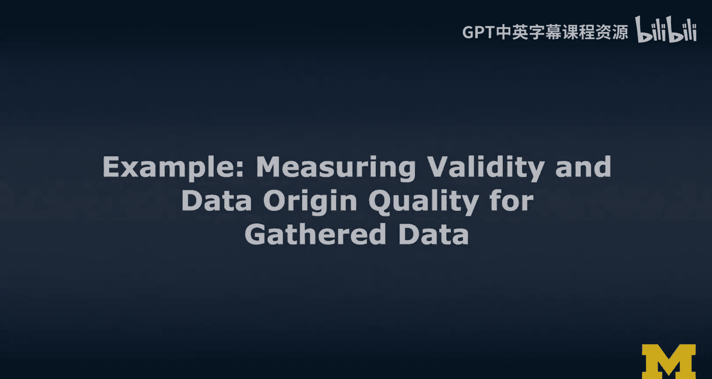
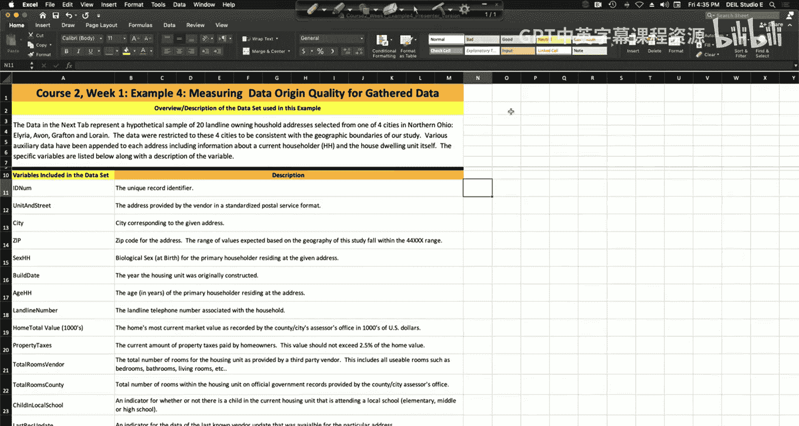

# 密歇根大学《总体数据质量（框架、度量、设计策略）total data quality》 p52 8_示例4：采集型数据效度与溯源质量评估.zh_en -BV1Jn4y1X7uS_p52-

Thanks for joining us for our example on measuringas data origin quality for gathered data。

 I'm Tm Buskirk， it's great to have you here。

The data in this example represent a hypothetical sample of 20 landline owning household addresses that were selected from one of four cities in northern Ohio。

 we restricted these cities to Aria， Avon， Grafton and Lorraine to be consistent with the geographic boundaries of our study。

Various auxiliary data have been appended to each of these addresses。

 including information about the current household and the house dwelling unit itself。

The specific variables that we have included in a description of them are listed here so you can review those。

 Some of these variables refer to the householder， some of them refer to the actual dwelling unit itself。

 altogether， we have these items listed。 The goal of this example will be to evaluate different metrics for data origin quality specifically we're going to evaluate consistency metric。

 compliance metric， accuracy metric， accessibility metric and timeliness or currency metric。

Using information that we have available from the frame as well as some auxiliary information。

So here are the data that we have。 The first couple of columns are coming from the frame。

 We have additional information about the household the age of the household， the sex， etc ce。

 These are landline phone number so we have landline number we have the home value。

 we have property taxes。 We have the total rooms from a vendor we have the total rooms from the county。

 This is going to be our gold standard for evaluating accuracy。

 So this is not a particular variable in the data set。

 but it is one that we've appended and the other variable that we gathered from county assessors' offices was whether or not the children were in the local school And so we got that information by appending this sample file to county records that were available for this area and then lastly we have an record update indicator for from the vendor itself and because we were looking at doing something。

Post COVID we needed the record the record will only be able to be useful for us if it is beyond 2020 as the update because we want to look at COVID related outcomes for this particular study so that is going to be helpful for us to evaluate some of these indicators a couple of notes about the formatting of this file you'll notice that there are some per variable metrics that we can talk about are these are the metrics that we can calculate per variable in our data file the accessibility is blacked out for many of these variables because essentially we were able to access information using the sample vendor file for all of the addresses that's how we generated this file so the accessibility metrics are either going to be 100% or we just note that those are really not of interest to calculate but what is different the one variable that we do want to calculate accessibility。

Mes for is the variable that we had to bring in from the outside。

 which is the additional appending from the local school system variable。Finally。

 you'll notice that there's only two blocks for the redundancy metric and the timeliness and currency metric。

 and that's because those metrics are datas specific or so they're going to refer to this data as opposed to referring to an individual variable so there's only going to be one measure for those metrics for this entire data set。

 Okay what I would like to do now is to walk you through a couple of these examples。

 so I'm going to calculate some of these per variable metrics and I'm going to do this for a few of the variables and then I'm going to allow you to work on the rest of them on your own time but when one thing I want to note is that under the details of computation tab。

If we go there now， you can see。I have basically taken every metric that we want to compute。

Along with every variable that we have in the data。

 and I provided you the calculation of that metric and a description or rationale for how that calculation was done。

 so every calculation has a paper trail here for you to see exactly how and why I computed the metrics the way I did for that file or for that particular variable I don't have time in this example to walk through this entire grid but it is available to you for reference。

 I'll go through a couple of these examples though。

 to illustrate the flavor of these calculations so that we can get a feel for how these things are done。

So let's go back to the quality example and I've already done a little bit of homework to highlight some of these things to talk through a couple of key points here on these variables。

 so let's look at consistent representation here。For the unit and street。

 we're expecting these addresses to have a standard format。 There is a street number。

 a street name and and an orientation。 So for example，1，2，3， Broadway street north。

 So there's a street number a street name， an orientation。 And so if we look at these。

 if we look at this particular， and we can automate some of this calculation。

 but for the purposes of this example， I wanted to qualitatively walk through these cases。

 that's why you see a very small number of them to get a sense of how we would think through the calculations。

 and then you can use that understanding to automate this for a much larger file。So in this case。

 it looks like we have for consistent representation what we're looking for is the number of inconsistent values or the number of records out of these 20。

 that somehow are inconsistently formatted this consistent representation metric is about the formatting of the particular values in a particular field so if we look at these unit and street。

 if we just scan down all of these look to have the normal format， there's a number。

 a street name qualifier for whether it's a street or a road and potentially a location like a north the south etc。

 so in this case the consistent representation is equal to one minus zero over 20。

It's another way to say one， I understand that， but the consistency metric is of the form1 minus the number of inconsistent records divided by the number of records total。

Now， if we go to the city， so if we go back over to the details and con。

 you'll see that I've already indicated this in this field and I've given you a rationale。Now。

 if we go here， we notice that remember that the cities there are only four cities in this study。

 the cities are Ilyria， Lorraine， Avon and Grafon。 So in this column。

 you'll notice that one of these values is Toledo。 That's not one of the four cities that we mentioned。

 But it doesn't speak to the consistent representation metric。

 it will speak more to the compliance or the accuracy metric。

 which we'll talk about in just a minute。 So hold on。

 But one thing to note is that these cities are represented in all capital letters with no abbreviations。

 So regardless of what is included here， whether it be Toledo or one of the four cities that I care about。

 I'm looking only for this metric， whether or not these city names are consistently represented as capital letters full spelling of the city。

 In this case， all of them are city names。formatSo again。

 the consistency representation is 1 minus0 over 20 because we don't have any inconsistent values。

Now if we move to the zip code， we notice that the majority of the data are represented by a five digit zip code with the exception of the first two records。

 the first two records have the zip plus4 format which is not the regular zip code5 digit format So in this case two of these records are have an inconsistent format with the remaining records why is this even important If you were to use this data file as part of a larger process and you were going to feed the values of the zip code from this file into a larger record later on and that larger records was expecting to receive five digits for this column The first two records would actually be an error there would be an error that would be generated or vice versa if you were expecting nine digits plus a hyphen for each of these records then there might be an error flagged。

The processing step because the 18 records only have five digits。

 they don't have the plus four so the consistent representation quality metrics can actually be very useful for setting up further processes and feedback loop for maximizing data quality which we're going to talk about in the next course so in this case the consistent representation is equal to 1 minus2 divided by 20 because two out of these 20 records are inconsistently formatted compared to the others so this would give me a 90% value for this metric and if I go back into the details of the calculation you can see this is what I have told you here。

So and then of course for the I'm going to look at the sex variable here。

 you can see that the sex is a one digit letter for the majority of the records。

 but for three of these records I'm actually not represented sex as male or female in one case I have a W or woman and so I'm not consistently represented sex so in this case the consistency metric is equal to 1 minus3 over 20 because I have three inconsistent values The last one I'm going to illustrate and then you can sort of work on the rest of these on your own time and of course we do have the details of these calculations going forward the the other the build date in some cases is represented by an abbreviated date format and in other cases it's represented by a long date format where there's four digits for the year and so if we look at this actually a missed a few of these。

If we highlight these as well， these are also in a different format and so if we wanted to look at the consistent format。

 there are five records here along with three more so this is。1 minus8 divided by 20。And of course。

 this is a date field， so I need to format this as a number。

And so you'll see that I have a 60% calculation there。

 and so you can continue to see that as well and in the values here this should actually be1 minus8 over 20。

 so there's a little bit of a typo there。And of course we also have the other the last sort of three values here that are also inconsistent in their format。

 so as you can see going forward， we can go forward and we can calculate these values per variable now the thing that's important right is that each of the variables have a natural different format。

Number variables are formatted differently than date variables the telephone number is a landline telephone in the US because these are four cities in the US landline telephones in the US of a 10 digit area code phone number combination。

 and so in some of these cases we see that three of these variables there are two variables that do not have the 10 digit representation。

The remaining variables have a 10 digit representation， so in this case。

 the consistent representation metric is1 minus。Two divided by 20。Or 90%。 so again。

 we can see from the landline phone number piece， we get that value as well。

So we can continue through and you can calculate the rest of these understanding that consistent representation is variable specific and each variable has a different context for what would be a reasonable representation or formatting that one would expect now I'm going to move over to the compliance score and the compliance is actually calculated as the ratio of the number of compant records divided by the number of records available so compliance in this case is looking to see whether or not the values of the data themselves。

 regardless of if they're correct or not because that speaks to the accuracy of the values but whether or not the values are our complianceant with an expectation so for example this expectation could be a result of natural processing so a landline number in the US is supposed to be within 10 digits or the sex of a householder is supposed to be male or female or other if we had some other。

That was not included there， we might see that that value wasn't compliant or another example might be that we expect that the city is either one of the four variables that we talked about。

 regardless of the format， it has to be one of those values。So in this case。

 when're now we're looking at compliance for the city。 We expect that the city is one of four values。

 Aria， Avon， Lorraine or Grafon。 And in this case， we see two records that actually are veering away from that。

 One is Toledo。 One is Gratton。The Gratton could be a misspelling。

 And so if we look at the zip code for the Grtton some sort of corroborating evidence。

 what we notice is that this is likely not a compliance issue， but more of an error in spelling。

So the idea or accuracy in some ways， because we didn't accurately spell graftafton。So in this case。

 we won't count against the compliance metric this value because we have corroborating evidence that suggests that this is a misspelling。

 but otherwise， we are getting a value that we would expect。 Grafon Toledo， however。

 is a different value altogether。 And if you look at the zip code。

 it also confirms that this value is out of scope， if you will。

 If you have a value that's out of scope or out of range。 it isn't compliant。

 So the calculation of the compliance metric here will be 19 over 20。

 because we have 19 records that are compliant。Over the 20 records that are available。

 We can continue to calculate compliance metrics throughout this table。 And you can see also。

 So let's go over to age。 The age of humans， the oldest known human， I think。

 to date in modern history is about 130 years old。 I would not expect to see somebody whose age is either 0。

 even under 18， because households are typically 18 or older。

 And I would not expect to see a negative value for the age of the householder。 So in this case。

 I have two records that actually exceed a physical range limitation on age。 So in this case。

 the compliance would be 18 out of 20， because I have 18 records that have reasonable ages that fall within an expected range。

Relative to the two records that fall out of that range， in this case， for the compliance。

 for the landline number， I expect to see numbers in certain area codes， because these are landlines。

 So the first  three digits of this landline number should be 4，4，0。

 because that's the area code that covers the four cities that I'm interested in for my study。

There are three records that don't have an area code that satisfy that condition。

 and so the compliance in this case would be 17 out of 20。Or 85%。

 So you can continue to work through the compliance calculations for the remaining variables。

 And again， you can check the details of the computations for how I would have computed those values in particular。

 noticeice that the child in school variable where there's a lot of nas， for example。

 that compliance you can calculate the compliance for this variable， but again。

 the NAs would not necessarily mean that the value is out of compliance。

 It simply means that we don't have a value for that particular case。 so its sort of missing。

 So compliance would not necessarily penalize you for missing information。

 we would assume that the variable we just either just not calcable in terms of not being compliant。

 So as far as this goes， we would expect a value to be yes， no or missing。 So in this case。

 the compliance would be 100%。For the again， for the total rooms from the county。

 this is auxiliary information that we're getting from the county and this is not something we would compute the metrics for because technically this is our gold standard reference data that we'll use later on let's go on to accuracy the accuracy statistics are interesting here because in order to really calculate accuracy。

 you need some gold standard metric to be able to corroborate the value here and so if we look at the details of the calculation for some of these accuracy is assumed to be correct for many of these cases because I don't have a corroborating evidence to suggest otherwise and so for the age of householder variable。

 for example， what you'll notice is that these values of 151 and 145。

 I don't have a gold standard for calculating the exact age of the household。

But because these values are out of a biological possibility。

 it is completely plausible that these two values are not recorded accurately。

They're also out of range。So in this case， the accuracy。

 which is measured as1 minus the number of inaccurate records divided by the total number of records。

 there would be two incur measure inaccurate records out of the 20。

This value of 90% accuracy for the age variable is a conservative estimate。It it's an upper bound。

 if you will。 In part， because I don't have another variable that can tell me whether or not the remaining values of the age of householder for these other cases is actually as recorded。

 I can't tell if case number 5 is really 21 or 23。 I don't have an external source to validate that。

 So I have to assume on face value that this value was recorded correctly。

 because I wasn't the one who recorded it， and I don't have access to that portion of the data gathering process。

 So again， the 90 per cent is an upper bound saying that this variable is at most 90% accurate for as far as I can tell。

 If we look at the property tax variable here。We can see that some of these property taxes are the rule for property tax is that it would not exceed。

More than2 and a half percent of the home value in thousands of dollars。

 that's the rule from the county。 So the county tax amount is no greater than two and a half percent of the household home total value in thousands of dollars。

 so I put a property tax check indicator here， calculated according to whether or not this value is exceeds two and a half percent of this value in thousands of dollars。

So what we notice is that there are four records that have property tax values that are outside of the boundary of what we would expect。

So the accuracy measure for this property tax value here is at most1 minus4 divided by 20 because we have four values that we know are too large。

Again， if we go to the details of the calculations and we look at accuracy and we look at the property tax value。

 you will see this explanation provided here。Keep in mind that the compliance is the property tax values。

 there is no upper bound on property taxes， so in terms of a natural a natural value of what we would expect to see in terms of a normal range。

 property taxes can range from a very small amount to a large amount depending on the home value and so the compliance calculation would be 20 over 20 because we。

We don't have any property tax values in this column that are negative。

 that are in the hundreds of thousands that would be outside of a normal range that we might expect for the homes in this area。

The accuracy， though， the actual amount that is posted。

 is in error for four of these values because we know they've exceeded the property tax calculations from the county itself。

 so we have a way to check whether or not these limits are with or these values that are posted are well within the accuracy measures of what is consistent with the calculations done at the county level so I want to move to accessibility here。

 you can calculate the accuracy。 the other variable that you can calculate accuracy for in particular is this room total rooms。

 we have the number of rooms for the house given by the vendor and we have the total number of rooms that we have from the county's assessor's offices and this room count checks variable looks to see whether or not these two values are the same。

😊，Because that is representing accuracy using a gold standard that's external to the value I have in my data set。

So we notice that there are 1，2，3，4，5，6 values， so the accuracy in this case would be 1 minus6 divided by 20。

 and that isn't a conservative estimate。 that's actually an estimate that we've been able to corroborate using a gold standard from an external source。

Okay let's move to accessibility， it only is going to be calculated for one variable it looks like there are that the city of Avon and the city of Grafon those county or those school records or not accessible to us in order to merge our files together。

 so we did not have information for any house that was in Avon or Grafon with respect to whether their children were in the local school。

 that information was not accessible from those school districts in those particular cities。

 so in this case the accessibility metric is calculated by the number of records that were accessible to us divided by the number of records total。

 so in this case we had 12 records that we could access that particular information。

Divided by the total in the data set， so we had about a 60% accessibility rate for this particular variable and of course while we can calculate accessibility for all the other variables。

 it really is an interesting calculation in this case because we didn't try to access additional information outside of the bounds of the administrative records that we got or the sample vendor file that we got from the vendor。

For redundancy， this is a dataset specific metric that looks at the number of records that we have that are redundant。

 divided by the total number of records that we have available to us and again I highlight the details in the redundancy calculations here。

 and so if we go back to the calculations， the number of records that are redundant are rows 14 and 20 if we look at those rows completely。

 all of the information from those rows are completely identical across all the variables。

 so these are considered duplicate records， so the redundancy metric is essentially the proportion of duplicate records in the data file so this is equal to2 divided by 20 or 10% of the records are duplicates。

Finally， the timeliness or currency metric is also data set specific and we've set a particular rule for how updated we want these records to be。

Because we want to look at something post COVID， we want these records to have been updated after the year 2020。

So in this case， we have three records that are not that are not updated after 2020。

 the last update for these three records was in 2018， so for the timeliness or currency metric。

 it is equal to one is equal to the number of records that are updated or that are current divided by the number of records in our data set。

 so there were 17 records that met our update standards of being updated beyond 2020。

And a total of 20 records in the data file， so this metric would be 85% current our data set represents 85% current records。

You can again that we， I didn't have time to fill out this entire grid of calculations。

 but remember the details of the computations provide an explanation for how I would reason through these calculations。

 as well as the values of those calculated metrics for your reference。 So please refer to those。

 as you are working through this example on your own。 Thank you so much for joining us。

 I really hope this was instructive for explaining how to calculate a wide array of metrics around data origin quality for gathered data。

 Thanks so much for joining us。 Good luck in working through this on your own。

 And we welcome to see you back in the next lecture。 Thanks so much。😊。

