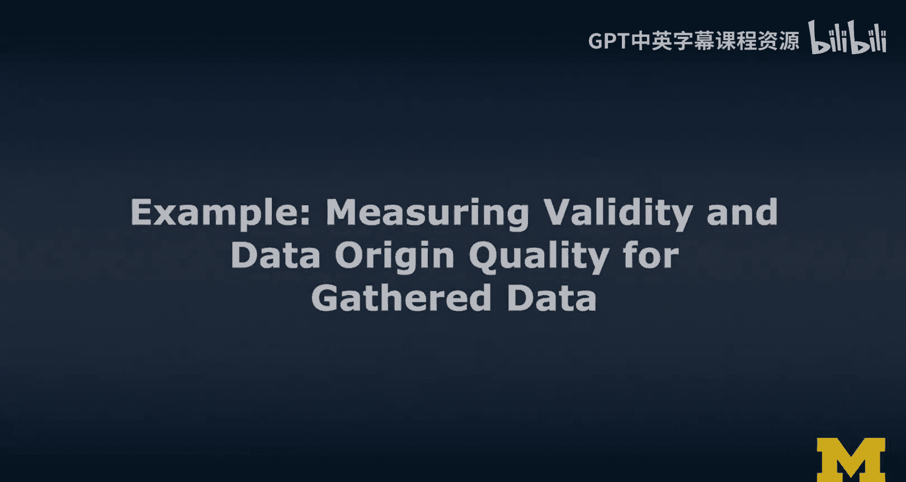
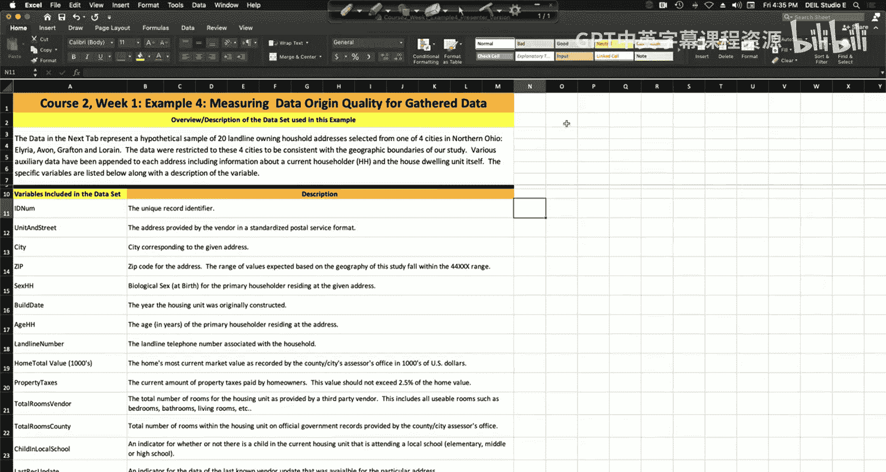

# 总体数据质量（框架、度量、设计策略）：8：示例4：采集型数据效度与溯源质量评估 📊

在本节课中，我们将通过一个具体示例，学习如何评估采集型数据的溯源质量。我们将计算一致性、合规性、准确性、可访问性、冗余性和及时性等多种度量指标，并理解其背后的计算逻辑。

## 概述

本次示例的数据是一个假设的样本，包含20个拥有固定电话的家庭地址，这些地址选自俄亥俄州北部的四个城市。为了与研究的地理边界保持一致，我们将城市限定为伊利里亚、埃文、格拉夫顿和洛兰。每个地址都附加了各种辅助数据，包括当前家庭和住宅单元本身的信息。我们的目标是评估数据溯源质量的不同度量指标。

## 数据描述

以下是数据集中的变量列表，供您查阅。其中一些变量涉及户主，另一些则涉及住宅单元本身。

*   户主年龄
*   户主性别
*   固定电话号码
*   房屋价值
*   房产税
*   供应商提供的房间总数
*   县评估办公室提供的房间总数（将作为评估准确性的“黄金标准”）
*   子女是否在当地学校就读（通过将样本文件与县记录关联获得）
*   供应商提供的记录更新指示器

## 度量指标计算说明

在开始计算之前，需要了解本数据集中度量指标的结构。

以下是我们可以为数据文件中每个变量计算的指标。可访问性指标对许多变量显示为已屏蔽，因为本质上我们能够使用样本供应商文件访问所有地址的信息，这就是我们生成此文件的方式。因此，可访问性指标要么是100%，要么我们注明这些指标不值得计算。

我们真正想要计算可访问性指标的一个变量是我们必须从外部引入的变量，即从当地学校系统附加的变量。

最后，您会注意到冗余度量以及及时性和时效性度量只有两个区块，这是因为这些指标是数据集特定的，它们将指代整个数据集，而不是单个变量。因此，整个数据集对于这些指标只有一个度量值。

现在，我将带您看几个示例。我将为其中几个变量计算这些“每变量”指标，然后让您在自己的时间完成其余部分的计算。但我想指出的一点是，在“计算详情”选项卡下，我基本上列出了我们想要计算的每个指标以及数据集中的每个变量，并为您提供了该指标的计算过程以及计算方式的描述或理由。因此，每个计算在这里都有一个完整的记录，供您查看我如何以及为何以那种方式计算该文件或特定变量的指标。

我没有时间在本示例中遍历整个网格，但它可供您参考。我将通过几个示例来说明这些计算的风格，以便我们了解如何完成这些工作。

## 一致性度量计算

一致性表示度量关注特定字段中具体值的格式。其计算公式为：**一致性 = 1 - (不一致记录数 / 总记录数)**。

让我们回到质量示例，我已经做了一些准备工作来突出显示一些要点，以便讨论这些变量上的几个关键点。

**1. 单元和街道**
我们期望这些地址具有标准格式：街道号码、街道名称和方位。例如，“123 Broadway Street North”。扫描这20条记录，所有记录看起来都具有正常格式。因此，一致性表示等于 1 - 0/20，即 100%。

**2. 城市**
研究中只有四个城市：伊利里亚、洛兰、埃文和格拉夫顿。请注意，此列中有一个值是“托莱多”，这不是我们提到的四个城市之一。但这与一致性表示度量无关，它更多地涉及合规性或准确性度量。对于一致性表示，我们只关注城市名称是否始终以大写字母和城市全称表示。在本例中，所有城市名称的格式都是一致的。因此，一致性表示再次为 1 - 0/20，即 100%。

**3. 邮政编码**
大多数数据由五位邮政编码表示，但前两条记录除外，它们具有“邮政编码+4”格式，这不是常规的五位邮政编码格式。因此，在这种情况下，有两条记录的格式与其余记录不一致。一致性表示等于 1 - 2/20，即 90%。

**4. 性别**
性别在大多数记录中用一个字母表示，但有三条记录没有将性别表示为男性或女性。例如，其中一条记录使用了“W”（代表女性）。因此，性别表示不一致。在这种情况下，一致性度量等于 1 - 3/20，即 85%。

**5. 建造日期**
在某些情况下，建造日期以缩写日期格式表示，而在其他情况下则以长日期格式表示（年份为四位数）。实际上，我漏掉了几条。如果我们高亮显示这些，它们也是不同的格式。因此，如果我们想查看一致的格式，这里有五条记录，再加上另外三条，总共八条记录格式不一致。所以，一致性为 1 - 8/20，即 60%。

**6. 固定电话号码**
这些是美国固定电话，应为10位数字（区号+电话号码）。在某些情况下，我们看到有两个变量没有10位表示形式，其余变量则有。因此，一致性表示度量为 1 - 2/20，即 90%。

我们可以继续计算其余部分，理解一致性表示是变量特定的，每个变量对于什么是合理的表示或格式都有不同的上下文预期。

## 合规性度量计算

合规性的计算方式是合规记录数与可用记录数之比。合规性关注数据值本身是否符合预期，而不论其是否正确（那属于准确性范畴）。例如，美国固定电话号码应为10位数字，户主性别应为男性、女性或其他（如果我们包含了其他选项）。另一个例子是，我们期望城市是我们讨论的四个变量之一。

**1. 城市**
我们期望城市是四个值之一：伊利里亚、埃文、洛兰或格拉夫顿。在本例中，我们看到有两条记录偏离了这一点：一条是“托莱多”，一条是“格拉顿”。“格拉顿”可能是拼写错误。如果我们查看“格拉顿”的邮政编码作为佐证，我们注意到这可能不是一个合规性问题，而更多是拼写错误。因此，在这种情况下，我们不会因为此值而扣减合规性度量，因为我们有佐证证据表明这是拼写错误。然而，“托莱多”则完全不同。如果您查看其邮政编码，也会确认此值超出了范围。因此，此处的合规性度量计算将为 19/20，即 95%。

**2. 年龄**
人类的年龄，据我所知现代历史上最长寿的人大约是130岁。我不希望看到户主年龄为0、小于18岁（因为户主通常年满18岁）或为负值。在本例中，有两条记录超出了年龄的物理范围限制。因此，合规性将为 18/20，即 90%。

**3. 固定电话号码**
由于这些是固定电话，我期望看到特定区号的号码，因为前三位数字应为440，这是覆盖我研究中感兴趣的四个城市的区号。有三条记录的区号不满足此条件。因此，此处的合规性将为 17/20，即 85%。

您可以继续完成其余变量的合规性计算。再次请注意，对于“子女在校”变量，有很多NA值，您可以计算此变量的合规性，但NA值不一定意味着该值不合规，它只是表示我们对该特定案例没有值，属于缺失。因此，合规性不一定会因为信息缺失而惩罚您。

## 准确性度量计算

准确性统计在这里很有趣，因为要真正计算准确性，您需要一些“黄金标准”指标来佐证此处的值。

**1. 户主年龄**
例如，对于户主年龄变量，您会注意到151和145这两个值。我没有计算户主确切年龄的黄金标准。但由于这些值超出了生物学可能性，完全有理由认为这两个值记录不准确。它们也超出了范围。因此，准确性（衡量方式为 1 - 不准确记录数 / 总记录数）将是有两条不准确记录，准确性为 90%。这个90%是保守估计，是一个上限。部分原因是我没有另一个变量可以告诉我其余案例的户主年龄值是否如记录所示。我无法判断第5个案例是21岁还是23岁，我没有外部来源来验证这一点。因此，我必须表面认定此值记录正确，因为我不是记录者，也无法访问数据收集过程的那部分。所以，这90%是一个上限，表明据我所知，此变量最多有90%的准确性。

**2. 房产税**
我们可以看到，一些房产税超出了县里的规定：县税额不超过房屋总价值（以千美元计）的2.5%。我在这里设置了一个房产税检查指示器，根据此值是否超过此值（以千美元计）的2.5%来计算。我们注意到有四条记录的房产税值超出了我们预期的边界。因此，此房产税值的准确性度量最多为 1 - 4/20，即 80%，因为我们知道有四个值过大。

请记住，对于合规性，房产税值没有上限。就我们可能预期的该地区房屋的正常范围而言，房产税可以从很小到很大，具体取决于房屋价值。因此，合规性计算将是 20/20，因为我们在此列中没有任何负值或数十万的房产税值，这些值会超出该地区房屋的正常预期范围。然而，准确性方面，实际发布的金额在四个值中存在错误，因为我们知道它们超出了县本身的房产税计算。

**3. 房间总数**
我们可以计算准确性的另一个变量是房间总数。我们有供应商提供的房屋房间数，也有县评估办公室提供的房间总数。这个“房间数检查”变量查看这两个值是否相同，因为这是使用我数据集中值外部的黄金标准来表示准确性。我们注意到有六个值不同，因此此处的准确性将为 1 - 6/20，即 70%。这不是保守估计，而是我们能够使用外部来源的黄金标准进行佐证的实际估计。

## 可访问性度量计算

可访问性似乎只为一个变量计算。看起来埃文市和格拉夫顿市的那些县记录或学校记录我们无法访问，以便合并我们的文件。因此，对于任何位于埃文或格拉夫顿的房屋，我们没有关于其子女是否在当地学校就读的信息，这些信息无法从那些特定城市的学区获得。在这种情况下，可访问性度量的计算方式是我们能够访问的记录数除以总记录数。因此，在本例中，我们能够访问该特定信息的记录有12条，除以数据集中的总数，因此该特定变量的可访问率约为60%。当然，虽然我们可以计算所有其他变量的可访问性，但这确实是一个有趣的计算，因为我们没有尝试访问从供应商获得的行政记录或样本供应商文件范围之外的额外信息。

## 冗余性度量计算

这是一个数据集特定的度量，查看我们拥有的冗余记录数除以我们可用的总记录数。冗余记录是第14行和第20行，如果我们完整查看这些行，所有变量上的所有信息都完全相同，因此这些被视为重复记录。因此，冗余性度量本质上是数据文件中重复记录的比例，等于 2/20，即 10% 的记录是重复的。

## 及时性/时效性度量计算

及时性或时效性度量也是数据集特定的。我们为希望这些记录的更新程度设定了一个特定规则。因为我们想研究新冠疫情后的事情，我们希望这些记录在2020年之后更新过。在本例中，有三条记录未在2020年后更新，这些记录的最后更新是在2018年。因此，对于及时性或时效性度量，它等于已更新或当前记录数除以数据集中的记录数。有17条记录满足我们“在2020年后更新”的标准，数据文件中共有20条记录，因此该指标为85%，我们的数据集代表85%的当前记录。

## 总结

在本节课中，我们一起学习了如何为一个采集型数据集计算多种数据溯源质量度量指标。我们逐步计算了一致性、合规性、准确性、可访问性、冗余性和及时性指标，并理解了每个指标背后的计算逻辑和适用场景。通过这个示例，您应该能够将这些方法应用到自己的数据质量评估工作中。请参考提供的“计算详情”以获取完整的计算过程和理由。祝您在自行完成此示例时顺利，我们欢迎您在下一讲中再次加入。