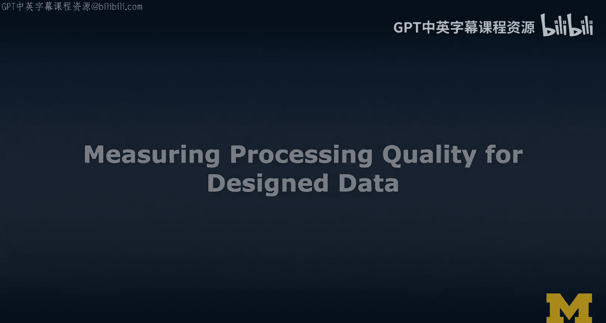
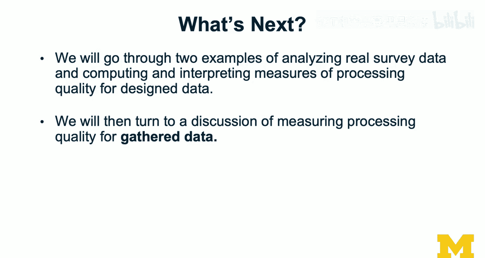

# 密歇根大学《总体数据质量（框架、度量、设计策略）total data quality》 p53 9_设计型数据处理质量测量.zh_en -BV1Jn4y1X7uS_p53-

Okay hello everyone， welcome back in this lecture， we're going to talk about how to measure processing quality for design survey data。

So back to our big picture of the total data quality framework Now we're moving on to the measurement dimension of processing。

 so now we're going to the actual data values that were recorded in response to different variables or different items in a design data collection and we're going from the reported data values to the actual edited data so the data that we might ultimately use for data analysis and thinking carefully about how we can measure the quality of the processing step where we go from the data collected to the actual edited data that we use for our data analysis so that's going to be our focus in this particular lecture。

So with design data， how do we go about measuring the quality of the data processing When human beings are coding openended responses in design data collections。

 one popular technique is to use multilevel models So we talked about the use of multilevel models for looking at interviewer effects as a form of data origin quality when coding is part of our processing operation in a given design data collection。

 we can use the same types of models to estimate between coder variant in commonly coded indicators。

 So if we have multiple people processing the openend responses。

 we can look at the between coder variance in terms of the indicators that there are ultimately coding and editing for the final data set and there's an example of this by Pam Campanelian colleagues in this 1997 book chapter which you can read a little bit more about in the references。

 So the way we would do this is we would fit a multilevel model to a given coded indicator。

 So for example， was an openend。Occupation coded as blue color or not。

 And so that indicator that was coded by our human data coders could be a one for a yes and a0 for a no。

 whether it was a blue color occupation。 And then in that model。

 we would include random effects associated with a coder Id variable in the data。

 much like we talked about with using an interviewer I variable when looking at interviewer effects。

 And so in the same way that we talked about with our example of looking at interviewer effects。

 we want to see if the variability of the random coder effects is greater than0。

 So our different coders， ultimately coding different types of responses on this variable of interest。

 So again， this is much like our example of looking at interviewer effects。

Another way that we can look at the quality of the data processing in the case of design data is to compute the reliability or the agreement of edits or codes that are entered by independent editors or coders starting with the data that were actually collected in the survey and again。

 going to that step of editing the data and producing final values for analysis。 So as an example。

 you might have two human coders that are coding the openended reports of occupations into an indicator of being a blue color job And in this case。

 the two human coders are coding that same response for the same survey respondent。

 So we're getting two codes of that open-ended report for the same survey respondent given these two codes from the two independent human coders we could then compute the Kappa statistic as a measure of agreement between the two coded indicators and a higher value on this Kappa statistic would suggest that the two。

Cs are more reliable in general。 This is known as intercoder or between coder reliability or agreement between different coders。

 And this is a very important quality metric when we talk about processing open ended data in design data collections。

So for design data， data processing also includes editing of recorded values on survey variables。

 so for example， is the recorded age between some minimum and maximum allowable values on that particular variable。

 so the minimum in the maximum might be 18 and 120 for a variable like age。

 and the question is whether or not there's sufficient editing of the values on the variables of interest or if some highly unusual values are getting through the editing process into that final data set。

Data processing could also include what's known as imputation of missing values for selected survey variables。

 when we talked about data origin quality， we talked about the importance of assessing missing data rates on individual survey variables and one important processing step given the presence of missing data on individual variables is known as imputation and this is the idea of predicting the values that should have been observed based on the values of other variables that were actually observed in the data so in other words。

 we're filling in those missing values for particular variables in the data based on predictions of what those values should be according to relationships with other observed variables in the survey data So the processing stage includes both editing of recorded values and also imputation of these missing values and it's important to pay attention to the quality of each of these different steps in the processing stage。

Processing could also include construction of survey weights for probability samples so when we're working with design data collections and we've selected probability samples。

 the data producers need to include survey weights in the data files to allow those survey respondents to speak to a larger population that we might be interested in and the weights in the data set allow data analyst to compute weighted estimates that reflect what the population should look like based on the probabilities of selection for the different respondents to the survey so we're going to be discussing imputation when we get to the missing data dimension on the representation side and we'll be discussing the use of weights and analysis when we get to analysis but these are very important processing steps that allow us to measure the quality of the overall data processing and we'll talk about more about these different steps in examples so simple quality indicators given the processing steps that we just talked about at the editing stage include error rates。

For each of the different variables So what fraction of variables for a given case have out of bounds values and then average error accounts for each data record So are we seeing that a lot of different data records are failing these edit checks given the possible values on the variables of interest we can compute those average error accounts and error rates for individual variables or for cases in general so we could count up the number of error accounts for given survey respondent and then calculate the average number of error accounts and again。

 see if those errors vary across different coders or different aspects of the processing step we can look at variability in those error accounts across different survey respondents typically in computer assisted data collections editing routines are built in to the overall data collection process so as survey responses are recorded in computer assisted data collections there's automatic editing routines so that human beings don't have to do that editing after the fact。

Post processing examination of edits and error rates often leads to error rates that are very。

 very small because a lot of the errors in the recorded responses are picked up by the computer assististed data collection system and corrected on the fly when the data are being collected。

Now， for manually entered data where there's not this kind of automated computer checking of the recorded values to particular variables。

 double data entry is a technique that's often used with subsequent file comparison。

 So the question is given these different error rates of all the possible data values。

 what fraction of data values did not agree between the two data files。

 So if one human being coded a given mail survey， for example。

 and an independent person also coded that exact same mail survey， all the respondents。

 if you stack those two files on top of each other。

 Are there any disagreements in terms of the coded values in those two files and what is the rate of disagreements between those two coded data files。

 that's another very important quality metric in terms of the processing stage when double data entry is used to enter the values that are recorded in a survey。

 So double data entries a very valuable tool for assessing data quality at this stage。

Now what's next that we've talked about some of these different metrics for looking at processing quality。

 we're going to go through two examples of analyzing real survey data and computing and interpreting measures of processing quality for design data then we're going to turn to a discussion of measuring processing quality for gathered data。

 so thank you。

