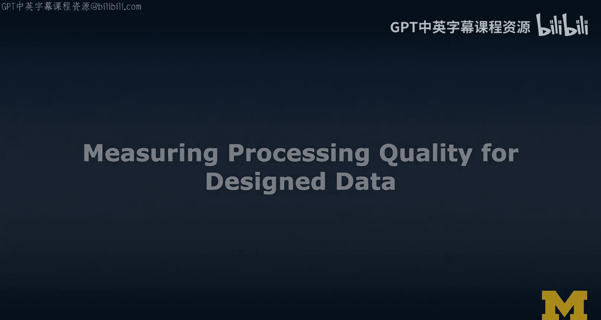
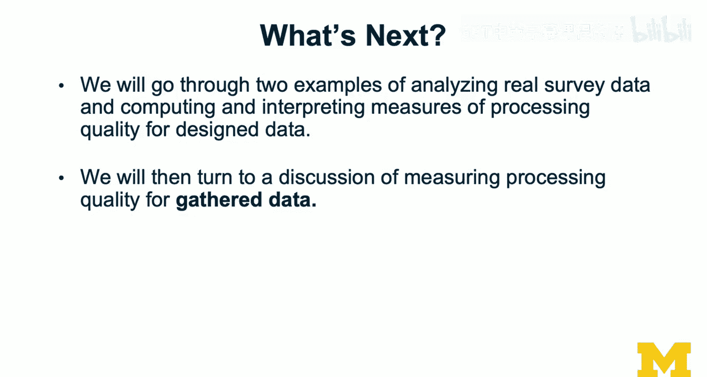

# 总体数据质量（框架、度量、设计策略）：9：设计型数据处理质量测量 📊

在本节课中，我们将学习如何测量设计型调查数据的数据处理质量。我们将探讨从收集到的原始数据到最终用于分析的编辑数据这一处理步骤中，可以使用的具体质量度量方法。

---

上一节我们介绍了总体数据质量框架的概览，本节中我们来看看“处理”维度的具体测量方法。我们的焦点是从调查中记录的实际数据值，到最终用于数据分析的编辑数据，并思考如何衡量这一处理步骤的质量。

对于设计型数据，当人类编码员对开放式回答进行编码时，一种流行的技术是使用**多水平模型**。我们之前讨论过使用多水平模型来评估访员效应，将其作为数据来源质量的一种形式。当编码是数据处理操作的一部分时，我们可以使用相同类型的模型来估计不同编码员在常用编码指标上的**变异**。

以下是具体做法：
*   我们为某个已编码的指标拟合一个多水平模型。例如，一个开放式“职业”回答是否被编码为“蓝领”。
*   在该模型中，我们包含一个与数据中“编码员ID”变量相关的**随机效应**，类似于我们评估访员效应时使用的“访员ID”变量。
*   我们关注随机编码员效应的变异性是否大于0，以判断不同编码员在编码结果上是否存在系统性差异。

另一种评估设计型数据处理质量的方法是计算**编码员间信度**或**一致性**。这指的是不同的独立编码员或编辑员，从收集到的原始数据开始，进行编辑和编码，最终得到用于分析的值之间的一致程度。

例如，两位人类编码员将同一受访者的开放式职业报告编码为“是否为蓝领工作”的指标。根据这两位独立编码员给出的编码，我们可以计算**Kappa统计量**作为两者编码一致性的度量。Kappa值越高，表明编码员间的可靠性越高。

对于设计型数据，数据处理还包括对调查变量记录值的**编辑**。例如，检查记录的年龄是否在某个变量允许的最小值和最大值之间（如18岁到120岁）。关键在于，是否对感兴趣变量的值进行了充分的编辑，或者是否有一些高度异常的值通过了编辑过程进入了最终数据集。

数据处理还可能包括对选定调查变量的**缺失值插补**。我们之前讨论数据来源质量时，提到过评估单个调查变量缺失率的重要性。鉴于单个变量存在缺失数据，一个重要的处理步骤就是插补。这是基于数据中实际观察到的其他变量的值，来预测那些本应被观察到的值。换句话说，我们根据调查数据中与其他已观测变量的关系来预测并填补特定变量的缺失值。

处理阶段既包括对记录值的编辑，也包括对这些缺失值的插补。关注处理阶段中这些不同步骤的质量非常重要。

处理还可能包括为概率样本**构建调查权重**。当我们处理设计型数据收集并选择了概率样本时，数据生产者需要在数据文件中包含调查权重，以便让那些调查受访者能够代表我们可能感兴趣的更大总体。数据集中的权重允许数据分析师计算加权估计，这些估计能根据不同受访者被选中的概率来反映总体应有的样子。

我们将在“表征”侧的缺失数据维度中讨论插补，并在分析部分讨论权重的使用。但这些是允许我们衡量整体数据处理质量的重要处理步骤。

根据我们刚刚讨论的编辑步骤，简单的质量指标包括**错误率**。

以下是针对不同层级的错误率计算：
*   **变量错误率**：对于给定个案，其变量值超出允许范围的比例。
*   **个案平均错误数**：计算每个数据记录（即每位受访者）出现的错误数量，然后计算平均错误数。

我们可以查看这些错误计数在不同编码员或处理步骤的不同方面之间是否存在变异。在计算机辅助数据收集中，编辑程序通常被内置到整个数据收集过程中。因此，当调查回答在计算机辅助系统中被记录时，会自动运行编辑程序，这样人类就不必事后进行编辑。事后对编辑和错误率的检查通常会导致错误率非常低，因为许多记录回答中的错误都被计算机辅助数据收集系统发现并在数据收集时即时纠正。

对于手动录入的数据，如果没有这种对特定变量记录值的自动化计算机检查，通常会使用**双数据录入**技术，并进行后续的文件比较。

关键问题是：在所有可能的数据值中，两个数据文件之间不一致的数据值比例是多少？例如，如果一个人编码了一份邮寄调查，另一个独立的人也编码了完全相同的调查，将这两个文件叠加起来，编码值是否存在任何分歧？这两个编码数据文件之间的分歧率是多少？当使用双数据录入来录入调查中记录的值时，这是处理阶段另一个非常重要的质量指标。因此，双数据录入是评估此阶段数据质量的宝贵工具。

---

本节课中我们一起学习了测量设计型调查数据处理质量的多种方法。我们探讨了使用多水平模型评估编码员效应、计算编码员间信度（如Kappa统计量）、检查编辑错误率以及利用双数据录入进行质量评估。这些指标帮助我们确保从原始数据到最终分析数据的过程是可靠和准确的。

接下来，在讨论了这些不同的处理质量度量方法之后，我们将通过两个分析真实调查数据的例子，来计算和解释设计型数据的处理质量度量。然后，我们将转向讨论如何测量收集型数据的处理质量。