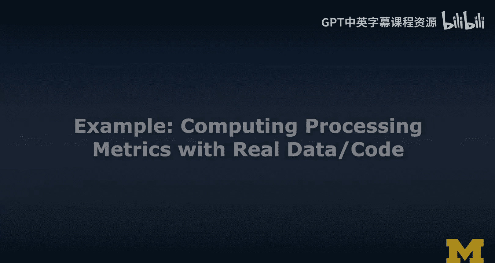
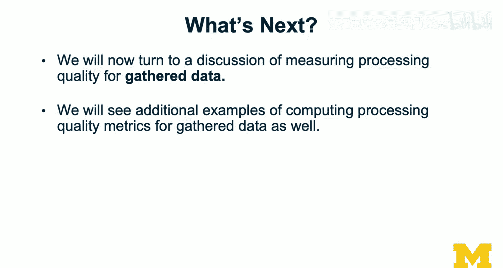

# 密歇根大学《总体数据质量（框架、度量、设计策略）total data quality》 p54 10_示例：真实数据与代码实现处理质量指标计算.zh_en -BV1Jn4y1X7uS_p54-

Okay， hellello， everyone。 Welcome back。 Now that we've talked about some measures of processing quality that we could compute conceptually for design data。

 we're going to look at some examples of actually computing those measures of processing quality within the our software。

 Okay， so back to the big picture again。 We've now talked about thinking about quality with respect to validity。

 Comp measures of quality with respect to the origin of the data。

 Now we're going from actually having a data value recorded。

 processing those recorded data values and producing an edited data set and thinking about measures of quality associated with that processing step。

 So now we're going to see some examples of computing those quality metrics associated with the processing step in the measurement dimension side。

Okay， so here's an example。 One type of processing quality metric that we can look at with design data is intercoder agreements。

 Okay so suppose that two human coders have been asked to code 10 open-ended survey responses for a survey variable that captures people's occupations So people could say whatever their occupation was in an openended manner they could say as much as they wanted to or as little as they wanted to and these human coders have been asked to code these into reasonable categories that can be used for analysis and in this particular application where looking to create a new variable in the survey data set that represents whether these are blue collar occupations where a one means yes in a zero means no。

 So that's the variable we ultimately want to code。The data handed to coder 1。

 or actually the binary indicators produced by coder 1。 you can see here 1，0，1，10，0，0，1，0，0。

 So those were their codes。 So then when looking at the exact same 10 open ended responses。

 Coder 2 produced 1，0， That's an agreement， But then 0， that's disagreement，1 is in agreement。

0 is in agreement。 But then one is in disagreement， And then finally， for the 10th case。

 they disagreed where codeder 1 said 0。 codeder 2 said 1。 So the question is。

 how do we quantify this level of intercor agreement， and is it acceptable。 So for the analysis。

 we're going to look at a cross tabulation of the different codes for the two coders。

 And then we're going to compute the Kappa statistic as a measure of intercoder agreement and test it for significance。

Okay， so here's the R code that we would use for the cap analysis。

 And we're going to turn back to our studio here in a second。 but we start with cross tabulation。

 Okay， so we' pretty easy to do this。 We just use the table function。

 and we indicate the two vectors that we wish to cross tabulate。

 So I'm using the C function to indicate the raw data here more generally。

 that could be two different variables within a data frame object either way this works。

 but that creates a simple cross table where we look at how much agreement there was and how much disagree there was。

 So looking at that crosst， we note that there's 70% agreement so for 70% of these cases。

 the two coders agreed in terms of the coding。 And I just took that by looking at the counts of agreement4 where both cases at0。

3 where both cases at one and dividing by the total number of cases coded and that works out to be 0。

7 in this case。Now that just gives us a descriptive sense of the agreement。

 we can compute that Kappa statistic as a more formal measure of this intercoder agreement here。

There are many different ways to do this within our one particular contributed package that contains a quick function for calculating the Kappa statistic is this FMSB package。

 so we can load that particular package and then run that Kappa do test function again。

 referring to the exact same two vectors of produce codes by the two human coders。 All。

 so let's switch to our studio and we're going to take a look at how to do this。

 Now for the example here。 you've been provided with an R markdown file。

 so this is a nice file that allows you to more formally share your results with colleagues and add your own text within the body of the overall analysis that you're doing so that you can ultimately produce a document that can be very transparent and open about your results that you're generating in the code that you were using So up here at the top of this R markdown R file。

 I see a very standard part of this R markdown file， which just introduces the title of this。😊。

Overall files， I'm calling this between coder variance example。 And then within an R markdown file。

 you can type whatever you would like。 you can add whatever kind of text you would like to introduce your analyses to interpret your analyses and you can also add hyperlinks to different part of the text。

 So what you can do to add hyperlinks is just put the section of the text that you want to hyperlink and square brackets and then immediately following in parentheses include the website that you wish to link to for that particular text。

 so I've just added some introductory text here about our markdown in our studio。

 And then I said we're going to use the coder data set here to illustrate the estimation of between coder variant in a binary indicator。

 So the first step we're going to take is to load the coder cv data set and this is available online into an R object that we're calling coder data。

 Now notice here within the our markdown file。 we have this general text that I was typing。

 but then you have these chunks of our codes。 you see these three apostropes here followed by an R and curly brackets。

Whatever follows that is just our code that will be executed when you run the R markdown file。

 And the end of that chunk of R code is this three apostrophees once again。

 So I just have one R function in this code here that says to read the Cv file。

 which is available at this website and recognize variable names in the first row。

 That's what header equals true means here。 So we're creating a new data frame object called coder data in this chunk of R code within the R markdown file。

 Another cool thing about our markdown files is you can run these chunks one at a time rather than processing the entire file within the chunk。

 I can just highlight that code and click on this play button which stands for run the current chunk。

😊，So if I do this that reads my data set into a new object called coder data。

 and then I can process that coder data frame further。Okay。

 now what we're going do moving forward is to load a contributed L LME4 package in R。

 which enables users to fit multilevel logistic regression models using the GLMER function。

 so we're going do that when we get back to estimation of this between code variant now that we've had a sense to look at the overall kappa test。

 we'll come back to this in a second here。 Now， once we load that library here in FmB。

 and we can run this Kappa test， let's take a look at the output that would be generated。

 so here's the result of that particular kappa test function。

 So we estimate Co's Kappa statistics and test and all hypothesis that the extent of the agreement is the same as random。

 That's our null hypothesis here。 is that any agreement between these two coders is essentially random or Kappa equals 0。

 so this function echoes the data that we input。 then we get an overall Z staistic to perform our hypothesis test and the function also。

P's a P value for testing the null hypothesis as to whether or not the agreement was random。 Okay。

 this function also produces a 95% confidence interval for the actual Kappa Kappa statistic。

 The actual estimated Kappa is 04。Okay， and so the question is， well。

 is that large agreement or is that you know， is that small agreement between these two coders。

 Very cool thing about this particular function and why we picked it is the function also produces a judgment of that estimate。

 So it helps you to interpret what that estimate means。 And specifically。

 the function calls this level of agreement。 Fair agreement。

 so previous authors have proposed kind of an ascending scale of agreement。

 depending on the value of the Kappa statistic， and this would only be called fair agreement in this case。

 So our Kappa estimates 。4。 The P values 。1， which would generally mean we fail to reject the all hypothesis。

 which is agreement seems to be occurring at random。

 and the qualitative label again for the strength of the agreement in this case is fair。

 which means that we could be doing a better job between these two coders。

 and we need to actually resolve this level of disagree。 Now。

 notice that the 95% confidence interval， is pretty wide in this case。

 And that's because our sample size is only 10。 There's a lot of。

Certainty in terms of this estimate of Kappa with a larger data set。

 more values where you're looking at agreement between two coders。

 that confidence interval is going to be narrower， and you'll have more power to detect a Kappa statistic is potentially being significant。

 But at least in this case， we don't have enough evidence against an null hypothesis。

 If that P value is below 0。05， we'd have a little bit stronger evidence to say that there's agreement in this case。

 But as it is， if their disagreeing 3 out of 10 times。

 we don't really have strong evidence that agreements consistent。

 we have to go back and resolve some of those discrepancies。Okay。

 so disagreements are occurring a bit more frequently than expected。 We like a bit larger Kappa。

 A solution would be to resolve these discrepancies with potentially a third independent coder。

 maybe an expert in these measurements， and discuss any of the discrepancies with the two original coders and try to arrive at a final coding for all 10 of these cases before we actually do the analysis。

 right， because if there is this level of disagreement。

 we want to resolve those disagreements before we produce a final edited data set for analysis。

 And Kappa is an important processing quality metric at this stage。 Again。

 keep in mind that this was also very small sample size， mainly for illustration。

 So in most surveys many more cases would be coded。

 And we want to see if the strength of agreement rises above that fair level when using this particular function。

Okay， so we've looked at Kappa now as another example。

 let's look at between coder variants more generally as another processing quality metric for design data。

 So suppose that you have data from 15 different coders and each of them has been assigned a random subsample of openended occupation responses。

 And again， they've been charged with coding these openend occupation responses as being blue color or not And so we read in that coder data you can see in the R markdown file to start with from the online site here。

 and what we want to do is estimate between coder variants in the probability of coding the type of occupation is blue collar。

 So do different coders tend to produce blue collar results at a higher rate or a lower rate than other coders。

 Is there a lot of variability between the coders in terms of how often they interpret blue collar occupations if they've each been assigned random subsamples and then we want to。

Test that variance between coders for significance。 So in other words， is a model。

 including these random coder effects on these binary indicators。

 a better fit than a model excluding the random coder effects。So how we do this。

 we fit a multilevel logistic regression model， logistic because our dependent variables binary here。

 Did they code it as blue color 1 or blue color 0。 That's why we're using a different type of model。

 and we fit these multilevel logistic regression model is using the Gme。

 what some people call glimmer function within R。 And then we also fit that same model without the random code effects using the more standard GLM function。

 which doesn't include the random code effects， So you can see the difference in the code here。

 In the GLMR function， blue color is are dependent variable， the binary indicator。

 Then after till they， we have these random coder I effects。 in the data set here， coder data。

 we have that coder Id variable。 and we include random effects of coder Id。

 The data frame objects call coder data。 And then the family for the dependent variables binomial。

 that by default means that the dependent variable binary in nature。

 and we're fitting this logistic regression model。😊，Now。

 for the model without the random code effects， we simply say G LM。

 So different model without random effects。 dependent variable still blue collar。

 We include a one to say that this model only includes an intercept without any random code effects。

 Sam data set。 Same family because we have a binary dependent variable。

 Okay So let's flip back to our studio here。 the next chunk of our code。

 We do have to load the LE4 package first， because that's where the G LmeR function lives to fit multilevel logistic regression models。

 So I can do that in this chunk of our code where it says require LE4 provided that I've already installed the LE4 package。

 And again， you can install packages over in the lower right pane here by clicking install and then typing the name of the package that you want to install where it says packages here。

 I'm not going do that in this case because I've already install the L4 package。

 I am just going to load it by running this chunk of our code。

 So that the glimmer function is available。😊，Now， let's fit both of these models that we talked about in the slides here。

 the first model and then M2， which includes those random， which excludes。

 excuse me the random code effects to see whether or not the between code or variance is significant。

 Now， I'm going to fit those models， creating these objects called M and M2 And then notice down below that。

 I'm going to write some custom code， I'm declaring a function here。

 So this is a custom function within R that I created myself， which takes two objects as input。

 So notice I'm using the general function command here。

 And then within parentheses the two arguments that I want to input。 And then after curly brackets。

 that's where you can supply a series of our functions， our operations to execute something。

 using those two objects。 So what I'm doing is I'm taking the log likelihoods of those two model fit objects。

 I'm calculating their difference， I'm multiplying that by negative 2。

 And then I'm calculating a chi square。😊，P value based on that difference in the negative two log likelihood。

 this is what's known as a likelihood ratio test。And because I'm testing a variance component。

 I multiply the p value of that chi square test by 05。 it's a technicality here。

 But because we're testing that between coder variance， we want to test whether it's greater than0。

 that between code variance component set to 0。 That's kind of the edge of the values。

 it can possibly take。 And so there's a minor modification of that P value here where we have to multiply it by 。

5。 But this gives you the theoretically correct likelihood ratio test for these two fitted models here。

 And then notice after I declare this function within the curly brackets。

 Then I simply run that new function that I created called LrRT。

 And my two input objects are my model fit objects from up above M and M2。

 And this will automatically perform that likelihood ratio test of the null hypothesis that that between code variance is equal to 0。

 So let's run this entire chunk here。😊，And see what we get as a result。

 we're going to fit the two models， the two competing models。

 compare them using that likelihood ratio test and see whether that between code variance is adding something significant to the overall model。

 okay。Okay， so you can see it went kind of fast there in the output， the two models were fit。

And then after the two models were fit， excuse me。 Sorry， after the two models were fit。

 we look at the result of that likelihood ratio test。 Here's the P value。

 You can see that that P value is tiny。 this is like 3。2 times 10 to the negative 15th。 very。

 very small value。 So that means we would strongly reject the null hypothesis that that between coder variance is equal to 0。

 And when you run these chunks of code and you generate output up in the R markdown file。

 you'll also see that same output up in in the R markdown script up above here。

 So you can see in the text that I added to the R markdown file。

 you see a tiny P value And that suggests a significant difference in the fits of these two models where the larger model that included the random coder effects has a significantly better fit。

 we would reject the null hypothesis that we can exclude those random code effects and their variance is 0。

 So it definitely seems like there's between code or variance in terms of how often they code blue color。

 right if that。P value is larger than say， 0。05。 We could conclude that between code variance is not a significant concern。

 but in this particular application with these data， it does seem like the 15 different coders are。

 in fact， coding blue color at different rates。 And we want to look into that a little bit further。

 We'll talk about that more in the next class on maximizing data quality。

But with design data where this kind of coding is often necessary to create the edited data file。

 very important to look at variability in that process。

 especially if human beings are involved in that coding to see if additional trainings needed or something might be needed to reduce that between code variant and really make sure that everybody is on the same page in terms of how they're coding these open edit outcomes。

So in the slides， again， just some more detail here about that function。

 Coning the likelihood ratio test。 We apply that function。 We see the small P value。

 We reject the null hypothesis。 And again， you can see that R markdown file from today for additional details。

 We would also like you to use these R markdown files as templates。

 If youd like to write your own R markdown files， add your own text。

 run your own R code so that you can again share these with colleagues。

 So just to illustrate that idea after we've run all this code。

 I'm going to knit this R markdown file， the entire file together into a nice looking H document that。

 like I said， you could potentially share with colleagues。 So I go up to the top here。

 click on this knit pull down menu and say knit to H What R is going to do it's going run that entire R markdown file and then produce this kind of H file And you can see my hyperlinks that I ahead in my text。

 You can see the text that I had all the R code is in the is set aside in these gray boxes where you can see the。

😊，R code。 You can see the output that was generated by running all of this R code。

 you can see again the text explaining the output that we're seeing the actual output generated from fitting the models of doing whatever your analyses are。

 you see that big chunk of likelihood ratio test code。

 and then you see the text at the end interpreting。 So the nice thing about this。

 You could post this on web pages。 could you could knit your R markdown file into a P document。

 share it with your colleagues makes it very easy to reproduce our code， reproduce results。

 be transparent about what it is that you're doing makes it easy to perform these kinds of quality checks。

 especially if you're working on teams。 Okay so we've seen some examples now of computing these processing quality metrics for design data。

 Now we're going turn to a discussion of measuring processing quality for gathered data。

 and we'll see some additional examples of computing processing quality metrics for gathered data as well。

 thank you。

