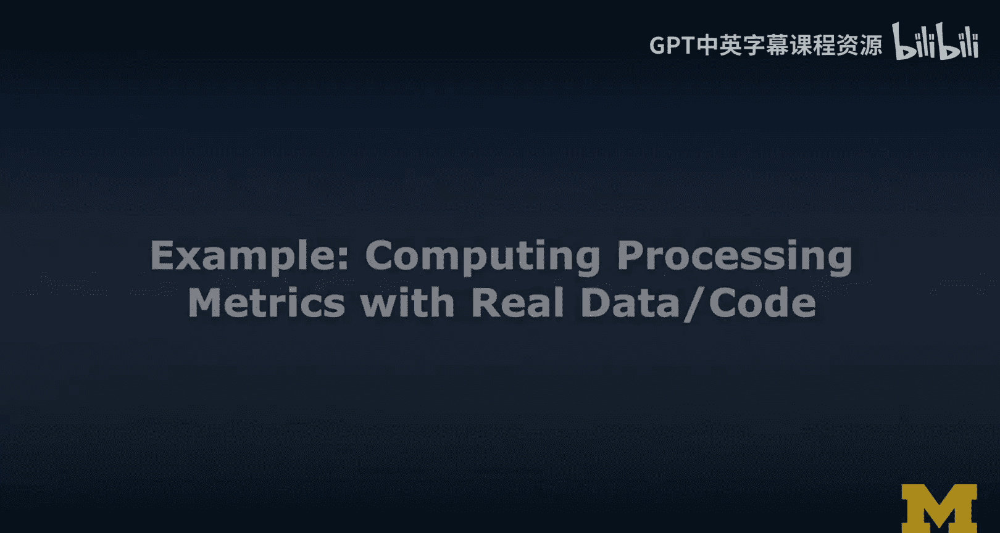
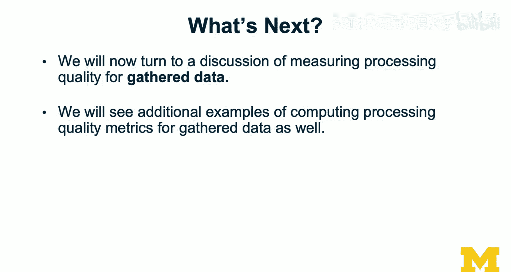

# 总体数据质量（框架、度量、设计策略）：10：示例：真实数据与代码实现处理质量指标计算 📊




在本节课中，我们将学习如何通过实际的数据和代码来计算处理阶段的质量指标。我们已经从概念上讨论了针对设计数据的处理质量度量，现在我们将通过软件中的具体示例，来实际计算这些度量。

## 从概念到实践

上一节我们介绍了与数据处理步骤相关的质量度量概念。本节中，我们来看看如何在R软件中实际计算这些与测量维度相关的处理质量指标。

## 示例一：编码者间一致性（Kappa统计量）

一种针对设计数据的处理质量度量是编码者间一致性。假设有两位人工编码员被要求对10条开放式调查回答进行编码，这些回答是关于职业的。最终目标是创建一个新的二分变量（1代表蓝领职业，0代表非蓝领）。

以下是两位编码员对相同10条回答的编码结果：
*   编码员1：1, 0, 1, 1, 0, 0, 1, 0, 0, 0
*   编码员2：1, 0, 0, 1, 0, 0, 0, 0, 0, 1

问题在于如何量化这种一致性水平，并判断其是否可接受。我们将通过列联表和Kappa统计量来分析。

### R代码实现与分析

以下是进行Kappa分析的R代码。我们首先创建列联表。

```r
# 创建列联表
cross_tab <- table(coder1 = c(1,0,1,1,0,0,1,0,0,0),
                   coder2 = c(1,0,0,1,0,0,0,0,0,1))
print(cross_tab)
```

通过观察列联表，我们可以计算出一致性比例为70%。但这只是一个描述性统计。为了进行更正式的度量，我们使用`FMSB`包中的`Kappa.test`函数计算Kappa统计量。

```r
# 安装并加载FMSB包
# install.packages("FMSB")
library(FMSB)

# 计算Kappa统计量并进行检验
kappa_result <- Kappa.test(coder1 = c(1,0,1,1,0,0,1,0,0,0),
                           coder2 = c(1,0,0,1,0,0,0,0,0,1))
print(kappa_result)
```

函数输出包括估计的Kappa值（本例中为0.4）、用于检验“一致性是否随机发生”这一零假设的P值（0.1），以及Kappa值的95%置信区间。此外，该函数还提供了一个定性判断，将0.4的Kappa值评估为“一般一致性”。

由于P值大于0.05，我们无法拒绝零假设，即当前观察到的一致性水平可能与随机发生无异。同时，“一般一致性”的定性评估也表明，两位编码员之间的分歧（10条中有3条不一致）需要解决。解决方案可能包括引入第三位独立编码员（或专家）进行仲裁，或组织编码员讨论分歧点，以在分析前达成最终编码。

**核心公式**：Kappa统计量用于衡量超出随机预期的一致性程度。其计算公式为：
**Kappa = (P_o - P_e) / (1 - P_e)**
其中，`P_o`是观察到的一致性比例，`P_e`是随机预期下的一致性比例。

## 示例二：编码者间变异（多级模型）

现在，我们来看一个更一般的处理质量度量：编码者间变异。假设有15位编码员，每位被随机分配一部分开放式职业回答进行编码（蓝领=1，非蓝领=0）。我们想要估计不同编码员将职业编码为蓝领的概率是否存在显著变异。

我们通过拟合一个多级逻辑回归模型来估计编码者间的变异，并检验其显著性。具体方法是比较包含编码员随机效应的模型与不包含随机效应的模型。

### R代码实现与分析

首先，我们加载数据并安装必要的包。

```r
# 读取数据
coder_data <- read.csv("your_data_url_here.csv", header =TRUE)

# 安装并加载lme4包以拟合多级模型
# install.packages("lme4")
library(lme4)
```

接下来，我们拟合两个模型：`m1`包含编码员随机效应，`m2`不包含。

```r
# 模型1：包含编码员随机效应的多级逻辑回归模型
m1 <- glmer(blue_collar ~ 1 + (1 | coder_id), data = coder_data, family = binomial)

# 模型2：不包含随机效应的普通逻辑回归模型
m2 <- glm(blue_collar ~ 1, data = coder_data, family = binomial)
```

然后，我们使用似然比检验来比较这两个模型，以判断编码员间变异是否显著。

```r
# 自定义函数进行似然比检验（针对方差成分）
lr_test <- function(model1, model2) {
  log_lik_diff <- logLik(model1) - logLik(model2)
  test_stat <- -2 * as.numeric(log_lik_diff)
  p_val <- 0.5 * pchisq(test_stat, df = 1, lower.tail = FALSE) # 乘以0.5用于检验方差是否为0
  return(p_val)
}

# 执行检验
p_value <- lr_test(m1, m2)
print(paste("似然比检验P值：", p_value))
```

如果输出的P值非常小（例如小于0.05），则我们拒绝“编码员间变异为0”的零假设，认为不同编码员的编码行为存在显著差异。这表明在处理阶段需要关注编码员间的分歧，可能需要通过额外培训等方式来减少变异，确保编码标准一致。

## 使用R Markdown提升分析可重复性

在上述示例中，我们提到了R Markdown文件。这是一种强大的工具，允许你将代码、输出结果和解释性文本整合在一个文档中。通过点击“Knit”按钮，你可以生成格式优美的HTML或PDF报告，便于与同事分享，并确保分析过程的透明度和可重复性。

## 总结

本节课中，我们一起学习了如何为设计数据计算处理质量指标。我们通过两个具体示例进行了实践：
1.  使用**Kappa统计量**评估两位编码员间的一致性，并判断其显著性。
2.  使用**多级逻辑回归模型**和**似然比检验**来评估多位编码员间的变异是否显著。




这些度量有助于识别和量化数据处理阶段（尤其是人工编码环节）引入的变异与不一致性，是确保最终数据集质量的重要步骤。掌握这些方法后，我们就能更系统地在实际工作中监控和改进数据处理过程的质量。