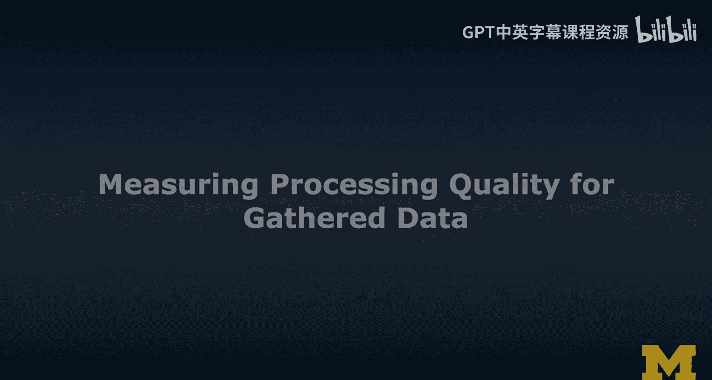
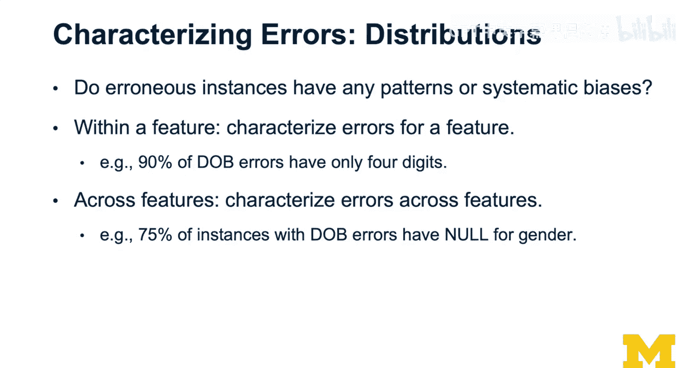
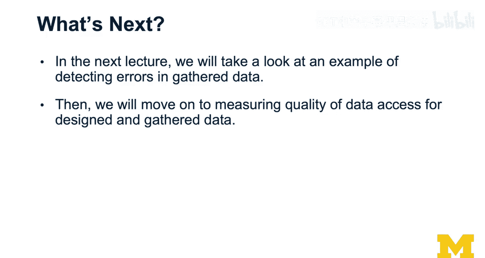

# 密歇根大学《总体数据质量（框架、度量、设计策略）total data quality》 p55 11_采集型数据处理质量测量.zh_en -BV1Jn4y1X7uS_p55-

Hello everyone in this lecture you will learn how to measure data processing quality for gather data。

Before we move on， let's check where we are in the big picture。In previous lectures。

 you have learned how to measure validity and data origin quality。Now。

 we are going to look at measurement of data processing quality for gather data。

To measure data processing quality， we can quantify processing errors using frequencies and ratios for this。

 we can count how many instances have errors in two ways， first。

 we can count a number of instances with invalid values for feature and calculate its ratio of the total number of instances For example。

 in a data feature for date of birth， 10% of all instances may contain invalid values。Second。

 you can count the number of instances with invalid values across two or more features， For example。

 in gathered data， we may find that 5% of all instances have invalid values for date of birth and gender features。

 Another important way to quantify data processing errors is to look into the distributions of errors for this。

 we ask a question like do Iraniananous instances have any patterns or systemic biases。

Instances with errors in a feature may have specific pattern。 For example。

 it may be found out that 90% of date of birth errors have only four diseaseits in the format of two disease month and two disease date。

 instead of six visitits in the format of two disease year to disease month and two disease date。

 We may also find errors have patterns across to or features。 For example。

 75% of instances with date of birth errors in the data we collect may have no values for gender。

 indicating that date of birth errors are related to gender feature。

Then how can you find those data processing errors in gather data？

A straightforward way is to search errors manually by looking into data entries one by one。

 although intuitive and accurate， this approach is not applicable to large scale gather data。

 which may record millions of instances on a few dozens of features。

Another way is to get help from experts who know the domains of gather data， for example。

 doctors and nurses can provide the list of frequent errors in electronic medical records， EMLs。

 which are widely used as gather data for biomedical research。

These experts can be very helpful to detect and characterize errors in gather data collected from their domains。

 but their expertise may not be applicable to the data from different domains or tasks to address the limitationviation of manual inspection。

 we can define rules for errors and filter instances that match those rules。

Using the text processing technique called regular expression。

 we detect instances that do not conform to a specific format in large scale data， for example。

 we can filter instances that do not match on the date of birth format of to diseasey month。

 followed by slash to diseaseit date， followed by slash to disease year。

Another example of the filter instances with incorrect email addresses that do not conform to the standard email address format of an alphabet or numeric string followed by a a symbol and a domain name without thatt。

 but this rule based method still requires us to decide the format of errors。

To overcome this limitation， we can use machine learning algorithms to detect instances with abnormality。

This advanced method can detect unknown errors in big data。

 but creating a training set for supervised machine learning can be very costly。 Also。

 this method still requires expert inspection for validation of results。In the next lecture。

 we'll take a look at an example of detecting errors in gathered data。

 Then we will move on to measuring quality of data access for designed and gathered data。

