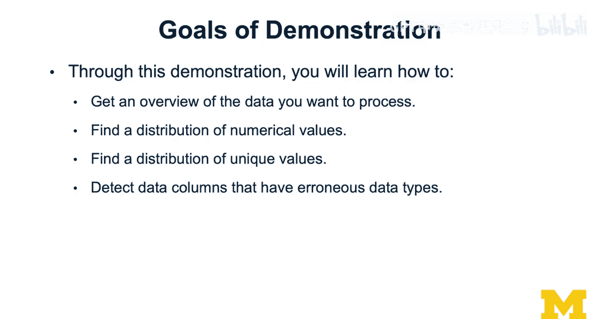
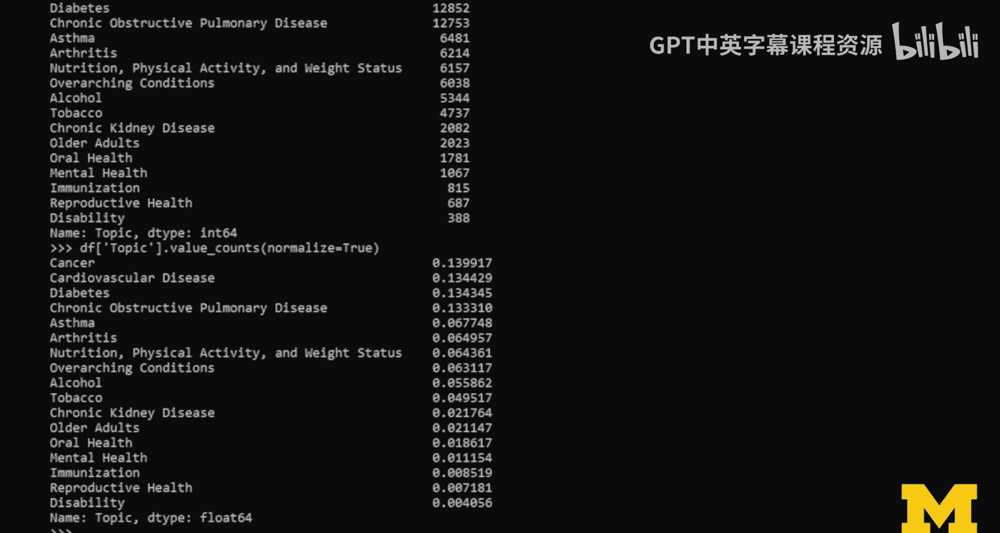
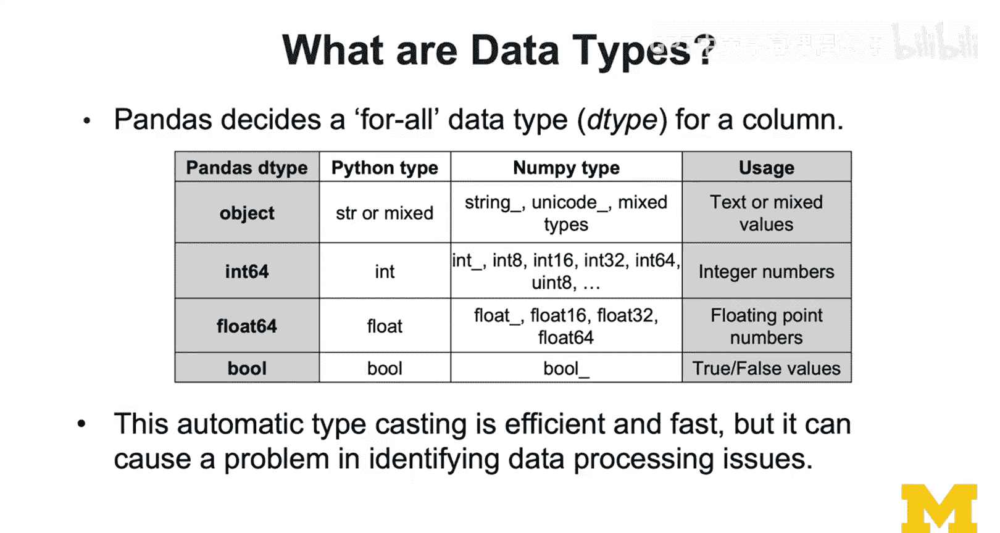
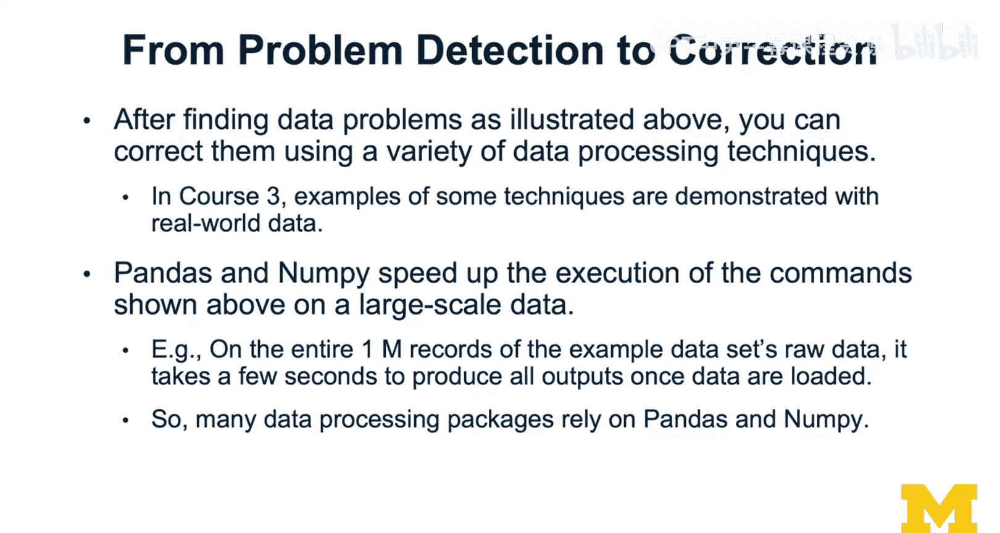

# 密歇根大学《总体数据质量（框架、度量、设计策略）total data quality》 p56 12_示例：采集型数据处理质量指标计算实践.zh_en -BV1Jn4y1X7uS_p56-

We will take a look at an example of computing data processing metrics for gathered data。

Data processing is the preparation of quality data for analysis。This includes parsing， cleaning。

 standardization， filtering and transformation of data instances and fields。

We need to carefully investigate data to find if any data problems occur during data processing。

This example shows how you can find data processing problems in large scale data and characterize those problems using Python packages For this example。

 we will use a data set from datagov a US government's open data portal。

 The data set contains 1 million records of chronic disease indicators collected from federal and state agencies in public health from 2001。

Please do not download data directly from the link instead we will use a sample of the raw data。

Before you dive into the example， please check if you have installed Python and two packages。

 Nmpy and pandas on your computer for details about installation。

 please follow the links in the slide to get to guide documentations。

 This example demonstration will show you how to get an overview of the data you want to process。

 find the distribution of numerical values， find the distribution of unique values and detect data columns that have data types with errors。

Let's do some handsoneing exercise。 Please download chronic diseasease sample CSsv from the TDQ course page and save it in a folder of your choice on your computer。

Open a command prompt and change the working directory to the folder where the data is stored。

Please type Python on the command prompt and press enter。A Python console will be opened。

 providing the information about the version of Python installed on your computer。From here。

 every python commands are typed after the Tropo angle brackets。First， type。

 import pandas S P D and press enter。Then type import nuy as N P and press enter。 Next。

 we will load the sample data。For this， type of command D F equal P D dot3 on the bar CSV and write the sample file name with double quotation marks wrapped in parentheses。

 press enter。Now， the sample data set is loaded as D F。Let's get data overview。

Type D F that had followed by empty parentheesis， and press enter。

You will see the first five rows and a few first and last columns of the loaded data。

The ellipses tell you that some data columns among 26 columns are not shown on the screen。

Type D F dot info and parentheses and press enter。 It shows an overview of the load data。

The range index shows that there are 95664 instances。 There are 26 columns。

 This also reports data typed and non missing value count in each column。For example。

 the first column year start has 95664 non null count， which means there is no missing instances。

A streotype is integer。 Now， type D F dot describe empty parenthses and press enter。

This reports distributions of numerical values in columns。For each column， it shows count， mean。

 standard deviation， minimum 25，50，75 percentile and maximum values。

Some columns are not shown as there are too many columns。Next。

 how can you find out unique values for a column topic， for example。

Type D F and topic with single quotation marks wrapped in square brackets。

 followed by a dot and value on the bar counts and empty parentheses。Press， enter。

You can see the list of unique values in the column topic and their accounts sorted in a descending order。

For example， cancer appears 13385 times。What if we want to calculate the ratio of each unique values instead of count。

Type the same command we input just before the FN topic with single quotation marks wrapped in scale brackets followed by a dot and value on the counts。

But this time， at normal lies equal true in the parentheses and press enter。

You will see the list of unique values and their ratios， which sum up to one。

Let's take a look at the table that lists data types in pandas pandas decides a data type denoted as D type for a column automatically。

 For example， a data type object means values in a column may have text or mixed values。

Please note that only a single data is decided for all instances in the column。

This automatic type testinging is efficient and fast。

 but it can also cause a problem in identifying data processing issues。

To see what this problem looks like， please type D F dot info with empty parentheses again and press enter。

This will show you the list of columns， and their data types。Take a look at the column， data value。

The data value column is expected to have only numerical values。

 but its data type was reported as object， which means it has text or mixed values。

To check the problem， type D F data value equal Df data value as type。

Float。This asks pandas to convert all values in the column data value into float values。Press enter。

 and you will see a chunk of error message。Please pay attention to the very last line that says value error could not convert string to float column。

 no。This indicates that there exists a text string no in the column。

Let's find suspicious instances in the column that cause this problem。Type a command， as follows。

This creates a filtered copy of the loaded data where rows are filtered if they contain any alphabetical characters in the data value column。

In the command， lowercased A to z， followed by uppercased A2 Z with single quotation marks wrapped in square brackets is a regular expression that filters any text strings from given values。

N A means no value。 N A is set as false so that during the filtering。

 any missing values dennoted by any text strings like N A N or N A are not selected。Now。

 each time to check what text strings are filtered and stored in the new data frame named D F Underbar filtered。

 type of command as follows。It asks pandas to find counts of unique values in the column of the filter data frame named the F underba filtered。

If you press enter， you will see a list of text strings and their count。No。

 is shown to appear 110 times in the data。There are other text strings like yes， and category1。

These values are recorded in text strings instead of numeric values and can cause a problem in analysis。

This example shows you how you can find data problems so that you can crack them using a variety of data processing techniques。

In course 3， examples of some techniques are demonstrated with real world data。

We use the pandas and nuy packages， for the example。

These two packages can speed up the execution of the overall shown commands on a large scale data。

For example， on the entire 1 million records of the example data set， original data。

 it takes a few seconds to produce all the outputs shown above once the data are loaded。

So we can rely on pandas and Ny for fast and scalable data processing。

