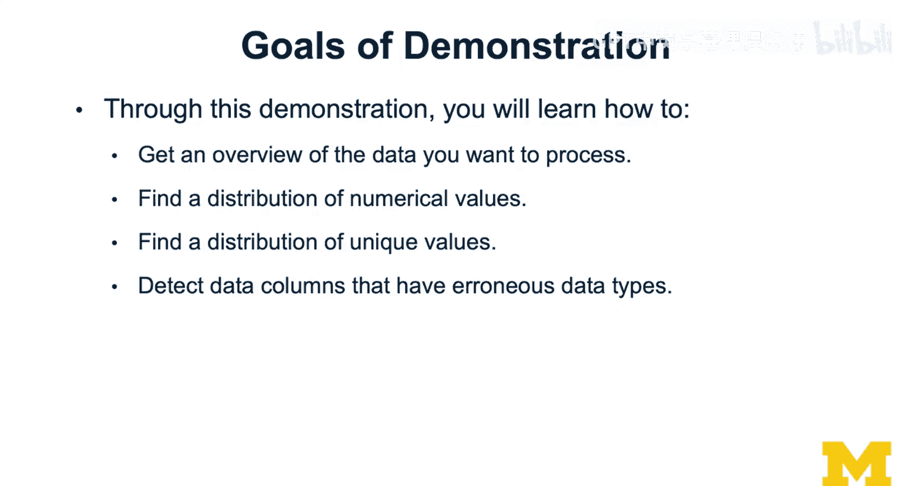
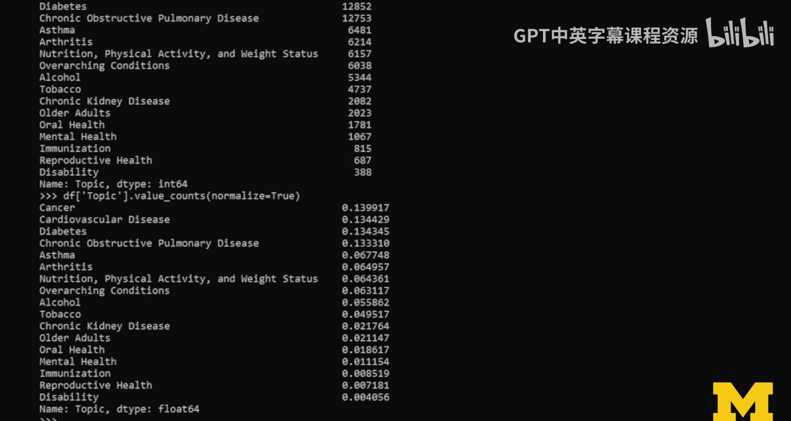
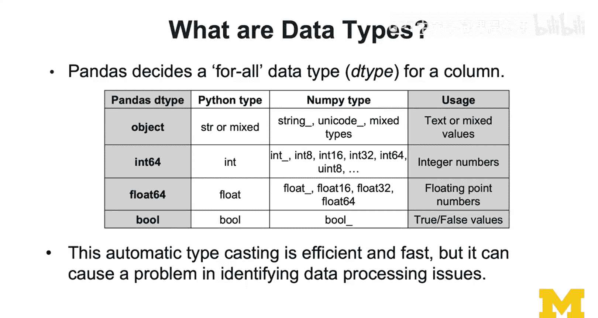
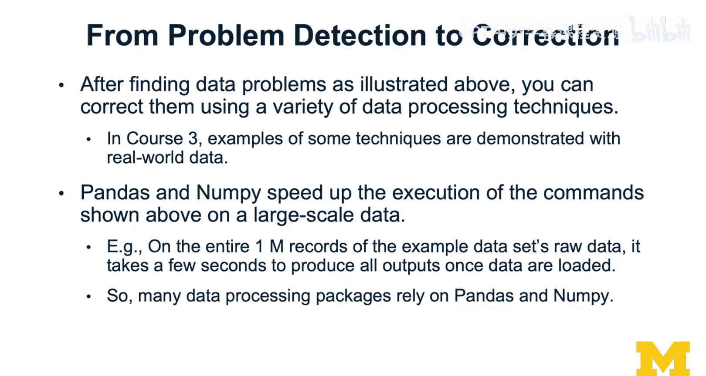

# 总体数据质量：12：示例：采集型数据处理质量指标计算实践 📊


在本节课中，我们将通过一个具体示例，学习如何为采集到的数据计算数据处理质量指标。我们将使用Python的pandas和NumPy库，对一个真实的公共卫生数据集进行探索，识别其中的数据处理问题，并学习如何量化这些问题。

数据处理是为分析准备高质量数据的过程。这包括对数据实例和字段进行解析、清洗、标准化、筛选和转换。我们需要仔细检查数据，以发现数据处理过程中可能出现的任何问题。

## 数据概览与加载

上一节我们介绍了数据处理的基本概念，本节中我们来看看如何实际操作。首先，我们需要获取并加载示例数据。



以下是操作步骤：
1.  从课程页面下载示例文件 `chronic_disease_sample.csv`，并保存到电脑上的一个文件夹中。
2.  打开命令行工具，将工作目录切换到数据文件所在的文件夹。
3.  在命令行中输入 `python` 并按回车键，打开Python控制台。
4.  在Python控制台中，依次输入以下命令来导入必要的库并加载数据：

```python
import pandas as pd
import numpy as np
df = pd.read_csv("chronic_disease_sample.csv")
```

现在，数据已加载到名为 `df` 的变量中。让我们获取数据的整体概观。

## 探索性数据分析

数据加载完成后，我们需要从多个角度了解其结构和内容。这有助于我们发现潜在的数据质量问题。

首先，查看数据的前几行和基本信息：
```python
df.head()
df.info()
```
`df.info()` 会显示数据概览，包括实例数量（95664行）、列数（26列），以及每列的数据类型和非空值数量。例如，第一列 `yearstart` 有95664个非空值，数据类型为整数。

接着，查看数值型数据的分布统计：
```python
df.describe()
```
此命令会报告各数值列的基本统计信息，包括计数、均值、标准差、最小值、25%/50%/75%分位数和最大值。

## 检查唯一值分布

了解分类数据的分布情况同样重要。我们可以检查特定列（例如 `topic` 列）中唯一值的出现频率。

以下是计算唯一值及其计数的命令：
```python
df[‘topic’].value_counts()
```
此命令会列出 `topic` 列中的所有唯一值及其出现次数，并按降序排列。例如，`cancer` 出现了13385次。



如果想查看每个唯一值的占比（比率），可以使用以下命令：
```python
df[‘topic’].value_counts(normalize=True)
```
此时，输出的列表将显示唯一值及其占总数的比例，所有比例之和为1。



## 识别数据类型问题

Pandas会自动为每一列推断一个数据类型（`dtype`）。例如，`object` 类型表示该列可能包含文本或混合类型的值。这种自动推断虽然高效快捷，但也可能掩盖数据处理问题。


让我们再次查看数据信息，以识别潜在问题：
```python
df.info()
```
观察 `datavalue` 列。我们期望此列只包含数值，但其数据类型被报告为 `object`，这表明其中可能存在文本或混合值。

为了验证这个问题，尝试将该列转换为浮点数类型：
```python
df[‘datavalue’].astype(float)
```
执行此命令后，会出现错误信息。最后一行显示 `ValueError: could not convert string to float: ‘No’`。这表明在 `datavalue` 列中存在文本字符串 `‘No’`。

## 定位并分析问题数据

现在，我们需要找出导致此问题的具体数据行。我们可以使用正则表达式来筛选出包含字母字符的行。

以下是创建筛选后数据框的命令：
```python
df_filtered = df[df[‘datavalue’].str.contains(‘[a-zA-Z]’, na=False)]
```
在这个命令中，`‘[a-zA-Z]’` 是一个正则表达式，用于匹配任何字母字符。`na=False` 参数确保缺失值（如 `NaN`）不会被选中。

接下来，查看筛选出的数据框中 `datavalue` 列的唯一值及其计数：
```python
df_filtered[‘datavalue’].value_counts()
```
执行后，你会看到一个文本字符串及其出现次数的列表。例如，`‘No’` 出现了110次。此外，可能还有 `‘Yes’`、`‘Category1’` 等其他文本值。这些以文本形式记录的值，在后续的数值分析中可能会引发问题。

这个示例展示了如何发现数据问题，以便后续使用各种数据处理技术（如数据清洗、转换）来解决它们。在课程的其他部分，会使用真实世界的数据演示一些具体的技术。

## 总结




本节课中我们一起学习了如何为采集型数据计算和处理质量指标。我们使用 `pandas` 和 `numpy` 库，对一个包含近10万条记录的慢性病指标数据集进行了探索。具体步骤包括：加载数据、获取数据概览、分析数值与分类数据的分布，并重点演示了如何识别因数据类型自动推断而隐藏的数据问题（如数值列中混入文本）。通过定位并分析这些异常值（如 `‘No’`, `‘Yes’`），我们能够为后续的数据清洗和转换步骤做好准备。这些工具和方法能够高效、可扩展地处理大规模数据。