# 密歇根大学《总体数据质量（框架、度量、设计策略）total data quality》 p57 13_设计型数据访问质量测量.zh_en -BV1Jn4y1X7uS_p57-

Hello， I'm Trenm Buskirk。 Welcome to our lecture on measuringas data access quality for design data。

 So just as we like to do in every lecture， let's sort of figure out where we are in our framework。

 Today's lecture is going to really be focused on the representation side of our framework where we're looking at data access quality for design data in particular。

 recall that data access for design data。 The sampling frame gives us access to our target population。

 The sampling frame is a set of information materials or procedures used to select a sample。

 The selection can be done using either a probability or non-probability based design。

 but measures of data access quality for design data will certainly focus on attributes of the sampling frame。

 because the sampling frame is what gives us access to our target population。

 If we were interested in using a web based survey。

 Then those without internet service would not necessarily be included in a sample design。😊。

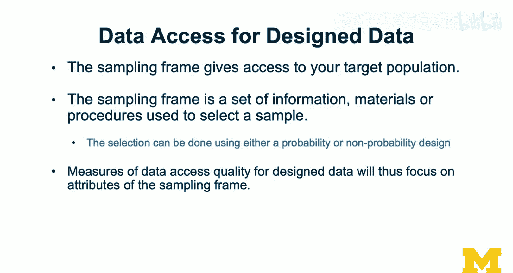

That rely on web connectivity to collect survey information to evaluate data access quality of such sampling frames。

 We need measures of key outcomes for both those who have Internet service and those who do not。

 We can get such measures from those with Internet service using web based surveys。

 But these types of surveys will not allow us to measure anything from those people who do not have internet access or Internet service。

 So we can embed questions in an existing face to face probability survey about characteristics that would allow us to make comparisons between those with and without Internet service on relevant variables like do you own a smartphone。

 do you have a landline phone。 Do you check mail from a appeal box。

 Then we can estimate the prevalence and correlates of each indicator as they relate to Internet service or not These measures will help us understand if our sampling frame with only those having Internet service。

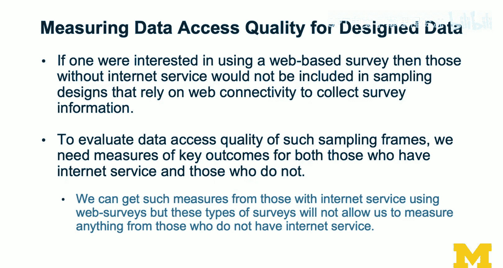

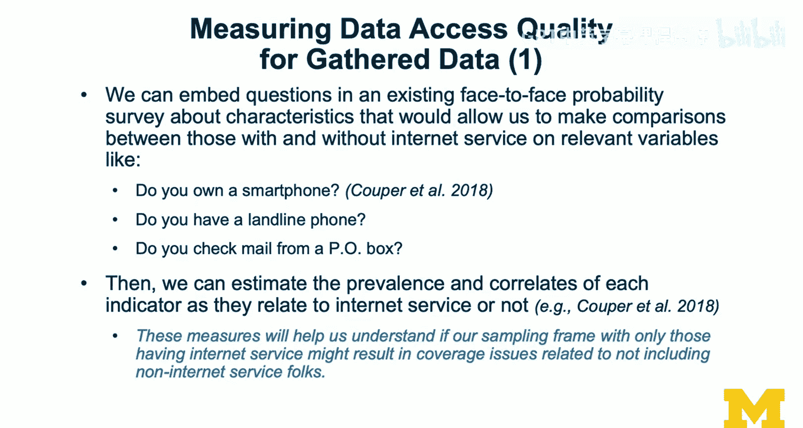

Might result in coverage issues related to not including non internet service folks。 So specifically。

 we can estimate internet access bias。 Are those who routinely have access to the Internet at home different than those who do not。

 we can estimate this bias in a survey that facilitates participation from both groups。 In this case。

 with and without internet access like a face to face survey that we just mentioned。

 The key here is we wouldn't be able to assess or estimate this bias if we only used。

 say an online survey， for example， because that would give us no information from the people without Internet access。

 The Internet access bias is a function that has two components。

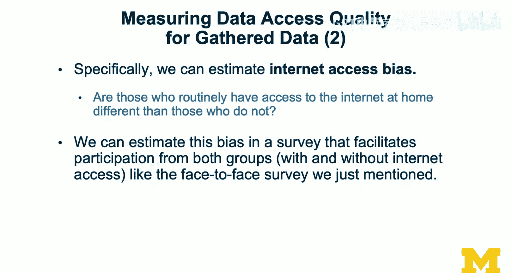

1， the differences between those with and without Internet access。

 So we're going to denote that by y bar sub int minus y bar sub no int。

 Y represents a variable that we might care about。 And then the second component is the proportion without Internet access。

 So this is P hat， no Internet。Or no int。 The bias is then estimated as the difference between the estimate from those with Internet access minus the overall average including everybody with and without Internet access。

 We can operationalize this difference as a difference between those with Internet access and those without Internet access。

 as you see here in this formula。 So the bias is estimated as the proportion without Internet access multiplied by the difference of our estimate for the variable that we care about。

 from those with Internet access and those without Internet access。 And again。

 why Bar sub all is the average value of the indicator or the variable that we care about in the target population comprised of those who do and do not have Internet service。

 This graph referenced some results from the study that we mentioned earlier。

 Cooper and colleagues in 2018。 Remember that our estimate。

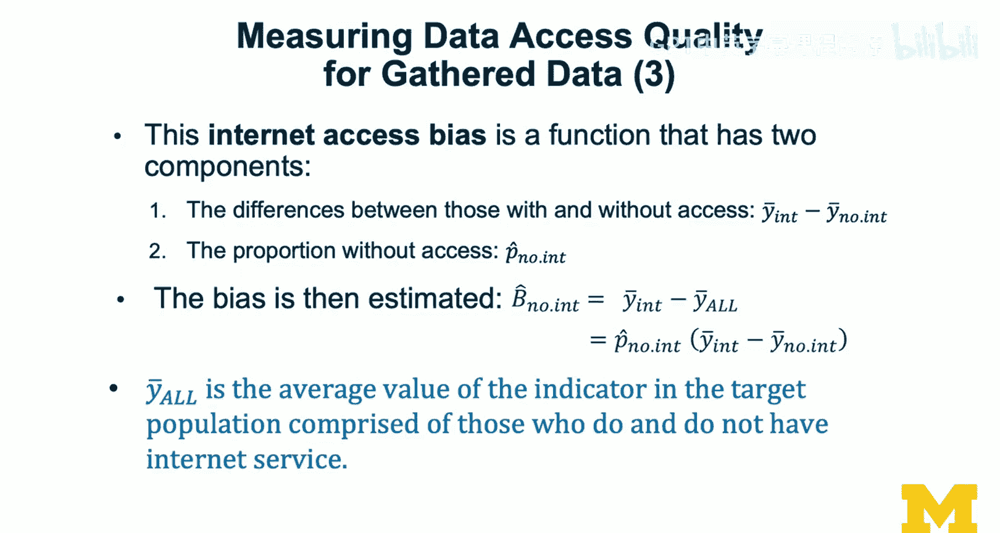

For the bias for without Internet access is the difference between the estimate derived from the Internet access folks on the variable that we care about minus the overall estimate from everyone。

 those with and without Internet access。 What we can see is that the blue bars represent the full sample。

 So those with and without Internet， because this was a face to face survey that collected information from those people that have Internet and those who don't。

 The orange line is those that are excluding no Internet access。

 So essentially the orange line is what we would get from looking at only the Internet access folks。

 What you can see in some cases is that those with Internet access are slightly less ever pregnant。

 they are slightly higher on zero live births， So no children know live births。

 and then they are slightly lower on three plus live births， for example。

 the other variables seem to be relatively consistent， but on these three particular variables。

That we've highlighted， there are some differences if we were to rely on estimates only derived from those with Internet access。

 In some cases， we would underestimate the full population values and in other cases。

 we would overestimate the full population values。 Dutwin and Weskirk in 2017 did a more expansive study where we explored 5000 variables from 12 different survey sources that all collected information about whether or not you had Internet access in the home。

 and we looked in this study a differences in Internet and nonin households。

 We found some key differences in whether or not you traveled outside of the house。 for example。

 Internet households overrepresented quite a lot。 those that traveled outside of the US compared to non-in households。

 Similarly， those from Internet households had heard of GMmoOs at a much higher rate than those without Internet and those with Internet had higher proportions reporting that they see friends every day。

😊。

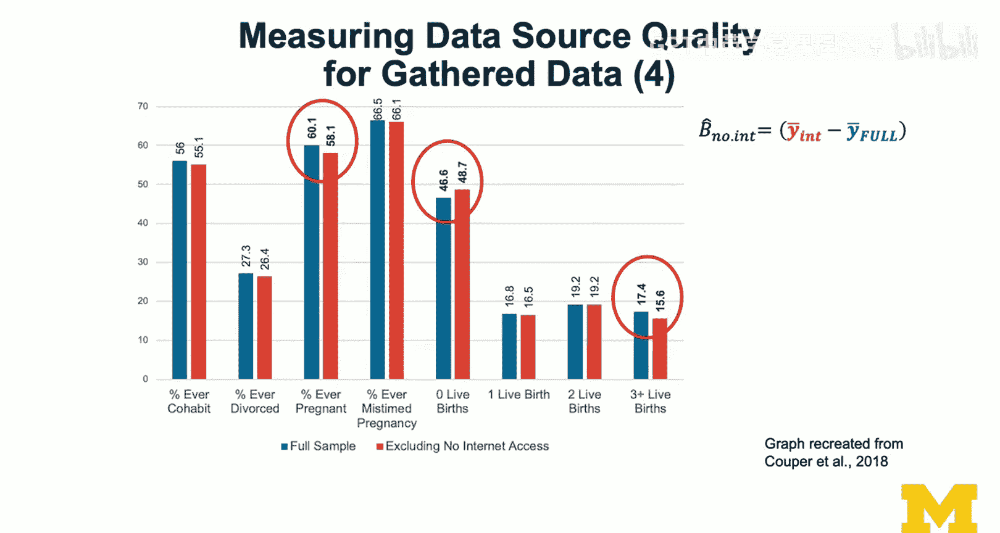

Than those households without internet， for example。

 And so the idea here is that if we were to use an internet only accessible study designed like a webbased survey。

 we would not get information from the non-internet households and in some cases we would have large overestimate by relying only on the internet households。

 a report information from that particular survey， so this can result in coverage bias because we are not covering the entire population we're using a portion of the population to represent everyone i。

e。 the Internet population and in this case， that may not be sufficient or of reasonable quality to move forward with those estimates to represent everyone we mentioned earlier that data access for design data is a function of the sampling frame and many sampling frames consist of primary contact information on each sampling unit along with auxiliary information such as region。

 household size and number of employees。

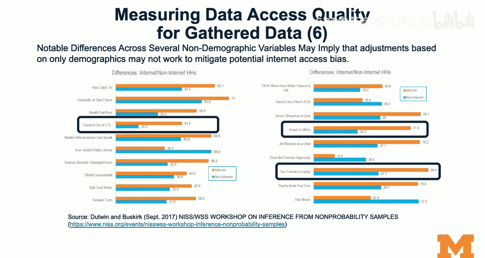

This auxiliary information can actually be very helpful for assessing data access quality and potential biases on variables or correlates of variables that you might care about because you have information available for everybody on the frame with these auxiliary variables this study in 2019 with English can all myself and harder discuss various aspects of how vendors maintain and construct。

 addressbased sampling frames that can be helpful when thinking about data access quality。

 including the amount of append information， the appendant information that's available。

 the timeliness of frame updates and the types of addresses that are typically exclude from the frame。

 some frames exclude households that are in seasonal environments or households that are outside of the mailing that are outside of the delivery capabilities of the postal service for example。

 in a given country So understanding the exclusions of the frame are。

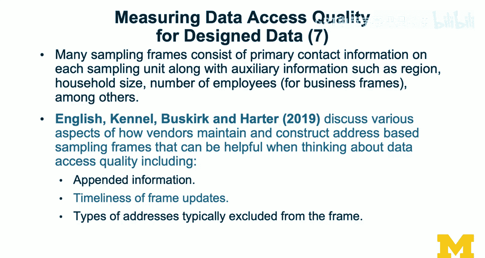

because these relate， again， to potential coverage biases similar to what we discussed with Internet and nonin households。

 Another study in 2014 that I did with colleagues discuss the notion of concordance that measures how consistent auxiliary information provided by multiple vendors are for address dress based sampling frames。

 So if you decide that you want to use in auxiliary variable that's available for everybody on your sampling frame。

 The auxiliary variable may be sourced from three different vendors or multiple vendors。

 And when you source from multiple vendors， there could be different values of the variables that are included or appended to the frame。

 whether or not those variables are consistent is a question that you can measure empirically using these metrics like concordance that I mentioned。

 study in 2019 also discuss various quality metrics related to auxiliary variables。

 including the match rate， the append or yield rate and the accuracy of appended data。

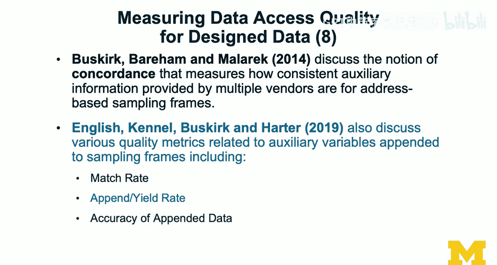

The accuracy of appended data is also related to the concordance。

 English and colleagues in 2015 illustrated how to utilize auxiliary information from multiple vendors to create a new variable that could be used in a stratified sample design to maximize the coverage of the sampling frame within the primary stratum of interest。

 which was families with children under5。 One metric for data access quality that can be very important here relates to the timeliness or what we call currency。

 which measures the degree to which information on the frame is current or up to date。

 You would want currency to be high， So almost all the frame is current。

 that's what we would say if you were going to use a time sensitiveens or time varying variable for stratification。

 like the one that English and colleagues used here。

 being the presence or absence of children under5 in the home。

 if these variables that were appended to the frame about children under5 were 10 years old。

 you can imagine that those variables indicating that there were children。

Under the age of five at 10 years ago， would not be very helpful for identifying where the children under where the households are with children under5 to day。

 So currency is really important when you're thinking about these variables that might be sensitive to time Earl。

 we discussed the idea are the implication of coverage with respect to designs that might only rely on those with Internet access。

 There are alternate measures of undercover that can relate to frames as well。

 One of them is the coverage ratio， which compares the population size on a given frame to that of an external benchmark for like。

 let's say， the census。 This coverage ratio， though， does not measure bias due to under coverage。

 because that bias due to under coverage is particularly or potentially variable specific。

 As we saw in the Cooper and colleagues study in 2018。

 Some variables that were represented by the Internet access households measured very similarly to the。

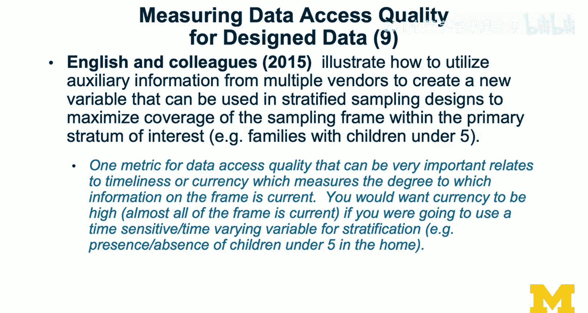

So there was little coverage bias in those variables。

 but other variables did have notable differences that would portend potential biases with coverage related to internet access。

 There's also a dual estimation system process where given a frame with size capital N。

 we draw a sample from that frame， we estimate the percentage of individuals who are actually in our population of interest。

 that would be C， then based on a highqu independent sample from the same population。

 we estimate the percentage of individuals in the population of interest。

 and then we calculate this ratio。 So this dual system estimation allows us to improve our estimation of the population sizes for populations that we care about to better estimate the coverage that we have for that particular population。

 We can also compare different methods of asking who the usual residents of a household are for developing household rosters。

 for example。

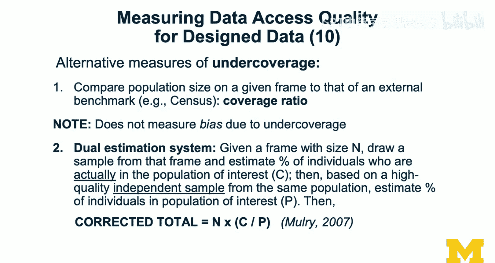

erates the largest lists， asking multiple field listers to generate the same address list for the same area and examining the additions。

 deletions and confirmations。 Is there any variance in the process。

 Is there consistency across these multiple field listers， et cetera。

 This gives us confidence in data access， quality measures to allow us to move forward to the next stage of our designs。

 Com up， We'll go through an example of computing and interpreting measures of data access。

 quality for design data using a real life example。

 We will then turn to a discussion of measuring data access quality for gathered data。

 Thanks for being with us in this lecture。 We look forward to seeing you in the next。😊。

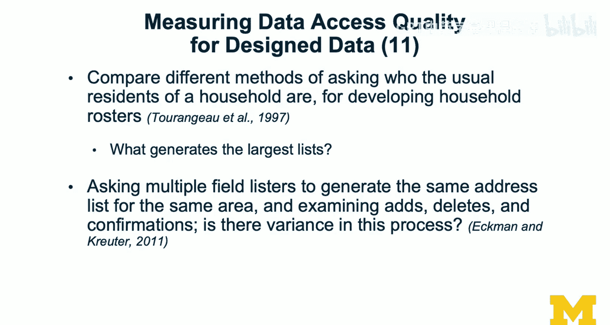

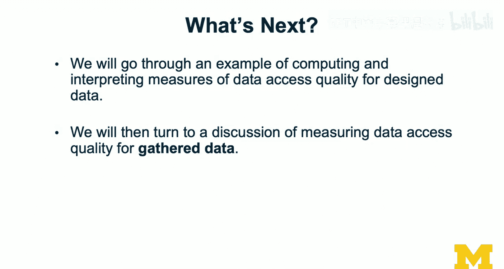

