# 总体数据质量（框架、度量、设计策略）：13：设计型数据访问质量测量 📊

在本节课中，我们将学习如何测量设计型数据的访问质量。我们将重点关注抽样框如何影响我们接触目标总体的能力，并探讨衡量这种访问质量的具体方法。

## 概述：设计型数据访问质量

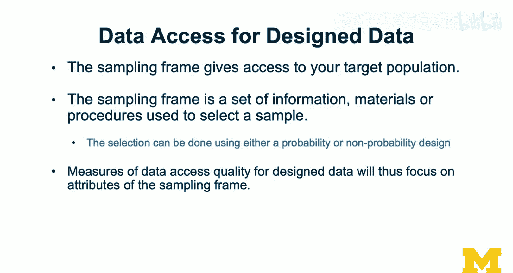

上一节我们介绍了数据质量框架的组成部分，本节中我们来看看设计型数据的访问质量。数据访问对于设计型数据而言，其核心在于**抽样框**。抽样框是用于选择样本的一套信息、材料或程序。选择过程可以采用概率或非概率设计。衡量设计型数据的访问质量，主要关注抽样框的属性，因为抽样框是我们接触目标总体的桥梁。

例如，如果我们计划使用网络调查，那么没有互联网服务的人群可能不会被纳入样本设计。为了评估此类依赖网络连接收集信息的抽样框的数据访问质量，我们需要测量有互联网服务和无互联网服务人群的关键结果指标。

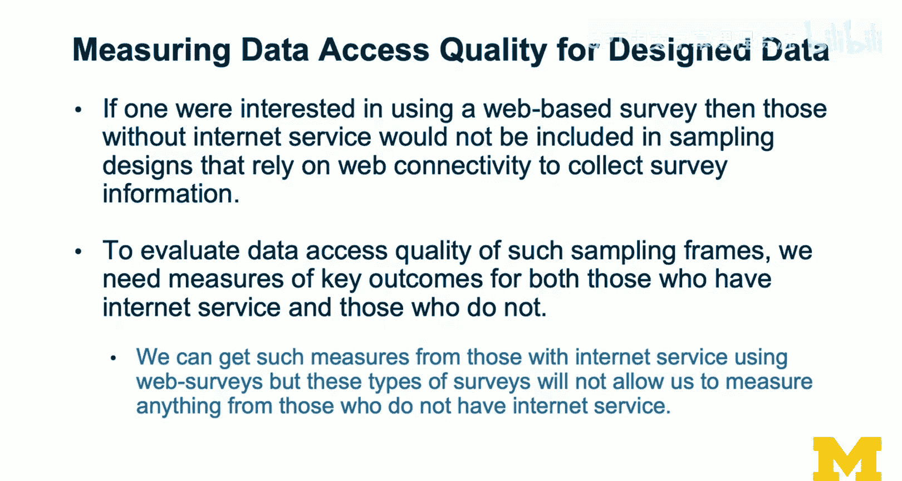

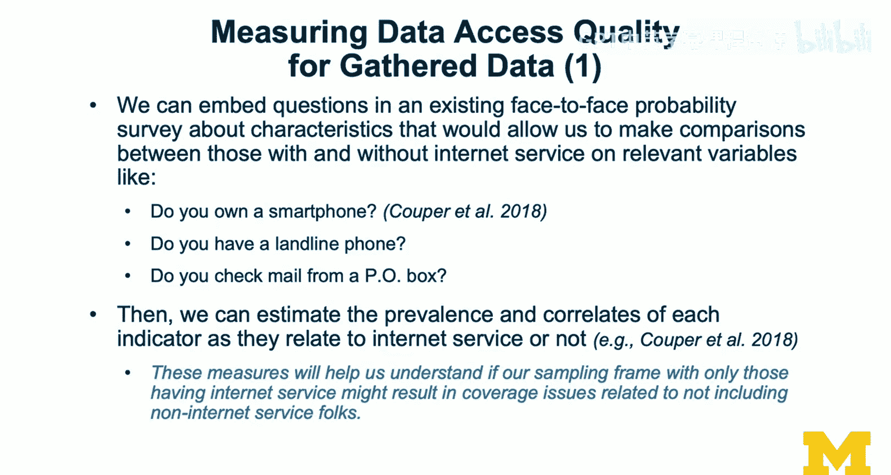

## 测量互联网访问偏差

为了评估仅依赖互联网访问的抽样框（如网络调查）的质量，我们需要比较有互联网和无互联网人群在相关变量上的差异。我们可以通过以下方式获取测量值：

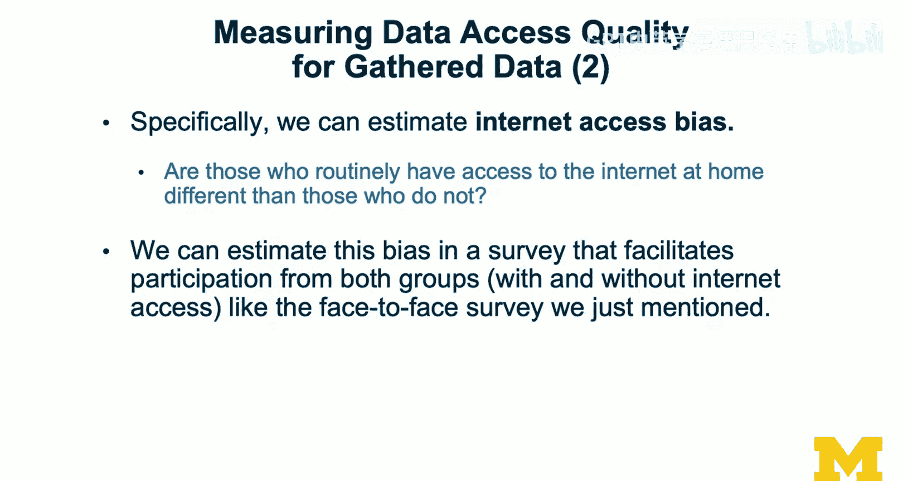

*   对于有互联网服务的人群，可以使用网络调查。
*   对于没有互联网服务的人群，网络调查无法触及。因此，可以在现有的面对面概率调查中嵌入问题，收集可用于比较两组人群的特征信息，例如：你是否拥有智能手机？你是否有固定电话？你是否从邮政信箱收取邮件？

然后，我们可以估计每个指标在与互联网服务相关方面的普遍性和相关性。这些测量有助于我们理解，仅包含有互联网服务人群的抽样框是否会导致因未包含非互联网人群而产生的覆盖问题。

具体而言，我们可以估计**互联网访问偏差**：那些通常在家能访问互联网的人与那些不能的人是否存在差异？我们可以在一个能促进两组人群（即有和没有互联网访问）参与度的调查中估计这种偏差，例如前面提到的面对面调查。关键在于，如果我们只使用在线调查，就无法评估或估计这种偏差，因为那无法提供无互联网访问人群的任何信息。

互联网访问偏差是一个包含两个组成部分的函数：

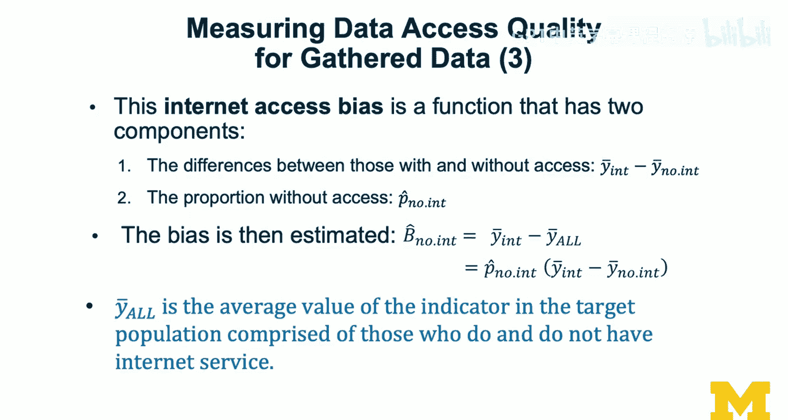

1.  有互联网访问者和无互联网访问者之间的差异。我们用 `ȳ_int - ȳ_no_int` 表示，其中 `y` 代表我们关心的变量。
2.  无互联网访问者的比例。我们用 `P̂_no_int` 表示。

偏差的估计值等于仅来自有互联网访问者的估计值减去包含所有人的总体平均值。我们可以将此差异操作化为有互联网访问者和无互联网访问者之间的差异，如下列公式所示：

**偏差估计公式：**
`偏差 = P̂_no_int * (ȳ_int - ȳ_no_int)`

其中，`ȳ_all` 是目标总体（包括有和没有互联网服务的人）中我们关心的指标或变量的平均值。

一项2018年的研究（Cooper等人）展示了这种偏差的实例。在某些变量上，仅依赖有互联网访问者的估计值会低估或高估总体值。例如，有互联网访问者中“曾怀孕”的比例略低，“零活产”（无子女）的比例略高，“三个及以上活产”的比例略低。

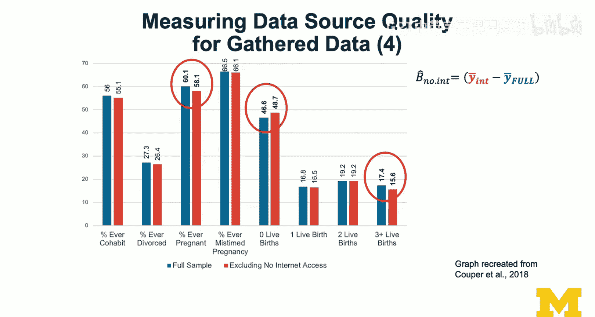

另一项更广泛的研究（Dutwin和Buskirk，2017年）检查了来自12个不同调查源的5000个变量，发现互联网家庭和非互联网家庭在一些关键变量上存在显著差异。例如，互联网家庭中出国旅行、听说过转基因食品、每天与朋友见面的比例都远高于非互联网家庭。这意味着，如果使用仅限互联网访问的研究设计（如网络调查），我们将无法获得非互联网家庭的信息，并且在某些情况下，仅依赖互联网家庭的调查信息会产生较大的高估。

这可能导致**覆盖偏差**，因为我们没有覆盖整个总体，而是用总体的一部分（即互联网人群）来代表所有人，而在此情况下，这可能不足以或质量不足以用这些估计值来代表所有人。

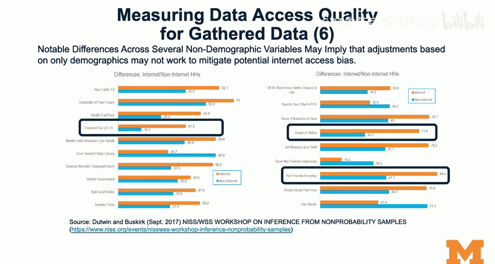

## 利用辅助信息评估抽样框质量

我们之前提到，设计型数据的访问质量是抽样框的函数。许多抽样框包含每个抽样单元的主要联系信息以及辅助信息，如地区、家庭规模、员工数量等。这些辅助信息对于评估数据访问质量以及你可能关心的变量或其相关变量的潜在偏差非常有帮助，因为这些辅助变量在抽样框上的每个人都有信息可用。

一项2019年的研究（English等人）讨论了供应商维护和构建基于地址的抽样框的各个方面，这些方面在思考数据访问质量时很有帮助，包括：

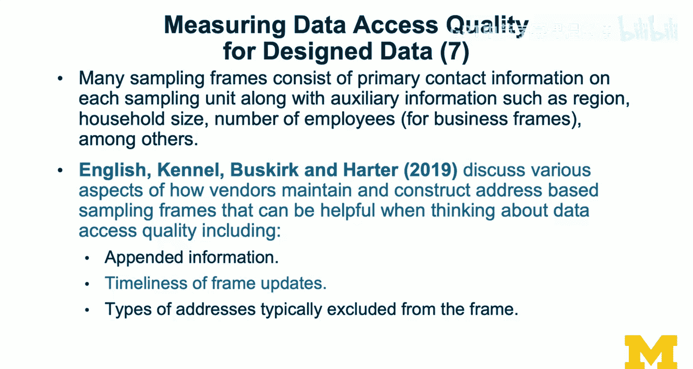

*   附加信息的数量和质量。
*   抽样框更新的及时性。
*   通常被排除在抽样框之外的地址类型（例如，季节性住宅或邮政服务无法投递的地区）。

理解抽样框的排除范围很重要，因为这关系到潜在的覆盖偏差，类似于我们讨论的互联网与非互联网家庭的情况。

另一项2014年的研究提出了**一致性**的概念，用于衡量多个供应商为基于地址的抽样框提供的辅助信息的一致性程度。如果你决定使用抽样框上每个人都有的辅助变量，该变量可能来自多个供应商。当从多个供应商获取时，附加到框上的变量值可能不同。这些变量是否一致，可以使用一致性等指标进行实证测量。

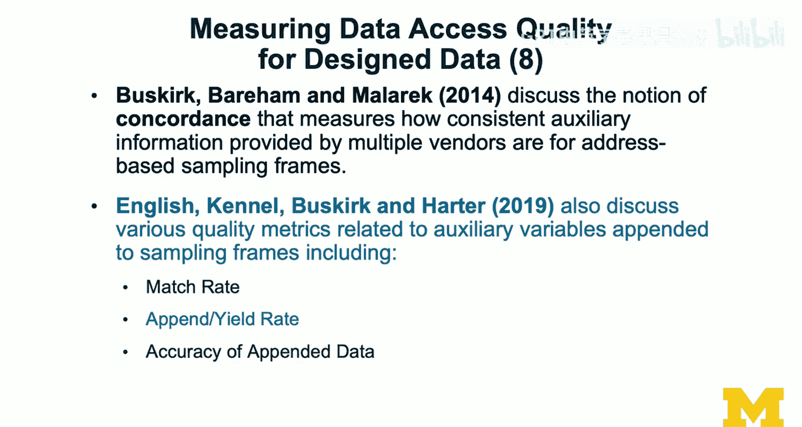

2019年的研究还讨论了与辅助变量相关的各种质量指标，包括：

*   **匹配率**：成功将辅助信息附加到抽样框单元的比例。
*   **附加率/产出率**：获得附加信息的单元比例。
*   **附加数据的准确性**：这也与一致性相关。

## 关键质量指标：及时性与覆盖度

一个非常重要的数据访问质量指标涉及**及时性**（或称**时效性**），它衡量抽样框上信息的当前或更新程度。你希望时效性高，即几乎整个抽样框的信息都是最新的。如果你打算使用对时间敏感或随时间变化的变量进行分层（如English等人在2015年研究中使用的“家中是否有5岁以下儿童”），这一点就至关重要。如果附加到框上的关于5岁以下儿童的信息是10年前的，那么这些信息对于识别今天哪些家庭有5岁以下儿童就没有太大帮助。

我们讨论了仅依赖互联网访问的设计可能带来的覆盖问题。此外，还有与抽样框相关的其他覆盖不足衡量方法：

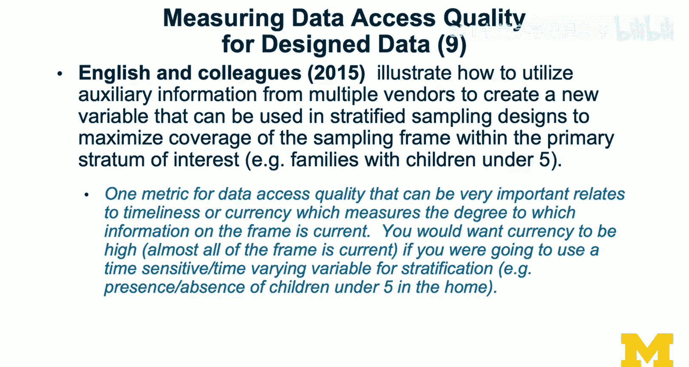

*   **覆盖比**：将给定抽样框上的人口规模与外部基准（如人口普查）进行比较。然而，这个比率并不衡量因覆盖不足导致的偏差，因为这种偏差可能因变量而异。
*   **双重系统估计**：给定一个大小为 `N` 的抽样框，我们从中抽取样本，估计实际属于我们感兴趣总体的人口比例 `C`。然后，基于来自同一总体的另一个高质量独立样本，我们再次估计感兴趣总体的人口比例，并计算比率。这种双重系统估计法可以改进我们对所关心总体规模的估计，从而更好地估计我们对该特定总体的覆盖情况。

我们还可以比较不同的方法来询问家庭的常住居民以编制家庭名册，例如，哪种方法能生成最大的名单。让多个实地名单编制者为同一区域生成相同的地址列表，并检查其中的新增、删除和确认情况，可以评估过程中是否存在差异或是否具有一致性。这为我们提供了对数据访问质量测量的信心，使我们能够推进到设计的下一阶段。

## 总结

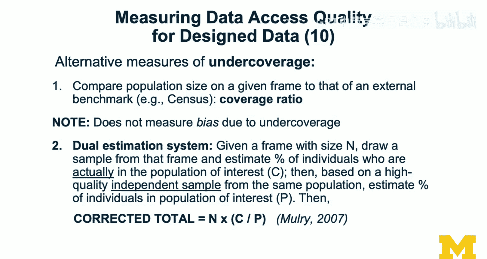

本节课中我们一起学习了如何测量设计型数据的访问质量。我们了解到，设计型数据的访问质量核心在于抽样框，它决定了我们能否接触到目标总体。我们重点探讨了：

1.  **互联网访问偏差**的测量与影响，强调了仅依赖网络抽样框可能导致覆盖偏差。
2.  利用抽样框中的**辅助信息**来评估潜在偏差和质量，包括一致性、匹配率、时效性等指标。
3.  其他衡量覆盖质量的方法，如覆盖比和双重系统估计。

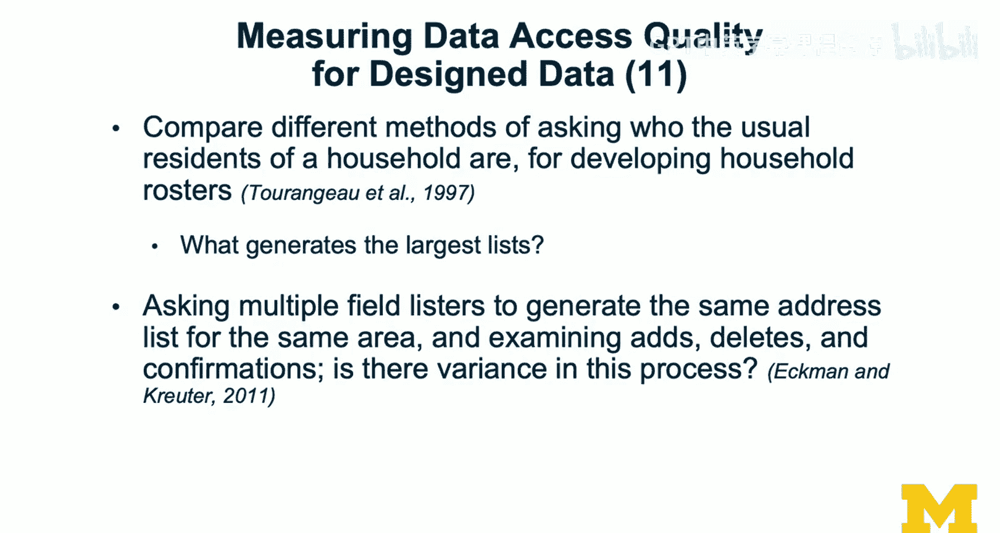

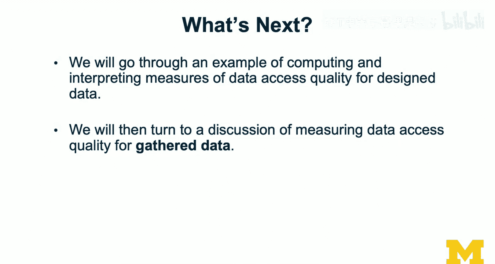

理解这些测量方法有助于我们在研究设计阶段识别和评估潜在的访问质量问题，为收集高质量数据奠定基础。在接下来的课程中，我们将通过一个真实案例来计算和解释设计型数据访问质量的测量，然后转向讨论收集型数据的访问质量测量。