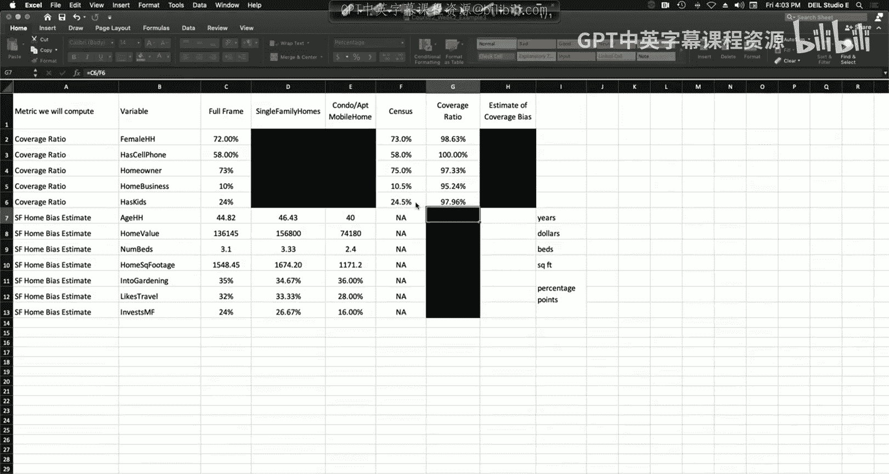
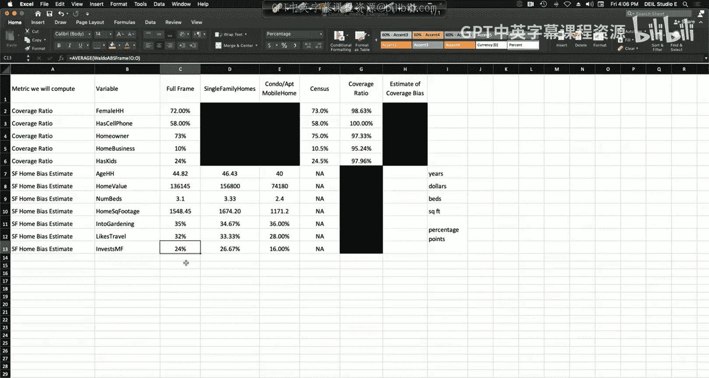
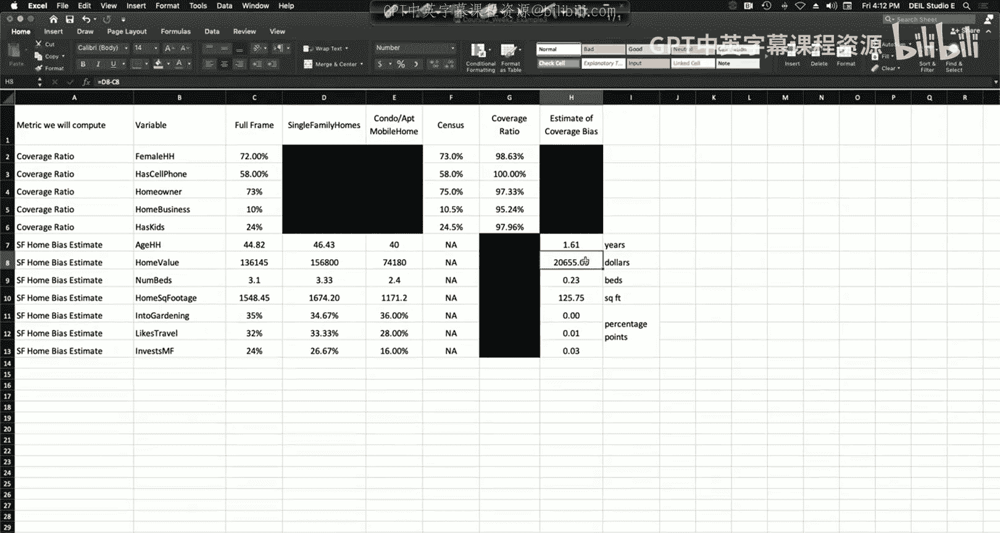

# 密歇根大学《总体数据质量（框架、度量、设计策略）total data quality》 p58 14_示例：读取数据与代码实现访问指标计算.zh_en -BV1Jn4y1X7uS_p58-

Hello， welcome to our example on measuring data access quality for design data。I'm Trent Busker。

 happy to have you here。 This particular example is going to help us understand some of the metrics that we were talking about for data access quality for design data。

 In particular，re we're going to do some estimates of coverage biases and of the coverage ratios。

 So let's get to it。😊，The data in this particular example represent a hypothetical sampling frame of addresses and append auxiliary information for the city of Waldo。

 Florida。The key objective of this example is to explore the potential coverage biases associated with using samples of addresses of only single familymi homes or single familymi houses。

 and that is indicated by the variable S F home and the value of one。

 and for the key outcome variables that we care about are the items in green。

 which you'll see below and they're also underlined。

 Well also investigate the coverage ratio for variables highlighted in pink， which are also boldface。

 These are variables that we have census information for and frame information for。

 so we can calculate coverage ratios for those variables in particular。

 We have all of the calculations that I'm going to work through in this example。

 We have formulas for every one of the calculations under the formula formulas for calculations tab。

 so you can go and verify your own calculations using the information that's provided in this Excel file。

 So let's go ahead and。😊，Get started。 I want to look at the data set here。 For example。

 This is the ABS frame here。 And so you have the variables highlighted in row 1。

 and let me just make this bigger so everyone can see it。

 So these are the variables that we have on the frame we have some information around these variables are the variables that we care about measuring potential biases and we have whether or not the household is a single family home is indicated in this variable as well。

 The idea is that even though we have the full frame we're using the full frame to assess this。

 right， you need some way that captures information from single familyly households and non-s familymily households in order to evaluate potential biases。

 But the idea of the study， the motivation of the study is to think about enumerating or using only single family homes。

 Why would you do that。 Well， single family homes may be easier to get。

to they may be easier to send an interviewer to。 There's not multiple drop points。

 So if I mail a postcard to an apartment complex， it's going to。

Maybe sit on a desk and maybe somebody has to find it or other choices that we may care about in the field for using the more simple sort of single family homes。

 so we want to figure out if there is potential coverage biases with respect to the outcomes that we care about。

By using a sample samples taken only from single family homes。

 So that's really the goal here is to figure out if there is coverage biasious。

Associated with using only single family homes。The other motivation for this example is for us to compute additional or alternate measures of quality for data access around the coverage ratios that we talked about now coverage ratios are we're going to compute them for a few different variables。

 but essentially they're not measures of coverage bias。

 they're just measures of coverage in general so how close is your frame to the population on particular variables that you care about。

 in other words， does the frame cover that domain adequately and the domain is defined by variables that we might care about so females。

 homeowners， etc。

So let's move to the calculations tab where we can actually work through some of these calculations now I did a little bit of work beforehand so that we can use the summary measures。

 but if you look at the in the last lecture you will note that the calculation of coverage ratios。

 requires us to have an estimate of the variable or the distribution for the sample or the full frame。

And from an external source like the census。 So basically for the variables that I wanted to calculate the coverage ratio for。

 I calculated summary measures for the entire frame。

So this is just a summary measure or an average of a 01 variable that I calculated to give me the value for my frame。

 my sample frame。The census value comes from the census。 I didn't compute it。

 I'm just gathering that from the external source of census for this particular county in Florida。

 So the coverage ratio is defined as the ratio or the estimate of from the full frame divided by the the estimate from the gold standard source。

 So in this case， I'm going to take the full frame value。

And I'm going to divide that by the census value。And I represent it as a percentage。

 I'm going to do this again。 So this is going to be。The full frame value divided by the census。

And in your version of Excel， you should be able to pull this down。

So I'm just going to keep populating these。 so bear with me for a quick second。

 you're seeing very clearly what the calculations are。

It is possible for the coverage ratio to be more than one。In that。You might be representing more。

Of a particular on a particular variable than what is available in the county for particular reasons。

 Perhaps there's duplications in your frame。 That's one way The coverage ratio can be large or larger than one。

 or there could be。

Attribution error in the frame。 You think that a house is located in Waldo。

 but it's actually located in Warren， which is a county adjacent to Waldo。

 So for some reason the zip code was miscodeded or the county was miscodeded or the city was miscodeded and you could actually have a coverage ratio of more than one100%。

 so but the coverage ratio does help if you get a coverage ratio of greater than 100%。

 it definitely gives you a signal for quality for coverage that could be investigated by potential errors that we've already enumerated like duplication errors or attribution errors or accuracy errors on the city variable。

 for example， So these are all indicators that might get you to relook at the frame itself and see whether or not theres accuracy issues or duplication issues that are driving that coverage ratio The coverage ratio should not be greater than one generally。

 but it can be greater than one for the reasons we just spoke about。

It looks like in this case， this frame is adequately representing many of the parties or constituents that we might care about。

 We are picking up almost all of the female head of households in the frame。

 we are picking up all of those who have cell phones on this ABS frame。

 we are picking up 97% of the homeowners on this frame。

 we are picking up 95% of the home businesses using this frame and about 98% of the households with children using this frame。

 according to census estimates for Waldo， Florida。 So from there。

 though this is a relatively straightforward example， a couple of things to think about here again。

These are just summary measures calculated from the full frame file。 These are sourced externally。

 from another gold standard source， Either it can be from city。

 a census statistics itself or from the US census or from some other administrative gold standard source that we would consider to be trustworthy。

 Now， let's move on to the estimate of coverage bias in order to estimate coverage bias with respect to covering the population using only single family homes。

We need to calculate two different summary measures for the variables that we care about to evaluate the bias。

 These are the variables that we care about evaluating potential coverage bias。

 And we have an estimate from the full frame。 Remember in the video lecture。

 we have that Y bar sub all statistic。 That is exactly what is computed here。 This is y bar sub all。

 where y represents age。This is the y bar home value for the entire frame。

 This is the average number of beds for the entire frame and so on。

 This represents the proportion or the average of a 01 variable。

 So what proportion of the full frame is into gardening。

 What proportion of the full frame likes to travel and what proportion of the full frame invests in mutual funds。

To calculate the estimate of coverage bias， it is simply the difference of the average value from the domain that we want to evaluate。

 so this would be single familymi homes， that's the source of information that we're going to use。

 we want to evaluate whether or not using only that source has coverage bias。

So it's the y bar value from the single family homes subset of the frame minus the y bar all from the full frame。

 So we need one more set of calculations for calculating the Y bar values for just those addresses in the frame that are single family homes。

 So that's where using that SF home equals one indicator is going to be helpful。 So essentially。

 what I did was I filtered the A BS frame。

By single family homes， I filtered it by only selecting the ones。

And then I calculated the summary measures for each of the columns that I care about。

 So all of these columns here， I just calculate the averages for those columns after I have filtered。

Into this data set， only those addresses with a single family home value of one。 So when I do that。

 and I look at the calculations tab， these measures here。Are exactly those calculations。 So 46。

43 is the average age of the householder among single family home addresses。

 H and 56800 is the average home value in dollars for the single family home addresses。In my frame。

 I continue to do this going forward。 And then， of course， this is the leftover。

 So one way to calculate the coverage bias is to look at the difference of these two multiplied by the percentage of non single family homes available in the frame or mathematically its equivalent and a little bit easier to calculate because they only need two numbers is to calculate the difference between the single family home estimate。

 the Y bar。Minus the y bar from the full。 So my coverage bias estimate here is simply the difference between the estimate from my domain。

 minus the estimate from the full。 So again， this is the value from the domain minus the value from the full frame on your version of Excel。

 you should be able to pull this down on my version of Excel。 This isn't working。

 So I'm going to do this semi manually here。So， again。Value from the domain。

Minus the value from the full frame。And I'll continue to do this all the way down for these variables。

And the last one。Okay， so now we look at this and the units here are the units of the original measure。

 So this one would suggest that。Single family homes are。

Slightly overestimating the age of a householder by about 1。6 years。

 were slightly overestimating the value of a home by about $20000。

We are overestimating the number of beds by about a quarter。

 We're overestimating the square footage by about 125 square feet。

 We are about on par with into gardening。 we're about one percentage points upon the like liking travel and about three percentage points above on the investing。

 So these are in percentage points。 So this actually is one about one percentage point and this is about no percentage points is about they are about equivalent。

 So very little coverage bias happening for the into gardening but we do see some coverage bias potential for the home values being overestimated。

 the square footage is being overestimated， as you might expect。

 and a slight edge on the number of bedrooms the investing in mutual funds also slightly over。

Estimated， but the others seem very close。Again， these coverage biases are variable specific because it is possible that some very similar to the Cooper example that we illustrated in the lecture。

 some variables have very little coverage bias evidence other variables have slightly larger or concerning coverage bias。

 so it is it is indeed the case that if we wanted to estimate the home values or the size of those homes or even the age of the households using the single familymi home samples only might give us some coverage bias that we may not want to ignore in our overall estimates。

I hope that this example has highlighted a little bit of the calculations of not only the coverage bias but also some of the alternative ways that we can evaluate data access quality through the coverage ratio。

 for example， If you wanted to work through these calculations on your own the formulas for all of the calculations are listed under the formulas tab so you can see exactly how I walk through all the calculations。

 including calculating the summary measures that we needed to fold into those calculations of biases。

 as well as the bias calculations themselves。 so you're encouraged to work through this example yourself and you can always check your work using these formulas for the calculations tab。

 Thanks so much for joining us through this example。 I hope it's been insightful。

 we look forward to seeing you in the next lecture。😊。

