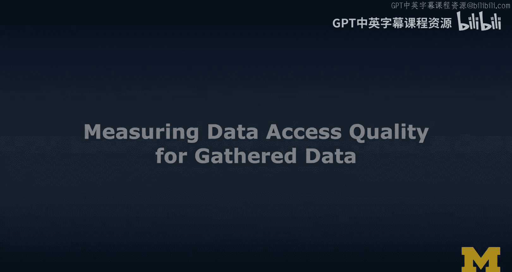
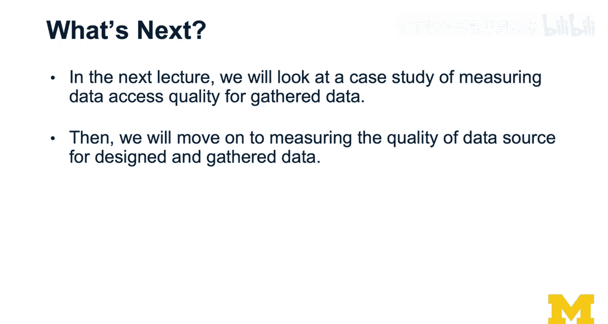

# 密歇根大学《总体数据质量（框架、度量、设计策略）total data quality》 p59 15_采集型数据访问质量测量.zh_en -BV1Jn4y1X7uS_p59-

Hello everyone， in this lecture you will learn how to measure data access quality for getter data。

Don't forget to check in where we are in the big picture。

We are going to look at measurement of data access quality for gather data。Recently。

 many open data platforms give users full access to their data， for example。

 US government agencies provide free API based access to their public data。

 you may download snapshots of entire data without much restriction。From data。gov， for example。

 you can download 337，000 data sets。In this case， we can measure data access quality by assessing if a user can obtain necessary data in its entirety。

For this specifically， we can count the number of data instances collected and compare it with the number of data instances available to get a ratio or percentage。

However， not every data platform is fully open。Social media platforms like Twitter。

 Facebook or YouTube allow restricted access to their datata for reasons such as protection of intellectual property information。

 userss nondisclosure setting， and prevention of exploitation by third party applications。

So they usually provide data users with limited amount of information through APIs for example。

 Twittertter。com allows 1% of tweets to be accessible and Y。com permits only 5000 calls per day。

In this restricted access scenario， data access quality can be measured by assessing how well the G data represent the population data。

Some researchers have used rank order correlation between top 100 topics in API gather Twitter data and those in population Twitter data over a specific time range。

As you may suspect， gather data obtained through limited access may not represent population data。

Twitter。com allows users to collect 1% sample of tweets through APIs。

 but how the sample is selected is not fully explained。

A good news is that social media population data are available。

 but a bad news is that they can be very expensive。

 so researchers using social media data have developed methods to evaluate data access quality under limited access scenarios Some scholars have compared gather social media data against all administrative data to address the question like are social media users randomly distributed over the US population。

For this， they compared distributions of geolocations in Twitter data with population in the US census data。

They concluded that COT tweets are not representative of the US population。

 this means gather Twitter data to be used with caution to make valid inferences about real world population。

Another group of scholars directly compared gathered Twitter data with population data in a nation。

They use the Twitter FireHse， which provide full access to the entire Twitter data at a substantial cost。

According to them， randomly selected Twitter users in Japan are representative of the Japanese population。

When the full access to the population data is unavailable。

 several scholars compared the overlap between data sets obtained from different access APIs to the same data source。

They calculated ratios of overlapped contents over different data sizes， time frame and topics。

Others estimated bias in feature and structure information within samples of gather data from the same source。

Without accessing the full Twitter data， they compared feature distribution like mentions and natural properties of Twitter convention or retreats across samples obtained by different access methods。

They found out that natural properties are less vulnerable to biasers than future distributions。

 but the biases in both are very high。In the next lecture。

 we will look at the case 30 of measuring data access quality for gather data。

Then we will move on to measuring quality of data source for design and gather data。

