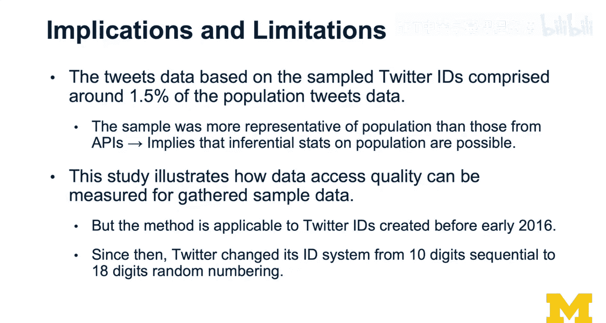

# 密歇根大学《总体数据质量（框架、度量、设计策略）total data quality》 p60 16_案例研究：Twitter采集数据访问质量评估.zh_en -BV1Jn4y1X7uS_p60-

Hello everyone， in this lecture we will take a look at a cases study measuring data XX quality for G toada。

Let's check where we are in the big picture。We are going to look at measurement of data access quality for gather data。

We can gather Twitter data through APIs， but they are a small subset of the entire Twitter data。

 this is because access to the Twitter population data are limited and only samples are accessible。

In addition， around 1% of all tweets during a limited time range are available in most cases。Here。

 we need to ask a question。Are the sampled gathered data representative of the population data？

According to many researchers， the gathered Twitter data are likely biased。

How have researchers measured the access quality of gathered data。Basically。

 they have compared characteristics between target population data and sampled gather data。

 most researchers have used social network measures to measure data access quality on Twitter data sampled based on specific topic or keyword。

 but they found out that a data representation can be heavily affected by hot keywords or events。

 unlike these studies that used network measures on recent study measure data access quality using sampled user IDs。

 let's take a look at this interesting study in detail。In a 2019 study， two researchers， Dr。

 Haino and Dr。 Hay Fehe collected 1。6 million Twitter user IDs as follows First。

 they drew random numbers between one and the most recent Twitter user ID in 2016。

This was possible because Twitter usual ID used to be 10 visits assigned sequentially until 2016。

Next， they checked if each user ID was an active account with the language setting set as Japanese。

They repeated these steps until the sample size stop increasing。

Then they gathered all available tweets using Twitter RE API for the selected Twitter user IDs。

 a total of 500 million tweets were collected after the collection was finished。

 the researchers gained an access to a commercial archive of full tweet data called Crimson Haxagon。

 which is now brandwach。They reiterated all historic tweets about two major Japanese political parties。

The Liberal Democratic Party and the Democratic Party between June 22 and July 25th。

Then they compared characteristics between the population to its data and they are collected to its data for this。

 they used ordinary least squares regression between these two data sets on keyword volume and daily top 100 topics。

Our major finding of this study is that quote， the keyword trends in total population are very accurately replicated on code in the sample data。

The regression scores were very high with all sacred values hovering above 0。

97 or8 for both political parties， Liberal Democratic Party and the Democratic Party。

How about daily top 100 topics， according to the study quotethe patterns of vocabulary use and word relationship in the sample data closely mirrored on those in the population data？

"，Again， the OLS regression results showed high r squared values with 097。Here。

 topics were decided by the LDA tapping modeling， the details about the technique can be found in the designated reference in the slide。

So what did the case 30 tell us about data access quality for to data。According to the study。

 the tweets collected through the sampled Twitter ID made up around 1。

5% of the population tweet data。The sample was more representative of population than sample data collected from APIs。

This implies that infferluential statistics on population are possible using the sample data based on Twitter IDds。

This study showed how data access quality can be measured for sample data。

 But the method is applicable to Twitter I is created before early 2016。 Since then。

 Twitter changed its I D system from 10 digs Sc numbering to 18 digs， random numbering。

 So the study cannot be replicated for recent data。

