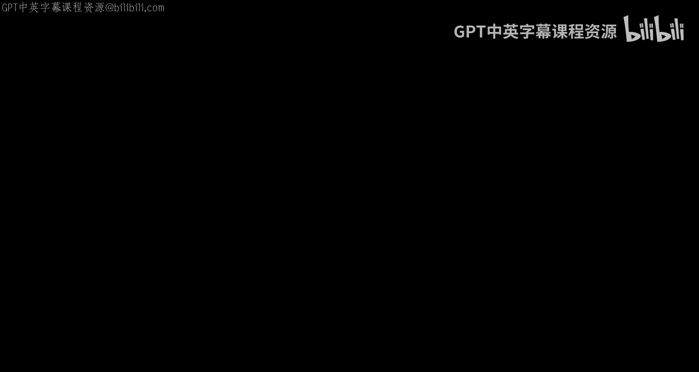
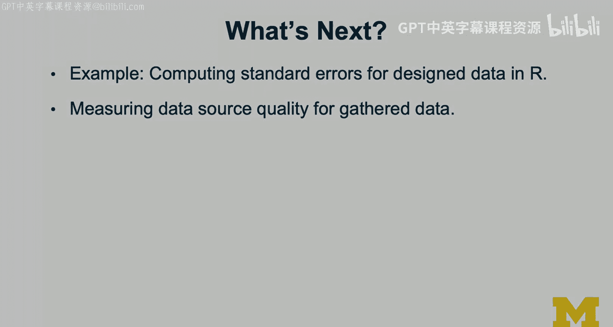

# 密歇根大学《总体数据质量（框架、度量、设计策略）total data quality》 p61 17_设计型数据源质量测量.zh_en -BV1Jn4y1X7uS_p61-

Hey， welcome back。 Today， we're going to be talking about measuring threats to data source quality with a focus on designed data。

 Remember the big picture， we're talking about data source errors that occurs on the representation side of the figure that we're looking at now for design data。

 Data source is measuring the quality related to having drawn a sample from a sampling frame。

And the most common measure of data source quality is sampling error。

And I'm going to define sampling error here。 It's the difference between a sample estimate and the true population quantity that is due to taking a random sample rather than a complete census of all cases。

 hence the term sampling error。We can look at hypothetical sampling distributions to see how they reflect the estimates that could be achieved under the same design。

 So here I'm presenting a simulation example where I have simulated a population of 100000 units with a mean of two。

 So I know the whole population。 I know what the mean is。

And then I've drawn a thousand samples from that population under three different designs。

With different sample sizes， and have estimated the mean of each of those samples。

Once I have those thousand estimates of the mean， I've plotted the distribution under each of the three different sample designs。

 The three different sample designs have three different sample sizes。

 One is a relatively small sample size of only 5。 The second is a sample size。

 a slightly bigger sample size 10。 and the third is somewhat larger with a sample size of 50。

 And you can see the impact on the sampling distributions。

 The simulated sampling distributions in this case。

What we notice is that larger sample sizes have smaller sampling error。 That is。

 the distribution is narrower。 So in general， a larger sample size equals smaller sampling error。Now。

 it's very common in statistical analyses of survey data to estimate standard errors as an approach to measuring sampling error。

 An estimated standard error is the estimated standard deviation of the sampling distribution of estimates that would arise if we selected thousands of probability samples under the same design。

So a smaller standard error represents a more precise estimate and is generally associated with a larger sample size。

 Now， there are key features of the sample design other than the sample size that impact sampling error。

 I think we've talked about some of these。 But just to reiterate stratification。

 clustering and weighting， all have an impact on estimates of standard errors。And in fact。

 we need special software to evaluate the impact of these features。We're listing three examples。

 there are other software that can also estimate appropriate design based standard errors。

 The three that we mention here are sta with the survey commands are which is many packages are available。

 we recommend the survey package and SAS， which uses the survey prox to get appropriate standard error estimates for the sample design in use。

Here's an example if I wanted to use sta， and I'm estimating the standard error of a weighted survey estimate of the mean body mass index using the status software。

 We would use commands like those you see on the screen here。To estimate。

The sampling error across hypothetical repeated samples。 In this case。

 we're incorporating information about the sampling weights and the stratification。

 The key elements of the design in this case that we need in order to get estimates that are appropriate for the design estimates of the standard errors。

 Now， one way that we measure data source quality is to measure something called the design effect。

 which is a measure of the statistical efficiency of the sample design。Now。

 the design effect is the variance of a statistic under actual design divided by the variance under simple random sampling。

 same sample sizes the only difference are the clustering stratification and weighting in the design that's in the numerator so we're comparing the efficiency of our design compared to the same sample size using simple random sampling。

The design effect， therefore， is produced by differences in weighting。

 strraatification and clustering。 When the design effect is less than one。

 the sample is more efficient than simple random sampling。 For example。

 stratification tends to reduce variance。 And so if we have strong stratification。

 we might expect a design effect less than one。 when the design effect is greater than one。

 The sample is less efficient than a simple random sample。 In practice。

 the design effect is usually greater than one。 Since sample designs often include clustering and almost always include unequal weighting。

 So as a result， we generally expect design effects greater than one。So next we'll take an example。

 computing standard errors that are adjusted for the sample design in R。

And then we'll turn to measuring data source quality for gathered data。

