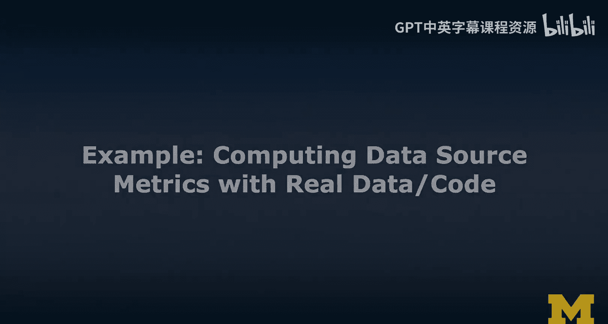
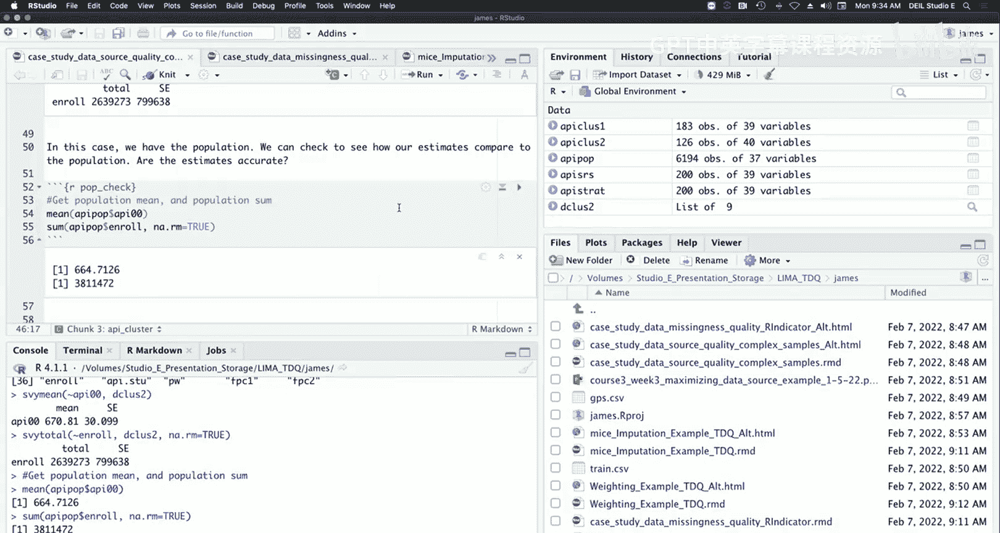

# 密歇根大学《总体数据质量（框架、度量、设计策略）total data quality》 p62 18_示例：真实数据与代码实现数据源指标计算.zh_en -BV1Jn4y1X7uS_p62-

Well， welcomel back today， we're going to do real data and real code to look at data source quality for design data。

 We're going to be using R mark down today and we'll take a look at the R code and then we'll look at the results。

Today we're going to start with the survey package。

 a very useful package for the analysis of design data。

 The survey package is designed by TS Lumly and is available for download and use with the R software in this demonstration。

 we're going to start with the vignette that's available with that package as a way to get familiar with the code and then we'll turn to a bigger survey data set in order to analyze using the survey package and to account for the dis sample design features。

So let's start with the survey package vignette Now the vignette uses something called the Academic Performance Ind。

 which is a computed score for all California schools and it's based on standardized testing of students in those schools。

There are multiple data sets available as part of the API data set that comes with the survey package。

 including the population of students， a simple random sample of students。

 a one stage cluster sample of school districts， and a two stage cluster sample of schools sampled within sampled school districts。

And a stratified sample。We will load the data and then we'll look at some characteristics of the population。

 So we've already loaded the survey package。We can run this chunk of code to see that happen。

There we go。Now， we can ask for the data from that package。

 the API data set that I mentioned a second ago， and we'll look for how many records are in the population。

What's the mean value of this performance index score for the year 2000。

 And then we'll look at the sum of the total number of enrolled students。All right。

 so there we get some output。 There are 6194 records in the population data set。

The number of schools。Well look at the mean API score。From API 2000664。7126。

 And then the sum of those enrolled，3。8 million approximately。

So the next we're going to look at the two stage cluster sample and in order to specify the sample design information。

 we're going to use a function from the survey package called survey design。

It'll account for the clustering involved in the sample design。

The clustering is at the district level， so we will identify the cluster ID。

To the survey package using the I D S argument or I Ds。

 Here's the text from the package description of that argument。

 formulaula or data frame specifying cluster Is from largest level to smallest level。

0 or one is the formula for no clusters。 In this case。

 we'll specify the finite population correction。The finite population correction is used in situations where the sampling fraction is quite large。

 and as a result， can lead to reduced variance estimates。In many situations。

 the sampling rate will be small， and we can ignore the finite population correction or F PCs it's sometimes called。

 Finally， we specify the data set name。A PI plus 2。

Once a sample design is specified in that survey design package。For function。

 then we can review the specification using the summary function。Once we have that survey design。

Input and reviewed， Then we can use that as an input to different inference functions。 For example。

 survey mean and survey total are functions。That estimate means and totals for survey data。

 And they rely on that survey design object we've just created as information about the sample design in order to correctly account for the survey design features。

Let's take a look at the survey mean and survey total function in this next piece of code。 Now。

 again， here's the specification of the sample design we just talked about using that survey design function。

How we specified the clustering。The finite population correction， and the data set。

Then we're going to ask for the mean of API。Ass an estimate from the sample。

 And we're going to use an estimate of the total enrollment， also from the sample。

 And we're telling it， here's the survey design object that we just created。

 So let's run that chunk of code。Now we get a mean and a standard error of that API 2000 score。Now。

 that standard error is correctly adjusted for the design。

 So the information about the clustering that we've fed that survey design function is incorporated into this estimated standard error。

 So we have a design， adjusted standard error。Allright， Very useful。Now， in this case。

 we have the population so we can actually compare the population values to our sample estimates。

Don't usually have that。 We wouldn't do a survey if we had the population totals to start with。

 But in this case， since this is a vignette and were usinging it for practice， we， we have both。

Let's take a look。

Similar， but not exactly the same as we'd expect。Now we can look at a data set with more complex features in the sample design and we'll need to account for those complex features。

The survey that we're going to use is called the National Health and Nutrition Examination Survey。

 It's a very large， federally sponsored survey that collects data on the health of the population in the United States。

 And one thing that's very unique about the the Nhans。

 the abbreviation for that survey is that it uses a mobile examination unit to measure different characteristics of the health of the population。

 For instance， blood pressure。In this case， we're going to look at the proportion of the population that's ever been told that they have high cholesterol。

 been told by a doctor that they have high cholesterol， I should say。So。

We're going to go through the same procedure。 now I'm going to use this。

Package N Has A that makes the data available for N Has。 very nice feature。

 And then we're going to request some information about the Nhans。

 and we need to specify different sections。 They've broken the questionnaire data。

 the survey data up into sections to make each of those sections smaller。

 We're going to look at some of those。 Get information about variable names in each of those sections。

And then we're going to select some subset of variables we need， including some design information。

About the clusters and strata。And then we're going to select the cholesterol question。

 now I needed to look through these names and look through the questionnaire to get the information about the question that I was interested in。

Once I have that， I'm going to merge those two pieces together。

 I'm going to merge together the sample design information with the survey variables of interest。

 In this case， only one variable B P Q 0，8，0， which is。

 has a doctor ever told you that you have high cholesterol。So， let's take a look。

Let's run that chunk of code。All right， so now I've ended up with the data set。And I've recoded。

 The last thing that I'm doing is recoding a variable that's one is yes。2 is no。

 such that one is still yes， but two is a no is now 0。 Okay。

 so that'll allow me to just calculate the mean of the variable。

 and that'll give me the proportion of the population that's ever been told they have high cholesterol。

Now that the data have been extracted， we have to specify the survey design using that survey design function again。

The I D argument specifies the variable identifying the cluster。In this case。

 S DM V P U is the name of the cluster。I recognize that by looking at the variable names in the Nhans documentation。

The strata argument specifies the strata variable， SDM V SRA。

So the clusters are P SU's primary sampling units， and the strata R S DM V S T R。

 the weight variable， W2 I N T2 year is identified using the weight argument。

 So I have to specify the clustering， the strraatification and the weighting all in that survey design function。

Once we have the survey specification in place， we can then request a survey mean。

We can also ask for a design effect， which we talked about in the lectures。

 and we can drop the cases with missing values。In a later lecture。

 we'll look at using imputation to fill in missing values。Now， here's the code that I've developed。

To store the survey design using that survey design function。And again。

 I need to specify the clusters。The ster。The weights。And then I'm saying， the data set is。

This data set that I created in the previous trunk。Chunk of code。

Then I'm going to ask for the survey mean for that variable。

Haves the doctor ever told you that you have high cholesterol。

And I'm going to use that survey designoc。Object that I created in the previous step。

 As I said a moment ago， I'm going to remove missing values。 We'll talk about imputation。

 in a later course。And I'm also going to ask for the design effect。

 because I want to see what effect is the stratification。

 clustering and weighting having on my variance estimates compared to a simple random sample。

 Let's run the chunk of code and see what happens。All right。 I end up with the mean，31。

4 per cent have ever been told they have high cholesterol。

The standard error here design adjusted appropriate for a statified clustered sample with unequal weighting。

And I have the design effect，3。981。Now， just to reiterate the meaning of the design effect。

 that means relative to a simple random sample。This sample has  one over 3。981 less efficiency。

 It's a effectively smaller sample size。The， the formula is actually the variance under this design。

 divided by the variance under simple random sampling。

 So you can see that this design is less statistically efficient。Well， then you might ask， well。

 why did we do this， Because if I tried to do a simple random sample of the United States。

 which the Nhannes is， It's a random sample of the whole United States。

 If I tried to do a simple random sample of the whole United States， it would be very costly。

I might interview one person。In a small town in Montana。

 drive 400 miles to interview some else and so on to cover the whole United States。Instead。

 the clustering creates a much less expensive design， so much less expensive than， in fact。

 this is a more efficient way to carry out the survey。

 Theres no way I could do this number of interviews for the same price if I had a simple random sample design。

All right， before we go， let's take a look at the output。Genrated from the package。 Now。

 this might be useful when you download this for your own use。

Take a look at the HTML output and read through the text to see as a reminder of the things that we did today。

 I think this will be quite helpful as you try to put together your own analysis of design data using the survey package。

I'll skip to the bottom line here。 Here's where we reported the mean design adjusted estimate of the standard errors and the design effect。

So， thanks。

