# 密歇根大学《总体数据质量（框架、度量、设计策略）total data quality》 p63 19_采集型数据源质量测量.zh_en -BV1Jn4y1X7uS_p63-

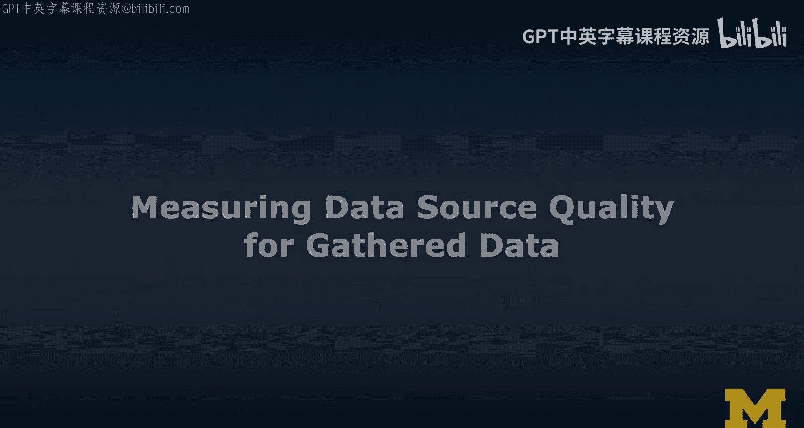

Welcome back。 I'm Trenm Buskirk。 We're going to be talking about measuring data source quality for gathered data in this lecture。

 Thanks for joining us。 As we do in all the lectures。

 we just want to make sure that we are understand sort of where we are in our overall framework。

 So in this particular lecture， we're going to be focused on the representation side。

 and we're going to be focused particularly on data source quality measures for gathered data。

 The source of the data in design data is a selected sample from the sampling frame。

 But for gathered data， the source refers to both the type of information actually extracted or selected as well as the platform or repository from which the information originates。

 So， for example， you might have a collection of tweets from Twitter users。

 you might have heart rate monitored data from a sample of users gathered via Bluetooth sensors。

 or you might have a data set of administrative administrative records from county tax assessors offices for a collection of households。

 So it's important that we note that we。😊。

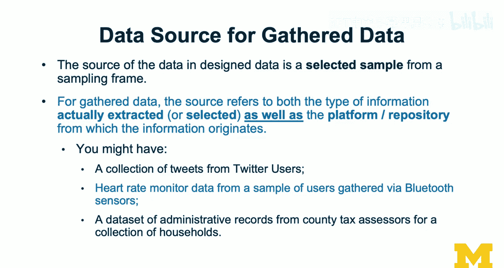

Qualifying not only the platform or repository for which the information originates。

 but also the kind of information that we're extracting。

 So to measure data source quality for gather data。

 it is important to understand not only the repository。

 but also the type of information that's available。

 And so different platform repositories can contain similar types of information。 So， for example。

 Facebook and Twitter both contain social media data in the form of comments or tweets。

 a single repository can contain different types of information。 So， for example。

 Twitter contains both social media data as well as digital trace data。

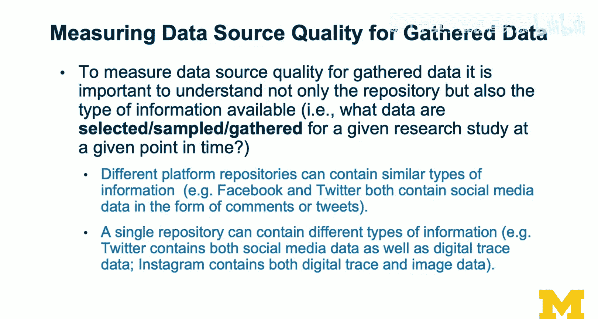

Instagram contains both digital trace data and image data。

 So there's been several pieces of literature that have really coalesced around data source quality。

 drawing on several works from the information systems literature。

 Theres a lot of work being done on data source quality measurement。

 and they relate to several of the contextual data quality dimensions that we discussed in an earlier video。

 specifically these dimensions refer to credibility or believability。

 the relevance or fitness for use and the amount of data or the quantity of data you might have These contextual dimensions again relate to information taken as a whole that is contained in a gathered data source。

 such as relevance and credibility， for example， because the data source we have gathered can vary in its type。

 So sensor data， digital trace data， etc cetera and repository。

 So whether or not there it's a sensor or social media platform， etc cetera。

 measuressure of believability。

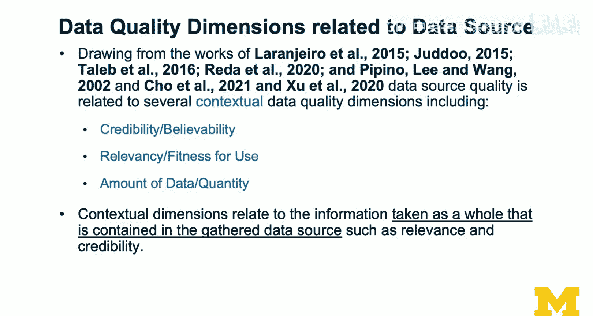

Or credibility or plausibility。 Those are all sort of synonyms for one another are an important aspect of measuring data quality source and represent the degree to which data is regarded as true。

 Credible and trustworthy。 These measures may be a mix of subjective and objectiveive measures。

 So Bppino and colleagues in 2002 suggested a measure of believability that's computed as the minimum of a threefold assessment of credibility of the data provennce。

 Does the data meet a minimum standard and your previous experience。

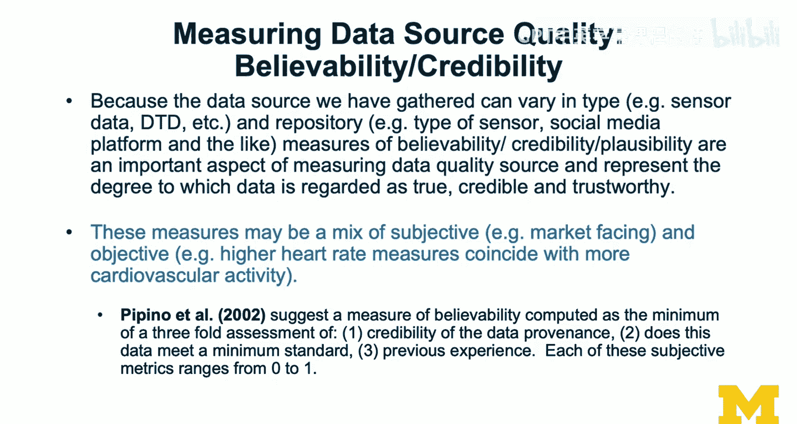

Each of these subjective metrics ranges from 0 to 1。

 and the overall measure is a composite or the minimum of these three。

 Another important measure of data source quality for gathered data relates to the amount of data or the quantity within the sample and relates to the extent that the volume of data is appropriate or sufficient for a given task。

 one obvious measure of amount of data would be the total number of usable cases that you have gathered here。

 we qualify that usable would relate to measures of completeness for the variables pertinent to a given case。

 thresholds for usability would then identify those cases that have enough information across the variables needed for a given analysis。

 Now， this might seem like it's related to missing values because we're talking about completeness。

 but in this case， what we're looking at is a minimum threshold。 So， for example。

 even though I might have missingness in my gathered data。

 I might need a minimum number of five observed。

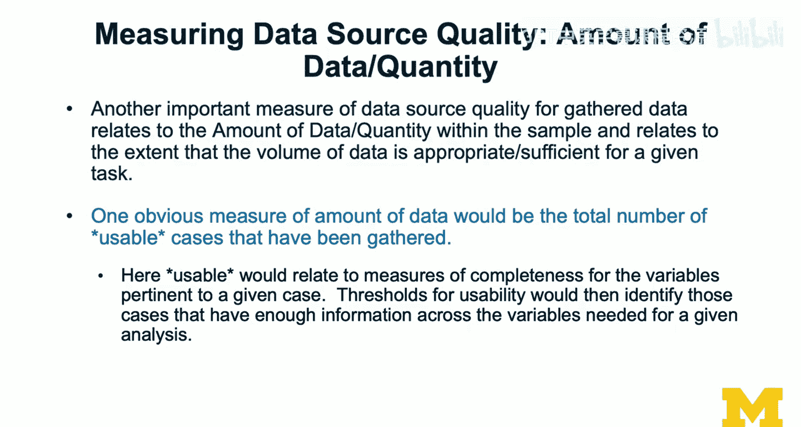

5 measures per case in order to calculate the sensorensed metric for movement or some other physical activity measure that I'm using based on sensor data。

 So， for example， if I'm measured by wearing a sensor and the sensor picks up or measures。4。

Measures for my physical activity and doesn't capture a fifth。

 sixthth or seventh measure for particular technical reasons or communications。

 Bluetooth reasons or other reasons that go beyond my control。

 Then that particular case would have missing data。

 but it wouldn't be usable in the sense that the amount of data that were available。

 didn't meet a minimum threshold of quantity。 Another way to measure quantity related to usability relates to the variables themselves。

 that I capture a sufficient number of cases for each variable that I'm planning to use in a given task。

 So， for example， if I need to use three different variables in a model。

 And those three different variables have to generate estimates of a reasonable level of accuracy。

 Then I might not have enough information for one variable。

 but I do have enough information for the other two。 So， for example。

 suppose you're planning to use an appended variable that measured whether a house had a pool for from administrative records。

To stratify a sample of households based on pool owners and those who don't own a pool。

 Les than 10% of your entire sample had a non missing value for this pool indicator。

 And the estimate of pool ownership in your area was 30%。

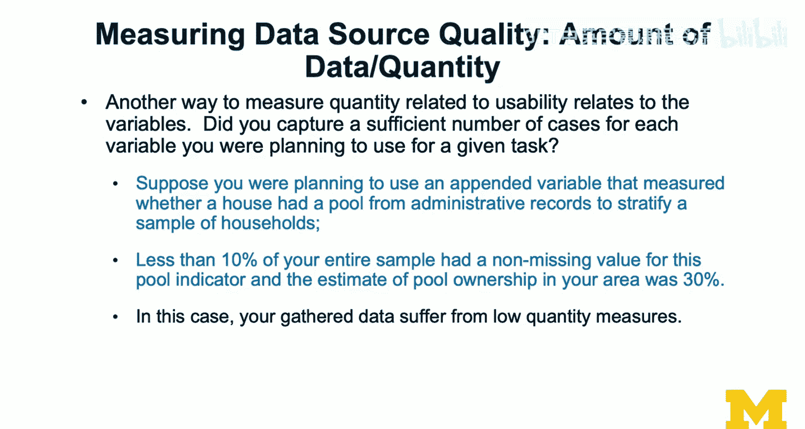

In this case， that particular variable has too few cases to really be useful for using it for stratification purposes。

 for example。 So in this case， I would say my gathered data suffer from low quantity measure。

 In text mining another measure we would look at is the distribution of a particular keyword or aspect of the gathered data and compare it compare its incidence to what might be obtained from the entire corpus。

 if your gathered data is missing tweets related to a specific keyword of interest。

 then this might indicate lower measures of quantity indicating data quality issues with your data source。

 In other words， my data source isn't capturing enough keyword variability。

 that I might expect to be present in the entire corpus。

 But pinot and colleagues in 2002 also suggested a data quality metric for measuring the quantity data quality dimension That is the minimum of two ratios。

 The first ratio。

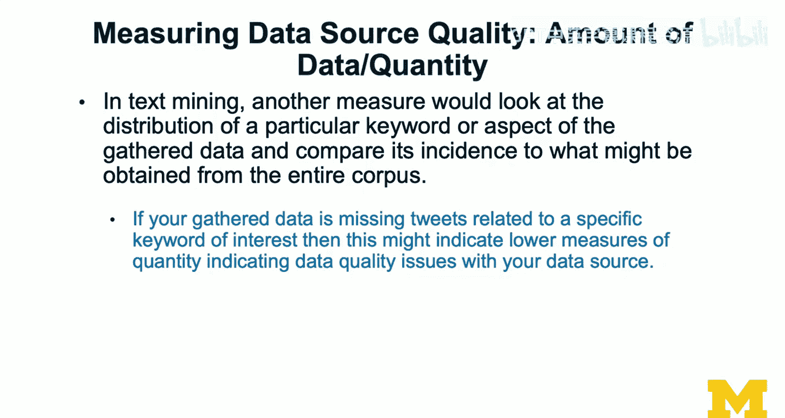

R1 is the ratio of the number of data units provided in the gathered data source to the number of units needed。

 R2 is the ratio of the number of data units needed to the number of data units provided in the data gathered source。

 So R1 and R2 are mathematical reciprocals of one another。

 The overall data quality metric for quantity is the minimum of R1 and R2。 So， for example。

 if I needed 200 records for my analysis。 and your gathered data obtained a total of 150 suitable records。

 then my data quality metric for quantity would be the minimum of the ratio 150 over 200。

 and the ratio 200 over 150， which in this case would be 0。75。

 Co and colleagues identified data quality dimensions for person generated wearable device data or Bluetooth sensors and included conformants。

 which is also called compliance。 they also included。

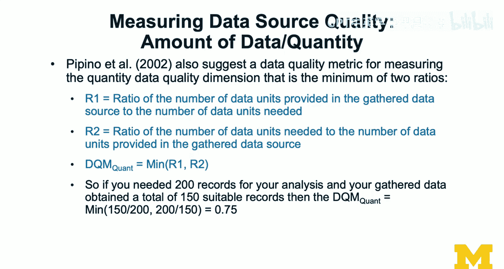

Completeness and plausibility。In the case of sensor data。

 completeness measures address missing values in three ways。

 An interruption in data capture might result in intermittent missing values for a given user because of technological reasons。

 battery reasons or communication reasons through Bluetooth。

 A variable that is completely missing information might be associated with user error or sensor error。

 the user did not wear the sensor or the sensor did not turn on。

 even though the on button was suppressed。

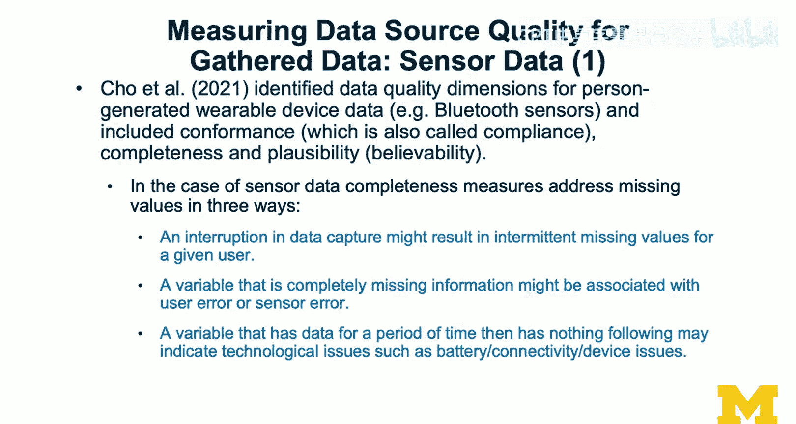

A variable that has data for a period of time that has nothing following may indicate technological issues such as a battery issue。

 connectivity issue or other device issues with data capture。

 They also discuss measures related to fitness for use or relevance that included specific issues of conformance and completeness for sensor data。

 They talk about temporal data， granularity metrics that measure whether the granularity of time stamps or other related paraadata measured by the sensors themselves is sufficient for the task at hand。

 So as an example， heart rate monitors measure heart rate every 15 minutes。

 which may be inadequate for marathon studies that need measures every second。 The density。

 completeness， metrics measure the extent to which cases have a specified or minimum number of measures。

 and that these measures occur over a specified number of days。 So， for example。

 we have a minimum number of measures needed per day， and we have a minimum number。

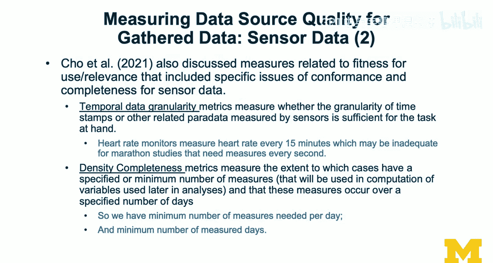

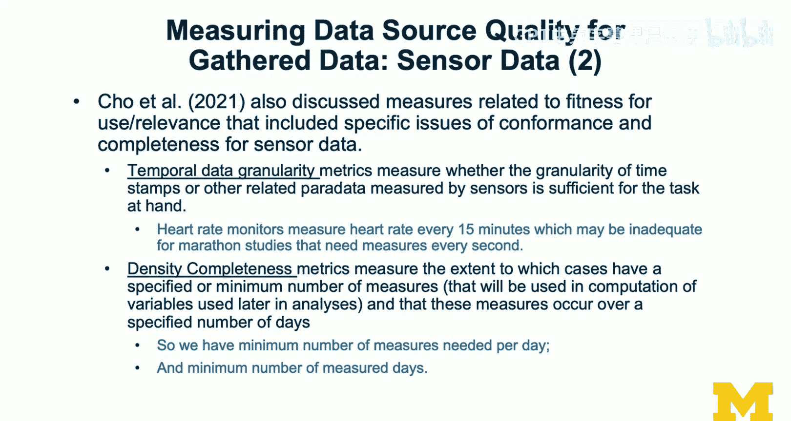

Measd days。 So， for example， for the runner study， I need heartbe。

 I need 15 measures of heart rate per day， and I need to make sure that I've measured at least five days worth of these measures。

This would be this would be an element of or or an example of density completeness metrics coming up next。

 we'll go through an example of computing and interpreting measures of data source quality for gathered data。

 And then we will turn our attention to a discussion and measuring data missingness for design data。

 Please stay tuned for that example。 We look forward to seeing you there。

 Thanks for joining us today。😊。

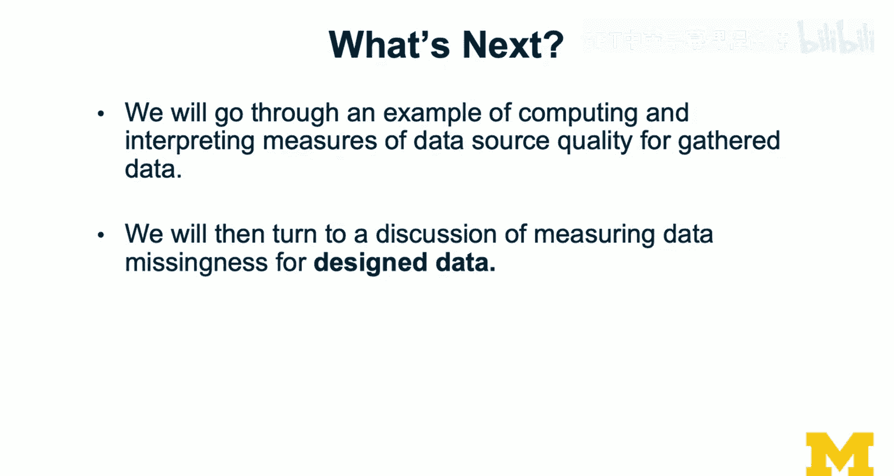

