# 总体数据质量（框架、度量、设计策略）：19：采集型数据源质量测量 📊

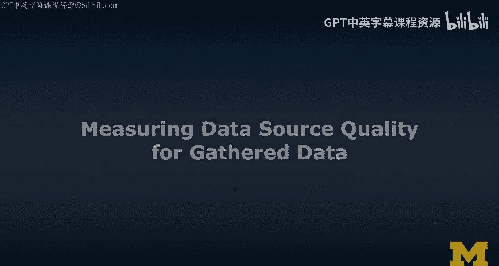

在本节课中，我们将学习如何测量**采集型数据**的数据源质量。我们将重点关注数据源的定义、关键的质量维度以及具体的度量方法，特别是针对从社交媒体、传感器等平台收集的非设计型数据。

---

## 数据源的定义与范围

上一节我们介绍了数据质量框架的整体结构，本节中我们来看看在采集型数据中“数据源”的具体含义。

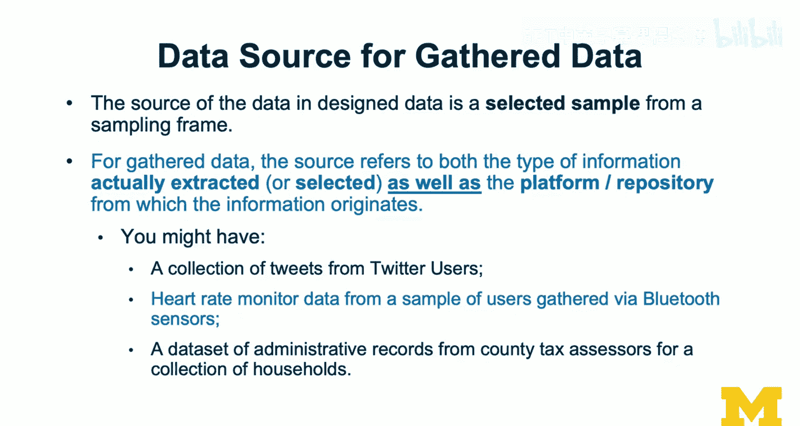

在设计型数据中，数据源通常指从抽样框中选出的样本。然而，对于采集型数据，数据源具有双重含义：
1.  **信息类型**：实际提取或选择的信息种类。
2.  **平台或存储库**：信息起源的平台或存储库。

例如，数据源可以是：
*   从推特用户收集的推文集合。
*   通过蓝牙传感器从用户样本中收集的心率监测数据。
*   从县税务评估办公室收集的家庭行政记录数据集。

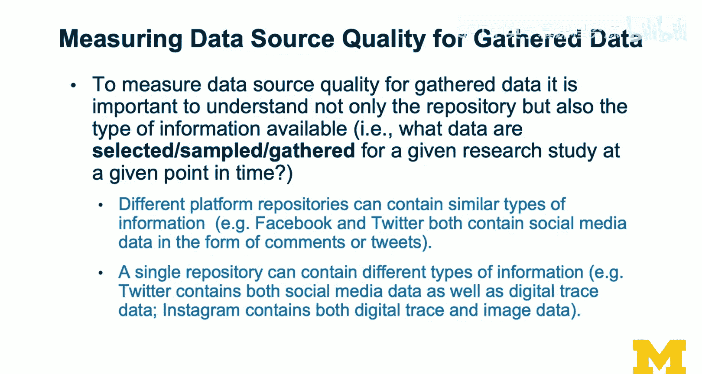

因此，测量采集型数据的数据源质量时，必须同时考虑信息起源的平台和所提取信息的类型。

---

## 关键数据源质量维度

为了衡量采集型数据的数据源质量，需要理解几个关键维度。这些维度与我们之前在上下文数据质量维度中讨论的概念相关，主要涉及信息的整体可信度和适用性。

以下是衡量数据源质量的几个核心维度：

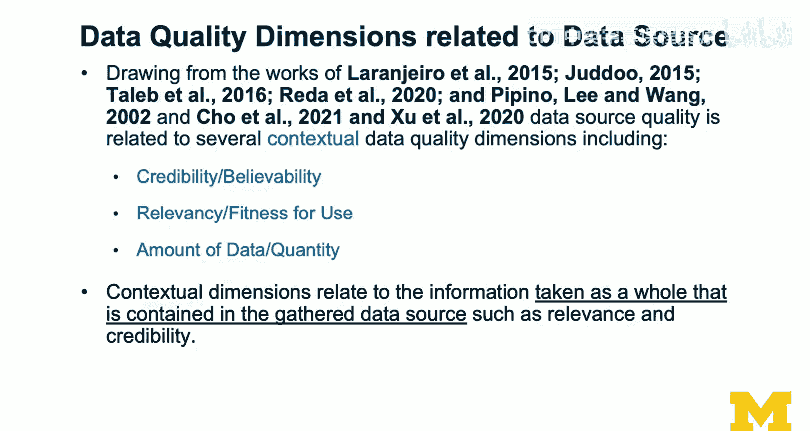

### 可信度（可信性/合理性）

可信度衡量数据被视为真实、可信和可靠的程度。它是评估数据源质量的一个重要方面，度量方法可能混合了主观和客观标准。

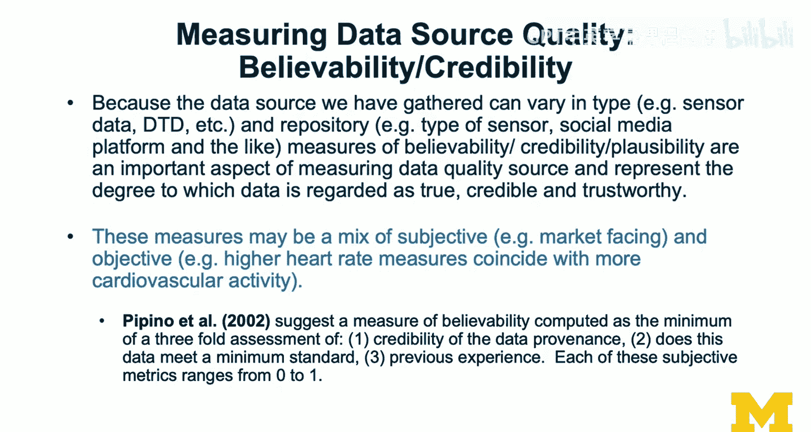

Bppino及其同事在2002年提出了一种可信度度量方法，其计算公式为对以下三项评估的最小值：
1.  **数据来源可信度**：数据来源是否可靠。
2.  **数据是否符合最低标准**：数据是否满足基本要求。
3.  **基于先前经验的判断**：根据过往经验对数据的信任程度。

每项主观指标的取值范围是0到1，整体度量值是这三项的最小值。其**公式**可表示为：
`Believability = min(Credibility_of_Provenance, Meets_Minimum_Standard, Previous_Experience)`

### 数据量（数量）

数据量维度关注数据量对于给定任务是否适当或充足。一个明显的度量是所收集的**可用案例总数**。

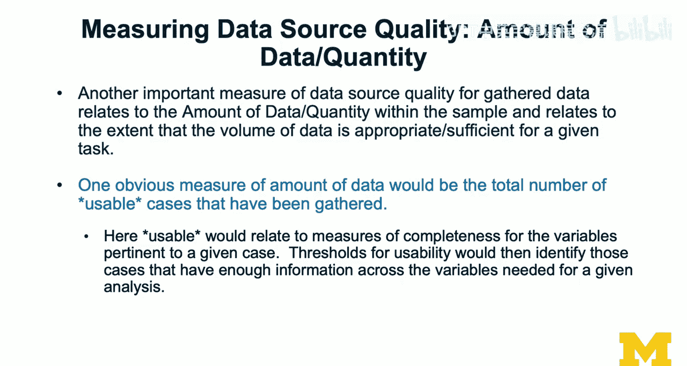

这里的“可用”与案例相关变量的完整性度量有关。可用性阈值用于识别那些在分析所需变量上具备足够信息的案例。

例如，在基于传感器数据的分析中，可能需要每个案例至少有5个观测值才能计算某项活动指标。如果某个案例因技术原因只捕获了4个测量值，即使数据有缺失，该案例也可能因数量不足而被视为不可用。

另一种衡量数量的方法关注变量本身：是否为计划使用的每个变量捕获了足够数量的案例。

例如，如果你计划使用一个从行政记录中获取的、标识房屋是否有泳池的变量来对家庭样本进行分层，但该变量在超过90%的样本中都是缺失值，而该地区的泳池拥有率估计为30%，那么这个变量就因案例太少而无法有效用于分层目的。

在文本挖掘中，可以查看特定关键词在收集数据中的分布，并将其与整个语料库中的出现率进行比较。如果收集的数据缺失了与感兴趣关键词相关的推文，则可能表明数量度量较低，揭示了数据源的质量问题。

Bppino及其同事在2002年也提出了一个用于度量数量维度的数据质量指标，它是两个比率的最小值：
*   **R1**：采集数据源中提供的数据单元数量与所需数据单元数量的比率。
*   **R2**：所需数据单元数量与采集数据源中提供的数据单元数量的比率。

R1和R2互为数学倒数。数量维度的整体数据质量指标是R1和R2的最小值。其**公式**为：
`Quantity_Quality = min(R1, R2)`
其中 `R1 = Units_Provided / Units_Needed`， `R2 = Units_Needed / Units_Provided`。

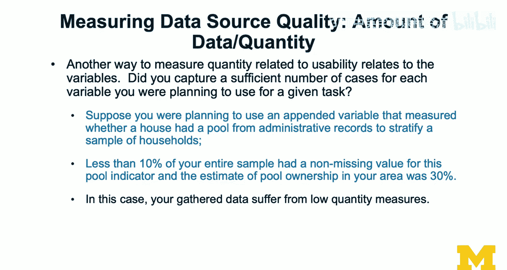

**示例**：如果分析需要200条记录，而采集的数据获得了150条合适记录，那么数量质量指标就是 min(150/200, 200/150) = min(0.75, 1.33) = 0.75。

### 针对传感器数据的特定维度

Co及其同事针对个人生成的穿戴设备或蓝牙传感器数据，确定了特定的数据质量维度，包括：
*   **符合性**：也称为合规性。
*   **完整性**。
*   **合理性**。

对于传感器数据，完整性度量从三个方面解决缺失值问题：
1.  **间歇性缺失**：由于技术、电池或蓝牙通信原因导致数据捕获中断，造成特定用户的间歇性缺失值。
2.  **完全缺失**：由于用户错误（未佩戴传感器）或传感器错误（未开机）导致某个变量的信息完全缺失。
3.  **数据流终止**：变量在一段时间内有数据，之后没有任何数据，可能表明存在电池问题、连接问题或其他设备捕获问题。

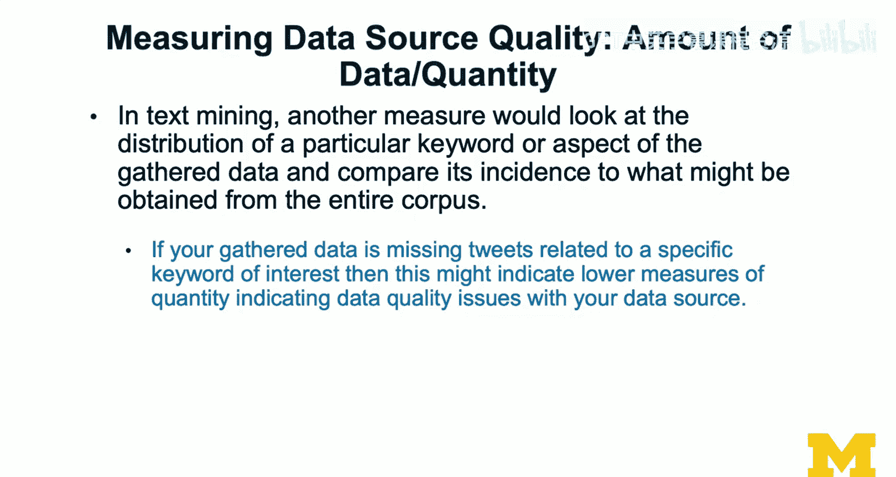

他们还讨论了与适用性或相关性相关的度量，包括传感器数据符合性和完整性的具体问题。

---

## 传感器数据的具体度量指标

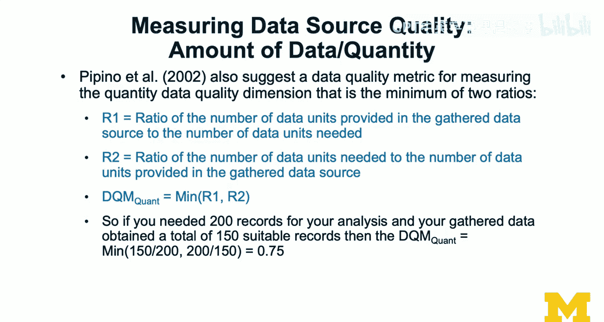

上一节我们介绍了数据源质量的通用维度，本节我们具体看看针对传感器数据的两个重要度量指标。

### 时间粒度度量

此度量评估传感器本身测量的时间戳或其他相关元数据的粒度是否足以满足手头任务。

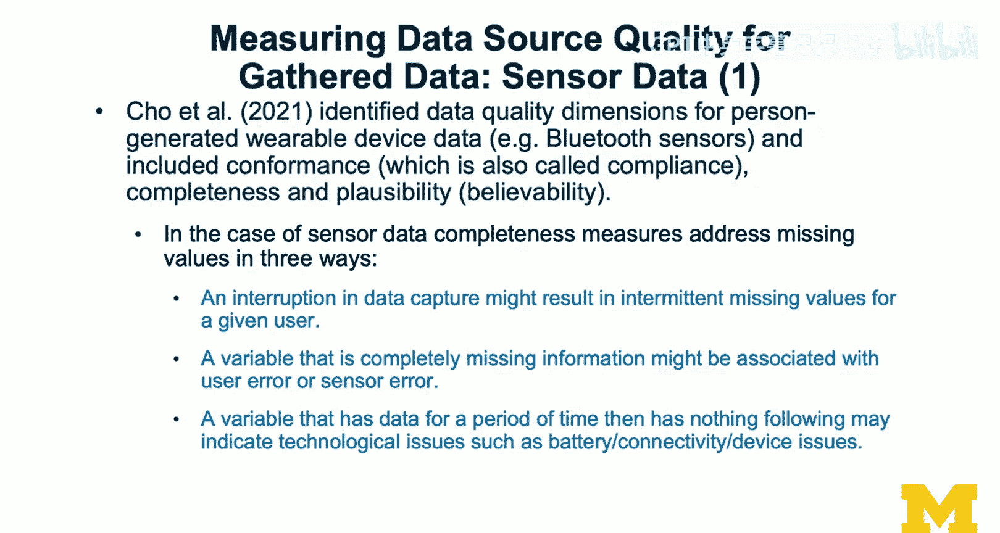

**示例**：心率监测器每15分钟测量一次心率，这对于需要每秒测量一次的马拉松研究来说可能不够精细。

### 密度完整性度量

此度量评估案例是否具有规定的最少测量次数，以及这些测量是否发生在规定的天数内。

**示例**：对于跑步者研究，可能需要每天至少15次心率测量，并且需要确保至少测量了5天的数据。这即是密度完整性度量的一个例子。

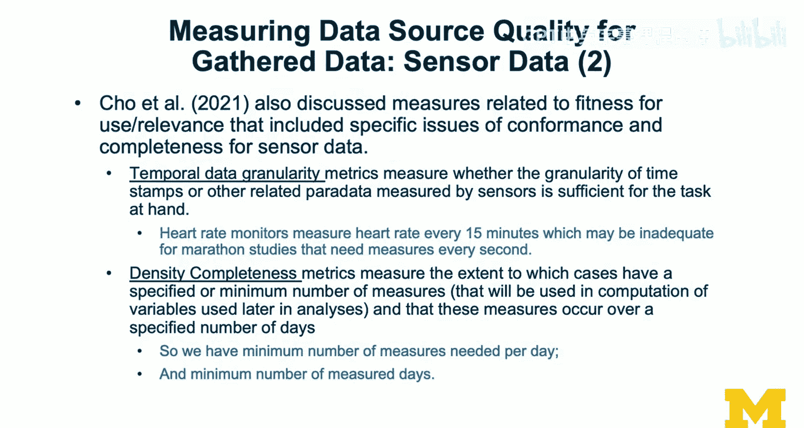

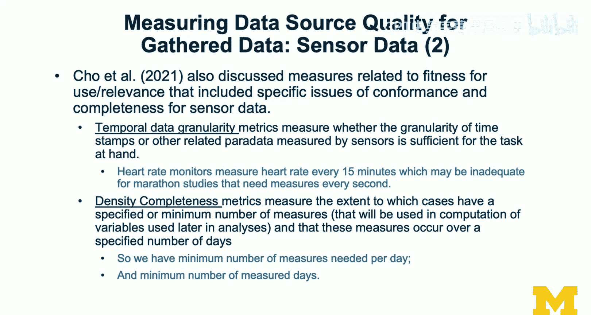

---

## 总结与预告

本节课中，我们一起学习了测量采集型数据源质量的核心概念。我们明确了数据源的双重含义（平台与信息类型），并深入探讨了三个关键质量维度：**可信度**、**数据量**以及针对传感器数据的**特定维度**（如符合性、完整性、合理性）。我们还介绍了具体的度量方法，如可信度的最小值计算、数据量的比率度量，以及传感器数据的时间粒度和密度完整性度量。

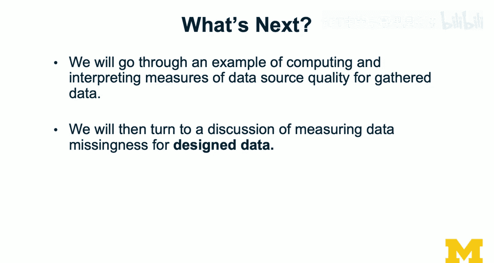

接下来，我们将通过一个具体示例，演示如何计算和解释采集型数据的数据源质量度量。之后，我们将把注意力转向讨论和测量设计型数据的缺失值问题。敬请关注接下来的内容。