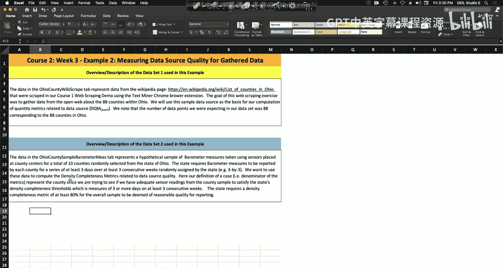
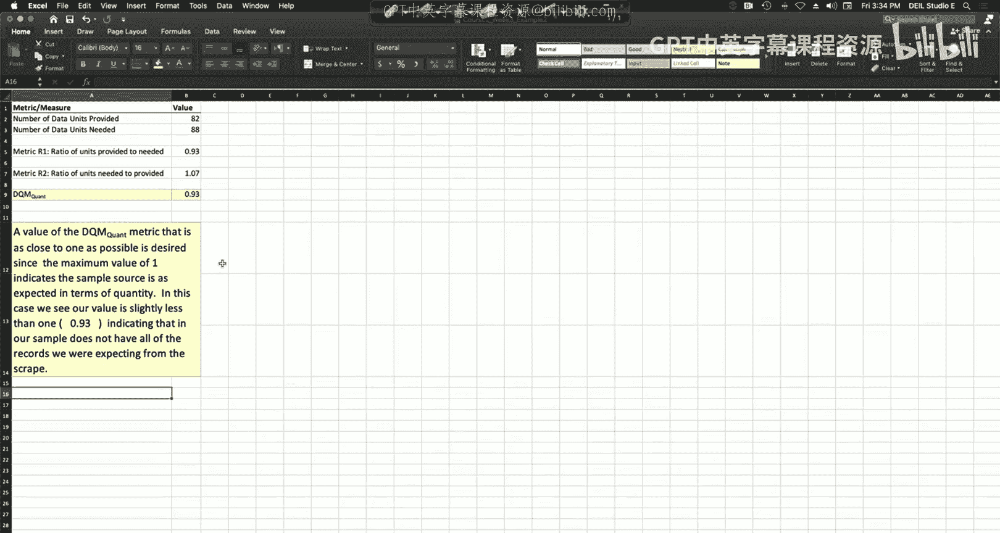

# 密歇根大学《总体数据质量（框架、度量、设计策略）total data quality》 p64 20_示例：真实数据与代码实现数据源质量指标.zh_en -BV1Jn4y1X7uS_p64-

Hi， I'm Trent Buskirk。 Welcom to our example on measuring data source quality for gathered data。

 We've already discussed in the previous lecture lots of different metrics for thinking about data source quality for gathered data and the quality dimensions that we might be carrying about and in this example I want to walk you through a couple of different ways that we can calculate these metrics。

 One of the metrics that we're going to be illustrating is the data quality metric around quantity and the other is the density completeness metric that we mentioned in the previous video。

 So let's go ahead and get started。 So there are two parts to this example。

 The first one we're going to use the data from the Ohio County Wiiki scrape that that example that we did in course one where we scrape the counties in the state of Ohio and we're going to calculate the quality metrics for quantity that is。

😊。

Based on using the two ratios that we discussed in the last video。

 and I'll walk you through that calculation in just a moment。

The other example that we're going to walk through is a density completeness metric example where in this case。

 we have data in the Ohio County sample barometer measure tab and this represents a hypothetical sample of barometer measures taken using sensors placed at county center locations for a total of 10 counties randomly selected from the state of Ohio。

 The state requires barometer measures to be reported by each county for a series of at least three days over at least three consecutive weeks in order to have adequate quality for the data set for the measures of barometer activity across the state So we want to use these data to compute the density completeness metrics related to data source quality here our definition of a case is the county and we're trying to measure the percent。

OfCoies that satisfy the density completeness metric。 Now， this might be confused with missing data。

 In fact， some counties will have missing information。 They won't have measured all seven days。

 for example， on a given week。We're less concerned about counting the missing values in this example。

 And we're more interested in counting the number of data points that actually were retrieved or gathered or measured。

 And we're trying to figure out if there are a minimum number of those measures that exist in two different dimensions。

 One is across the week。 So a minimum number of days per week。

 And then we have to have a minimum number of consecutive weeks with that threshold。So overall。

 the county or the state requires a density completeness metric of at least 80% for the overall sample in order to deem data that gathered data as of reasonable quality for reporting。

 so we're going to walk through this example as well and we'll revisit the description here in just a few moments。

 but let's jump into the county data that we've scraped in course one。

 and we'll go through the evaluation of the data quality metric for quantity。

Remember， or you might recall in that example that there are 88 counties in the state of Ohio。

 So I'm going to go over to the next tab where I have the data that I've scraped。

 and you'll see here that I have 83 rows corresponding to 82 pieces of information from 82 complete records。

 I don't have complete records for all the county。 So I want a measure of quantity as it relates to the dimension of data source quality。

 So we're going to evaluate this using the the minimum of two ratios that was proposed in the prior video。

So let's walk through the calculation of these here。

So the number of data units provided is the number of rows in the prior data tab。But remember。

 the first row is just the header。 so we don't count that row。

 So we have a total of 83 rows minus the header。 So there are 82 data units provided or cases provided。

The number of data units that we need or that we expect is 88。

 that's the total number of counties in Ohio。So we， we look at that as 88。Now， the metric R 1。

 the first ratio is the ratio of units provided to those needed。

 So if I were to calculate this directly， it would be the value here for a number of units provided。

Divided by the number of units needed。The second metric that is used in the calculation of our overall quantity metric is the ratio of units needed to those that are provided。

 So this is the reciprocal of the first ratio。 So in this case。

 this would be equal to the number of units needed。Divided by the number of units provided。

The quality metric for quantity is actually equal to the minimum。Of these two ratios。So。

 I'll calculate this。You don't really need the computer to calculate this。

 But if this were many different variables and you'd want to automate this process。

 this is how you would do it。 So our overall metric value is 0。93。

 So I'm going to insert that in to the parenthetical here so we can interpret what it is that we have。

So based on these calculations， a value of the data quality metric for quantity。

 we want that value to be as close to one as possible because the maximum value of one indicates that the sample source is expected in terms of the quantity。

 most is the best we can do。 We have everything that we expect。In this case。

 we see that our value is slightly less than1， which in this case it's 0。93。

Indicating that our sample does not have all of the records that we were expecting from the scrape。

 In fact， we've missed a few of the counties。 We've missed six of the counties that we were expecting。

 And so for whatever reason， our Web scraper did not pick up those last six rows。 So this quantity。

 this quality metric for data source gives us some feedback into the quality of our overall data source that was scraped from the county website。

 Given that we didn't get a metric of one， It means that we need to go back and reex why our Webs scraper missed those six elements or six rows。

 So in that case， this metric can help flag additional scrutiny that needs to be given to the webs scraper as part of a total quality process in terms of maximizing the overall quality of a gathered data sources。

 And we'll talk about。Maximizing data source quality for gather data in the next course。

 but you can see already some of the foreshadowing of how these measures can actually be useful for us to think about a feedback loop that can be used to improve the quality of data that we gather so this is the example sort of working a simple example in the context of gather data that we scraped ourselves。

Now I'd like to turn our attention to the second example and I'm going to go back to the overview tab here。

 this is where we're calculating density completeness metrics。

 so this is a little bit more complex example for deriving for measuring the quality of data source quality for gathered data。

Here we have two different dimensions of this metric。

 We have a minimum number of days that we expect to have measurements。

And we have to have that over a minimum number of consecutive weeks。

 So let's look at the barometer measure data under this Ohio tab。

 And we're going to see here that this is a long data file。

 And let me make this bigger so we can see this。 So now what you can see is this is Allen County。

 And so I'm just going to highlight Allen County。 And I'm going to look and see how we might walk through this metric。

 And then I have an Excel calculation that automatically does this。

 And I'll walk you through that in just a minute。😊。

So we can see here that on week number one， there are three days that were measured。

So if I'm keeping a running tally， Allen County has one week with three measures。

The second week also has three measures。The third week。Also has three measures。

The fourth week also has four measures， or three measures。So in this case。

 Allen County satisfies the density completeness requirement or threshold。

 So Allen County has four consecutive weeks。 Each week has three measures for the barometer readings。

 So Allen County is going to contribute one to our density completeness metric count。

 The denominator of that metric， is the number of counties that we're dealing with， which is 10。

 because this is a question about the data source。 The data source is information from gathered from 10 counties。

😊，If we move to Butler County， for example， on the first week， there are only two measures。

On the second week， there are three measures， four measures， and on the third week。

 there are three measures。 So Butler County has three consecutive weeks for。

 for which we have barometer measures， but only two of those weeks have the minimum number of measures。

 which is three。So Butler County would count would would contribute a0 to our count for the density completeness。

If we continue to work our way down this long file。

 you will see that I will eventually count7 counties that satisfy the completeness or the density completeness threshold。

 So the overall density completeness metric will be 70 per cent。

 So this data source does not meet the 80% density， completeness， metric criterion of 80% or more。

 So in this case， this particular gathered data source would be rejected by the state as not meeting the minimum requirements。

If you want to know how to automate the calculation of these counts for counting whether or not a county satisfies the requirements。

 you can work our way through these three different columns here。

The the column in orange or this column G is basically looking to see whether or not it counts the number of weeks with at least three measures per week。

 And it averages them across all the all the weeks for a given county that is observed。

 because ultimately， we're going to sum up each column。

 And this is a long data file where we're repeating counties over and over again。

 So I've taken the average here。 But essentially， if you sum up each column or if you sum up column G by each county。

 You'll get the count of the number of weeks。 I'll show you that here。

 If I highlight all of Allen County， and I look at the very bottom， the sum is4。

 there were four weeks that Allen County satisfied the criterion of three or more measures per week。

 So this column G counts the number of weeks with at least three measures。😊。

Then column H counts the number of counties with at least three weeks of three measures each。

 So now I'm aggregating on column H。 Now， if I aggregate column H across all of the data set。

 So if I look at just summing up this。 I get a total of 7。

 that means that 7 out of the 10 counties that are present。Did satisfy the criterion。Now。

 if I want to calculate the density completeness metric， This is a percentage。

 this would be 70% or 7 over 10。 So 70% of the counties satisfied the density completeness threshold of  three weeks。

3 measures each and not 80%。 So looking at this particular data source。

 It would not satisfy the minimum threshold quality criterion set by the state for density completeness a measurement。

 So in this case， you can see this is an example that is a bit more complicated。

 It involves tracking the number of of completed measures over another span of time and taking sort of a metric that takes into account both of those dimensions。

 a minimum number of measurements across a minimum number of weeks。

 I hope this example has been insightful and giving you a little bit more insight into how we might use some or how we might calculate some of。

Data quality metrics for data source， quality for gathered data。 Thanks so much for joining us。

 and we look forward to seeing you in the next lecture。😊。

