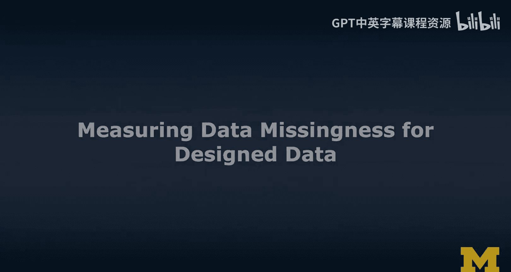
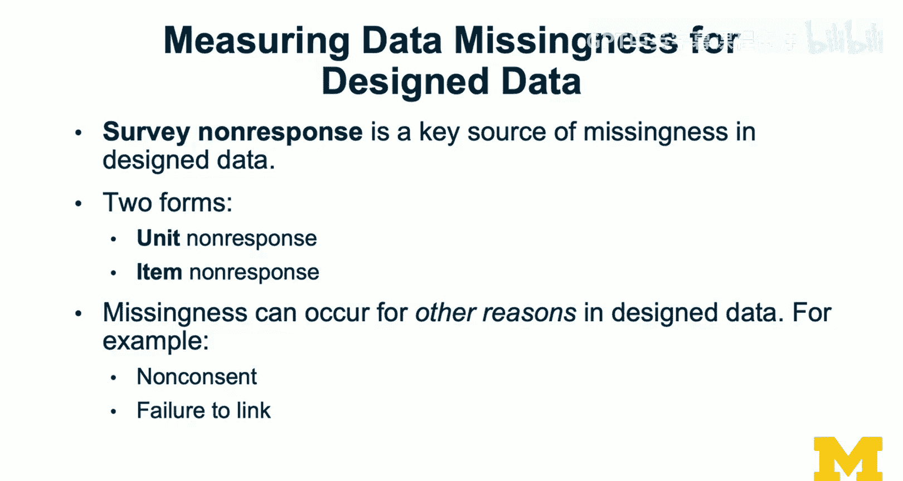
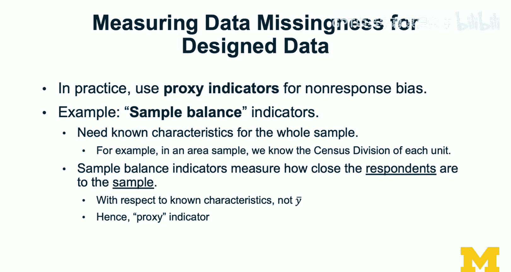
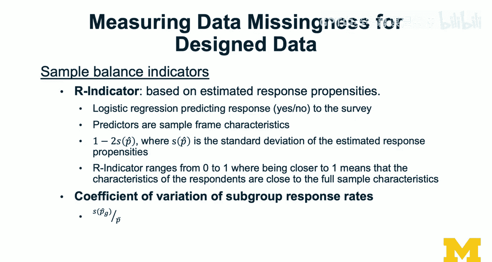
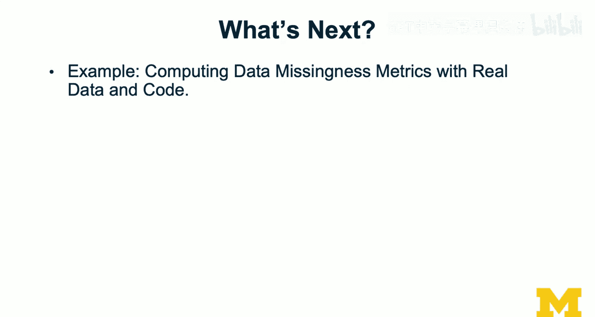

# 密歇根大学《总体数据质量（框架、度量、设计策略）total data quality》 p65 21_设计型数据源质量威胁测量.zh_en -BV1Jn4y1X7uS_p65-

Welcome back， today we're going to be talking about measuring data missingness for design data。

Remember the big picture， we're talking about missing data on the representation side。

 so we're collecting survey data。But we're not getting all of the data that we've expected from our sample。

And that can occur for several reasons。 The main reason is survey nonres。

 That's the key source of missingness and design data。

 and generally there are two forms of missingness。 The first we call unit nonrespon。

 when someone refuses to participate or fails to participate for some reason， for example。

 we're not able to contact them。A second kind of non response is item non response。

 so generally in surveys， respondents are allowed to say， I don't want to answer that question。

Where they can say that I don't know how to answer that question and we move on。 and in those cases。

 an element can be missing， and we need to resolve that in some way。

Missingness can occur for other reasons in design data， for example。

 someone may not consent to aspects of the survey， we may be asking for biospecimens， for example。

 and maybe they won't consent to those parts of the survey。

We can also be asking to link administrative data to their survey data。

And they may not consent to those procedures。Or they may consent and then were unable to link the administrative data to their survey record。

 so there's a lot of reasons additional to nonresponse。

 but nonresse is generally the main reason we experience missing data in design data。

Now we can estimate the bias due to nonre。Using a formula that's on this on this slide and the bias has two components。

 The first is the nonre rate noted here as P hat sub N R。

 the nonre rate and the difference between respondents and nonres。

 That is y bar sub R minus y bar sub N R。 Okay， So the difference between the nonres in the respondents and the nonre rate。

 the product of those two terms is an estimate of the bias。

The problem in practice is that we don't know the values， the survey values of the non respondents。

 That is， we do not have an estimate of Y bar subn R。Without that， we can't estimate the bias。Now。

 sometimes people have conducted special studies of non respondents to see what their survey values would be。

 special methodological studies， but those studies are rare。

Or we may have predictions of the variable of interest for nonreents。

 And in either of those situations， we can begin to describe the nonres bias。

 The latter being a prediction or an estimate that's based on a model。In practice。

 we use proxy indicators for nonresponse bias； that is we don't have the direct measurements of the survey variables for the nonrespondents。

 so we try to build proxy indicators that are close to what the survey variable of interest would be。

One example of a proxy indicator is a sample balance indicator where we have characteristics known for the whole sample。

Now in some kinds of sample， say an area sample， an area probability sample where we sample neighborhoods across the nation。

 or an address- based sample where we sampled addresses， we know the physical location of the sample。

 and we can attach information associated with that physical location， for example。

 we could say which census division， which part of the nation， which region of the nation。

 that unit is in。And we can attach other characteristics associated with that area。

Sample balance indicators then measure how close the respondents are to the sample。

Is one census division responding at a higher rate than another， for example？

These sample balance indicators are with respect to the observed characteristics。

 the census division， not the y bar of interest， not the survey variable of interest。

 hence their proxy indicators。 Now we want things to measure the balance on that are close to that y variable。

 and that can be difficult， but that's the goal。 It can be difficult to identify variables of that nature。

 but that is the goal。

So sample balance indicators a couple of examples， the first is an indicator known as the R indicator。

 and it's based on estimated response propensities or response probabilities。

So we start from a logistic regression model predicting response to the survey。 Yes or no。

 did they respond to the survey， And the predictors are the known characteristics that is we have that variable for every case。

 we have the value for that variable on every case in the sample。

The example I used on the previous slide census division。

 We know the census division for every unit in the sample。

 and we know whether or not each unit has responded so we can predict response using the census division among other characteristics。

Now， our indicator is the formula you see on the slide here。

 1 minus2 times the standard deviation of the estimated response probabilities。

That gives us an estimate of the variability of those response probabilities。

The more variable the response probabilities。The less balanced are set of respondences with respect to those observed characteristics。

So when we take1 minus2 times the standard deviation of the response probabilities。

 a higher R indicator represents more balanced response。Okay。So the R indicator。

 because of that formula ranges from 0 to1， where being closer to one means that the characteristics of the respondents are close to the full sample characteristics。

The coefficient of variation of subgroup response rates is another sample balance indicator。

 And here you see the formula， which is the standard deviation of the response rates of the subgroups divided by the mean response rate of the full sample。

So both of these measures give us a sense of the response rate differences across groups in the sample。

 are some groups responding at lower rates than others， and should we be concerned about that？

Other measures use the survey data but rely on a model for the missing data， for example。

 the fraction of missing information is a measure associated with multiple imputation。

 and it assumes that data are missing at random。 That is。

 if I have a model I can predict the values that are not observed。

Can missing information be recovered using frame characteristics is the basic question that the fraction of missing information answers。

 The lower the fraction of missing information。 The more we know about the predictive values。

 The better our predictions of the missing values are。

 the FMI will generally be lower than the nonre rate when it is than the known frame characteristics are predictive of the survey variables and help us recover lust information。

In non probability samples， the underlying mechanism for selection into the sample is unknown to the researchers。

 and it may be non iorable； that is， it may lead to selection bias。

There have been a couple of papers produced that provide tools for measuring the potential bias in estimates of means and proportions due to this type of non iorable selection。

 that is they explore a range of possible biases that may be due to the selection mechanism。

Very useful way to approach the problem， looking at the range of possible biases。

The measures require aggregate information on predictive auxiliary variables for the target population。

 and we show here a URL that will allow you to use our software and examples that are available on GitHub。

Okay， what's next， we're going to take a look at computing data missingness metrics with real data and code。

 some of the metrics that we looked at today。

