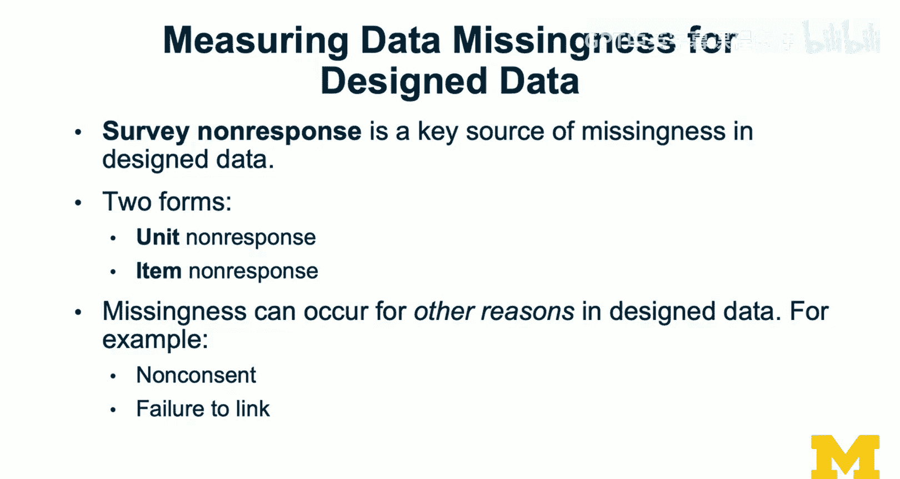
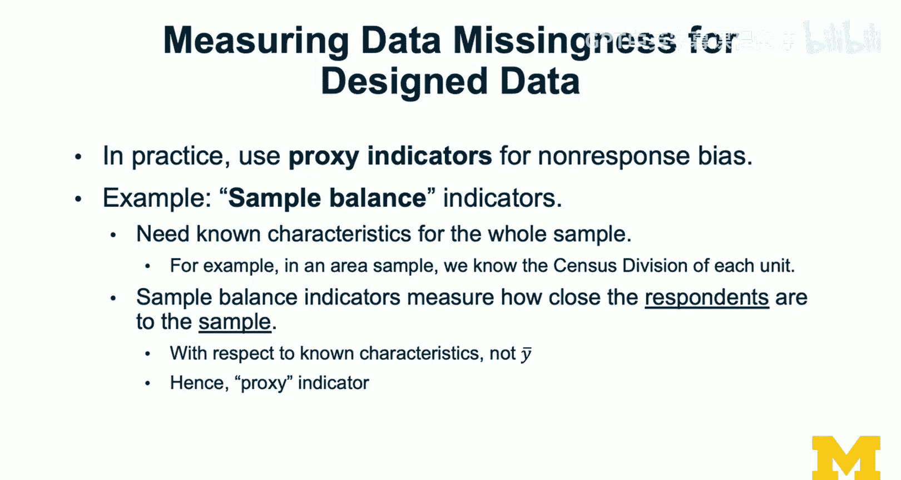
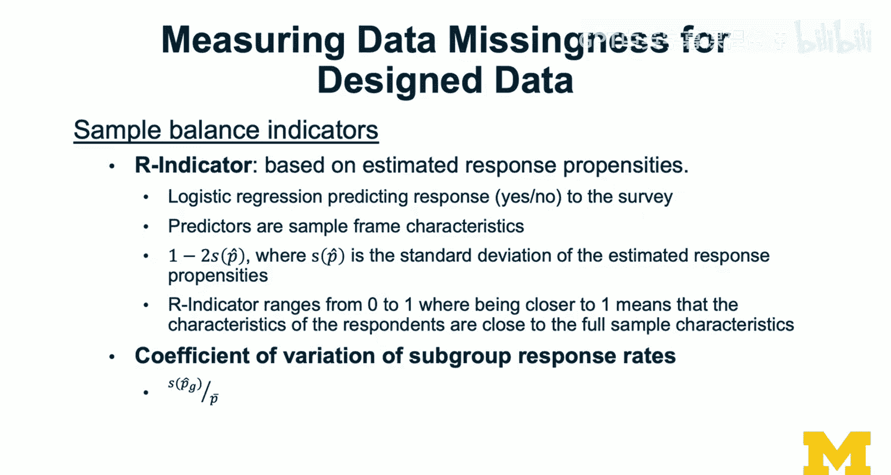
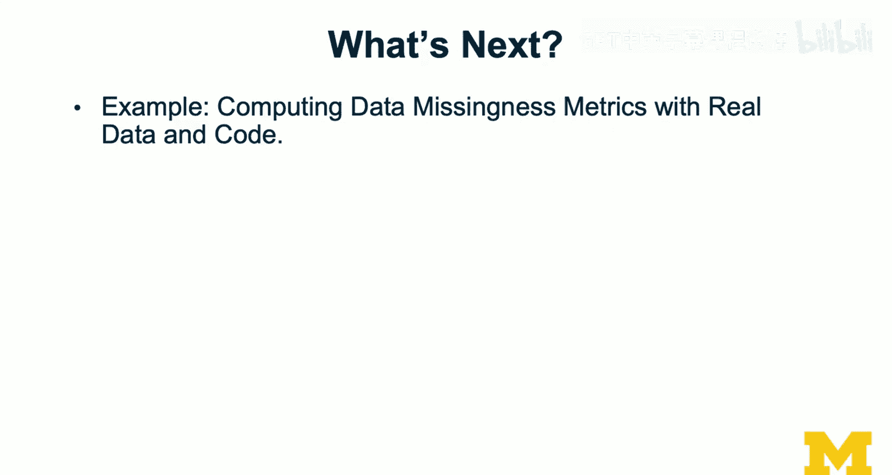

# 总体数据质量（框架、度量、设计策略）：21：设计型数据源质量威胁测量 📊

在本节课中，我们将要学习如何测量设计型数据源中的数据缺失问题。我们将探讨数据缺失的主要原因、评估缺失所导致偏差的方法，以及几种衡量数据缺失程度的实用指标。

## 数据缺失概述

上一节我们介绍了数据质量的不同维度，本节中我们来看看设计型数据源中一个常见的质量问题：数据缺失。

在收集调查数据时，我们可能无法从样本中获得所有预期的数据。这被称为数据缺失。数据缺失可能由多种原因导致，其中最主要的原因是调查无应答。

## 数据缺失的主要原因

以下是设计型数据源中数据缺失的几种主要形式：

*   **单元无应答**：指受访者因某些原因拒绝参与或未能参与调查。例如，我们无法联系到他们。
*   **项目无应答**：指受访者在调查中，针对特定问题选择“不想回答”或“不知道如何回答”，从而导致该数据项缺失。
*   **其他原因**：数据缺失也可能源于其他原因。例如，受访者可能不同意调查的某些部分（如提供生物样本），或不同意将其调查数据与行政记录进行链接。即使他们同意链接，也可能因技术原因无法成功匹配。

## 无应答偏差的估计

无应答会导致估计偏差。我们可以使用以下公式来估计这种偏差：

**偏差估计 = P_NR × (ȳ_R - ȳ_NR)**

其中：
*   **P_NR** 是无应答率。
*   **ȳ_R** 是应答者的变量均值。
*   **ȳ_NR** 是无应答者的变量均值。

这个偏差由两个部分组成：无应答率，以及应答者与无应答者在目标变量上的差异。

然而，在实践中我们面临一个主要问题：我们无法直接观测到无应答者的调查变量值 **ȳ_NR**。没有这个值，我们就无法直接计算偏差。有时，研究人员会通过专项研究来获取无应答者的信息，或者使用模型来预测他们的值。但在大多数情况下，我们会使用代理指标来间接评估无应答偏差。

## 样本平衡指标

由于无法直接测量无应答者的调查变量，我们转而使用代理指标。一个常见的例子是**样本平衡指标**。这类指标利用那些对整个样本都已知的特征（如人口普查区域、地址信息等），来评估应答者样本与原始总样本在这些特征上的相似程度。

以下是两种常用的样本平衡指标：

*   **R 指标**：该指标基于逻辑回归模型估计的应答概率。其计算公式为：
    **R = 1 - 2 × S(ρ̂)**
    其中，**S(ρ̂)** 是估计的应答概率的标准差。R 指标的值介于 0 到 1 之间。值越接近 1，表示应答者样本在已知特征上与总样本越平衡。
*   **子组应答率的变异系数**：该指标衡量不同子组之间应答率的差异程度。其计算公式为：
    **CV = S(r_g) / r̄**
    其中，**S(r_g)** 是各子组应答率的标准差，**r̄** 是总样本的平均应答率。这个系数可以帮助我们识别是否有某些子组的应答率显著偏低。

## 基于模型的缺失信息度量

除了样本平衡指标，还有一些度量方法直接利用调查数据，但依赖于对缺失数据的模型假设。

例如，**缺失信息比例** 是与多重插补方法相关的一个度量。它假设数据是“随机缺失”的，即基于已有信息可以预测缺失值。FMI 回答了一个基本问题：利用已知的框架特征，能多大程度上恢复缺失的信息？FMI 值越低，通常意味着我们对缺失值的预测越好。

## 非概率样本中的选择偏差

在非概率样本中，个体被选入样本的机制是未知的，并且可能是“不可忽略的”，这会导致选择偏差。已有研究提供了工具来测量这种选择机制对均值或比例估计可能造成的偏差范围。这些方法需要目标总体的预测性辅助变量的汇总信息，通过探索可能的偏差范围来评估风险。

## 总结

本节课中我们一起学习了设计型数据源中数据缺失的测量方法。我们了解到，无应答是导致数据缺失的主要原因，并可以通过公式 **P_NR × (ȳ_R - ȳ_NR)** 来概念化其导致的偏差。由于无法直接获得无应答者的数据，我们介绍了**样本平衡指标**（如 R 指标和应答率变异系数）作为评估缺失问题的代理工具。此外，我们还简要提及了基于模型的**缺失信息比例**以及在非概率样本中评估**选择偏差**的方法。这些工具共同帮助我们量化和理解数据缺失对数据质量的影响。