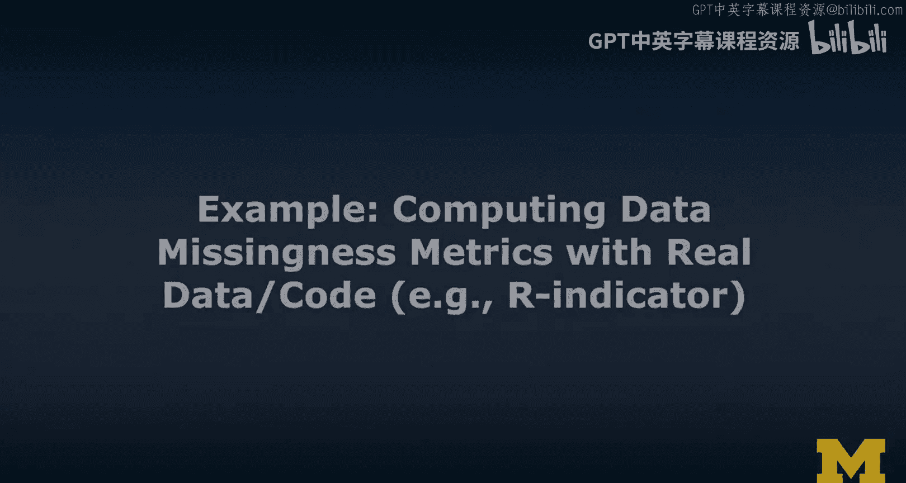
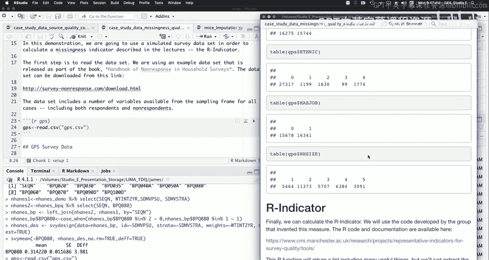

# 密歇根大学《总体数据质量（框架、度量、设计策略）total data quality》 p66 22_示例：真实数据与代码实现缺失率指标计算.zh_en -BV1Jn4y1X7uS_p66-

Welcome back。 Today， we're going to be computing data missingness metrics with real data and code。

We're going to be using R markdown today， and we're going to be looking at specifically an indicator called the R indicator。

 which we talked about briefly in one of the lectures。

 but today we'll be using some R code to implement that procedure。Now。In this demonstration。

 we're going to use a simulated survey data set in order to calculate a missingness indicator。

 and the indicator we're going to use is the one described in the lectures， the R indicator。

The first step is to read the data set。The example data set that is is been released as part of a book called the Handbook of No Response and household Surs。

 The data set can be downloaded from this link， and the data includes a number of variables available from the sampling frame for all cases。

That means that both respondents and non respondents have values。

 And that's what's going to allow us to calculate the R indicator。

 So the first step is to load the data。Now， one of the things we want to do is look at Uniivevariate analyses of the data just to become familiar with these data。

Now， we know that though both respondents and nonrespondentents are in this data set。

 but we want to know what was the average response rate。 So let's take a look at that。

 There's an indicator on the file， an indicator variable called response， that's one。

 If the person responded and 0 if they did not respond。

 The mean of this variables in unweighted response rate。 So first。

 we just look at a table and note that of the 320 or so respondents，18792 responded。

 I should say the 32000 sampled persons， about 18792 responded。 Well。

 rather than do the math in my head， I just looked at the mean of that variable to find the response rate of about 58。

7 per cent。Okay， so I've taken a look at that。 Let's look at some of the other variables in the data set。

The first one that I look at is age 13， and I know from the code book that this is categorical age in 13 different categories。

So有。Category 5，903， category 6，23，35。 so I can see the counts of each age group。

And I'm going to look at some of the other variables available on the data set as well。

 I can look at whether there are children in the household， for example。

What are the ethnic composition of this group。Does the person who。Is listed。 Have a job。

And what is the household size。Now， you might say， well。

 these are very detailed variables for a sampling frame。 And， in fact， they are。

 but they come from an example in the Netherlands where these kind of information are available in a population register that the statistical agency that collects data on the whole nation can use as its sampling frame。

 And that's who's developed this example data set。

No。After we've gone through that bivari Uniivevariate analysis。

 we can turn to the calculation of the R indicator。

And we're going to use the code developed by the group that invented the measure。

 The R code and documentation are available at the website， the URL that you see here。

This R function will return a list， including many useful things。

 but will just extract a single indicator， the unadjusted R indicator。

 If you're interested in the details of the R indicator。

 you can see the documentation and several publications that are available to describe the use and calculation of the R indicator。

The selection of the model is important， So it's important to consider which variables should be as included as predictors。

 The point is not to find predictors that are statistically significant。 Rather。

 the point is to identify predictors that could be an indication of potential biases in estimates。

So what things are important and what things do you think would be indicators of potential biases if these became。

 if， if the respondents became imbalanced with respect to these characteristics。For example。

 if you think representing all age groups in the final data set is important。

 you may want to include age as a predictor in your model。For this demonstration。

 we'll use several of the predictors that are available on the dataset set。 These include age。

 the one that we just looked at in 13 categories， presenceence of children in the household。

 ethnicity， gender， whether the person has a job and the household size。Let's go to the R code。

To see the calculation of the R indicator using the code supplied by the developers of the R indicator。

So， I'm going to。Source this file， which is available at the website。

 the URL I gave you earlier to get all of the functions available that I need in order to calculate the R indicator。

Once I have that， I'm going to specify my model。 as you see here， response， the outcome， that 0。

1 outcome variable。I'm going to include age as a factor。 the presence of children in the household。

 ethnicnic as a factor。 Gen as a factor， has job and household size。 household type is a factor。

 You see， I also have household value， marital status， non native region。

So called and urban as predictors in this model。I'm also specifying that there's a sample weight。

And I'm also saying some additional code to say I don't want partial。

 our indicators are partial coefficients of variation。

A separate topic that you might be interested in if you're interested in finding out which categories are having lower response rates。

And here， I'm just going to print the unadjusted R indicator。

Let's go back to the output to see after I run my model。

The R indicator function calculates the standard deviation of the。

Estimated response probabilities and converts that into the R indicator。 As a reminder。

 the R indicator goes on a scale from 0 to 1， with one being perfect balance between respondents and sample。

So there is no difference between in the characteristics between the respondent and the sample。

 an indicator of about 0。78 is closer to 1 than 0， indicating that the balance is relatively good。

 Now， for this measure to be meaningful， I need to want to compare it to other surveys or to different points in time on the same survey。

We might want to further explore which categories are underrepresented。

 The R indicator has some functions for doing this， as I mentioned a moment ago。

 But here we'll look at the response patterns across categories of one of the predictors in the model to see if we can identify any subgroup that may be responding at lower rates。

So I'm going to use some R code to do that。First， I'm gonna。Label things carefully。

 I'm going to make a graph， and I want things to be labeled carefully。

 So I'm going to add some labels， identify factors and set kind of a reference level。

And then I'm going to take a cross tab of ethnic by response and see if there are any ethnic subgroups that respond at lower rates。

I can use a chi square test to see if there is an association between response and the different categories of the ethnic variable。

 And then I'm going to use this association command to develop a figure。

 Let's go back to the output and take a look at the results。

So the first thing to note is this small P value indicates that there does appear to be some association between response and the ethnic variable on the dataset set。

 That is some ethnic groups respond at different rates than others。And I've developed this figure。

 which shows that this first ethnic group has somewhat imbalanced response。The first。

 the the zero group， the one group also has imbalanced response， as does as the second group。

 the third and fourth group are smaller。 The fourth group seems to be less imbalanced than the others。

 But this kind of figure then can help us identify where the different groups are responding at lower rates。

 And with that， using that information， Then we may decide to change the survey design or target subgroups or take actions that will。

Reduce the differences in response rates across the different groups。

So that's just one example of looking using bivariate information to look at how different subgroups are responding。

 I could go through many more variables in the same dataset set， exploring these issues。

 and then use that information to improve the design of future surveys。

But now we've seen how to calculate the R indicator。

How to set up the model and how to look at and interpret the results。Thank you。

