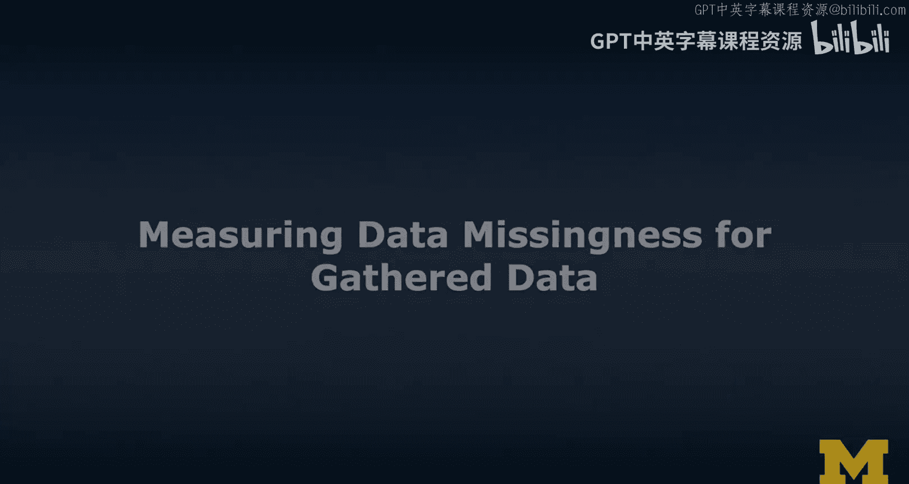
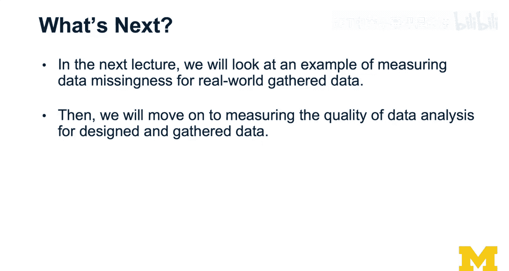

# 密歇根大学《总体数据质量（框架、度量、设计策略）total data quality》 p67 23_采集型数据缺失率测量.zh_en -BV1Jn4y1X7uS_p67-

Hello everyone in this lecture you will learn how to measure data missingness for gather data。

Before we move on， let's check where we are in the big picture。In previous lectures。

 you learned about measurement of data missingness for design data。

 Now we will take a look at gather data。We can measure data missingness in different ways。

 depending on whether we focus on data source， collection or processing。Especially。

 the measurements are closely related to the missingness threats we have learned in course 1。

For example， if data missingness occurs because of nonres， nondi， data ausray， or cleaning errors。

 we can measure frequencies， ratios， and distributions of missing values。

What if values are missing during linkage。We can count the false negative instances here false negatives mean cases that are supposed to be linked but fail to be so。

For example， researchers often link bibliographic data sets that contain who publishes what papers。

During the linkage， authors who record their names in different formats across data sets are often not linked。

 producing false negative cases。We can count the number of these false negative cases as missing for the linked data sets。

Another missing this threat is usual group bias。If we suspect that missing values exist because of that。

 we can measure missingness by comparing gather data against population or representative samples of population。

For example。A nonparts think tank Pew Research Center regularly publishes characteristics of social media users compared against a group of survey respondents who samples of population。

Let's take a look at some examples of measuring data missingness。

The first example is a 2016 study by Hans and colleagues。

The study addressed the timeis common in electronic health records。

The study collected a sample of about 8000 patients in a selected HER。

 The study found that 67% of patients have complete data for the weight fields。

 but the remaining 33% of patients don't。The study used the ratio of missing values against all instances in a field to measure data missingness。

To correct the missingness problem， the study conducted a telephone survey of patients with missing information to ask why they did not report their weight。

The next example is a 2021 study by Dr。 Kim and Dr。 Own Smith。

 scholars have linked the Open Researcher profilele database。

 OID and publication Record to find out who publishes what papers。

Our popular linkage method is to link names across databases if they share the same surname and the first full name initial。

The study showed that this method fails to link more than 270。

000 names instances because they are recorded in difference surname and first full name initial formats。

For the same authors。In this study， the count of name pairs that are not properly linked was used as the measurement of values missing during the linkage between OID and publication records。

In the next lecture， we will look at an example of measuring data missingness for real world gather data。

Then we will move on to measuring the quality of data analysis for designed and gathered data。

