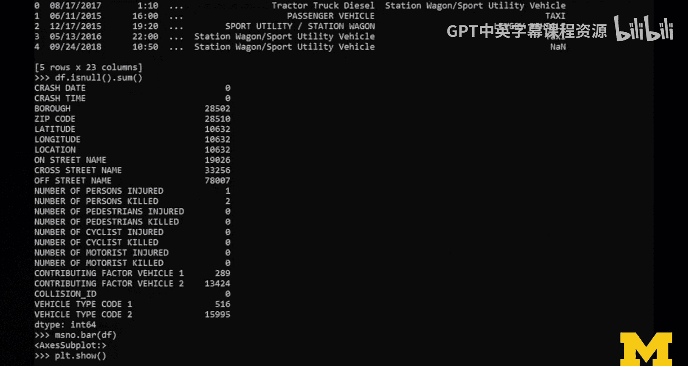
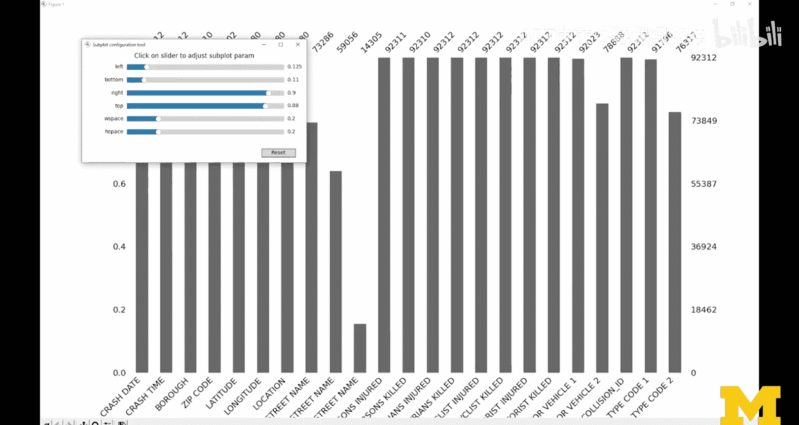
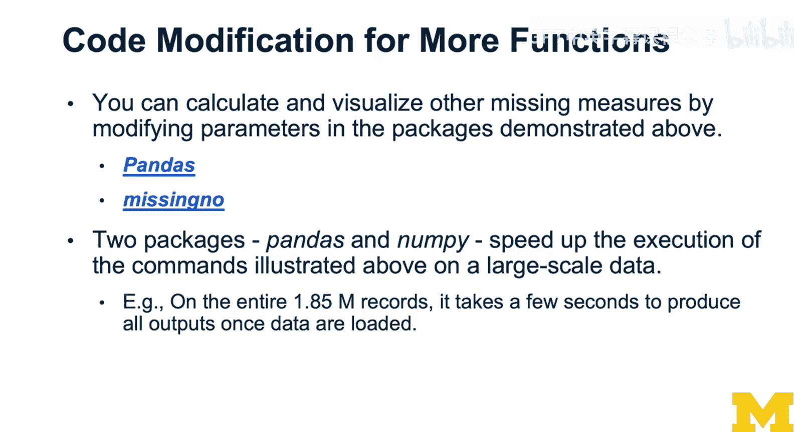

# 密歇根大学《总体数据质量（框架、度量、设计策略）total data quality》 p68 24_示例：采集型数据缺失率计算实践.zh_en -BV1Jn4y1X7uS_p68-

Hello everyone， we will take a look at an example to compute data missing mix for G data。

 it can be very challenging to find missing values in G data。

Gather data are often huge in size and data instances can be too many to search by manual inspection or traditional computing tools。

In addition， characterization of missingness can be difficult because computing missing patterns across data fields can be time consuming In this example。

 you will learn how to use Python packages to search missing values in large scale data and characterize the across column pattern。

For this example， we will use a data set from NYC Open data。

 which is New York City's online repository of public data。

 the data set is labeledMo vehicleh Cols crashes and contains 1。

85 million records or vehicle Cols reported by NYPD since 2014。

Please do not download data from the link。 We will use a sample of the raw data。

Before you move forward， please check your computer system for requirements。A computer with Windows。

 Mac OS or Linux is required to have Python installed to run the example code。

 you need to install four Python packages， numpy， pandas， matpllip and Myino。

Please remember all these package names are case sensitive。

Let's get ready for running commands First， download NYC Vco Col sample CSV file from the TDQ courserus page and save it in a folder you choose to use on your computer。

Next， open a command prompt and change the walking directory to the folder with the data。

Then type Python on the command prompt and press enter to open a Python console。

Now let's load Python packages。Type four commands as shown and press enter each。

Import pandas as PD D。Import nuy， S， and P。These two packages are used for loading and processing data。

Import missing no S MS， S，N， O。 This package helps us to explore and characterize missing values。

Import matpl lip dot pie plot has P L T。This package enables us to visualize processing results。

Now it's time to load the sample data。Type of command as shown below and press En。

Then type DF dot head empty parentheses and press enter。

The console will display the first five rows and a few first and last columns of the loaded data。

If any missinging value exists in a row， it is shown as NAAN or spelled as none。For example。

 the fifth row indexed as 4 has a missing value in the last column here none is an acronym of not number。

How can we count missing values in the data。Type Df dot is no parenthesesis does some parentheses and press enter。

This commands pandas to search D F for missing values and count a total in each column。For example。

 in the screen， you can see the columnC data has no missing value。

 but the column namedBrow has about 28，000 missing values。

Here's a few tips known about missing values in pandas。First。

 isO parentheses can be replaced by E and A parentheses to detect missing values in panda's data frame。

Second， by default， empty cells as well as words like NA and nu in their uppercased or low case strings are interpreted as missing values by pandas。

Let's learn how to visualize missingness in gathered data。

Do you remember at the beginning of this example， we imported a package named missing no SMSN O？

Type MSN O that bar open parentheses， Df， and close parentheses。If you press En。

 you will see a resolved message that reads access sub plot。

This indicates that the missing package denoted by MSNO produced a plot which is not shown right now on the console。

 to see the plot you need to type PLT。 show parentheses and press enter。

A figure will appear in a separate window。

It shows non missing value counts against the total number of rows for each column， for example。

 the bar representing column crash date on the far left has 92，312 non missing values。

The size of bars and positions of axis in the figure can be modified by adjusting the configurations button on the left bottom。

If you click the configure surplots icon， another small control window will appear showing several control options。

Now it's time to see how we can characterize missingness for this， we will use missing no again。

Type MSNO。 Hemap， open parentheses， Df， close parentheses and press enter。

 this produces a figure file。As we did just evolve， typed PLT does show parentheses and press enter。

A figure will appear in a separate pop up window， this visualizes correlations of missingness across columns。

If a cell shows a value of one missinginess in two columns associated with the cell occurs always in the same rows。

 For example， rows with missing location values always have missing longitude values。

The correlation is also denoted by colors with shades between red and blue。

Blue means positive correlation， while red means negative correlation。

You can calculate and visualize other measures of missingness by modifying parameters in the pandas and missional packages。

Especially pandas have and nuy speed up the execution of the commands illustrated above on a large scale data set。

 for example， on the entire 1。85 million records， it takes a few seconds to produce all outputs shown off of once data are loaded。

