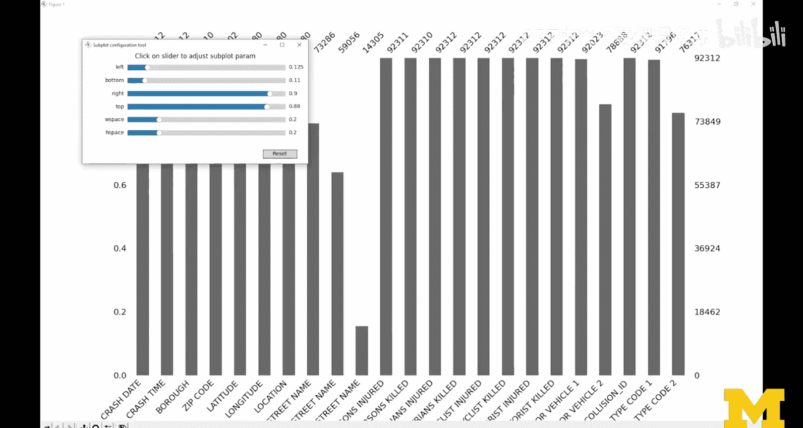

# 总体数据质量：第24课：采集型数据缺失率计算实践 📊


在本节课中，我们将通过一个具体示例，学习如何使用Python工具在大规模采集型数据中计算和表征数据缺失率。我们将使用纽约市公开的车辆碰撞数据集作为示例，演示从数据加载、缺失值检测到可视化分析的完整流程。

---

## 环境准备与数据加载 💻

上一节我们介绍了计算采集型数据缺失率的挑战。本节中，我们来看看如何为实践操作准备环境并加载数据。

首先，请确保您的计算机满足以下要求：
*   一台安装了Windows、Mac OS或Linux操作系统的电脑。
*   已安装Python运行环境。
*   需要安装四个Python包：`numpy`、`pandas`、`matplotlib`和`missingno`。请注意，所有包名都区分大小写。

以下是操作步骤：
1.  从课程页面下载`NYC_Vehicle_Collisions_sample.csv`文件，并保存到您电脑上的一个文件夹中。
2.  打开命令行终端，将工作目录切换到存放上述数据文件的文件夹。
3.  在命令行中输入`python`并按回车，打开Python控制台。
4.  依次输入并执行以下命令，加载所需的Python包：
    ```python
    import pandas as pd
    import numpy as np
    import missingno as msno
    import matplotlib.pyplot as plt
    ```
    其中，`pandas`和`numpy`用于加载和处理数据，`missingno`用于探索和表征缺失值，`matplotlib`用于可视化结果。


现在，让我们加载示例数据。输入以下命令并按回车：
```python
df = pd.read_csv('NYC_Vehicle_Collisions_sample.csv')
```
要查看数据的前几行，可以输入：
```python
df.head()
```
控制台将显示已加载数据的前五行以及最前和最后的几列。如果某行存在缺失值，它会显示为`NaN`或`None`。例如，索引为4的第五行，其最后一列就有一个缺失值。`NaN`是“Not a Number”的缩写。

---

## 检测与统计缺失值 🔍

我们已经成功加载了数据，接下来学习如何检测和统计其中的缺失值。

在Python控制台中输入以下命令并按回车：
```python
df.isnull().sum()
```
该命令指示`pandas`在数据框`df`中搜索缺失值，并统计每列中的缺失总数。例如，从输出中可以看到，名为`CRASH DATE`的列没有缺失值，而名为`BOROUGH`的列约有28,000个缺失值。

关于`pandas`中缺失值检测的几个要点：
*   `isnull()`函数可以用`isna()`函数替代，两者功能相同，都用于检测`pandas`数据框中的缺失值。
*   默认情况下，`pandas`会将空单元格以及像`NA`、`null`这样的大写或小写字符串都解释为缺失值。

---

## 可视化数据缺失情况 📈

我们已经学会了统计缺失值，本节中我们将利用`missingno`包来直观地查看数据的缺失情况。

还记得我们在开始时导入的`missingno`包吗？输入以下命令并按回车：
```python
msno.bar(df)
```
您会看到一条提示信息“AxesSubplot”，这表明`missingno`包已经生成了一个图表，但并未直接在控制台显示。要查看这个图表，需要输入：
```python
plt.show()
```
一个独立的窗口将弹出，显示该图表。

该图表以条形图形式展示了每一列中非缺失值的数量与总行数的对比。例如，最左侧代表`CRASH DATE`列的条形显示有92,312个非缺失值。您可以通过点击图表左下角的配置按钮，调整条形大小和坐标轴位置。点击“配置子图”图标后，会弹出一个小控制窗口，显示多个控制选项。


---

## 表征跨列缺失模式 🔗

仅仅知道每列有多少缺失值还不够，我们还需要了解缺失值在不同列之间是否存在关联模式。本节我们将使用`missingno`来表征这种跨列的缺失模式。



输入以下命令并按回车：
```python
msno.heatmap(df)
```
与之前一样，这会生成一个图表文件。接着输入`plt.show()`并按回车，图表将在弹出的窗口中显示。

这个热力图可视化地展示了各列之间缺失值的相关性。如果一个单元格的值为1，则表示与该单元格关联的两列，其缺失总是发生在相同的行中。例如，`LOCATION`列有缺失值的行，其`LONGITUDE`列也总是缺失。相关性也通过红蓝之间的颜色深浅来表示：蓝色表示正相关，红色表示负相关。


---

## 总结与扩展 🎯

本节课中，我们一起学习了使用Python工具包处理大规模采集型数据缺失率的完整流程。

我们首先准备了Python环境并加载了纽约市车辆碰撞的示例数据。接着，我们使用`df.isnull().sum()`命令统计了每列的缺失值数量。然后，我们利用`missingno.bar()`函数可视化了各列的非缺失值计数，直观了解了数据的完整性概况。最后，我们通过`missingno.heatmap()`函数生成了缺失值相关性热力图，深入分析了不同字段间缺失模式的关联性。


通过修改`pandas`和`missingno`包中的参数，您可以计算和可视化其他缺失率度量指标。特别值得一提的是，`pandas`和`numpy`能够加速上述命令在大规模数据集上的执行。例如，在整个包含185万条记录的数据集上，一旦数据加载完成，仅需几秒钟即可生成所有展示过的输出结果。