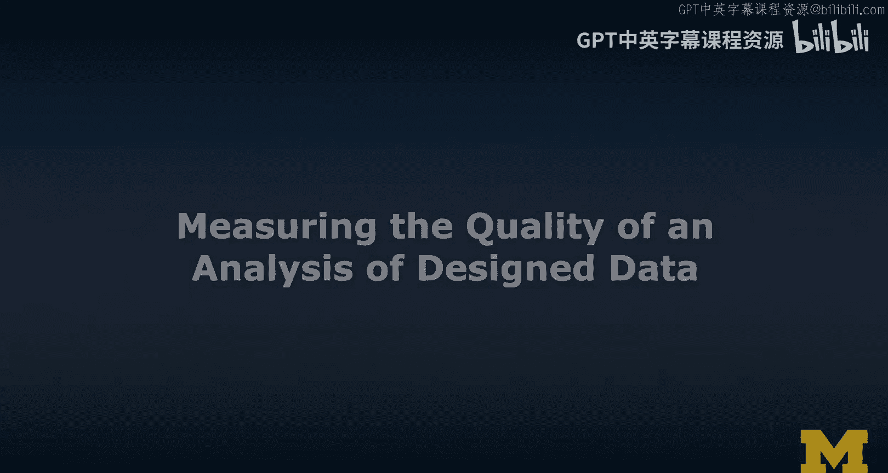
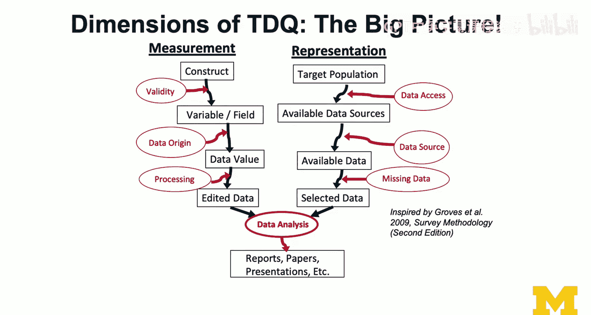
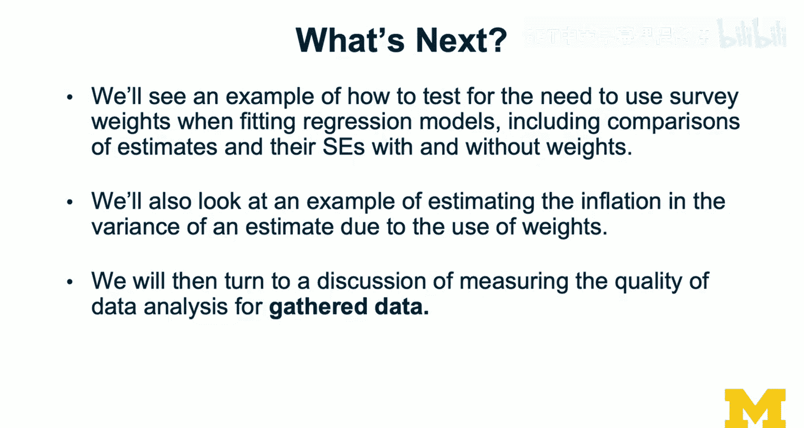

# 密歇根大学《总体数据质量（框架、度量、设计策略）total data quality》 p69 25_设计型数据分析质量测量.zh_en -BV1Jn4y1X7uS_p69-

Okay， hellello everyone， welcomecome back。 Now we're going to be turning to how to measure the quality of an analysis of design data。

 So now we've talked about measuring the quality along different dimensions of the total data quality framework。

 we're going to turn our attention to analysis。 Okay now that we've talked about measurement and representation。

 It's also very important to think about how to quantify the quality of a given analysis of that design data。

So back to our big picture of the total data quality framework again。

 we've talked about different approaches to measuring quality in terms of validity。

 data origin and processing on the measurement side and the representation representation side。

 we've talked about how to measure quality with respect to data access the data source and then missing data Now remember both of these sides ultimately tie together to produce the data that we're actually going to analyze when we want to generate our reports。

 our papers， our presentations， etc ce。 but we also have to make sure at this analysis stage that we're doing a high quality analysis and there's different ways to quantify the quality of the data analysis that we're performing and we're going to talk about how to do that in terms of design data in this particular lecture。

So measuring data analysis quality for design data。

Some design data sets will include indicators for sampling clusters and sampling strata。

 and these represent features of complex probability samples that should be accounted for when we compute the standard errors of survey estimates。

 So in the popular media you might hear about estimates of say what fraction of the population voted for Biden in the last election or something like that。

 And then you hear about this term margin of error。

 So when we're computing that margin of error for a given survey estimate。

 we need to make sure that we're taking important features of the sampling plan into account as well。

 and design data sets will often include variables that represent these sampling clusters and sampling strata that again。

 reflect features of the complex samples that are selected that need to be accounted for when we do our analysis to make sure that those margins of error are correct。

 So in general， a best practice is when you're analyzing data you want to use analysis methods that fully account for these design features。

In addition to the use of survey weights for our estimation。

 so if you find in your dataset that survey weights have been included。

 which allow analysts to make representative statements about target populations。

 we want to make sure that those weights have been used for analysis as well。

 So it's a best practice to make sure that these different sampling features are accounted for when we do our analysis。

 We're going to see examples of how to do that。We also want to make sure， though。

 that the use of survey weights in estimation is not inflating the standard errors of our estimates artificially above and beyond any expected inflation in those standard errors due to cluster sampling。

 So when people designing samples， select these large national probability samples。

 they often select clusters of individuals to begin with。

 And when cluster sampling is part of a design data collection。

 that cluster sampling can inflate the standard errors of our estimates， and that's to be expected。

 the entire act of selecting clusters in a sampling plan does tend to inflate the sampling variable of our estimates。

 But when we're using weights and estimation， the more variable that those weights are。

 the more variable our estimates might become。 And if those survey weights are not correcting bias in our estimates at the same time that they're inflating the variability of those estimates that could be reducing the quality of our estimates。

 if they're not correcting any of the bias that come from the actual sampling。

 So we need to keep a careful。Lly on this when we're actually analyzing the data。

 and we're going to talk about how to do that。So when you're working with design data that have weights included in the data phone。

 you can read about these types of survey weights in the documentation for the different data sets that you might be working with。

 it's also very good practice to compare survey estimates and their standard errors before and after using those survey weights and estimation and this book by Hear and colleagues talks more about this process when you're analyzing survey data。

In general， those final survey weights are intended to produce population estimates that are more or less free from bias。

 bias due to sampling， bias due to nonresponse， bias due to the fact that your sample may not exactly mirror what the population looks like。

 So the weights compensate for those different possible sources of bias。

 They should shift your survey estimates， without also raising the standard errors of your estimates。

 So this really speaks to what we call a bias variance trade off in terms of the quality of the estimates that we're producing when we sit down and analyze survey data。

 We want those weights to reduce bias。 but we don't want them to also increase the variability of our estimates at the same time。

 making our estimates very noisy with large margins of error。

So what we like to do is compare the standard errors with and without adjusting for the weights in our analysis。

 If we find that there is significant inflation in the standard errors of our estimates。

 without corresponding shifts in the point estimates。

 that may suggest that the weights are noninformative what that means is that the weights are not correlated with the variable that we're trying to trying to analyze And so they're not correcting any bias in estimates based on that particular variable and the more variable that those weights are。

 the more unnecessary noise that they might be introducing in the weighted estimates。

 And so this is always something to check for for those survey weights to correct bias。

 they really do need to be correlated with the values on a variable of interest。

 So Danny Fefferman in a 2011 paper that will be in the references suggested dividing the survey weights by their predicted values and those predicted values might be based on a regression model for the weights using the covariates in some type of analysis of interest that you might be working on。

 So things like a。age race， ethnicity， et cetera， things that you might want to account for in your analysis。

 So we would basically be calculating predictions or expectations of those survey weights and then dividing the actual survey weights by their predictions。

 Okay， so what should a person's survey weight look like， given their other characteristics。

 We can look at that kind of ratio and then use those adjusted weights for analysis to reduce some of this unnecessary noise。

 This is a process that's known as Q weighting。Okay。

 so one way that we can check for the importance of using weights when analyzing design data with survey weights present is to perform the type of walled test that I'll describe here。

 and there's more detail about this in the book by Rick Vallliant and J Diver in 2018。

 which you can also find in the references， but we're going to see examples of how to do this in practice。

So the way we do this is we would include the weight variable and two weight interactions between that weight variable and all of the other covariates in a regression model that you might be interested in that does not use the weights for estimations。

 so in other words we fit an unweighted regression model for our variable of interest and we include the weight variable as a predictor and we include twoway interactions between that weight variable and all the other predictors that we're interested in in that same regression model and we fit that regression model without using the weights for estimation。

Now， once we come up with the estimated coefficients in that particular model。

 we perform what's called a walled test for the coefficients of all of those additional terms that we added to our model of interest。

 the weight variable and then all those interactions between the weight variable and the other predictors in that regression model。

 we perform a wall test that all those coefficients and the regression model for those additional terms are equal to 0 at the same time。

 So put differently the values on the weight and then the relationships of the other predictors with the outcome that might be moderated by the weight。

 none of the coefficients for those predictors are different from 0。

 which means that the values of the weight don't change the estimates of our regression coefficients。

 In other words， the weight is not informative about the coefficients of interest in our regression model。

If that walled test of all those additional coefficients involving the weight variable is not significant。

 meaning that we don't have evidence against the null hypothesis that all those coefficients are equal to0。

 There's no need to use the survey weights in estimating those different regression coefficients if that walled test is significant then there is evidence to use the survey weights to estimate those regression coefficients because the weights are informative about the regression coefficients。

 They're changing the values of the estimated regression coefficients。

 So that makes it important to account for the weights when fitting your regression model of interest。

 So we're going to see an example of how to do this。

 but this is an important way to check on the quality of your analysis。

 Are you just inflating the standard errors of your estimates unnecessarily due to the use of weights or are those weights actually informative about the coefficients that you're trying to estimate in your regression model of interest。

So Ken Boin and colleagues in a 2016 paper that's also in the references provide more discussion of different tests that you can use to look at the need to use survey weights and estimation and corn and Grbarard in their 1999 book on analysis of health survey data。

 they also suggest efficiency measures to quantify this kind of inflation in the variance of estimates due to the use of weights and again。

 whether or not the weights seem to be inflating the variances of your estimates unnecessarily。

 a very general tool that you can use to get a sense of this variance inflation for your estimates is to compute what's called the coefficient of variation of the survey weights and that coefficient of variation is the standard deviation of the weights。

 divided by the mean of the weights。 So very simple to compute those two descriptive measures for your final survey weight variable。

 then you square that coefficient of variation so multiply by itself and then add one to that value。

 So this one plus squared coefficient variation。turnsurs out to be the maximum multiplicative inflation of the variance of a given survey estimate due to the use of weights and estimation。

 So if this one plus cv squared measure turns out to be2。

 that means that the variance of your estimate is increasing by 100% just due to the use of weights and estimation so the variance of your estimate is in fact doubling Because you're using those weights and estimation and the question is。

 are those survey weights shifting the estimate itself。

 are they reducing bias in that estimate more so than the variance is increasing and we're going to look at this again in an example。

More general cases， when thinking about data analysis quality and how to measure it。

 we can examine the sensitivity of our inferences to alternative model specifications。

 So in particular， if we're working with regression models。

 this is an issue of omitted variable bias。 So if we add additional predictors to a model or we take some predictors out。

 does that change our inferences about the relationships of other variables with the dependent variable that we might be interested in。

 we can also carefully assess residual diagnostics in modeling to assess distributional assumptions underlying a given regression model that we're interested in。

 So always very very important to carefully assess these kinds of residual diagnostics when we fit a regression model to make sure that the assumptions that we're making about that model make sense。

😊，We can also evaluate goodness of fit tests that are available for the models that we're fitting in a given data analysis。

 and for example， the Hasmer Leme show test is a popular goodness of Fi test for logistic regression models or logit models and we can use that type of test to make sure that the model that we're fitting provides a good fit to the observed data。

 So predictions based on our model are consistent with the values in the dependent variable that we're trying to model。

 And then finally， if we talk about machine learning for our data analysis。

 we can examine whether our results and conclusions are sensitive to the machine learning algorithm that we're using or the method that we're using to tune hyperparameters for a given algorithm and we're going to hear more about using those kinds of techniques to assess quality when we turn our attention to gather data。

😊，So what's next Now that we've introduced some of these approaches for looking at the quality of the analysis of a design data set。

 we're going to look at an example of how to test for the need to use survey weights when we fit regression models and we're going to include comparisons of estimates and their standard errors with and without weights to get a sense of what we're looking at here。

 We're also going to look at an example of estimating the inflation in the variance of an estimate due to the use of weights。

 we're then going to turn our discussion to measuring the quality of data analysis for gathered data in particular。

 So thank you。

