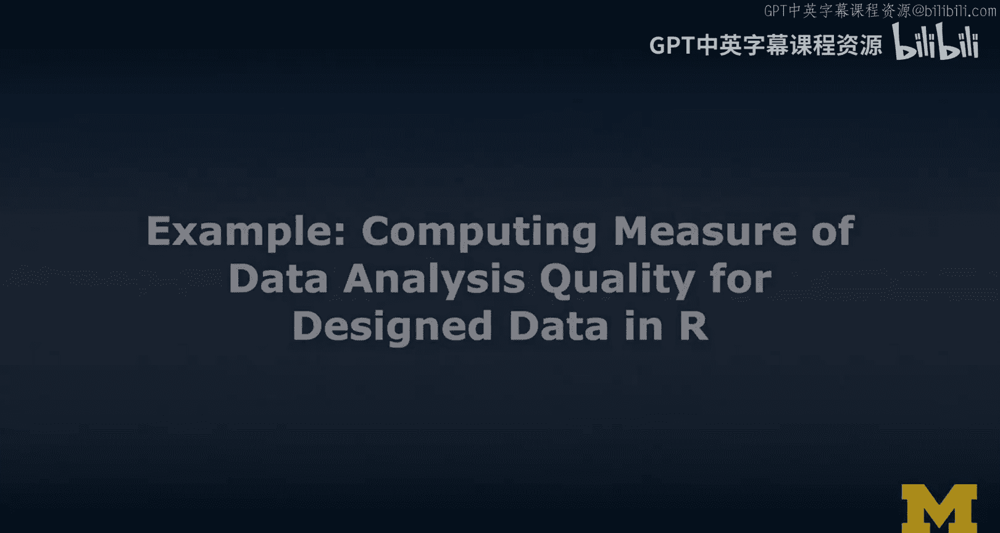
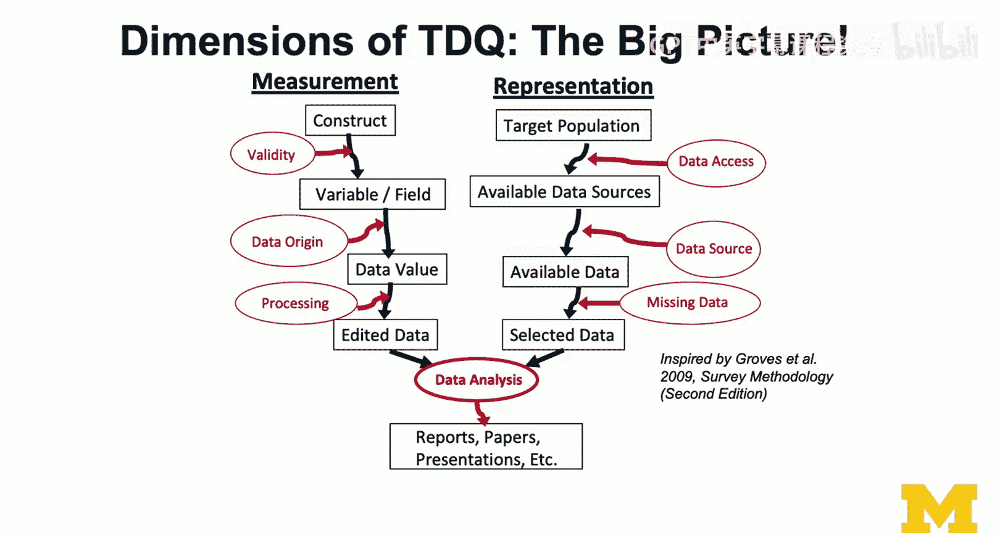
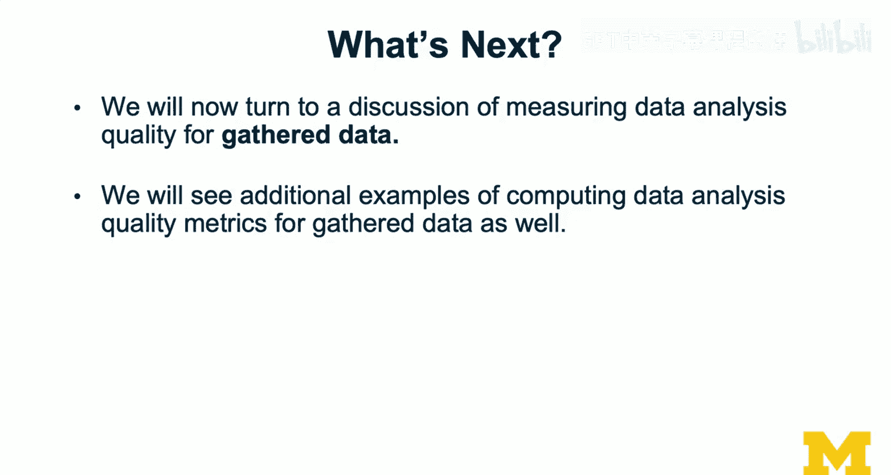

# 密歇根大学《总体数据质量（框架、度量、设计策略）total data quality》 p70 26_示例：R语言中设计型数据分析质量指标计算.zh_en -BV1Jn4y1X7uS_p70-

Okay， hello everyone， welcome now that we've talked about some different techniques for assessing the quality of our data analysis when it comes to design data。

 we're going to look over some examples of how to compute some of the measures that we were discussing within the R software。

So back to our big picture， in terms of the total data quality framework， again。

 our focus right now is on best practices and evaluating the quality of the data analysis that we're performing in preparation for again the reports。

 papers， presentations that we'd ultimately like to write or go over with our colleagues。

 we want to make sure that just because we've paid careful attention to quality along the other six dimensions of total data quality that we don't slide at this point of data analysis。

 we're going to see some examples of how to evaluate this with respect to design data within our right now。

So we talked about this notion of variance inflation due to weighted analysis of survey data。

 so recall that the use of survey weights and estimation when analyzing design survey data is designed to reduce bias in our estimates due to different sampling probabilities。

 survey nonresse， etc， generally a best practice to use those weights to make sure that we're fixing up some of those biases that often come with survey data。

However， the use of weights and estimation can also inflate the variance of our weighted estimates。

 affecting inferences， like we talked about in the previous lecture。

 So the more variable that the weights are， the larger the inflation in the variance of the estimates will be if the weights aren't correlated with our key variables using those weights may not be wise。

So we can compute that diagnostic measure that we discussed in the last lecture to get a sense of the maximum potential inflation in the variance of a given estimate due to weighted estimation。

 If the weights are correlated with the key variables that we want to analyze。

 there may not be as much variance inflation， which is a good thing。

 This calculation assumes that the weights are not correlated with the variables of interest。

 and that's why the measure， the diagnostic measure that we're talking about here is considered an upper bound in terms of the variance inflation of our estimates。

 The higher the correlation of our weights with the variable of interest。

 the lower the variance inflation is going to be。So here's an example computation using the European Social Survey Russia Surve data file and along with this example you see an R markdown file in the materials in addition to an HTML file that we've prepared which shows the results of running that R markdown file within our studio so I'm going to flip over to that R markdown file here real quick and again you can generate this HTML file that we're seeing on the screen right now simply by running the R markdown file that we've provided with you to go along with these examples within our studios you can open up that RMD file within our studio and then knit that markdown file within our studio you'll see a button for doing that and that will produce this kind of HTML file you can also knit to produce PDF files and word documents in this case we knitted that R markdown file to produce the HTML file that you see here。

The nice thing about our markdown file is that you'll see the specific parts of the R code。

 which are called chunks set aside from the rest of the output in the display here in those gray boxes like you see here。

So the first R code we're reading in that ESS Russia data set from that website that you see here。

 then we're loading the packages associated with the tidyverse just to facilitate some data management here。

 and we're loading the survey package， enabling the analyses that we're about to demonstrate。

 and then we get to our initial computation of this diagnostic measure。

 So remember this diagnostic measure for variance inflation due to weighting was taking the coefficient of variation of the weight squared and then adding one So what this R code is doing here。

 you see we're taking the standard deviation of the final survey weight in the Russia data frame and we're dividing that by the meme of that final survey weight in the Russia data frame and then we're squaring that ratio。

 we're squaring the coefficient variation and then we're adding one。

So then in the output that you see here generated by our markdown， you can see that that value is 1。

347 roughly。 So if we go back to the slides here， our interpretation would be that at most the use of these survey weights and estimation will inflate the variance of a weighted estimate by 35% or 1。

35 times So this is a multiplicative inflation factor for the variance of our estimate。

 So this is an upper bound in terms of how much the variability in those survey weights is going to inflate a descriptive estimate based on the ESS Russia survey data。

 So in general， this type of variance inflation would be considered relatively minor。

 this is a quite reasonable value。 if you see a 1 plus squared coefficient variation value that gets to be like 5 or 10 or something larger than that that's suggesting that the variability in the weights may be overwhelming any reductions in bias in an estimate due to the use of weights and estimate。

And then using the weights and estimation may be a bit questionable so for larger values。

 we would want to carefully assess how much our estimates are shifting when using the weights， again。

 calculating weighted estimates with the weights on。

 and then comparing those to unweighted estimates with the weights not being used in your actual estimation。

Another technique that we talked about for assessing the quality of a given analysis of design data is whether or not we need to use those survey weights when fitting regression models of interest so now we'll consider an example of formally testing whether accounting for survey weights is necessary when fitting a regression model to design survey data when we're interested in looking at relationships between variables So we're going look at that example in the R markeddown code and that HTML output that we were looking at from today for the details of this kind of analysis right so let's turn back to our HTML file。

And another nice thing about our markdown that you can see here is that you can intersperse notes and information that others can read about the analysis that you're conducting so you can mix the R code。

 these chunks of R code with actual text that explains what you're seeing in the R output and you can see that in the our RMD file that we've provided for you to open within our studio。

Okay so we're going to see how to test the need for using survey weights when we fit a regression model and the first thing that we're going to do this first chunk of our code here is to create an index of overall satisfaction with life in the ESS Russia data set So to do that。

 we're actually using the mutate function， which is part of the tidyverse group of functions that can be used for data management so what this code is saying is that we're taking the Russia data frame object and then you see what's called a piping operator that percent and then the greater than sign and then the percent that says input that Russia data frame object into the next sequence of functions or command and that next functions is called mutate So we're submitting that Russia data frame object to this mutate operation and what we're doing is we're creating a new variable called overall S which is the sum of the variable STF life STF Eco and STF gov like in a measure of overall satisfaction in the ESS Russia survey data。

And then we're storing the results of that operation in the data frame object called Russia。

 so basically we're overriding the Russia data frame with the results of this operation。

 adding overall set to our Russia data set。Next， what we're going to do is declare the key features of the European Social Sur sample design。

 those final survey weights， those stratum codes that reflect the sampling procedure used and those cluster codes that reflect the sampling procedure used。

 Remember where the cluster sampling tends to inflate the standard errors of our estimates。

 We're going to declare all of those key design features of the sample design in a new design object called Russia DSsgm。

 and this is using a function that's available in that survey package within our that we just loaded。

 this is just to declare the features of the sample design so that we can account for those features when we're actually analyzing the survey data from Russia。

 Once we declare that design object， and you see that we're doing that here。

 we're using the sVy design function within the survey package。

 We're declaring those PSU codes as this Is argument。

 That's where we indicate the PSU or the cluster codes。 We're declaring the stratum codes。

 which are in the variable called stratify to。The strata argument after a till day。

 the data frame object is called Russia。 and we're using that data frame object where we just added that overall set variable。

 We're saying that those sampled clusters are nested within the strata。

 which is common in these types of sample designs。 And then here's where we declare our final weights。

 There， the weights argument is saying PSP weight are our final weights。

And after we declare this object called Russia do DsGM。

 we can then look at a descriptive summary of the design information that we just specified。

 And so in this H file that was generated by running or knitting that dot RMD file within our studio。

 you can see that overall summary of the design here。 You see how many clusters we have。

 We see eight different strata indicated in the E SS Russia sample design。

 And then the names of the variables in the actual data set that we're working with。

 So there's a lot of information contained in that Russia dot Dsg design object。

 And we're going to keep referring to that design object when we go through this analysis。😊，Okay。

 so the first thing that we're going to do is fit our regression model to the ESS Russia surveyve data set fully accounting for those design features。

 and to do that we use the SVY GLM function contained within the survey package that we loaded。

 so this is another function that's contained within that survey package that we loaded with that required statement earlier。

So in SVy GlM， we're saying that our dependent variable of interest is overall satAT。

 That variable we just created on the lefthand side of a tillday and our predictors are going to be the age of the survey respondent。

 the marital status of the survey respondent， which is declared to be categorical in this regression model。

 we do that using this factor function。 and then this indicator variable of whether or not the respondent was a male or10 variables。

 So those are three predictors of overall satisfaction with life。

 and then after we specify the model， we indicate the name of that design object。

 we just created that design object contains the data， and it contains those design features。

 the weights in the survey data set， the stratum codes in the cluster codes for this kind of analysis。

 we make sure that we're fully accounting for all those features， including the weights。

 So we can use this sY GlM function to fit the model and then we're going to save the results in this new object called fit serve。

 And then we can use the summary function with that fit serve object to look at the。😊。

In our regression model， and that's the next set of output that you see here in the HTML file。Okay。

 so these are the estimated coefficients for our target population in the based on the ESS Russia survey data set because we use the weights in estimations。

 so you see our estimated intercept in the regression model and then the estimates of the coefficients for all the other predictors that we included this model。

 and we also see indications of whether or not those coefficients are significantly different from zero。

So this approach that we just went through yields design unbiased。

 So based on the sample design that was used for the ESsS。

 these are unbiased with respect to that sample design estimates of the regression coefficients due to the fact that we're using weights to fit this model。

 In addition to their standard errors。 You can see those standard errors in this standard error column here。

 This is generally best practice Again， fully accounting for all these design features used for the sampling in estimating our coefficients of interest。

 However， like we talked about in lecture， when we fit these regression models to design survey data。

 the use of weights and estimation may not be necessary if we've done a good job specifying that model。

 and we've captured these relationships between age and marital status and mail in the target population。

 In these cases， the use of weights may simply inflate the variances of our estimated coefficients。

 and this makes it harder to test the coefficients for significance。

 And this tends to reduce our statistical power。 So we can test for the need to use weights by declaring。

A new design object， which ignores those weights， an estimation。

 so notice now we're again using that SVY design function， same cluster codes。

 same stratum codes defining our sample design， but now instead of declaring the weights variable。

 we're just declaring a one after the tillday。 And that means that everybody in the data set just gets a weight of one instead of the weights that we're in that variable to begin with。

 everything else is specified as the same， we still need to account for the cluster sampling and the stratification in terms of our overall variance estimation。

 but I'm saving this new design object in a new object here called Russia do Dsgn do no Owgt。

 So to indicate that this is a different design object where the weights have been ignored。

 then I can look at a summary of that no weight design object。

 And you can see that our is interpreting all of our probabilities of selection as being one this is an equal probability of selection design where weighting is not necessary because those weights are being ignored。

😊，elsel is the same。Okay， so then what we do is we refit our model of interest， ignoring the weights。

 So this command looks exactly the same S PY GlM function。

 but now we're using that different design object， Russia do DSsgn do no weight。

 and we're saving the results of that model fit in a new object called fit doserv no weight。

 And then we're applying the summary function to that new object here。

 So now we see our new set of output， the estimated coefficients， their standard errors。

 and again test of significance。And looking at this output。

 we see that the estimates and our conclusions based on our conclusions about the relationships。

 based on these estimates would be quite similar to those based on the fully weighted analysis。

 the coefficients look very similar。 So the question is。

 is the use of weights and estimation telling us anything about our coefficients of interest or is the use of weights only inflating those standard errors。

 So to formally test the need for the weights。We add the final weight variable as a predictor to the unweighted model。

 So notice in the model specification， we're now adding the weight as a predictor。

 And then we're also adding these two weight interactions between the final weight variable and each of the other predictors。

 So the weight times age， the weight times the categorical marital statusfactor and the weight times male same specification otherwise。

 we're just adding the weight and these two weight interactions to that full model。 And again。

 we're using the no weight or unweighted design object here to fit that model。

 Then after we fit that model， we perform a walled test。 and we can do that using reg term test。

 which I'll come back to in a second。 But here are the estimated coefficients in this model。

 adding those predictors representing the weight and then the interactions of the weight with each of the other predictors that we're really interested in。

 So if any of these new coefficients werere significant。

 that would suggest that the weight is either changing the value of the inner。😊。

if this weight coefficient is significant or that the weight is changing the relationships of our predictors of interest with the outcome。

 which means again， that the weight is informative about our coefficients of interest。

 And looking at these P values here， you see that none of these additional coefficients involving the weights really seem like they're significant so those ratios of the coefficients to their standard errors are all pretty large。

 So we can do that overall walled test for those additional terms that we added to the regression model by using this reg term test function。

 which is also available in the survey package。 So to use re term test。

 we take our model fit object which included those additional weight predictors。

 And after a comma and a till day， we simply indicate the names of those additional predictors。

 the weight， the interaction of the weight with age using a colon。

 the interaction of marital status with the weight using a column and then the interaction of the weight with male that will give us an overall test of the null hypothesis that the。

Coefics of those additional weight terms are all equal to zero。

Meaning that the weights are unnecessary。 so here are the results of that walled test。

 And you can see that the P value for that walled test is about 0。253。

 So what that means is that we would fail to reject the null hypothesis that all those coefficients are different from 0。

 And what that means is that the weights aren't changing the estimates of the coefficients in our model。

 All they're doing is inflating the variance of those different estimates。

 So the use of the weights in the analysis in this particular example does not seem to be necessary。

 If that p value is really small， close to 0， less than 0。05 to say。

 then that suggests that the weights are in fact， moderating some of our coefficients in this particular model。

 and we would probably want to keep the weights and account for the weights in our estimation because they are informative about the regression coefficients of interest。

 so in this example， it seems like we've done a good job of specifying our regression model。

 we've captured the relationships well and we don't really need。

To account for those weights in the overall estimation。Okay。

So walking through that example in our markdown， we see that the use of weights was not necessary when fitting this particular model。

 and this is always a good test to consider to make sure that you're not computing inefficient estimates。

 estimates with too much standard error， again due to the variability in the weights。Okay。

 so now that we've seen examples at looking at these measures of quality in terms of the analysis of design data。

 we're going to turn to a discussion of measuring data analysis quality for gathered data and in that discussion we'll see additional examples of computing data analysis quality metrics for gathered data as well that we can think about so thank you。

