# 密歇根大学《总体数据质量（框架、度量、设计策略）total data quality》 p71 27_采集型数据分析质量测量.zh_en -BV1Jn4y1X7uS_p71-

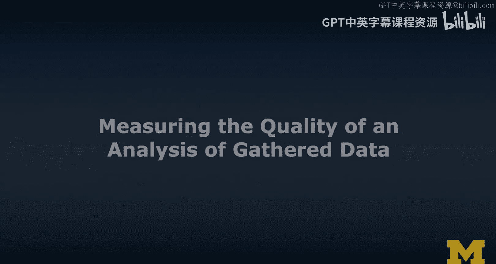

Hello， welcome to our lecture on measuring the quality of an analysis of gathered data。

 I'm Trenm Buskirk。 Thanks for joining us。 As we do in all the lectures。

 We want to make sure that everybody's on the same page with where we are in our framework。

 And so here we're going to focus on the data analysis portion of the framework。

 and we're going to pay a close attention to data analysis quality for gather data。

 Many types of gathered data fall into what we call big data with many cases。

 Many variables or combination of the two to understand so-called signals in these data sets。

 we often have to employ flexible nonparmetric methods generally referred to as machine learning methods or machine learning models。

 These machine learning methods or models， are nonparmetric。

 meaning that they don't require an a priori form specified by the user before the model is run。

 They also don't rely on a particular distribution family like the normal distribution assumption or Poisson distribution assumption or etc ceter。

 So they are a bit more flexible and can adapt。😊。

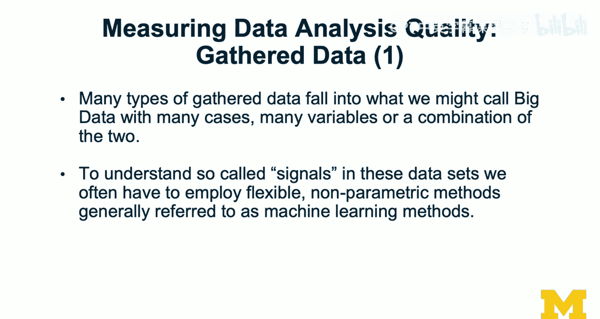

To the complexity of the data that you have at hand。 According to Wikipedia。

 machine learning is the scientific study of algorithms and statistical models。

 the computer systems used to effectively perform a specific task without using explicit instructions。

 i。e。 format of the model， distributional assumptions， etc cetera。

 and rely on patterns and inference instead， it is seen as a subset of artificial intelligence。

 machine learning algorithms build a mathematical model of sample data。

 which we call training data in order to make predictions or decisions on new data。

 which we would often refer to as test data without being explicitly programmed to perform the task。

 So therein lies the flexibility， and the ability for the algorithms to adapt and not have to be preprogrammed or decisions have to be made a priori about the format of these models。

 while the machine learning models can process large amounts of data in order to develop a prediction。

 There are several steps in an analysis should take prior to building such a model to ensure that the overall analysis is of exception。

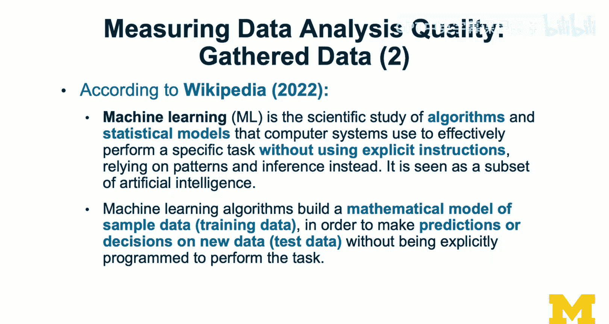

Quality， and these include examining breadth， completeness of your sample by breadth completeness。

 Well， you mean determining whether or not you have the right predictors for your analytic goals。

 Are there key predictors missing altogether from your data。 In that case。

 we would say that the breadth completeness is low。

 If you haven't included all the predictors that you think might be important for explaining or predicting a particular outcome that you care about。

 We also encourage analyst to examine how colon your predictors are。 In some instances。

 Col predictors may impact the accuracy of certain derived measures like variable importance。

 We also encourage an analyst to ask whether or not any of the variables have near zero variance By that。

 we mean the variability in the measure that then the values that you've captured for particular variable just aren't highly variable。

 In other words， one variable you measure all zeros。

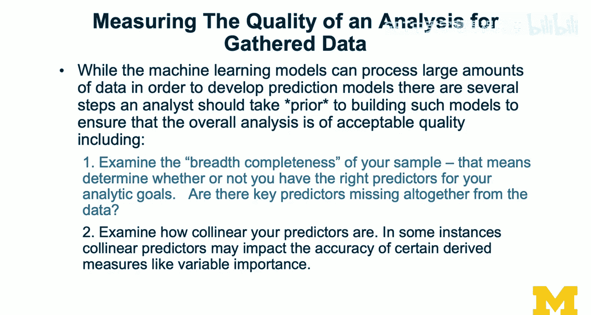

And 1，1， that variable doesn't really have a very strong signal with respect to the outcome。

 because almost all the cases have the exact same value。

 That variable would be deemed near zero variance。 It would be very unlikely that such a variable could be important in an overall prediction model。

 So in those cases， if we find such variables。 Have you excluded them from your analysis。

 What is the process by identifying near zero variance variables。 There are different cutoffs。

 One could use for making that determination。 All of those things are important considerations in this step。

 We also encourage analysts to ask whether or not the variables are standardized so that no one variable with a large range may dominate the modeling process。

 This is particularly important if you' are going to use unsupervised learning techniques or you're trying to segment or cluster the overall population。

 for example， And standardized measures really refer to continuous or ordinal variables and not to nominal variables like。

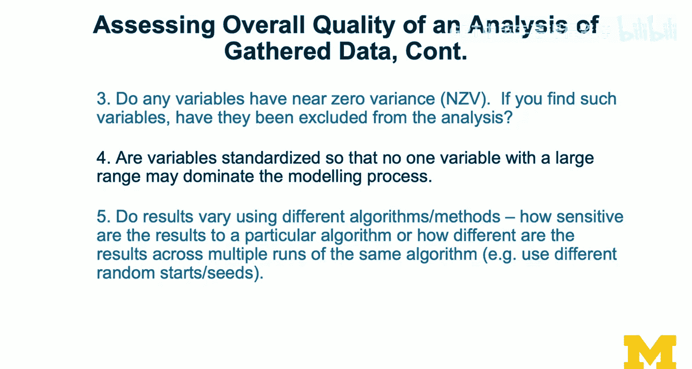

Gender or race。 Finally， we would encourage analysts to ask the question about whether or not results vary using different algorithms or methods。

 if I use machine learning method 1 versus machine learning method 2。

 do I get highly different predictionctions with respect to the outcome that I care about。

 This is sort of akin to a sensitivity analysis that one might do。

 How sensitive are the results to a particular algorithm that I've selected。 Now， obviously。

 some algorithms are better than others at making predictions。

 So one would have higher prediction accuracy than another algorithm。 But generally speaking。

 if you see consistency across algorithms， This gives you a better sense that your selection of algorithm is is not driving the overall results。

 But in fact， the variables in the patterns that are detected by such algorithms are driving the results。

 Machine learning models are used for both classification and regression tasks with gathered data。

 classification tasks are whether or not you want to predict。

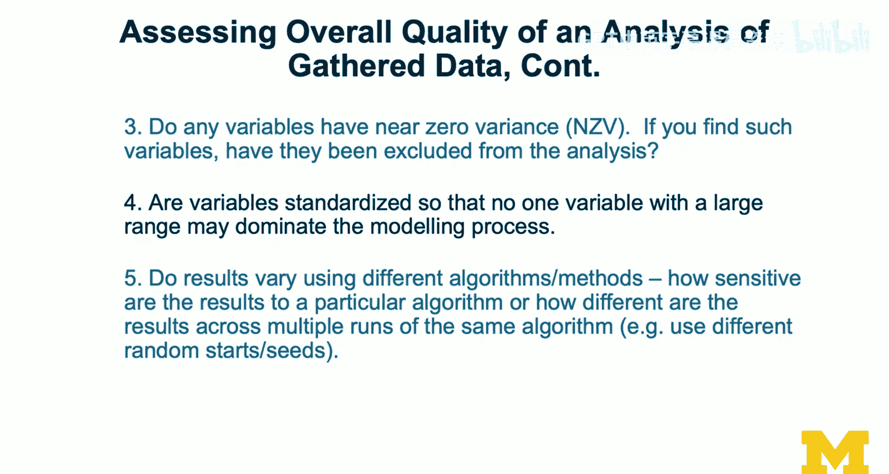

A 01 category， for example regression tasks are whether or not you want to predict some continuous outcome。

 for example。 So for classification tasks， my outcome is categorical in nature。

 we may use metrics like percent correctly classified or accuracy We may also use measures called true positive rate or sensitivity or true negative rate also referred to as specificity or the area under the receiver operating characteristic curve or auc for short for regression tasks where my outcome is a continuous variable。

 we would typically use mean squared error as a metric for model accuracy or model performance an accessible overview and introduction to different metrics used to evaluate models for gathered data within the social science context can be found in a couple of these references。

 which we provide is suggested readings for this particular lecture to evaluate the quality of a model constructed with gathered data。

 we typically rely on using。

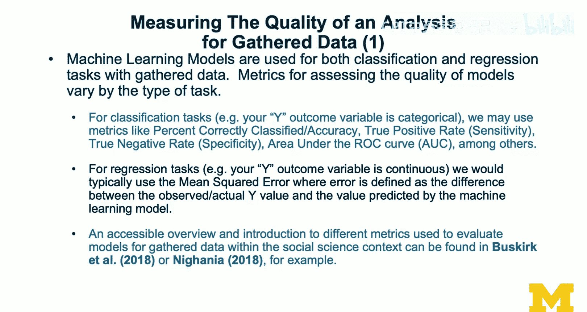

A test dataset set at a minimum， we would randomly split the overall gathered data sample into two parts。

 A majority of the data would be used for the training data to actually create the model。

 the remaining data would be used as a separate kept separate from the modeling process and used as a test for the model metrics for measuring model performance or computed comparing the actual values of cases in the test dataset to those that are predicted using the model that was computed based on the training dataset for classification tasks。

 we would typically create what we call a two by two matrix or specifically confusion matrix using the observations in the test set computationuts of model performance metrics are then derived from summary information that is included in the confusion matrix itself。

 So， for example， let's suppose that we had a binary outcome and the confusion matrix is a cross tabulation of the predicted outcome versus the actual outcome。

 So in this case the。

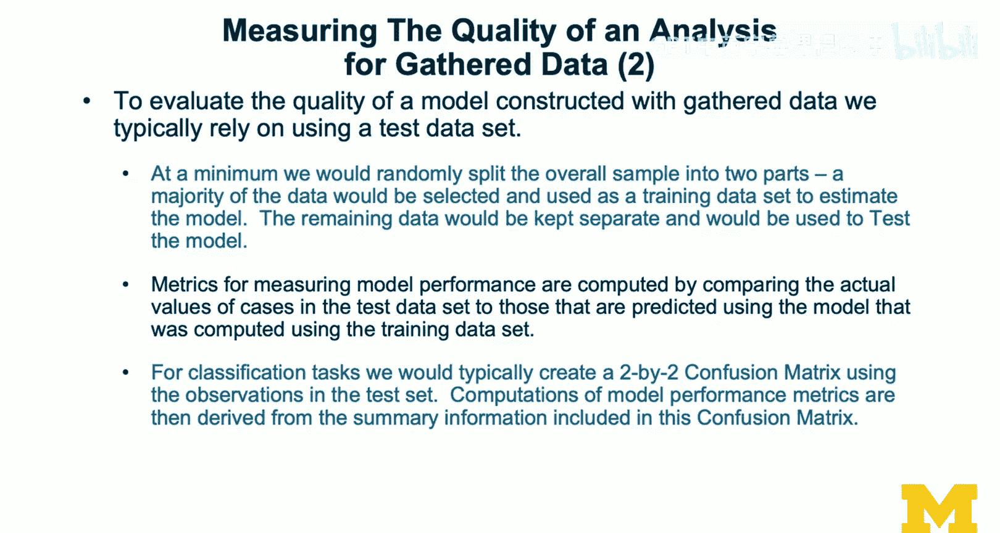

Those represent the predicted classes， No or yes，0 or one。 The columns represent the actual classes。

 No or yes， in this diagram， the items on the main diagonal highlighted in green are the T。

 N and T P。 Those represent the true negatives。 and the true positives。

 The true negatives are measured by the specificity。 That's called the true negative rate。

 it's the proportion of all false values or0 values that are predicted correctly to be false by the model。

 the bottom right cell of the confusion matrix， is what we refer to as the true positive cases that is quantified by the sensitivity metric or the true positive rate。

 which is the proportion of all true values that are predicted to be true by the model。

 because gathered data is not designed。 It may have inerctionions in representation。

 Both in terms of。😊。

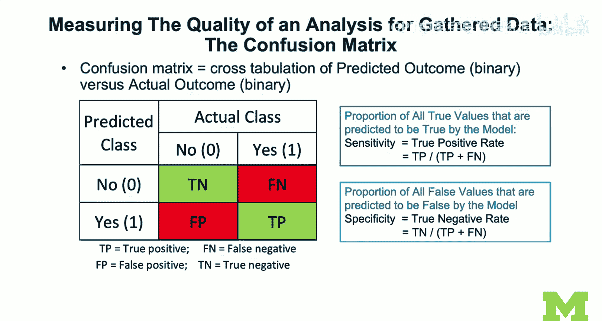

Target population， but also in terms of representing the actual concept to be measured or modeled。

 models derived using such data may inherit so-called algorithmic biases and may not fairly represent risks or other modeled outcomes equally across protected classes like race or gender fairness in machine learning models is assessed using a growing number of metrics such as representational parity and false positive parity or each group has equal false positive rates。

 Cerio and colleagues in 2019 describe a host of fairness metrics used to evaluate machine learning models。

 and they also discuss a a new toolkit for automating this evaluation。

 It's important to note here that models can be evaluated not only for their accuracy。

 but also for whether or not they are fair or whether or not they are bias。

 So these are important dimensions of overall assessment of machine learning models that are grown or that are developed using gathered data。

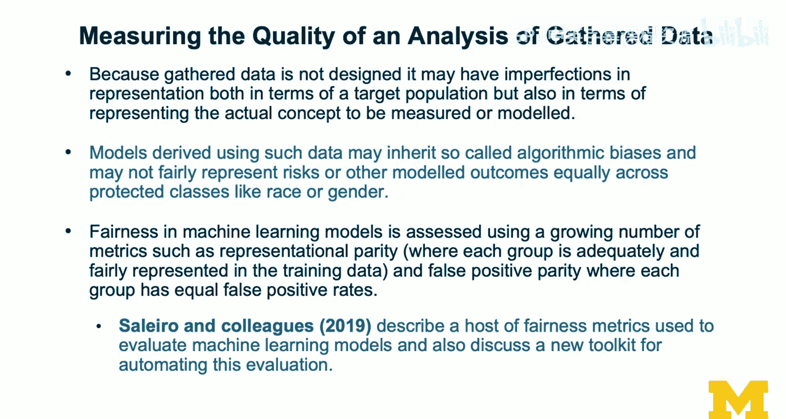

Coming up next， we're going to go through an example of computing three measures of model performance using gathered data。

 We'll then give you the opportunity to explore a new resource for helping to evaluate the fairness in machine learning models。

 Thanks so much for joining us。 We look forward to seeing you in the example。😊。

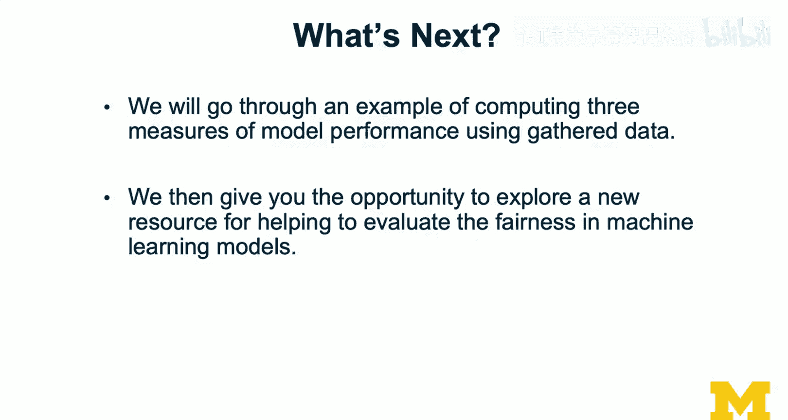

