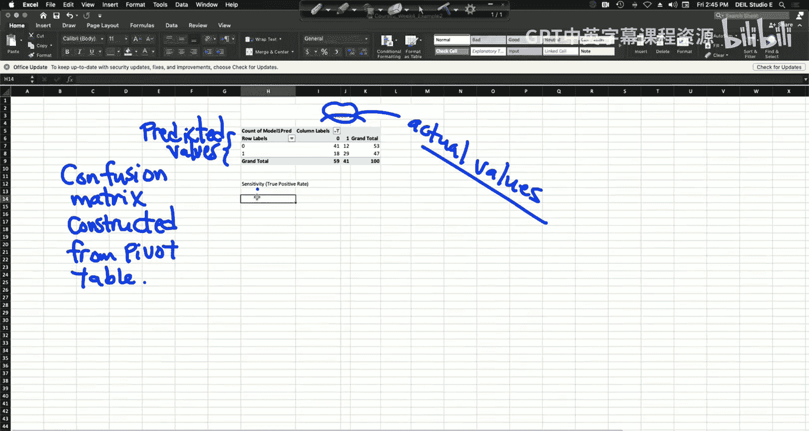

# 密歇根大学《总体数据质量（框架、度量、设计策略）total data quality》 p72 28_示例：采集型数据模型质量指标计算.zh_en -BV1Jn4y1X7uS_p72-

Hi， I'm Tm Uskirk， welcome to our example where we're going to be looking at measuring the quality of an analysis of gathered data。

Hopefully you just were able to see the lecture on how we measure the quality of an analysis of gathered data where we introduce metrics。

 sensitivity， true positive rate， specificity， true negative rate we talked a little bit about how machine learning models can be useful with gathered data and now we're going to walk through a specific example where we're going to calculate confusion matrices and then derive some of the metrics that we've already discussed in the previous video so for this particular example。

 we're going to make use of data that has already been modeled so we have three different machine learning models that have been applied to a data set to predict whether or not a student is going to drop out of a course。

 so our outcome measure is zero or one so zero represents no dropout from a course and one represents dropout from a course so we have a binary outcome variables so we're going to be looking at classification models to predict whether or not a student has dropped out of a course。

That we're using are based on a training data of 2000 cases。

 using administrative record data from the university that included information from various demographic and academic variables that you see here。

 So things like gender race class whether you're freshman sophomore etc the current credit hours that one is taking your cumulative GPA。

 the major college that you're in and then if you've had any prior drops if you dropped a class before the number of hours with a B or better that you've completed in your degree program and then whether or not the student lives on campus or elsewhere So these variables went into the machine learning models。

 so we're not going to talk about how to make those models or're really going to talk about how to measure the quality of them So we have three different machine learning models that were used with this 2000 student data and we have developed a predicted outcomes for each of those models and that is going to be under our model predicted test data tab。

We also have the actual value of whether or not a student has dropped out or not。

 we've created these models using the 2000 cases as part of our training data。

 And we're now going to evaluate the model quality using a test data set that has 100 students that we've kept out。

 So essentially， we have data from 100 students that are in our test data set。

 We've applied each of these three machine learning models to create predicted values for each of these 100 students。

 and the predicted values are either 0 or one。 We predicted they do not drop out or we've predicted they do drop out。

 So let's take a look at the data under the model pres test data tab。

 You'll see here that these are just the I D numbers of the students。

 You'll see there's 100 of them in this file。 that represents the00 students in our test data set。

 The column B is labeled dropped out。 That's the actual value， the true value。 So if it was a0。

 it means that the student。😊。

Did not drop out of the course， if it's a one， it means that the student did drop out of the course using the administrative records on file for the school。

Model 1 predicted values are included in column C。 again。

 a0 here represents that the model predicts that the student did not drop out If you have a one in this column。

 it means that the model is predicting that a student is dropping out same thing for model 2 and the same thing for Model 3 So remember in the previous lecture we talked about how analysts might be recommended to see how consistent results are across many different models using the same data。

 This is kind of an example in that regard here。 I've got three different models that I've run predictions on。

 I'm interested to see if there's a clear winner among these three。

 I'm also interested to see how consistent the model performance is across these three different models。

 I might look to choose the model that has the highest level of accuracy or the highest level of sensitivity or specificity among the three models that are available to me。

 So being able。

To assess the model quality of an analysis with gathered data is really important。 So in this case。

 the analysis has been completed。 The goal of that analysis was to make predictions of whether or not you're going to be a dropout student or you're not going to drop out。

 So now we have these predictions and using these along with the true value that we know to be accurate from the administrative records。

 We are going to figure out an assessment of the model analysis quality。

So specifically， let's go back to the first tab。 We are going to look at So what we want to do in this example is we want to use the predicted classes for each of the three models。

Along with the true values that are in the dropped variable column。

 we want to estimate the overall accuracy of each of the models。

 the true positive and true negative rates， based on the 100 student test data。

 We're going to do this by computing a confusion matrix for each of these models and then we'll use these matrices to derive these model quality metrics。

 So I'm going to walk you through how to do this for Model 1。

 you'll be able to reproduce what I'm doing for models 2 and 3。

 I'll go over some solutions with you and we'll talk about how to interpret these metrics as well as use them to make decisions as to what model we might want to use。

 So let's begin。 Now that we've sort of familiarize ourselves with the data。 We have to go back。

 Now we're going to create these confusion matrices。

 Remember that the confusion matrix for a binary outcome is a two by two table。

 The rows of the table are the predicted values from a particular model。😊。

The columns of the table correspond to the actual values that we have from the administrative records going forward。

 So in order to do this， we're going to insert a pivot table and we're going to create the confusion matrix from there we'll be able to calculate the metrics that we are talking about for this example。

 So first， what I would like to do is just set this up so that we can label our spreadsheet a little bit so everybody knows where we are。

So I'm going to call this little area model 1。 and this is going to be our area to work on metrics for model 1。

 So now what I'm going to do is I'm going to insert a pivot table。

And I'm going to go back to my original data to be able to pull all of these。Variables in。

And now I'm going to click O， and I'm going to insert。 And there's a pivot table that's here。

 And now what I need to do is actually fill the pivot table or create the confusion matrix。

 So this is where we are going to make the confusion matrix。

It will be constructed from the pivot table。So the rows are going to be our predicted values for Model 1。

 Remember， this is the Model 1 area。 So I'm going to go over here to the pivot table fields。

 and I'm going to move。 I'm going to grab。 I'm going to grab the pivot Model 1 predicted values。

 and I'm going to pull it down to be the rows of the table。And then for the columns of the table。

 I want to use the drop out variable。 That's the gold standard variable that we have。

I'm going to pull that in as the columns。The rows are the Model 1 predicted values。

And I'm going to remove the planks。So I'm not going to include blanks， we don't have any blanks。

 so this is just going to simplify things here。And now I have to populate this table。

 so I'm going to pull in the Model one predicted values and I'm just going to put this in as the values category and I want to choose this as the count。

So I'm just counting up the records that correspond to each of these areas。

So now what you will see is that there are 41 cases that the model predicts are a0 or non dropout。

That are actually non dropropouts。There are 29 cases where the model predicts that they are drop out and they are actually drop out。

 So remember the rows of this table。These are the predicted values。And the columns of this table。

Are the actual values？So now I want to create the metrics， so let me set this up。

We will now calculate the。Sensitivity。Which is the true positive rate。

We'll also calculate the specificity。

Which is the true negative rate。And finally， we'll calculate the overall accuracy。

Which is the overall correct classification rate。 So one。

 one thing to note here from the notes from the last lecture。Is that if we have a confusion matrix？

Where we have values。sayWe call these cells A， B， C， and D。

The sensitivity or the true positive rate is the。This is the these is the correct。

 These are the correct classifications from the a model。 they predict to be one。

 and they are actually a one。 So this sensitivity。Would be the ratio of D。

 which is the number of values that the model predicts as a one。

Over the number of actual ones that we have in the data set。 So this would be B plus D。

And the specificity。Would be calculated similarly， but were focused now on the negative values or the non dropouts。

 So this cell would be the correct decision， right that the model is predicting that these are not drop outs among those who are not dropped out。

 So the specificity is the ratio of the correct Lee classified non drop outs divided by the total number of non dropouts。

So knowing this， we're now going to plug in these formulas over here to calculate these values。

 so let's come back over here。And now we'll just create a cell that will say this will be equal to。

The D element， which is right here， this 29。Divided by。

The sum of the first two of of this of the column of ones。 So this。Plus。This value。And hit Richard。

And the specificity would be calculated similarly， but we're focusing on the column of zeros。

 So this would actually equal。This。A cell here。Divided by the sum of the a cell。Plus。The C cell。

The accuracy。Is the overall number of cases that were correctly classified。

 divided by the total number of cases that we have in our test set。

So correct classifications are again along the main diagonal， 41 is a correct classification。

 We'll highlight that in green。29 is a correct classification。 We'll highlight that in green。

 So the accuracy is simply。The sum of the correctly classified units。

 whether we're classifying you as as a non drop out。Or as a dropout。

Divideed by the number of elements in the test data set， which in this case is 100。

And we get an overall accuracy of 70 per cent。 So the true positive rate is 70 per。

70% of the actual dropouts were correctly identified by this model as being a drop out。

 Almost 70 per of the non dropouts were also correctly identified as non dropouts by this model。

By virtue of this specificity score of just shy of 70。

So this gives you an idea of how to set this up for the first model。

 You can do the exact same calculations for models 2 and 3。

 using the exact same procedures that I've just talked about here。 If you take a moment to do that。

 you can check it on your own。 by what we see under the next tab。

 which is confusion matrices and metrics。 And you will see that I have a confusion matrices for the first model。

 the second model and the third model here。 And you can see that the statistics are also calculator these metrics are also calculated for each of these models。

😊，And finally， in the solutions tab， and and also one thing to note here is you'll be able to see the formulas that are displayed here so that if you get stuck along the way。

 the formulas are provided for you for each of these steps so you can recreate what I've done for for Model 1。

 for models 2 and 3 on your own。😊，Finally， I've organized the solutions here with the exact calculations that I would do by hand showing you exactly how these confusion matrices were interpreted or used to identify elements of each of the formulas that we've already gone over so if we take a step back and the accuracy of the first model would say that about 60% of cases in our test data were correctly classified as either a dropout or a non-dropout。

83% of cases in the test data set for Model 2 were correctly classified as either a dropout or a non dropout。

 and finally， 71% of the cases in our test data set under Model 3 or predicted accurately to be either a dropout or a non dropout。

If we look at the sensitivity， again， this is the true positive rate， so among the dropouts。

 Model 1 was able to identify 71% of them as dropouts。

Model 2 was able to do that for 78% of the dropouts。

 and Model 3 was able to do that for only 59% of the dropouts。 Finally， if we look at specificity。

 this tells us that Model 1 was able to identify 69% of the non dropouts as non dropouts。😊。

Model 2 was able to do that for 86% of the non dropouts。

 and Model 3 was able to do it for 80% of the non dropouts。

If we think about these three measures of data analysis quality for gathered data and we take it a rather holistic view rather than focusing on a single metric。

 I might want to look at whether multiple metrics are giving me the same message It looks very clear to me if I look at these metrics on every single metric accuracy。

 sensitivity and specificity， Model 2 is better than either Model 1 or Model 3。 Given that scenario。

 I might very quickly say that Model 2 has the highest level of measured quality for the analysis of this gathered data compared to either Model 1 or model 3。

 So I might choose Model 2 as the final model that I would move forward in reporting。

 I hope that this example has clarified some of the calculations around the metrics that we could use for measuring the quality of an analysis in。

😊，Data， I encourage you to work through this example yourself and and make use of the formulas and the solutions that are provided here to help you make sense of these metrics and for you to be able to compute some of them on your own。

 Thanks for joining us through this example。 I hope that you learned a lot。

 Looking forward to seeing you in our next segment。😊。

