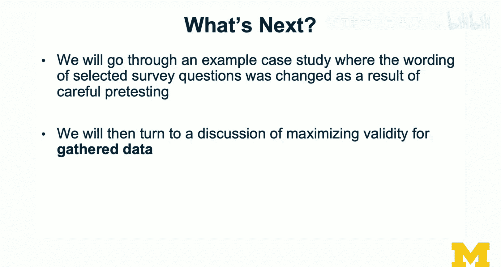
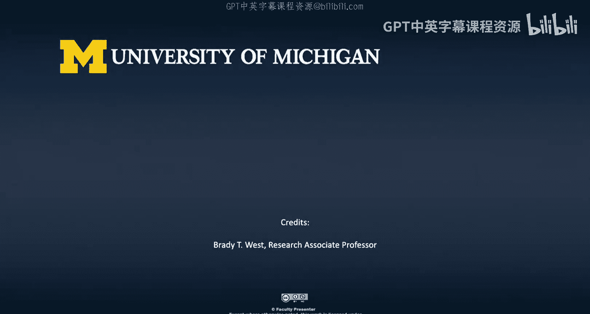

# 密歇根大学《总体数据质量（框架、度量、设计策略）total data quality》 p74 1_最大化设计型数据的效度.zh_en -BV1Jn4y1X7uS_p74-

Okay， hello， everyone。 Welcome again to course 3。 where're now we're going to turn our attention to maximizing total data quality。

 So we're going to talk about strategies for maximizing data quality along all the dimensions of the total data quality framework。

 And in this lecture， we're going to start with maximizing validity specifically for design data。

 So let's revisit our big picture again now that we're in the third course on and how to maximize data quality。

 Again， we have the measurement and representation sides of the overall TDQ framework。

 And we're going to start with our first measurement dimension when thinking about how to maximize quality specifically validity。

 as we go from a theoretical construct to the actual variable or field that we're attempting to work with。

 So when we think about design data specifically， what are some strategies that we can use to max validity。

 Well， first of all， we need to think about careful pretesting of questionnaires。

 This is an essential means of checking for the comparability of items。😊。

AndThe validity of indicators of constructs for design data specifically。

 and we've referenced a couple papers by Casper and colleagues and Stanley Pressser and colleagues in 2011 and 2004。

 using different pretesting approaches。 So， for example， cognitive interviewing。

 which allows people to think out loud about the questions that they're answering for different groups of non-native speakers that are tailored to communication styles and cultural norms is also very important。

 this is in a report by pan and colleagues in 2010。 So again。

 very important to keep in mind the cultural diversity of the population that you're attempting to survey when we talk about design data collections and making sure that your pretesting approaches are prepared for those different groups who may in fact。

 be non-native speakers。 So question pretesting is definitely not one-s fits all and you need to take that into account when thinking about different pretesting approaches。

 So recall our example， cognitive interview with Andrew Capparazso。

In the first course of this total data quality specialization。

 remember that was in week two of the first course there are many different approaches that one could use to conduct cognitive interviewing。

 The essential idea is to carefully pilot test a questionnaire。

 whatever combination of approaches that you're using before you ultimately put it in the field no matter how simple you think that question that web survey might be。

 it's essential to carefully pilot test that questionnaire on a representative set of people who might ultimately be responding to that questionnaire with cultural diversity in mind So carefully pretesting with a representative subgroup of persons from your population will ensure that you're maximizing the validity of your survey measures and you have no issues with respect to validity。

 Some strategies for maximizing validity， definitely we'd like to carefully apply question evaluation methods before fielding and instrument a very important article looking at these different possible methods is by Aaronin Maitland and Stan Presser in 2016 so。

Recall in course1 week2 again， we use the survey quality predictor to evaluate the validity of existing questions。

 This is an online database where we can look at questions that have already been written which could be included in surveys and evaluate their overall validity based on prior empirical studies Basically you want to use tools like the SQP to try to find any information that you can about the overall validity of a given question and be careful not to use questions that prior studies have shown to have low validity Furthermore。

 do not ask any questions with different measurement properties across different subgroups of your target population so recall our discussion of measurement invaris from course 2 specifically in week one where we looked at an example of testing for measurementvari we want to make sure that the same items are being measured the same way across different subgroups of our target population so performing analyses of measurement andvari on data collected from similar population。

Is a very important place to start in terms of maximizing validity。 Okay。

 so what are we going to be talking about next， We're going to go through an example case study where the wording of selected survey questions was changed as a result of careful pretesting。

 Then we're going to turn to a discussion of maximizing validity for gathered data。

Thank you。😊。

