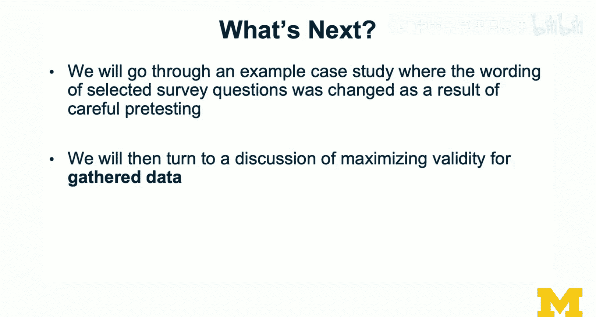

# 总体数据质量：3.1：最大化设计型数据的效度 📊

在本节课中，我们将学习如何最大化数据质量，特别是针对“设计型数据”的效度。我们将探讨从理论构念到实际测量变量的过程中，如何通过具体策略确保数据能真实反映我们想要测量的概念。

上一节我们介绍了总体数据质量框架，本节中我们来看看如何最大化设计型数据的效度。效度关注的是测量工具（如问卷）是否准确测量了它声称要测量的构念。

## 核心策略：问卷的精心预测试

最大化设计数据效度的首要策略是精心进行问卷预测试。这是检查问题项可比性以及构念指标效度的基本方法。

以下是几种关键的预测试方法：

*   **认知访谈**：这种方法允许受访者在回答问题时“边想边说”，帮助研究者理解他们的思考过程。这对于针对不同群体（如非母语者）设计问题至关重要。
*   **考虑文化多样性**：在设计数据收集时，必须考虑到目标人群的文化多样性。预测试方法应适应不同群体的沟通方式和文化规范，不能“一刀切”。
*   **在代表性群体中试点**：无论你认为问卷或网络调查多么简单，在最终投放前，都必须在目标人群中选取具有代表性的子群体进行仔细的试点测试。

精心对目标人群的代表性子群体进行预测试，可以确保你最大化调查测量的效度，并避免出现效度问题。

## 其他效度最大化策略

除了预测试，还有其他策略可以帮助我们在投放测量工具前最大化效度。

以下是一些具体建议：

*   **应用问题评估方法**：在投放工具前，仔细应用问题评估方法。例如，可以使用“调查质量预测器”（SQP）这类在线数据库，评估现有问题的效度。
*   **避免使用低效度问题**：利用SQP等工具，查找关于特定问题效度的已有信息，谨慎避免使用先前研究已证明效度较低的问题。
*   **确保测量不变性**：确保所提问题在不同子群体中具有相同的测量属性。这意味着同一问题在不同群体（如不同性别、年龄组）中测量的是同一个构念。对从类似人群收集的数据进行测量不变性分析，是最大化效度的重要起点。

## 案例研究与后续内容

接下来，我们将通过一个案例研究，展示如何通过精心预测试来修改调查问题的措辞。

然后，我们将转向讨论如何最大化“采集型数据”的效度。

---

本节课中我们一起学习了最大化设计型数据效度的核心策略。关键是通过精心预测试（如认知访谈）来确保问卷问题能准确测量目标构念，同时要考虑到文化多样性和测量不变性，并利用现有工具评估问题质量。下一节，我们将把这些原则应用到采集型数据中。