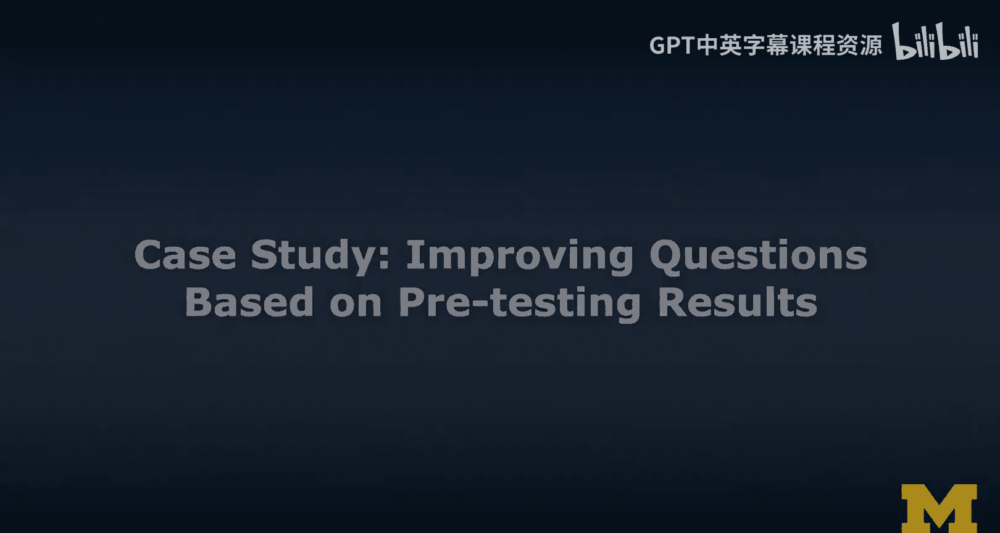
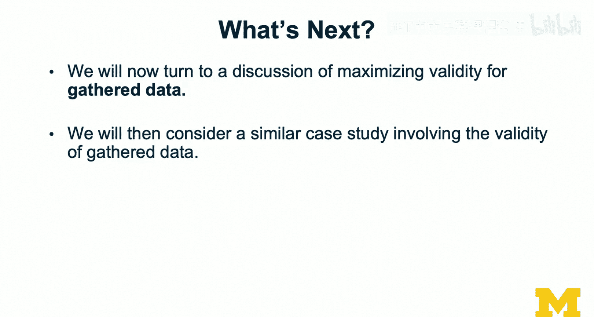
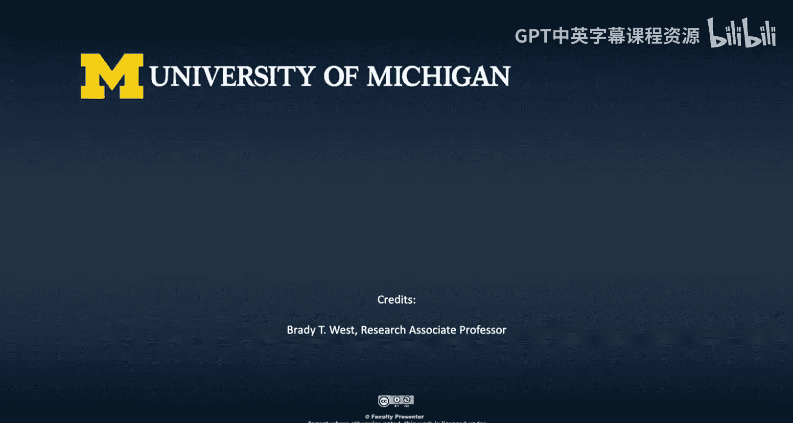

# 密歇根大学《总体数据质量（框架、度量、设计策略）total data quality》 p75 2_案例研究：基于预测试结果改进问题设计.zh_en -BV1Jn4y1X7uS_p75-

Okay， hello， so now let's turn to a case study of maximizing validity for design data。

 and what we're going to look at is improving questions based on the results from careful pretesting。

 Okay so again， our focus right now in the big picture of the total data quality framework is on that validity dimension on the measurement side of the overall framework。

 So here's the design setting in this case study， we consider the development of a supplemental set of questions。

 which we'll just refer to simply as a supplement for the survey of consumers you can see the web page here if you'd like to read a little bit more about the survey of consumers and this was a supplement that was developed back in 2015。

 the supplement was intended to ask questions on a topic of interest to two faculty members at the University of Michigan。

 and basically the topic was measurement mechanisms behind subjective probability questions So questions that are being asked in a survey about subjective probability and the mechanisms behind collecting measurement。

On those types of questions。 So here's an example question that we're talking about for this particular case study。

 First， by next year at this time， what do you think is the chance from 0 to 100 that mutual fund shares invested in blue chip stocks like those in the Dow Jones Industrial average will be worth more than they are today。

 So this is the type of question that might have been asked as part of this supplement to the survey of consumers where the respondent is being asked about the chances that those mutual fund shares will be worth more than they are today。

 So the question to think about here， suppose that you were the respondent to this particular survey How would you interpret chance on a  zero to 100 scale and what would it mean to you if you were to say 50 in response to this kind of question。

 So there were questions like this that had supplemental questions asked if respondents selected a midpoint response such as 50。

 So there were followup questions。Reponse of 50 was selected。

 So here's an example of one of those follow-up questions。

 Did you think that it is about equally likely that these mutual fund shares will increase in net worth as it is that they will decrease in net worth by this time next year or were you just unsure about the chances where a response of one would be equally likely and a response of5 would be unsure。

 So this followup question is asking the exactly what they meant by choosing that midpoint option of 50 they say。

 well it's equally likely itll increase or decrease or does it mean that they were unsure and they' they weren't really sure about what the response would be So there was careful pretesting done with these types of questions before that supplement was put in the actual field as a part of the survey of consumers data collection So a random subample of individuals in a neighborhood in the city of Plymouth。

 Michigan just one neighborhood was administered the questionnaire by graduate students who literally went through the neighborhood on foot and talked to individuals at randomly selected households within that。

ighorAnd those individuals who agreed to participate in this little study were asked to think out loud about their responses to these kinds of questions。

 Now we note here that only one neighborhood was considered due to budget limitations We didn't have a ton of money for this pretesting。

 but if at all possible， it's best to incorporate random selection at any stages of this kind of pretesting whenever is possible to try to get something that somewhat represents your target population of individuals。

 So what did the pretesting conducted by these graduate students reveal about these followup questions asking about what was meant by these midpoint responses。

 Well， here's a summary from the first interviewer who was out in the field。

 The first interviewer said that respondents generally struggled with this question。

 The interviewers also had trouble sometimes knowing when they actually had a codetable answer to this question。

 So， for example， the distinction between not sure and don't know or D could be murky。

 Was the respondent saying that he or she did not know whether to select equally or not sure or was the respondent trying to say。

That he or she selected 50 because the outcome could not be predicted。 So in other words。

 don't know means that they're unsure。 the concept of net worth was also confusing to some of the respondents per the first interviewer。

 Here's a second summary of one of the interviewers out in Plymouth who was doing this pretesting。

 This question simply did not work well。 I repeated it often and some respondent still did not understand that they were being asked to choose between two concepts of the notion of 5050 probability。

 So here are some verbatim examples of respondent confusion from individuals that were interviewed by this person in this particular neighborhood。

 So this first person I D 566 said equally。 I think the respondent either does not know what equally means or she was looking for a different type of dichotomous choice than the question offered。

 and she picked equally because she knew she did not want， Not sure。 In other words。

 she was still thinking about the probability of an increase more than she was thinking about the meaning of 50%。

 It is also possible that she thinks 50 represents a high probability。

 rather than a midpoint comments on。Second respondent， I D 569 D with the comment both。

 The respondent initially said D for don't know。 But then upon probing said 50 when they were probed after the actual question。

 So again， difficulty with what interpreting what this question is asking for。

 So what was changed in response to this careful pretesting out in the field。

 So in response to the feedback from the graduate students who were performing this pretesting。

 the wording of the question and the response options were both modified。 So here's the new question。

 When you said that there was a 50% chance on the scale or when you said that the chance was5 on the scale。

 this could have been applied to other types of questions with a0 to 10 scale。

 did you mean that it is equally likely that these mutual fund shares would increase or decrease in value or did you mean that you do not know if the value would increase or decrease and then they could choose between equally likely and do not know。

All of this， again， in response to that pretesting。 So here's the outcome。

 This change resulted in more valid data， including fewer missing values on this particular followup question。

 and in the actual survey of consumer data collection。

 fewer interviewer comments about confusion with understanding of this particular question。

 And all of this leads to data that are better for analysis and make data cleaning much easier as a part of the overall data collection process。

 the subtle issues with these questions would have been missed in the absence of these kinds of pretesting。

 And if there's a lot of respondent confusion on these kinds of questions that pretesting doesn't catch。

 you're going to end up with less useful data。 Okay， so that was a good case study。

 And that's a real example of why pretesting is so important for making sure that you're collecting valid high quality data in these surveys。

 So what's next。 We're now going to turn to a discussion of maximizing validity for gathered data。

 And then we'll consider a similar case study that involves evaluating the validity of gathered data。

 Thank you。😊。

