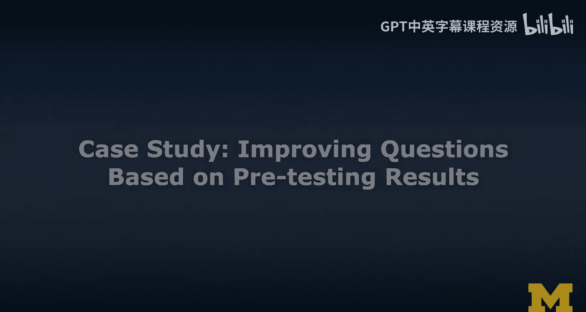
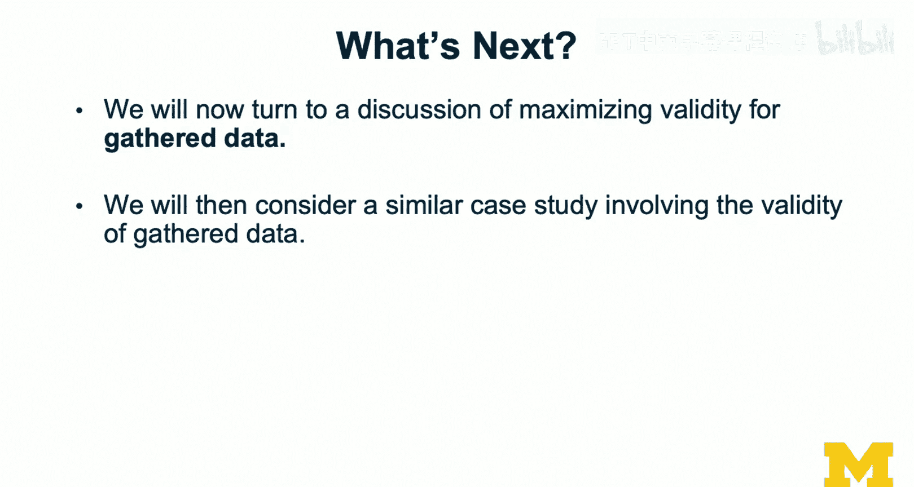

# 总体数据质量（框架、度量、设计策略）：2：案例研究：基于预测试结果改进问题设计 📝

在本节课中，我们将通过一个具体的案例研究，学习如何通过细致的预测试来改进问卷设计，从而最大化数据的有效性。

## 概述

上一节我们介绍了数据质量框架中的有效性维度。本节中，我们来看一个实际案例，探讨如何利用预测试的结果来优化问卷问题设计，以确保收集到的数据更准确、更有用。

## 案例背景与设计

本案例研究关注的是为“消费者调查”设计一套补充性问题。这套补充问题旨在探究主观概率类问题背后的测量机制，由密歇根大学的两位教员在2015年发起。

以下是案例中研究的一个示例问题：
> 到明年这个时候，你认为蓝筹股（例如道琼斯工业平均指数中的股票）共同基金份额的价值比今天更高的可能性有多大，请用0到100之间的数字表示。

假设你是受访者，你会如何理解这个“可能性”？如果你回答“50”，这具体意味着什么？为了澄清这一点，当受访者选择了“50”这个中点选项时，会触发后续追问问题。

## 初始设计与预测试

以下是一个初始的后续追问问题示例：
> 你认为这些共同基金份额明年此时净值增加和减少的可能性大致相等，还是你只是不确定其变化几率？
> *   选项1：可能性相等
> *   选项5：不确定

在将这套补充问题正式投入“消费者调查”的数据收集之前，研究团队进行了细致的预测试。由于预算限制，预测试仅在密歇根州普利茅斯市的一个居民区内进行。研究生们随机选择该区内的家庭，上门邀请居民参与，并请他们在回答问题时“边想边说”。

## 预测试发现的问题

预测试揭示了初始追问问题存在严重问题。以下是来自现场访谈员的总结反馈：

**访谈员一反馈：**
*   受访者普遍难以理解这个问题。
*   访谈员有时也难以判断受访者是否给出了可编码的答案。
*   “不确定”和“不知道”之间的区别模糊不清。
*   “净值”这个概念也让部分受访者感到困惑。

**访谈员二反馈：**
*   这个问题效果不佳。即使重复提问，部分受访者仍不理解他们需要在“50%概率”的两种概念解释中做出选择。

以下是受访者困惑的具体例子：
*   **受访者566**：选择了“相等”。访谈员评论认为，该受访者可能不理解“相等”的含义，或者她想要的二分选择与问题提供的不同。她选择“相等”仅仅是因为她知道她不想选“不确定”。
*   **受访者569**：最初回答“D”（不知道），但在追问后又说“50”。这再次表明受访者在理解问题意图上存在困难。

## 基于反馈的改进

根据研究生们在预测试中收集的反馈，研究团队修改了问题的措辞和回答选项。

以下是修改后的新问题：
> 当你在0-100的量表上回答“50%”的可能性时（如果是0-10量表，则回答“5”），你的意思是：这些共同基金份额价值增加或减少的可能性相等，还是你不知道价值是会增加还是会减少？
> *   选项：可能性相等
> *   选项：不知道

## 改进后的成果

这一修改带来了积极的结果：
*   获得了**更有效的数据**，该后续追问问题的缺失值减少了。
*   在实际的“消费者调查”数据收集中，访谈员关于受访者对此问题感到困惑的评论也减少了。
*   所有这些改进使得数据更利于分析，并让整个数据收集过程中的数据清理工作变得更加容易。

如果没有这类预测试，这些问卷中存在的微妙问题就会被忽略。如果大量受访者对问题感到困惑而未被发现，最终收集到的数据效用将会大打折扣。

## 总结

本节课我们一起学习了一个真实的案例，展示了细致的预测试对于确保在调查中收集到有效、高质量数据的重要性。通过预测试发现设计缺陷、理解受访者的真实困惑，并据此优化问题措辞和选项，可以显著提升数据的质量与可用性。

接下来，我们将转向讨论如何最大化“已收集数据”的有效性，并考虑一个涉及评估已收集数据有效性的类似案例研究。